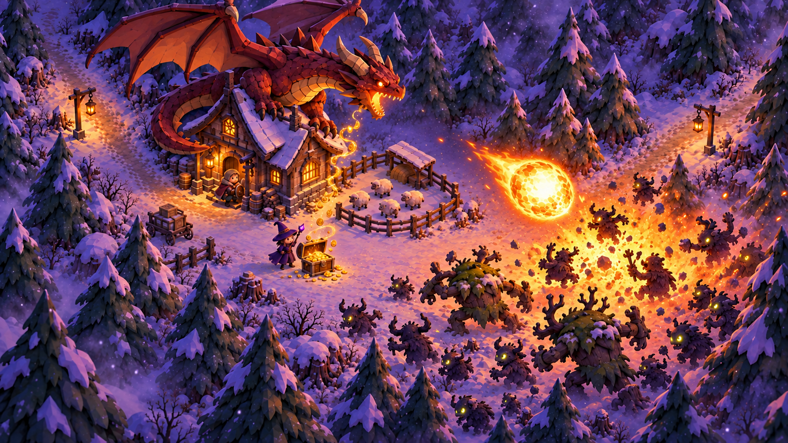
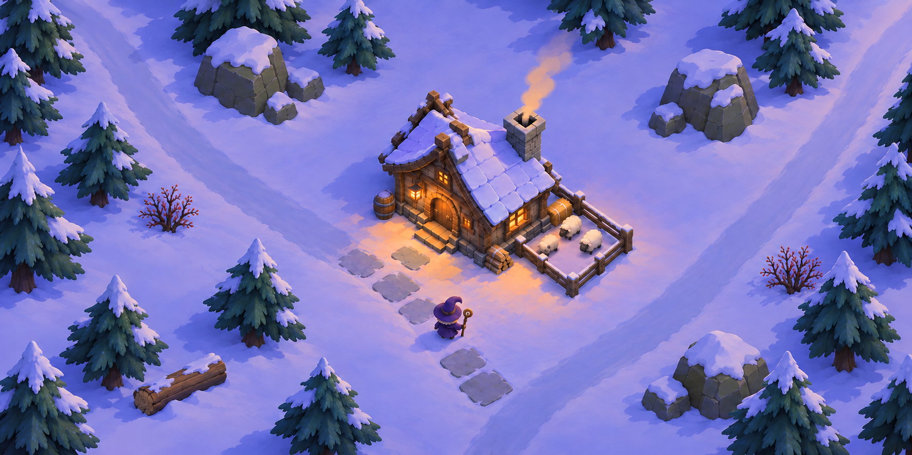
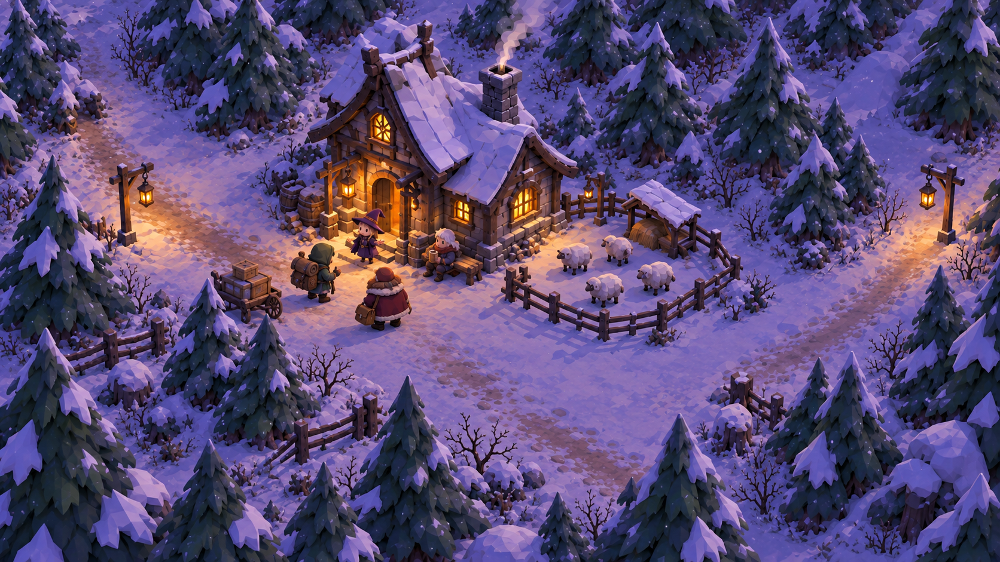
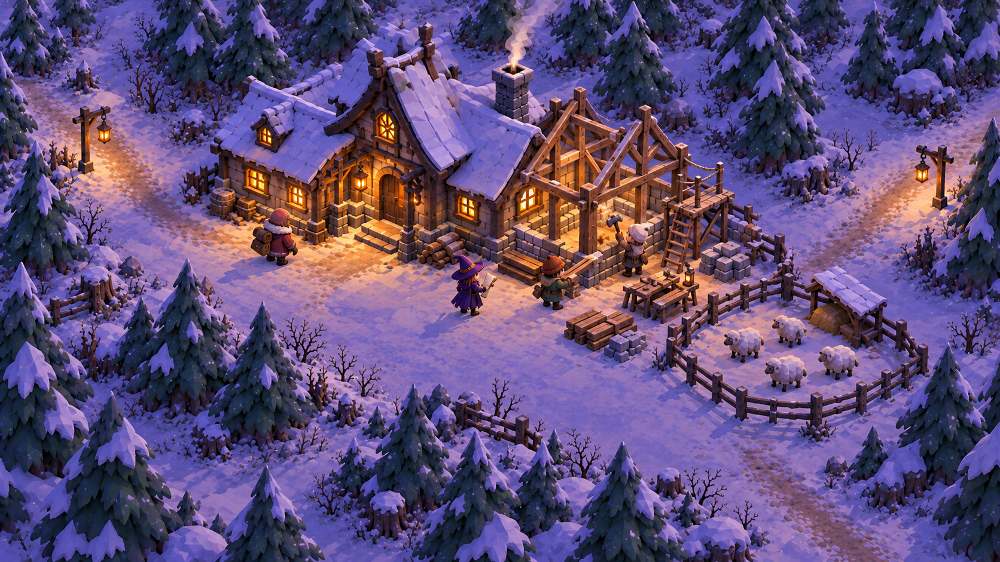
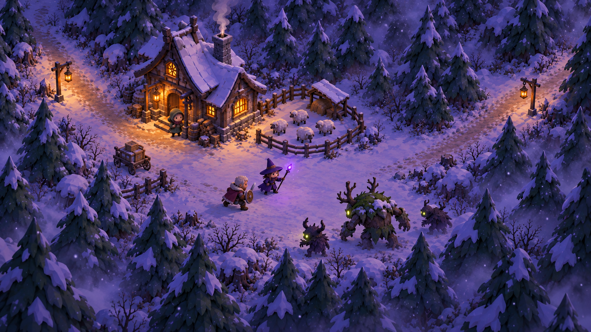

# Witch's Lodge · 마녀산장

깊은 설산 숲의 작은 산장을 운영하는 마녀의 이야기. **숙박 손님과 맺은 용병 계약, 양에게서 수확한 양털, 특정 몬스터의 소환권을 카드로 얻어 화면 하단 손패에서 원하는 대상에 드래그하는 방향**으로 코어를 발전시킨다. 용병을 벌목에 쓰면 목재를 얻고 계약이 끝나며, 방어에 쓸 카드는 다음 위기를 위해 보관할 수 있다. 큰 위기에는 모아둔 골드를 용에게 바쳐 산장 지붕 위에 거대한 용을 소환한다.

> 산장에서 얻은 가능성을 손에 모으고, 성장과 방어 중 어디에 사용할지 선택한다.

이 리포지토리에는 **게임 설정·컨셉 원화·모델링 시트와 플레이 가능한 Godot 프로토타입**이 있다. 19개 GLB와 Blender 원본으로 환경·캐릭터를 교체한 v22 실행 데이터를 제공한다. **카드 기반 코어 C0(하단 손패·드래그·용병 계약·양털 수확·몬스터 하수인)를 게임에 적용했다** — [구현 기록](docs/card-core-c0-implementation.md). 원화에 맞추는 작업은 진행 중이고 초기 밸런스 수치는 플레이테스트가 필요하다.

## 핵심 자료

- [캐주얼 재질 표현 적용 기획서](docs/casual-material-application-plan.md) — 사용자 제공 Redby Art 비교 이미지 포함. 목재·눈·바위부터 수정하는 제작 순서와 7종 프리셋 비교 기준. 현재는 기획 단계.

- [실사용 카드 에셋 4종·공용 뒷면](art/cards/README.md) — 기존 카드 라운드·투명 외곽 수정, 목재 추가, Godot용 PNG·손패용 PNG·문구 데이터.
- [기본 카드 포맷 확정·원화 작업 요약](docs/card-format-design-summary.md) — 비대칭 S자 곡선 포맷 승인, 시안 20장과 프롬프트 보존.
- [실제 게임 화면 프리셋 7종](docs/screen-style-presets.md) — 부드러운 명암·따뜻한 산장·차가운 숲·툰 셰이딩·강렬한 툰 셰이딩·두꺼운 툰 외곽선·기존 화면. 기본 소스와 배포 실행파일에 적용 완료, F2 또는 화면 스타일 메뉴로 전환.
- [카드와 월드의 라이팅·셰이딩 검토](docs/card-lighting-shading-review.md) — 화풍 차이 진단과 채택 방향의 근거.
- [킹덤 시리즈 코어 리서치 — 공식 근거와 적용 판단](docs/kingdom-core-research.md)
- [카드 기반 코어 기획서 v0.3 — 획득·손패·드래그·용병 계약·양털·하수인](docs/kingdom-integration-design.md) — 다음 제작 기준. 세부 수치는 시험안이다.
- [카드 전환 충돌 검토 — 기존 인력·양모·야간 제한·경제의 변경](docs/card-core-design-review.md)
- [이전 킹덤 접목 기획서 v0.2 — 보존 기록](docs/kingdom-integration-design-v0.2.md)
- [이전 접목 기획 검토 — v0.1의 규칙·경제 반례](docs/kingdom-design-review.md)
- [플레이 가능한 Godot 프로토타입](godot/README.md)
- [원화와 실제 렌더 비교 · 현재 수정 상태와 남은 차이](docs/art-refinement-progress.md)

- [기존 Godot 프로토타입 기획 인수인계 — v22의 초기 규칙·경제·웨이브·용](docs/godot-prototype-handoff.md)
- [모델링 인수인계 — 12종 에셋·크기·축·피벗·애니메이션·Godot 납품](docs/modeling-handoff.md)
- [프로토타입 승인 기준 이미지 — 높은 카메라·낮은 프랍/텍스처 밀도](art/concepts/environment/04-prototype-reference-simplified.png)
- [시작 장면 12종 3면도 — 개별 구조 참고](art/model-sheets/starter/README.md)
- [새 산장 3면도와 Blender 리모델링 기준](docs/lodge-redesign.md)
- [전체 내러티브와 플레이 흐름](docs/narrative.md)
- [아트 방향·시점·캐릭터 비율](docs/art-direction.md)
- [전체 이미지 갤러리](art/README.md)
- [이미지 원본 정보와 SHA-256 목록](art/manifest.json)
- [기록된 이미지 생성 프롬프트](docs/prompts/README.md)

## 현재 게임 컨셉

첫 화면은 중앙의 작은 본채, 앞의 마녀, 옆의 작은 양 목장으로 시작한다. 클릭 이동·자동 공격과 자동 숙박비를 바탕으로 손님 고용·양털 수확·몬스터 처치에서 카드를 얻는다. 하단 손패의 용병을 나무에 쓰면 벌목 후 귀가하고, 전투 위치에 쓰면 방어한다. 미사용 카드는 이후에 사용하고, 양털·목재는 수량을 묶어 보관한다. 준비 시간 뒤 웨이브가 오며 산장 파괴 또는 마녀 사망은 패배, 죽은 양은 골드 재구입이다.

현재 v22 실행판은 클릭 이동·자동 공격·숙박비·버튼 구매·120G 용 공물로 플레이한다. 카드 UI·고용·양 생산·하수인은 다음 구현 대상이다.

| 여행자의 방문 | 산장 증축 |
| --- | --- |
|  |  |

## 시각적 기준

2026-10-13 사용자가 승인한 위 수정 이미지를 **프로토타입의 최우선 시각 기준**으로 사용한다. 더 높은 고정 쿼터뷰, 워크래프트·하스스톤식으로 살짝 과장한 3D 프랍, 2~3등신 SD 캐릭터를 사용한다. 프랍 수와 배치 밀도를 낮추고 텍스처는 큰 색면과 넓은 명암으로 정리한다. 보랏빛 눈과 인디고 그림자, 짙은 초록 나무, 따뜻한 창문 빛을 유지한다. 거의 평평한 넓은 눈밭과 나무 사이 간격, 아주 작은 양 목장이 읽히게 한다.

이미지는 방향을 검토하기 위한 컨셉 자료다. 이전 탐색 시안, 구조 참고 시트, 사용자 제공 참고 이미지도 보존하며 각각의 용도를 갤러리에 표시했다.

자료 갱신일: 2026-10-13. PNG 37장: 기존 자료 32장 + 승인 기준 1장 + 후속 숲 분위기 2장 + 산장 리모델링 3면도 2장. 기존 12종 모델링 시트는 구조 참고로 유지하며 산장의 새 형태는 리모델링 시트, 화면 밀도와 텍스처 표현은 최신 승인 이미지를 우선한다.
