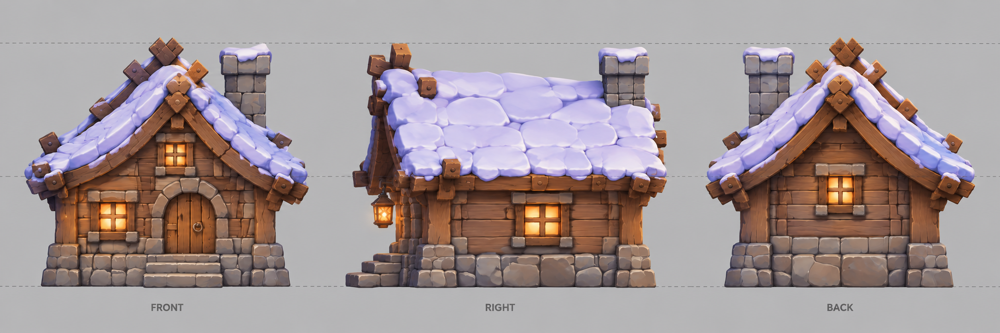
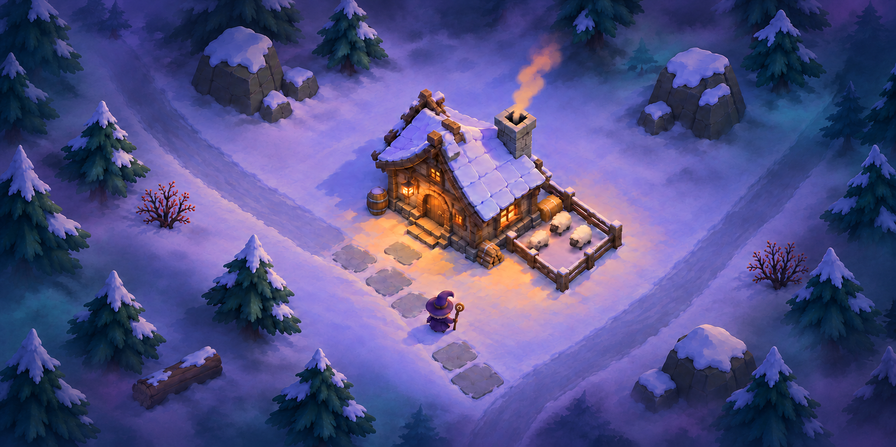
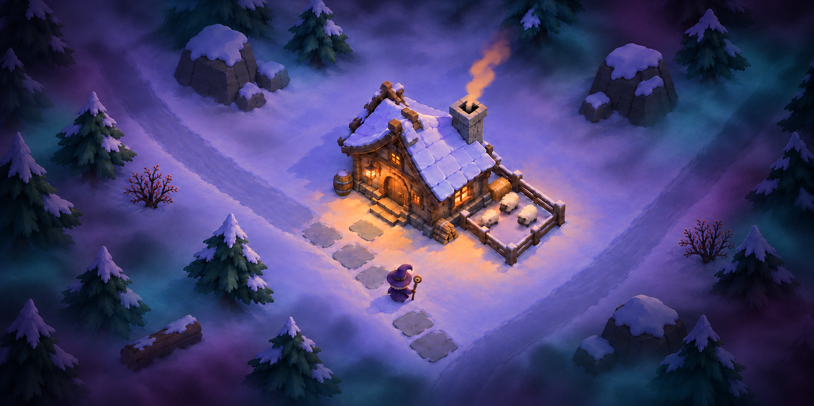
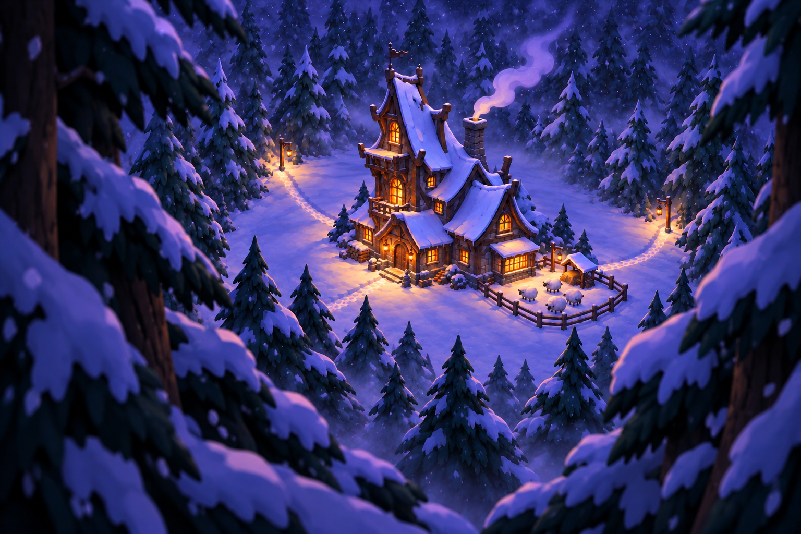
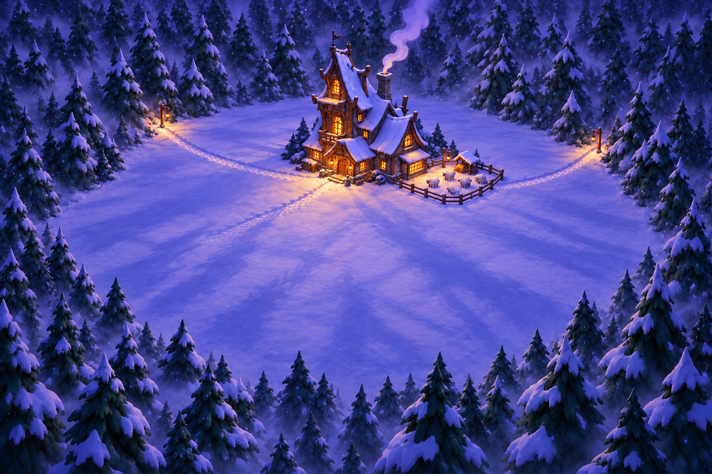
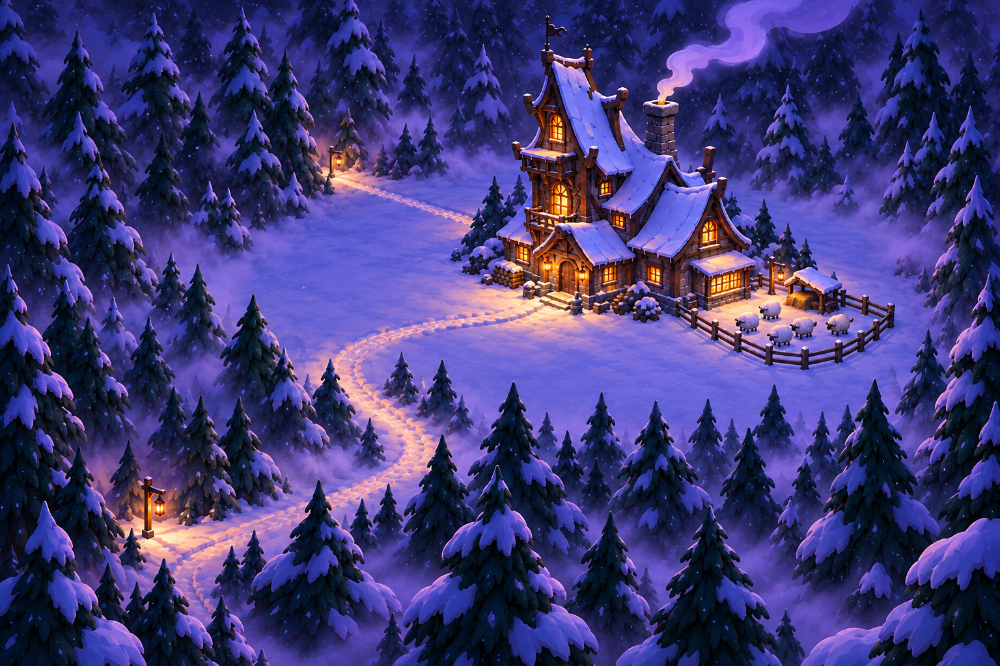
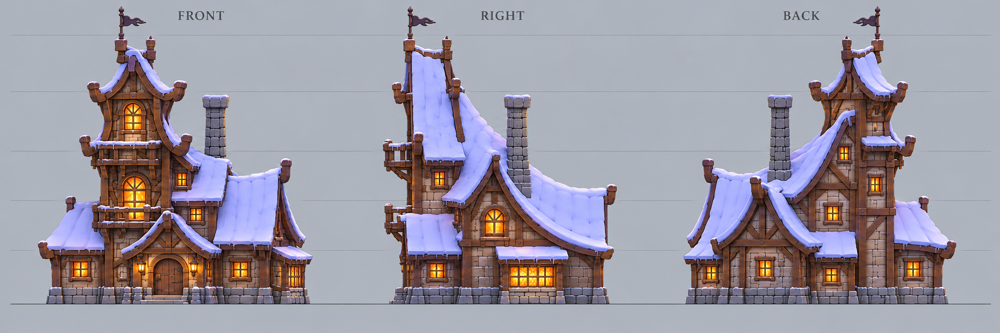
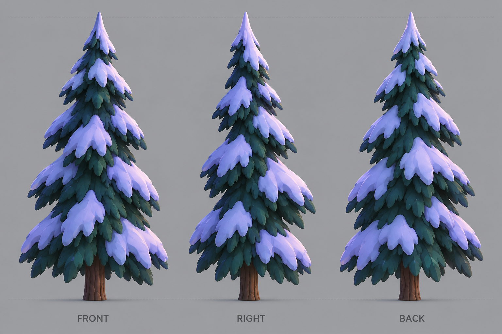
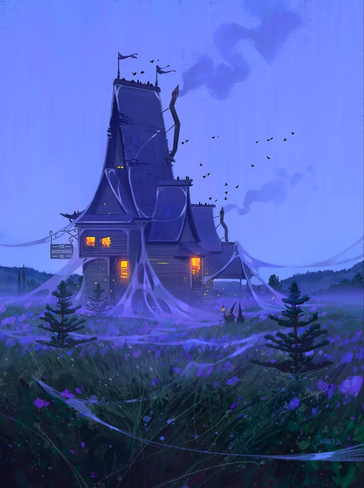
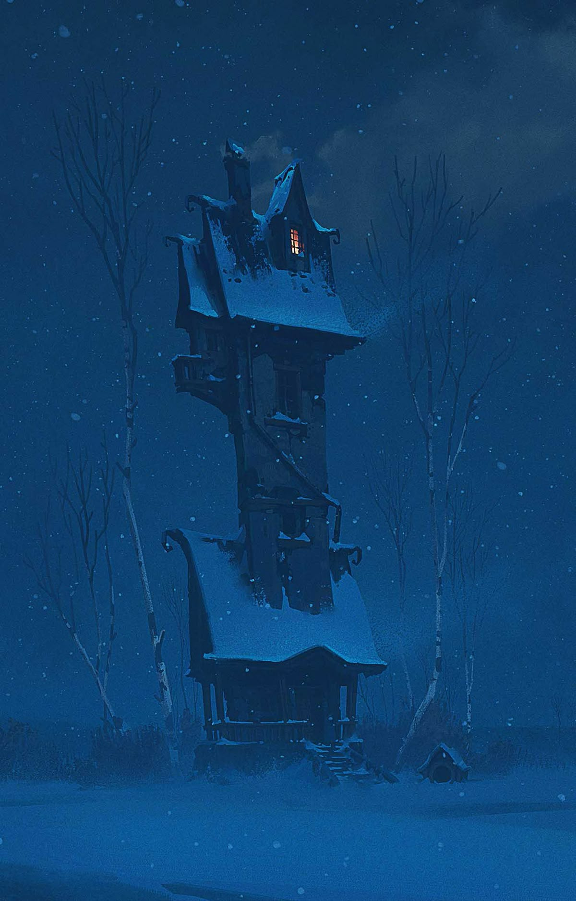

# 전체 이미지 갤러리

37장의 PNG를 원본 해상도로 보존했다. 최신 게임 방향은 **높은 고정 쿼터뷰 + 살짝 과장한 간결한 프랍 + 낮은 프랍·텍스처 밀도 + 2~3등신 SD 캐릭터**다.

## 산장 리모델링 3면도 · 2장

평이한 기존 산장을 Blender에서 다시 만드는 새 설계 시트다. [모델링 기준과 다음 단계](../docs/lodge-redesign.md), [최종 생성 프롬프트](../docs/prompts/lodge-redesign-three-view-v01.md), [굴뚝 보정 프롬프트](../docs/prompts/lodge-redesign-three-view-v02.md)를 함께 본다. [첫 시안](model-sheets/lodge-redesign/01-lodge-three-view-draft.png)도 보존한다. 생성 디자인 시트이며, 게임 모델 교체 완료나 사용자 승인 상태로 표시하지 않는다.

## 프로토타입 승인 기준 · 1장

[이미지 원본](concepts/environment/04-prototype-reference-simplified.png). 사용자가 2026-10-13에 프로토타입 제작 기준으로 지정했다. 높은 카메라·산장 배치·적은 프랍·넓은 눈밭·큰 색면과 넓은 명암을 우선한다. [아트 방향](../docs/art-direction.md), [프로토타입 기획](../docs/godot-prototype-handoff.md), [생성 프롬프트](../docs/prompts/prototype-reference-simplified.md)를 함께 사용한다.

## 후속 숲 분위기 · 2장

검정색으로 단순하게 덮지 않고 배경 컬러를 접목하라는 후속 요청의 수정본이다. [프롬프트](../docs/prompts/chromatic-forest-fog.md), [현재 실제 3D 비교](../docs/art-refinement-progress.md)를 함께 본다.

중앙의 따뜻한 빛과 프랍 배치를 유지하고 숲 주변의 보라·청록 색 덩어리를 조정했다. [최종 프롬프트](../docs/prompts/colored-forest-darkness.md).

## 기존 시작 장면과 모델링 시트 · 13장

12종 시트를 만들 때 사용한 시작 배치다. 개별 구조·축·피벗은 [12종 개별 시트 갤러리](model-sheets/starter/README.md)와 [모델링 인수인계](../docs/modeling-handoff.md)를 참고하고, 카메라·프랍 밀도·텍스처 표현은 위 최신 승인 이미지를 우선한다.

## 최신 게임 컨셉 · 4장

### 01. 여행자의 방문

마녀가 배낭과 짐을 가진 여행자들을 맞이한다.

### 02. 산장 증축

작은 본채에 객실이 붙고 다른 공간은 공사 중이다.

### 03. 숲의 괴물

숲에서 괴물이 나타나 마녀와 여행자가 대응한다.

### 04. 골드 공물과 지붕 위 용

모아둔 골드를 바친 마녀가 거대한 용을 소환한다. 용은 지붕 위에서 독립된 불덩이를 한 발씩 쏘아 몰려온 괴물을 휩쓴다.

## 전경 구도 대안 · 3장

| 나무 사이의 산장 | 넓은 둥근 공터 | 안개 속 접근로 |
| --- | --- | --- |
|  |  |  |

이 대안들은 SD 캐릭터 도입 전의 환경·카메라 탐색 자료다.

## 이전 프랍 3면도 · 2장

산장은 이전 복합 구조 기준이다. 후면은 추정 디자인이고 일부 사선 표현이 남아 있다. [제작 참고의 한계](../docs/art-direction.md#모델링-참고-시트의-한계)를 함께 확인한다.

## 초기 탐색 · 6장

| 순서 | 이미지 | 목적 |
| --- | --- | --- |
| 01 | [최초 설경 시안](exploration/01-painterly-snow-lodge.png) | 처음 만든 회화적인 산장 |
| 02 | [스타일라이징과 둥근 공터](exploration/02-stylized-circular-clearing.png) | 형태 단순화와 평지 배치 |
| 03 | [초록 숲과 음산한 분위기](exploration/03-green-eerie-forest.png) | 초록색·안개 탐색 |
| 04 | [퍼플톤 복원](exploration/04-purple-forest-lodge.png) | 퍼플 분위기와 복합 산장 |
| 05 | [단순 3D 산장](exploration/05-simple-3d-cottage.png) | 단순 구조와 3D 질감 |
| 06 | [알비온풍 로우폴리 탐색](exploration/06-albion-low-poly-baseline.png) | 이전 게임 시점·밀도·로우폴리 전환 탐색 |

## 보정 전 시안 · 2장

| 이미지 | 이후 수정 |
| --- | --- |
| [산장 3면도 첫 시안](archive/lodge-turnaround-first-draft.png) | 정면과 측면 구분을 더 명확하게 보정 |
| [용의 긴 화염 시안](archive/dragon-defense-long-flame-draft.png) | 입과 분리된 단발 불덩이로 보정 |

## 사용자 제공 참고 · 2장

| 보랏빛 마녀 집 | 푸른 겨울 마녀 집 |
| --- | --- |
|  |  |

처음 사용자가 제공한 분위기·건축 참고다. 이 대화에서 생성한 원화와 구분한다. 제작자·출처·이용 조건은 제공되지 않았다.

[원본 정보·해시 목록](manifest.json) · [생성 프롬프트 기록](../docs/prompts/README.md)
