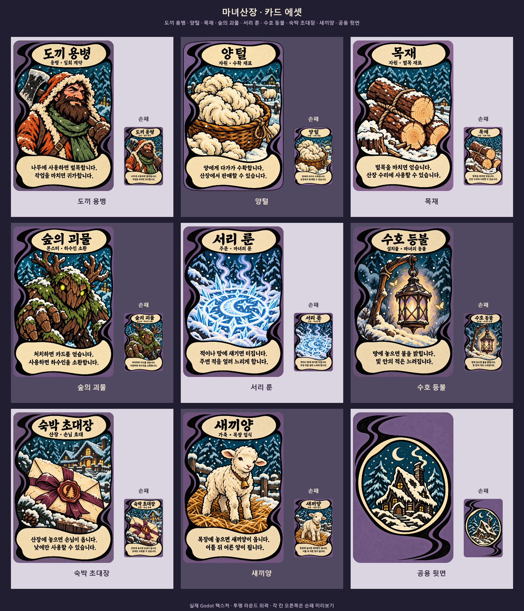

# 마녀산장 카드 에셋

2026-10-15 · 내장 image_gen 생성/수정 · 기존 4종 + 신규 4종 + 공용 뒷면



기존 도끼 용병·양털·목재·숲의 괴물에 **서리 룬·수호 등불·숙박 초대장·새끼양**을 추가했다. 보라색 물리 프레임, 검은 비대칭 S자 곡선, 크림색 제목/설명 패널, 굵은 한글 붓글씨와 겨울 숲의 붓터치 질감을 공유한다. 네 모서리는 살짝 둥글고 카드 밖은 투명 알파다. 배경색과 그림자는 PNG에 합성하지 않았다.

| 에셋 | 원화 | 게임용 1024×1536 | 손패용 256×384 |
| --- | --- | --- | --- |
| 도끼 용병 | [PNG](rounded/axe_mercenary.png) | [PNG](../../godot/assets/cards/axe_mercenary.png) | [PNG](../../godot/assets/cards/hand/axe_mercenary.png) |
| 양털 | [PNG](rounded/wool.png) | [PNG](../../godot/assets/cards/wool.png) | [PNG](../../godot/assets/cards/hand/wool.png) |
| 목재 | [PNG](rounded/timber.png) | [PNG](../../godot/assets/cards/timber.png) | [PNG](../../godot/assets/cards/hand/timber.png) |
| 숲의 괴물 | [PNG](rounded/forest_monster.png) | [PNG](../../godot/assets/cards/forest_monster.png) | [PNG](../../godot/assets/cards/hand/forest_monster.png) |
| 서리 룬 | [PNG](rounded/frost_rune.png) | [PNG](../../godot/assets/cards/frost_rune.png) | [PNG](../../godot/assets/cards/hand/frost_rune.png) |
| 수호 등불 | [PNG](rounded/ward_lantern.png) | [PNG](../../godot/assets/cards/ward_lantern.png) | [PNG](../../godot/assets/cards/hand/ward_lantern.png) |
| 숙박 초대장 | [PNG](rounded/guest_invitation.png) | [PNG](../../godot/assets/cards/guest_invitation.png) | [PNG](../../godot/assets/cards/hand/guest_invitation.png) |
| 새끼양 | [PNG](rounded/lamb.png) | [PNG](../../godot/assets/cards/lamb.png) | [PNG](../../godot/assets/cards/hand/lamb.png) |
| 공용 뒷면 | [PNG](rounded/card_back.png) | [PNG](../../godot/assets/cards/card_back.png) | [PNG](../../godot/assets/cards/hand/card_back.png) |

원화 9개, 배포 PNG 18개는 모두 RGBA·세로 2:3이다. 신규 납품은 위 네 카드의 원화·게임용·손패용 **12개 PNG**다. 원화는 생성 PNG를 그대로 복사했다. Godot 패키징은 불투명 카드 본체 기준 크롭과 Lanczos 리사이즈만 수행하며, 생성 알파를 유지한다. 코드로 그림·한글·라운드 마스크를 그리지 않는다.

가격·체력·공격력·지속시간 같은 시험 수치를 그림에 넣지 않았다. 새끼양의 “이틀 뒤”는 요청서에서 지정한 인쇄 문구다. 상세 수치·설명·그림자는 런타임 UI에서 처리한다.

## Godot에서 사용

게임에는 `res://assets/cards/<id>.png`와 `res://assets/cards/hand/<id>.png`를 사용한다. `scripts/ui/card_catalog.gd`의 `texture(id)`와 `texture(id, true)`로 불러온다. 텍스처는 조명·색보정을 적용하지 않고 비율을 유지해 표시한다. 카탈로그·게임 로직·씬은 Claude 작업 범위이며 이번 에셋 작업에서 수정하지 않았다.

## 제작 기록

- [신규 카드 요청서](../../docs/handoff/codex-new-cards-v01.md)
- [기존 4종 프롬프트](../../docs/prompts/cards/production-rounded-v02-prompts.md)
- [신규 4종 프롬프트와 최종 채택 기록](../../docs/prompts/cards/new-cards-v01-prompts.md)
- [파일 목록·SHA-256·이미지 메타데이터](manifest.json)
- [최종 확대 검수 기록](new-cards-v01-review.md)
- [신규 카드 인쇄 문구 원본 크기 모음](../../godot/screenshots/cards/new-cards-v01-text-proof.png)

이전 승인 원본과 시안은 `art/concepts/cards/`에 보존한다. 현재 원화는 `art/cards/rounded/`, 배포 파일은 `godot/assets/cards/`에 둔다.

## 재생성과 확인

Windows GUI 실행 파일은 PowerShell에서 다음 명령을 순서대로 완료하기 전에 반환할 수 있으므로, `Start-Process -Wait`로 각 단계가 끝난 뒤 다음 단계를 실행한다.

```powershell
$cardExe = (Resolve-Path '.tools/Godot-4.7.2.exe').Path
$cardLogDir = (Resolve-Path 'godot/art_sources').Path
# 제한된 환경에서는 에디터의 사용자 캐시도 프로젝트 output 아래에 둔다.
New-Item -ItemType Directory -Force output/new-cards-v01-runtime/roaming,output/new-cards-v01-runtime/local | Out-Null
$env:APPDATA = (Resolve-Path output/new-cards-v01-runtime/roaming).Path
$env:LOCALAPPDATA = (Resolve-Path output/new-cards-v01-runtime/local).Path
$cardJobs = @(
    @('--headless','--script','res://tools/package_card_assets.gd'),
    @('--headless','--editor','--import'),
    @('--headless','--script','res://tools/verify_card_assets.gd'),
    @('--script','res://tools/preview_card_assets.gd','--rendering-method','gl_compatibility'),
    @('--headless','--script','res://tools/update_card_manifest.gd')
)
foreach ($cardJob in $cardJobs) {
    $cardArgs = @('--path','godot','--log-file',('"' + $cardLogDir + '/card-rebuild.log"')) + $cardJob
    $cardProcess = Start-Process -FilePath $cardExe -ArgumentList $cardArgs -Wait -PassThru -WindowStyle Hidden
    if ($cardProcess.ExitCode -ne 0) { throw "Card pipeline failed: $cardJob" }
}
```

## 납품 검증 결과

- [PNG·카탈로그·Godot 로딩 검사](../../godot/assets/cards/verification.json): **8종+공용 뒷면, 배포 PNG 18개 통과**. 크기·RGBA·투명 모서리·중앙/외곽 불투명도·텍스처 로딩·ID·신규 문구와 카탈로그 일치를 확인한다. 현재 카탈로그의 없는 카드 ID에 대한 뒷면 대체도 검사한다.
- [갤러리](../../godot/screenshots/cards/asset-gallery.png): 실제 임포트된 8종과 뒷면을 밝고 어두운 패널에 3×3으로 렌더했다. 각 칸 오른쪽에 손패 PNG를 표시한다.
- 신규 4종 최종 게임용 PNG의 제목·분류·두 줄 본문을 확대해서 요청서와 직접 대조했다. 오탈자를 발견하지 않았다.
- [기존 배포 포함 검사](export-verification.json)는 **2026-10-13 기존 4종+뒷면의 기록**이다. 이번 신규 4종의 PCK 내보내기 검증은 수행하지 않았다.
- Godot 실행 시 시스템 인증서 저장소 읽기 오류가 로그에 남는다. 로컬 PNG 패키징·임포트·텍스처 검증·갤러리 생성은 정상 완료했다.
