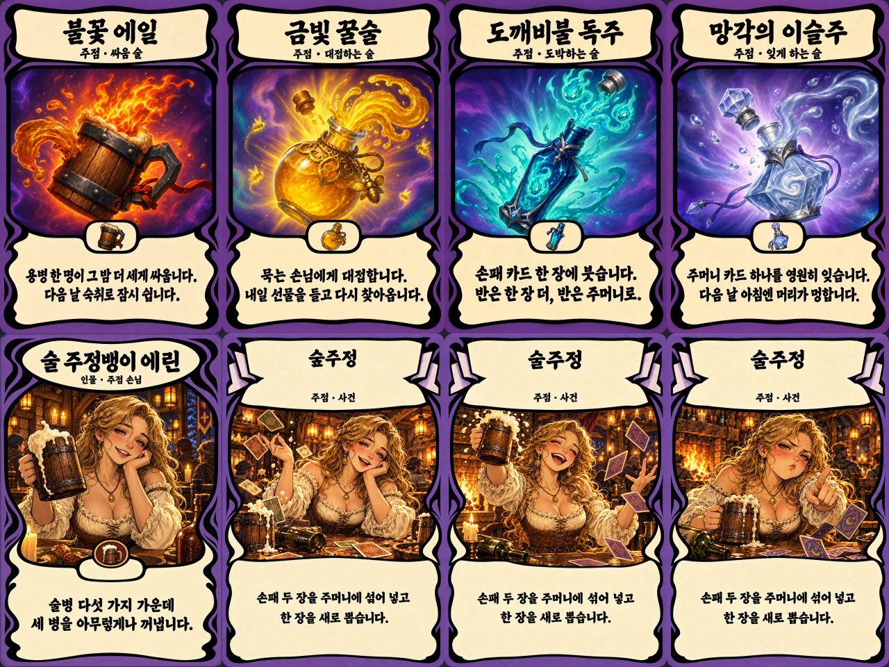

# 주점 카드 포맷 통일 · 술주정 추가 원화 v02

에린 인물 카드의 최신판은 사용자 선택에 따라 치마까지 보이는 구도를 유지하고 이름만 정리한 [v03](../tavern-v03/README.md)이다. 이 폴더의 v02 파일과 비교판은 이력으로 보존한다.

2026-10-20 · 내장 `image_gen` 이미지 편집 사용.

술 자원 4장, 에린 인물 1장, 술주정 사건 1장을 기존 카드와 같은 계열의 굵은 한글 붓글씨·크림 패널·보라 바탕·검은 프레임으로 재제작했다. 술 4종의 중앙 아이템·역동 구도는 유지했다. 인물은 `warrior.png`, 사건은 `forest_promise.png`의 배치와 역할 승인 개별 PNG를 실제 이미지 입력으로 사용했다.

| 파일 | 용도 |
| --- | --- |
| `fire_ale.png` | 불꽃 에일, 게임 적용 |
| `golden_mead.png` | 금빛 꿀술, 게임 적용 |
| `wisp_spirit.png` | 도깨비불 독주, 게임 적용 |
| `dew_of_forgetting.png` | 망각의 이슬주, 게임 적용 |
| `drunken_erin.png` | 술 주정뱅이 에린, 게임 적용 |
| `drunk_rant.png` | 술주정 기본 원화, 게임 적용 |
| `drunk_rant_toast.png` | 술주정 추가 원화: 잔을 들고 웃으며 건배하는 에린 |
| `drunk_rant_pout.png` | 술주정 추가 원화: 볼을 부풀리고 손가락으로 가리키며 투덜대는 에린 |

모두 1024×1536 RGBA. `hand/`에 같은 8종의 256×384 RGBA를 저장했다. 추가 두 장은 기존 술주정과 이름·분류·효과 문구가 같은 선택용 원화이며 새 카드 ID나 게임 규칙을 만들지 않았다.

기존 6종은 `art/cards/tavern-v01/`, `godot/assets/cards/`, `godot/assets/cards/hand/`에 반영했다. 교체 전 파일은 이 폴더의 `before/`에 보존했다. 에린 대화 초상은 같은 금발 인물의 기존 파일을 유지했다.

그림·한글은 내장 이미지 도구로 제작했다. 표식 내부 투명 오류를 이미지 편집으로 수정했으며, 패키징은 기존 `dark_ale.png`의 외곽 알파를 그대로 복사하고 크기를 맞추는 처리만 했다. 코드로 그림이나 문자를 그리지 않았다. 최종 인쇄 문구를 생성 원본 크기로 요청서와 대조했다.

- 실제 최종 프롬프트·입력 이미지·생성 파일: [prompts-and-sources.json](prompts-and-sources.json)
- 생성 원본: `sources/`
- 패키징: [package.ps1](package.ps1)
- 최종 파일 해시·메타데이터: [manifest.json](manifest.json)
- 검증 로그: `../../../output/tavern-v02-validation/`

검증: Godot 재임포트 종료 코드 0, 주점 검증 **RESULT 49/49**, Windows Desktop 내보내기 종료 코드 0. 프로젝트 루트 `WitchsLodge.exe`를 갱신하고 내보낸 실행파일의 헤드리스 시작 검사도 종료 코드 0으로 확인했다. 검증 종료 시 기존 `card_view.gd`의 트리 정리 오류·리소스 종료 경고는 로그에 남는다. 최종 내보내기에서는 임시 경로를 프로젝트 내부로 지정해 경로 권한 오류를 해결했다.

작업 중 보호 대상 713개 파일의 해시를 비교했을 때 `godot/scripts/ui/guest_interactions.gd` 한 파일의 별도 변경을 관측했다. 이 원화 작업은 해당 파일을 쓰거나 되돌리지 않았다. 비교 기록은 `protected-before.json`, `protected-check.json`에 보관했다.

참조 기준: [카드 디자인 가이드](../../../docs/card-design-guide.md), [원화 요청 자료](../../../docs/handoff/codex-tavern-cards-art-v01.md). 문서에 포함된 구현·기획은 이번 원화 요청의 참고 자료로 취급했으며, 게임 스크립트·카탈로그·씬·검증 스크립트는 편집하지 않았다.
