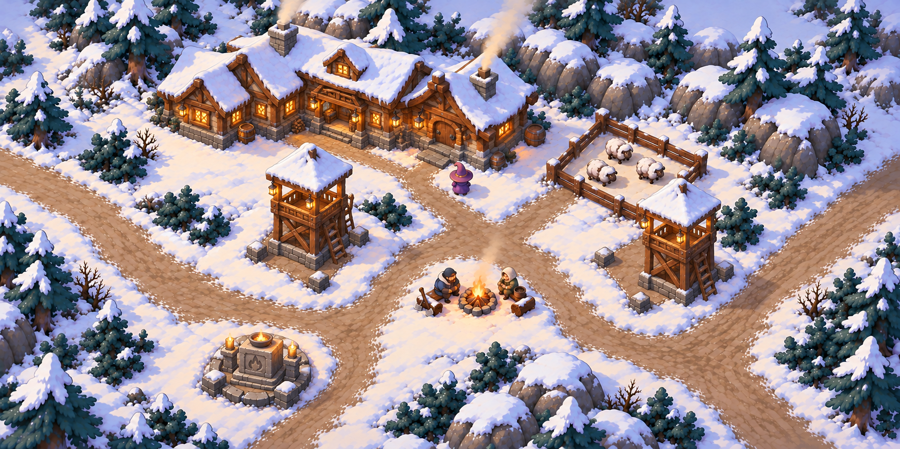
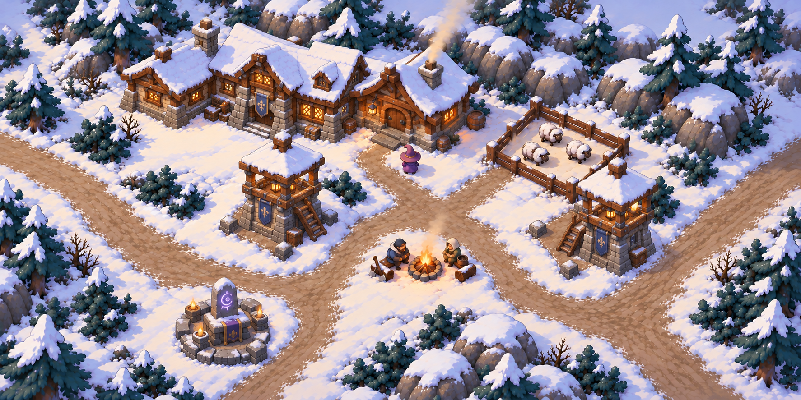
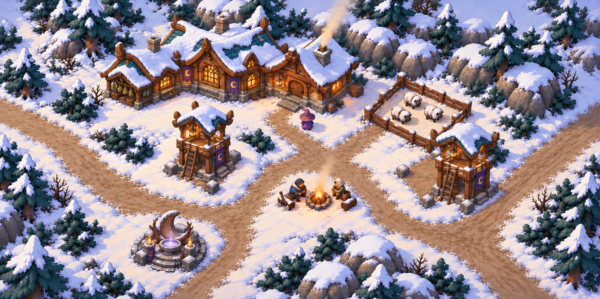

# 승인 A안 · 최대 증축·시설 완성형 콘셉트 3종

2026-10-17. 사용자 요청: “지금 저 배치 기준으로, 산장 최대 확장 증축한 모습과 감시탑 모습, 제단까지 모두 채워서 다시 그려줘. 3가지 컨셉으로 그려봐.”

[승인된 기본 배치·카메라·색감 원화](../layout-a-game-camera-v03-style/01-layout-a-style-restored.png)를 세 번 모두 실제 이미지 입력으로 사용해, 내장 `image_gen`으로 전체 맵 완성형을 각각 제작했다. 세부 시설만 따로 그린 시트가 아니라 같은 장소의 성장 완료 모습 3장이다.

## 세 콘셉트

| 콘셉트 | 전체 원화 | 증축 산장 | 감시탑 2개 | 제단 1개 |
| --- | --- | --- | --- | --- |
| 1. 목조 숙박 산장 | [01-timber-hearth.png](01-timber-hearth.png) | 원래 본채 왼쪽에 큰 객실·공용 홀을 연결, 낮은 박공지붕과 두꺼운 목재 | 목재 기둥·교차 버팀·난간·눈 덮인 지붕 | 봉헌 그릇과 촛불을 둔 두툼한 돌 제단 |
| 2. 석조 수호 거점 | [02-stone-warden.png](02-stone-warden.png) | 석재 기단·하부 벽과 목재 상부를 사용한 넓은 연결 증축 | 석재 하부와 목조 감시층, 접근 계단 | 룬이 새겨진 수호석과 봉헌대 |
| 3. 숲의 마녀 성소 | [03-forest-coven.png](03-forest-coven.png) | 곡선 처마의 서재·객실과 약초 작업 공간을 본채 왼쪽에 연결 | 휜 목재·곡선 지붕·작은 달 문양 장식 | 초승달 받침과 은은한 빛의 석재 수반 |

## 공통으로 유지한 기준

- 중세 기반 판타지. 목재·석재·직물과 생활 소재를 바탕으로 판타지적 형태를 각색.
- 승인 원화의 높은 게임 원근 시점과 2:1 프레이밍, 크림빛 눈·절제된 청보라 그림자·짙은 청록 식생·따뜻한 목재와 앰버빛, 큰 색면의 페인터리 표현.
- 기존 본채를 오른쪽 핵심 건물로 남기고, 왼쪽 예약 영역에 상당한 규모의 연결 증축. 작은 창고 하나를 붙이는 정도가 아닌 성장 완료 모습.
- 중앙 모닥불과 쉬는 일꾼 2명, 마녀, 오른쪽 양 목장과 양 3마리, 후면 바위·식생 경계.
- 기존 두 사각 공터에는 완성 감시탑을 각각 1개씩, 왼쪽 아래 원형 공터에는 완성 제단을 1개씩 배치.
- 좌우 웨이브 길과 앞마당·쉼터 연결은 시설 외곽을 지나도록 표현.

최대 증축 단계의 실제 면적·모듈 수·건설 비용과 단계는 아직 정해지지 않았다. 이번에는 예약 공간을 활용하는 최종 성장 모습의 시각 후보를 제작했다. 생성 프롬프트의 약 2.5~3배 규모 지시는 작은 증축으로 끝나지 않게 하기 위한 원화 지시이며, 확정 게임 수치나 면적 측정 결과가 아니다. 세 안 중 어느 하나를 채택한 것으로 기록하지 않는다.

## 검수와 인계

세 생성 결과와 프로젝트에 저장한 최종 PNG를 직접 열어 확인했다.

| 요구사항 | 1. 목조 | 2. 석조 | 3. 성소 |
| --- | --- | --- | --- |
| 승인 A 배치의 전체 맵 원화 | 확인 | 확인 | 확인 |
| 본채가 남고 왼쪽 예약 공간을 크게 채운 연결 증축 | 확인 | 확인 | 확인 |
| 완성 감시탑 정확히 2개, 감시층·지붕·접근 수단 표시 | 확인 | 확인 | 확인 |
| 왼쪽 아래의 완성 제단 정확히 1개 | 확인 | 확인 | 확인 |
| 중앙 쉼터·마녀·일꾼·목장·좌우 길 유지 | 확인 | 확인 | 확인 |
| 건축·감시탑·제단의 세 가지 별도 디자인 | 목재·생활 | 석재·수호 | 곡선·달 |
| 생성 원본과 복사본 SHA-256 일치, 1774×887(2:1) | 확인 | 확인 | 확인 |

이 검수는 원화의 가시적 구성과 파일에 대한 것이다. 실제 게임 배치·충돌·내비메시·감시탑 시야나 사거리·제단 효과는 구현하지 않았다. 탑의 지붕·전경 프랍에 의한 가림, 증축 후 현관·목장 문·시설 접근은 선택 후 실제 게임 카메라와 충돌 형상으로 검증해야 한다.

[실제 사용한 프롬프트](prompts.md) · [원본 경로·치수·해시](manifest.json) · [기본 배치 인수인계](../../../../docs/handoff/lodge-map-layout-a-v01.md)
