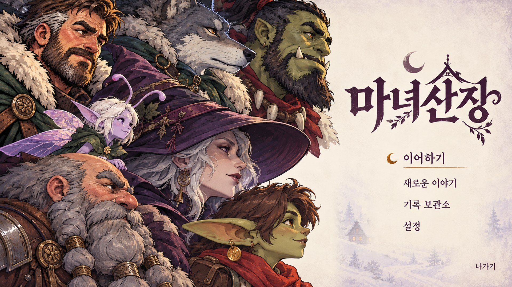
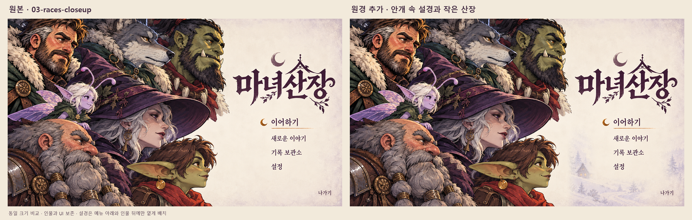

# 종족 클로즈업 로비 · 어슴푸레한 설경 원경 v01

2026-10-21. [요청 문서](../../../../docs/handoff/codex-lobby-races-closeup-distant-v01.md)에 따른 검토용 시안이다.

| 산출물 | 규격·내용 |
| --- | --- |
| [03-races-closeup-distant.png](03-races-closeup-distant.png) | 최종 시안, 1920×1080 PNG |
| [sheet.png](sheet.png) | 원본 / 새 시안 나란히, 2880×918 PNG |
| [prompts.md](prompts.md) | 실제 입력 3장, 내장 image_gen 프롬프트, 후처리·검수 |
| [drafts/](drafts/) | 생성 원본, 같은 크기로 확대한 원본, 합성 마스크, 재현 스크립트, 픽셀 검수 기록 |

## 표현과 보존

눈 덮인 침엽수 숲·완만한 언덕·오솔길·작은 목조 산장과 앰버 창문, 가느다란 굴뚝 연기를 인물 뒤와 화면 오른쪽 아래에 넣었다. 중세 기반 판타지의 작은 본채와 단순한 박공지붕을 사용했다. 원경은 크림색 안개에 녹은 낮은 대비의 라벤더·페리윙클이며, 또렷한 인물과 충분히 분리된다.

일곱 인물의 얼굴·배치·크기 관계·표정·의상·크롭, 제목과 메뉴의 글자 모양·위치, 초승달 선택 표시와 밑줄은 원본에서 보존했다. 타이틀·메뉴·나가기 주변에는 기존 밝은 여백을 남겨 원경 나무나 산장이 글자와 겹치지 않는다. 최종 시안에는 추가 문구가 없다.

실제 원본은 1672×941이므로 원본과 생성본을 함께 1920×1080으로 맞췄다. 인물이나 UI를 새로 그리지 않고, 확대 원본 위에 생성 배경만 최대 58%로 합성했다. [확대 원본](drafts/02-original-1920x1080.png) 대비 인물·UI를 포함한 보호 영역 1,872,337픽셀의 변경은 0개다. 이는 전체 크기 변환 후의 픽셀 보존을 뜻한다.

## 검수와 범위

- 최종 PNG와 비교 시트를 직접 열어 한글·인물·설경 거리감·메뉴 주변 여백을 확인했다.
- 최종 1920×1080, 비교 시트 2880×918, 생성 원본 1672×941을 확인했다. [픽셀 검수](drafts/pixel-verification.json)와 [파일 해시](drafts/delivery-sha256.json)를 함께 제공한다.
- 게임 임포트·내보내기·커밋은 하지 않았다. `godot/**`, `WitchsLodge.exe`, 기존 로비 세 폴더, 다른 문서는 이번 작업에서 수정하지 않았다. 작업 시작 때부터 있던 변경사항은 보존했다.
- 지정된 요청 문서 끝에 납품 결과를 추가했다. 사용자 승인 여부는 별도이며 게임 적용본이 아니다.

