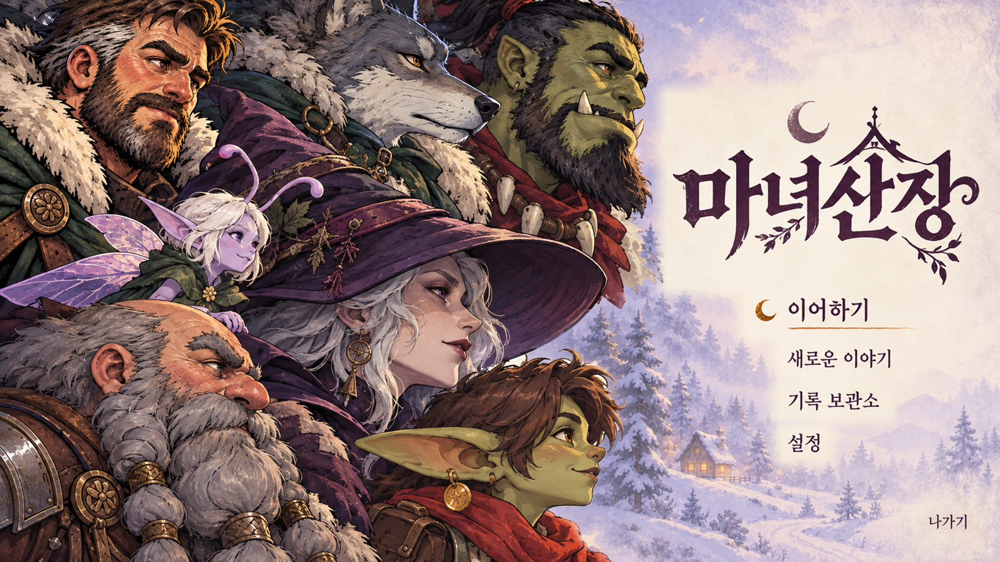
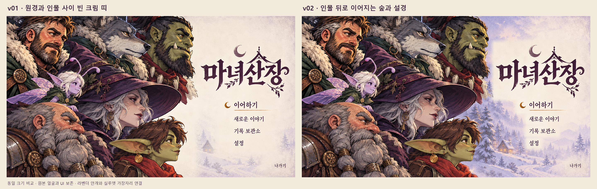

# 종족 클로즈업 로비 · 인물과 원경 연결 v02

2026-10-21. [요청 문서](../../../../docs/handoff/codex-lobby-races-closeup-distant-v02.md)와 사용자가 표시한 문제 영역을 확인하고 제작한 검토용 시안이다.

| 산출물 | 내용 |
| --- | --- |
| [03-races-closeup-distant.png](03-races-closeup-distant.png) | 최종 PNG, 1920×1080 |
| [sheet.png](sheet.png) | v01 / v02 나란히 비교, 2880×918 |
| [prompts.md](prompts.md) | 실제 입력·내장 image_gen 프롬프트·후처리·검수 |
| [drafts/](drafts/) | 생성 원본·합성 초안·마스크·재현 스크립트·픽셀 검수·해시 |

## 표현

오른쪽 아래에 따로 떠 있던 설경을 고블린 뒤·마녀 모자 아래·오크 어깨 뒤까지 이어 인물이 같은 숲 앞에 서 있는 구도로 연결했다. 인물에 가까운 회청·자두색 숲에서 멀리 갈수록 옅은 라벤더 언덕과 눈안개로 넘어간다. 머리카락·모자·털·스카프 외곽에는 차가운 대기색과 약한 앰버 반사광이 섞인다. 작은 목조 박공지붕 산장과 창문은 중세 기반 판타지의 생활감과 분위기를 따른다.

인물 안쪽의 굵은 먹선·큰 색면·인쇄 질감을 보존하고, 원경에 최대 22% 공기층을 더해 대비를 낮췄다. 제목과 각 메뉴 글자 바로 뒤에는 원래의 밝은 크림 여백을 유지했다.

## 얼굴·UI 보존과 확인

생성본의 인물·글자 변화는 v01 원본 픽셀로 복원했다. v01은 1920×1080 그대로 사용했고 생성본만 크기를 맞췄다. 일곱 얼굴·표정·배치·크기·크롭, 제목 「마녀산장」과 이어하기·새로운 이야기·기록 보관소·설정·나가기, 초승달과 밑줄을 직접 비교했다. 최종 시안에 추가 문구·표시선은 없다.

[픽셀 검수](drafts/pixel-verification.json)에서 얼굴을 포함한 전체 보호 영역 1,537,219픽셀의 변경은 0개다. 별도 오크·고블린 얼굴 보호 94,272픽셀과 UI 보호 271,447픽셀도 변경 0개다. 이 보호 영역들은 서로 겹친다. 최종본과 비교 시트를 직접 열어 외곽과 원경 연결, 글자 가독성을 확인했다.

## 작업 범위

내장 `image_gen` 편집 1회와 요청 문서가 허용한 보존 합성을 사용했다. [실제 프롬프트와 재현 방법](prompts.md), [파일 해시](drafts/delivery-sha256.json)를 함께 제공한다. 사용자 승인과 게임 적용은 별도다.

새 v02 폴더와 지정 요청 문서의 납품 절에만 작업했다. `godot/**`, 루트 `WitchsLodge.exe`, 기존 로비 폴더와 다른 문서는 수정하지 않았고, Godot 임포트·내보내기·커밋은 하지 않았다. 기존 작업 변경사항은 보존했다.

작업 전후 메타데이터 비교에서 기존 보호 파일 8,412개 중 Godot 캐시·일부 게임 파일·다른 문서·실행파일 등 12개의 갱신이 관측됐다. 이 작업에서는 해당 경로에 쓰기 명령을 실행하지 않았으며, 병행 중인 변경을 되돌리지 않았다. 기존 로비 폴더의 변경은 관측되지 않았다. [관측 기록](drafts/protected-paths-verification.json)에 경로를 남겼다.

