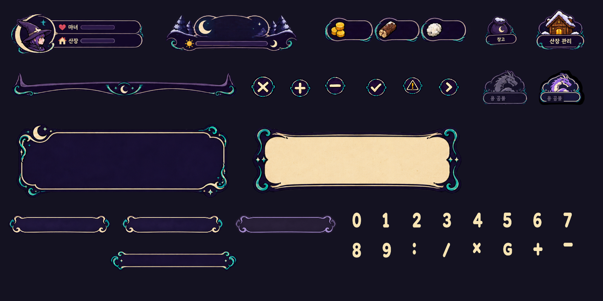
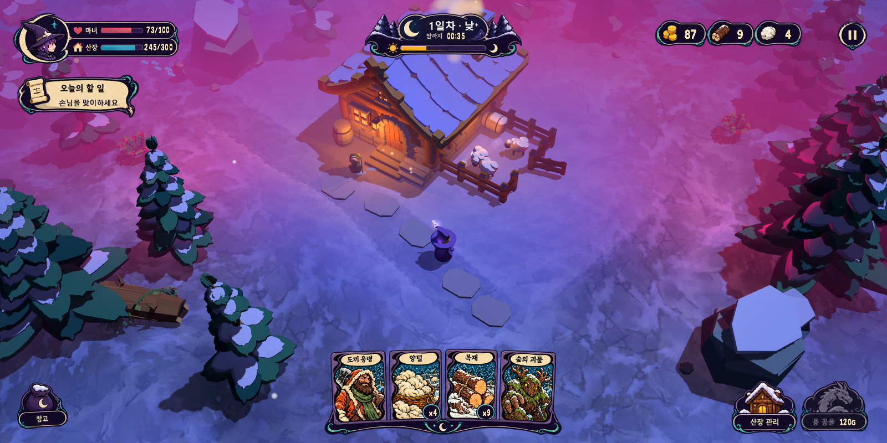

# 달빛 마법 UI 에셋 패키지 · v01

제작 완료: 2026-10-14. 사용자 채택 시안 **3번**을 기준으로 한다. 기능 명세서를 먼저 작성·통지한 뒤 에셋을 제작했다. 게임 구현은 Claude가 담당한다.

## 먼저 읽을 파일

1. [기능 명세서](../../../docs/ui-moon-runes-functional-spec.md)
2. [Claude 인수인계](CLAUDE_HANDOFF.md)
3. [화면 배치·동적 글 영역](layout.json)
4. [PNG별 크기·역할·source rect·9-slice](asset-catalog.json)
5. [전체 파일 해시·납품/원본/검증 구분](manifest.json)

## 시안을 그대로 유지하는 방법

`approved/atlas.png`와 `approved/mockup.png`가 픽셀 기준 원본이다. `approved/`의 8개 그룹은 이 atlas를 그대로 잘라 저장했다. 동일한 슬롯·AtlasTexture 방식으로 재조립한 `verification/approved-reassembled.png`는 **선택한 1600×800 시안과 차이 픽셀 0**이다.

예시 숫자를 그대로 붙이는 일반 플레이 HUD를 만들면 안 된다. `runtime/atlas.png`와 개별 부품을 사용해 실제 수치·게이지·카드를 연결한다. 이 atlas는 선언된 동적 영역을 제외한 모든 픽셀이 원본과 동일하다. 이미지 생성이 바꾼 불필요한 경계와 트랙은 최종본에 반영하지 않았다.

`runtime/hand.png`는 4장 배치의 참고 그룹이다. 실제 손패에는 `cards/{id}.png` 4종과 `runtime/hand_tray.png`를 따로 사용한다. `runtime/actions.png`도 두 버튼 배치의 참고 그룹이며 상호작용은 `lodge_button.png`, `dragon_normal.png`, `dragon_disabled.png`로 나눈다. `portrait.png`는 재사용 가능하지만 상태판에는 이미 들어 있어 두 번 얹지 않는다.

## 폴더별 용도

| 폴더 | 역할 |
| --- | --- |
| approved | 원본 atlas·mockup·배경과 정확한 원본 8그룹. 비교용 예시 값이 포함됨 |
| runtime | 빈 숫자/게이지를 가진 상태판·목표·낮밤판·자원판, 개별 counter/track/fill/버튼/트레이/배지, hover/pressed/focus/disabled |
| cards | 시안에서 추출한 4종 손패 표면·공용 뒷면. detail에 기존 승인 고해상도 원본 5종 |
| icons | 원본 아이콘 inset 7종, 확장 close/plus/minus/check/warning/arrow 6종 |
| common | modal·tooltip·toast·중립 버튼 상태·탭·리스트 행·scroll track/thumb·divider |
| fonts | 숫자/기호 비트맵 glyph atlas와 문자별 위치·간격 데이터 |
| verification | 재조립·실사용 부품 렌더·갤러리와 검사 JSON/로그 |
| source | 내장 image_gen 원본·프롬프트·패키징/검증 도구·미채택 초안. 게임 리소스로 일괄 import하지 않음 |

원본 inset은 아이콘 뒤의 작은 어두운 판 색까지 포함한다. 독립된 투명 아이콘처럼 월드 한가운데 붙이지 말고 같은 UI plate 위의 원래 위치에서 사용한다. 자원판·상태판에는 해당 아이콘이 이미 들어 있다. 확장 utility 아이콘은 자체 투명 외곽이다.

## 좌표와 배율

`layout.json`의 `slot`은 외부 박스, `display_rect`는 비율 유지로 들어간 실제 그림 영역이다. 원본 시안처럼 `KEEP_ASPECT_CENTERED`를 사용한다. Godot TextureRect의 expand/fit 설정을 적용한 **다음** size를 지정하여 원본 텍스처의 최소 크기로 박스가 커지지 않도록 한다.

동적 글 영역은 `native_rect`와 `screen_rect`로 제공한다. 글을 지운 자리 안에만 값을 넣는다. 손패 트레이의 위치는 hand 원본 그룹 안에서 `(0,217)`, 크기 `(856,123)`이며 hand의 `texture_scale`을 같이 적용한다. 카드 원본 좌표는 asset catalog의 source rect에서 hand atlas origin `(460,539)`을 빼면 된다. 트레이의 앞쪽 선·초승달은 카드 앞에 그려 카드 하단을 정리한다.

수량 표면 원래 위치: 양털 native hand `(369,221,46,35)`, 목재 `(557,221,45,35)`. 스택 배지의 글만 갱신한다. `runtime/stack_badge.png`는 원본의 원형 테두리·빈 바탕을 독립 투명 에셋으로 분리한 것이다. 1~8장으로 손패가 바뀔 때는 추가 제공된 hand_tray_left/center/right/rail_left/rail_right로 레일만 조절하고 중앙 초승달을 늘이지 않는다. 4장 기준 화면에서는 전체 hand_tray를 그대로 쓴다.

낮밤 타이머 `phase_timer_prefix.png`는 원본 ‘밤까지’ 글자를 보존한다. phase native `(205,75,56,25)`에 놓고 ASCII 시간은 옆 `(262,73,80,27)`에 둔다. 밤/정리 상태에서는 이 prefix를 숨기고 실제 상태 문구로 바꾼다.

## 숫자 비트맵 글자

정식 실사용 파일은 `fonts/numbers.png`와 `fonts/glyphs.json`이다. 지원: `0123456789:/×G+−`, 공백 advance도 제공한다. glyph 하나씩 AtlasTexture로 표시하거나 UI draw에서 같은 rect를 사용한다. 기준 cap-height 64, `scale=원하는 글 높이/64`, 위치/폭은 JSON의 `rect`, `xadvance`, `yoffset`을 따른다. 전체 문자열 폭을 먼저 계산하여 오른쪽 수치 영역에 맞추고, 부족한 폭에서만 축소한다. 숫자 시트 전체를 한 Label 뒤에 그리지 않는다.

한글 문장과 bitmap glyph 문자열은 별도 레이어로 취급한다. 고정 한글 타이틀은 원본 plate에 포함되어 있고, 변하는 한글은 기존 SystemFont를 유지한다. 제공되는 `source/numbers-format.fnt`는 포맷 초안/참고이고 실사용 계약이 아니다. `fonts/`의 PNG+JSON 렌더를 사용한다. Godot [FontFile](https://docs.godotengine.org/en/stable/classes/class_fontfile.html)의 직접 bitmap 로드와 [TextServer의 고정 크기 스케일](https://docs.godotengine.org/en/stable/classes/class_textserver.html#enum-textserver-fixedsizescalemode)은 별도 엔진 폰트 작업 영역이므로 이 패키지 검증과 혼동하지 않는다.

이 미리보기는 `73/100`, `245/300`, `87`, `9`, `4` 등 다른 예시 값을 넣어 정적인 원본과 구분되는 실사용 부품을 확인한 것이다. 실제 game 상태를 연결한 HUD 실행 결과는 아니다.

## 버튼 상태와 공통 창

- pause·storage·lodge_button·dragon_normal에 hover/pressed/focus PNG를 제공한다. 원본 normal과 외곽 alpha가 동일하며 tint만 변경한다. pressed의 1px 이동은 Claude가 UI에서 적용한다.
- 용 disabled는 승인 시안의 회색 버전이다. normal은 같은 원본 포즈를 기준으로 생성한 보라/크림 활성 상태이며, 최종 alpha 외곽은 disabled와 동일하게 고정했다.
- `common/button_*`도 같은 normal 실루엣에서 상태 색만 파생했다. 생성 시트의 다른 hover 실루엣으로 바꿔치기하지 않는다.
- 공통 창·버튼은 catalog의 `nine_slice` 순서 `[left,top,right,bottom]`만 늘린다. portrait·전체 HUD plate·카드·아이콘·divider·hand tray는 고정 비율로 사용한다.
- common의 modal/tooltip/toast/tab/row는 시안에 보이지 않던 보조 화면용 확장이다. 상시 HUD의 승인 plate를 이 범용 그림으로 교체하지 않는다. 지도 마커와 세계 대상 표식은 기존 procedural 표시를 재사용한다.

## 임포트와 검증

Claude는 납품용 `runtime`, `common`, `icons`, `cards`, `fonts`와 필요한 JSON을 `godot/assets/ui/moon_runes/`에 복사해 `res://` 경로로 연결한다. PNG는 선형 필터·mipmap off·lossless를 기본으로 한다. 원본 RGBA 해상도를 유지한다. `source`와 배경 캡처·로그·검증 전용 그림은 게임 실행 데이터에 넣지 않는다.

검증 결과:

- [패키지 검사](verification/package-verification.json): 원본 8그룹 픽셀 일치, 전체 시안 재조립 차이 0, 버튼 상태 alpha 동일, 숫자 glyph가 실제 렌더됨.
- [정적 픽셀 보존](verification/static-preservation.json): 동적 영역 밖의 변경 0.
- [숫자 glyph 검사](verification/numeric-font.json): 16개 glyph 모두 유효한 실제 alpha 픽셀·범위·문자 데이터 제공.
- 캡처된 최종 에셋·갤러리·재조립 화면을 직접 검토했다. 게임 버튼·드래그·시간 정지 등 기능 검증은 Claude 구현 후 수행한다.

프로젝트 루트에서 `.tools/Godot-4.7.2.exe --path godot --script <이 패키지 source/verify_package.gd 절대경로>`로 재현한다. exporter는 `build_assets.gd`, 숫자 exporter는 `build_numeric_font.gd`다. 이 세 도구는 저작/검증 도구이며 게임 입력 코드가 아니다.
