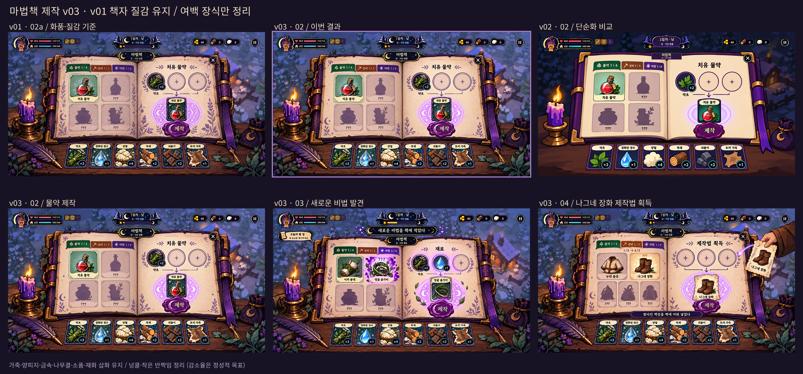

# 마법책 제작 화면 v03 — 시안 3장·비교 시트

2026-10-20 · [요청서](../../../docs/handoff/codex-spellbook-crafting-concepts-v03.md) · [실제 프롬프트·호출 이력](../../../docs/prompts/ui/spellbook-crafting-concepts-v03-prompts.md)

이전 429 차단 이후 제작을 재개해 완료했다. v01 02a를 실제 편집 입력으로 사용하고 책의 입체감·재질·소품·재화 삽화는 유지하면서 페이지 여백 장식을 정리했다. 내장 image_gen으로 4회 성공했으며 04의 추가 편집 결과를 채택했다.

## 결과 파일

| 파일 | 크기 | 내용 |
| --- | --- | --- |
| [02-window.png](02-window.png) | 1920×1080 | 물약 1 / 4, 치유 물약, 약초 ×2 + 빈 슬롯 2개 |
| [03-discovery.png](03-discovery.png) | 1920×1080 | 마법 2 / 4, 약초 ×2 + 정수 ×1, ???에서 덩굴 올가미 발견 |
| [04-recipe-reward.png](04-recipe-reward.png) | 1920×1080 | 장비 1 / 5 → 2 / 5, 누빈 솜옷 유지·나그네 장화 발견 |
| [sheet.png](sheet.png) | 2400×1120 | 상단 v01 02a / v03 02 / v02 02, 하단 v03 3장 |
| [drafts/](drafts/) | 생성 원본 4장 | 02·03 각 1장, 04 초안·추가 편집 각 1장과 후처리 기록 |

## v01 대비 덜어 낸 것

- 목록·슬롯에 붙는 연속 넝쿨 테두리를 끊어 모서리와 가장자리 일부의 가지로 남겼다. 여백에도 양피지 색 변화와 질감을 유지했다.
- 페이지 둘레의 작은 점·별을 정리했다. 카드 삽화 속 반짝임과 마법진·발견 장면의 의미 있는 빛은 남겼다.
- 결과 뒤 마법진의 겹을 줄여 카드 주변을 정돈했다. 보라 발광·룬·달 문양은 유지했다.
- 가죽·양피지의 미세 무늬를 없애지 않고 대비를 눌렀다. 가죽 주름·스티치·금속 광택·나무결과 촛불·깃펜·잉크·책 더미·주머니·리본을 남겼다.
- 가장자리 식물과 재화 줄이 분리되어 보이게 정돈하고, 재화 카드의 세부 묘사를 유지했다.

20~30%는 전체 장식 정리의 **정성적 목표**이며 실제 감소율 계측값이 아니다. v02처럼 카드 삽화를 단순 아이콘으로 바꾸지 않았다.

## 직접 확인한 항목

- 최종 3장과 비교 시트를 직접 열어 화풍·재질·소품·재화 삽화가 v01에 가까운지 확인했다.
- 03 배너 “새로운 비법을 책에 적었다”와 “마법책” 제목판 사이에 간격이 있고 겹치지 않는다.
- 04에서 누빈 솜옷은 기존 알려진 제작법으로 남고 나그네 장화 하나가 열린다. 남은 ???는 **투구·주머니·망토**이며 장화 실루엣이 없다.
- 04 배너는 “찢어진 책장을 책에 끼워 넣었다”. 모든 장면의 재화는 약초 ×3·정화된 정수 ×1·양털 ×4·목재 ×2·쇠붙이 ×2·토끼 가죽 ×1이다.
- 한글·수량·탭 상태와 중세 기반 판타지의 소재·복식·소품 표현을 확인했다.

## 후처리와 범위

생성 원본은 1672×941이며 비율 유지 확대와 극소량 중앙 크롭으로 최종 1920×1080을 저장했다. 시트는 System.Drawing으로 조립하고 게임의 NotoSansKR 글꼴을 읽기 전용으로 로드했다. 시안 내부 글자는 생성 결과를 유지했다. [재현 스크립트](drafts/build-deliverables.ps1)와 [최종 치수·해시](drafts/final-files.json)를 보존했다.

기존 `drafts/protected-files-check.json`은 **이전 시도의 기록**이다. 이번 재개에서는 v03 폴더, 지정 프롬프트 기록, 요청서 끝 납품 절에만 쓰기를 수행했다. `godot/`, `WitchsLodge.exe`, v01·v02 폴더와 다른 docs 문서는 수정하지 않았다. Godot 임포트·내보내기·커밋은 하지 않았다.
