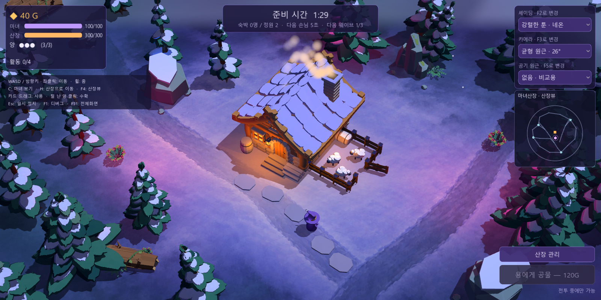
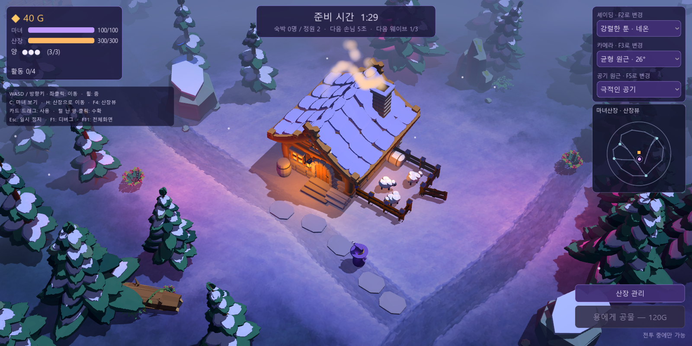
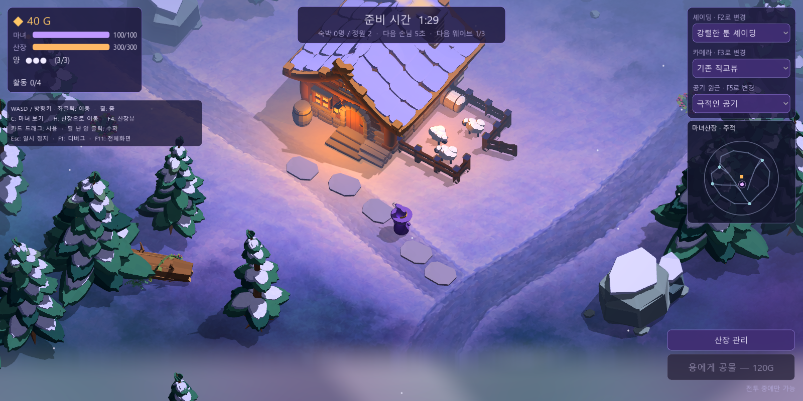
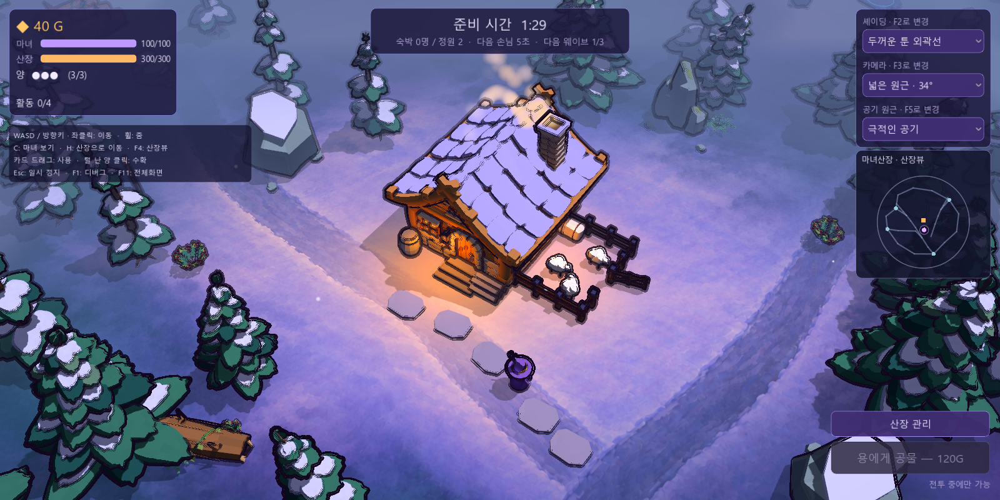
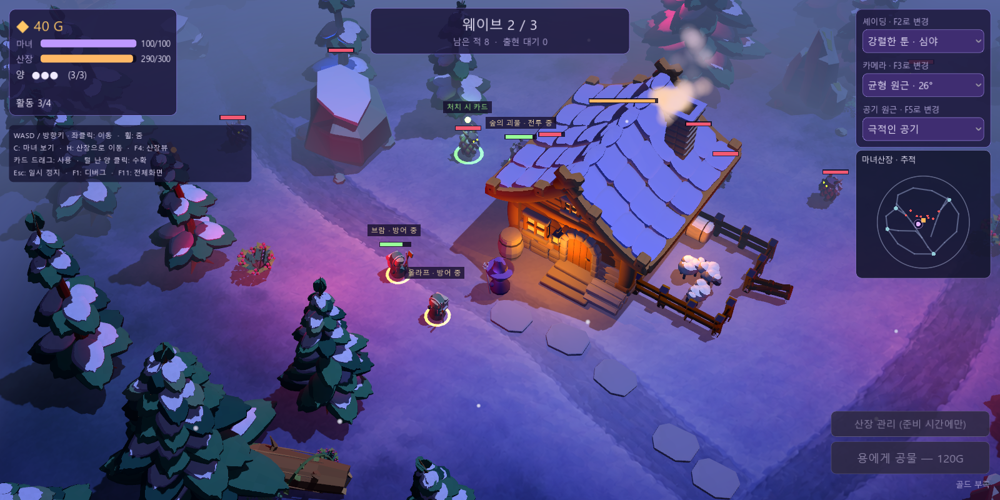

# 공기 원근법 — 공간감 강화

**주변 조명색 후속 적용:** 고정된 청보라색 대신 주변 광원의 위치·색·세기와 선택한 셰이딩의 환경광을 반영한다. 분홍·파랑 국소광과 창문의 앰버색이 공기층에 위치별로 섞인다. 거리별 대비·외곽선 감쇠와 F5 메뉴는 유지한다. [현재 실제 화면과 검증](colored-air.md). 아래 이미지는 이전 고정 공기색 적용 기록이다.

적용일: 2026-10-14. 현재 확장 숲과 플레이어 추적 카메라를 기준으로 적용했다. **전경의 선명한 툰 명암 → 중경의 산장과 배우 → 청보라색 공기층에 묻히는 원경 숲**이 구분되도록 실제 거리 기반의 Depth Fog를 사용한다. 소스와 `build/WitchsLodge.exe`용 PCK에 적용 완료했다.

## 적용 전후

같은 **강렬한 툰 · 네온 + 균형 원근 26° + 산장뷰**를 배포 실행판에서 직접 캡처했다. 합성 이미지가 아니다.

공기 원근 없음:



극적인 공기:



플레이어 추적 기본 실행:



## 조작과 선택

오른쪽 위 **공기 원근** 메뉴 또는 **F5**로 선택한다. 셰이딩(F2)·카메라(F3)와 독립이며, 기존 산장뷰/추적 전환(F4)도 유지한다. 일시 정지 중에도 비교할 수 있다. 프로그램의 새 실행은 **극적인 공기**로 시작하고, 같은 실행의 새 게임에서는 선택을 유지한다.

| 프리셋 | 먼 거리 최대 혼합량 | 시작 / 끝 거리 | 곡선 | 의도 |
| --- | --- | --- | --- | --- |
| 없음 | 0 | 효과 비활성화 | — | 기존 표현과 비교 |
| 은은한 공기 | 0.48 | 카메라~중심 거리 +1 / +18m | 1.2 | 거리감만 약하게 보강 |
| 극적인 공기 (기본) | 0.76 | 카메라~중심 거리 −2 / +12m | 1.1 | 먼 숲의 대비와 색을 낮춰 앞뒤 층을 확실히 분리 |

공기색은 청보라 계열 `(0.43, 0.49, 0.65)`다. 가까운 물체에는 효과가 거의 없고, 거리가 늘어날수록 그림자를 공기색으로 들어 올리고 밝은 면과의 차이·색의 대비를 줄인다. 최대 혼합량을 제한해 먼 나무의 실루엣도 남긴다. 전체 화면 블러는 추가하지 않았다.

## 구현

- [전용 공기 원근 모듈](../godot/scripts/visual/aerial_perspective.gd)이 Environment의 Depth Fog 설정과 수명을 관리한다. 렌즈나 플레이어 줌이 달라져도 중심점 기준으로 거리를 보정한다.
- 기존 플레이어 카메라가 갱신된 뒤 공기 거리를 동기화한다. 추적 시에는 현재 카메라 중심, 산장뷰에서는 기존 산장 중심을 사용한다. 카메라·조명 프리셋·게임 규칙을 변경하지 않는다.
- 실제 재질의 조명 계산 뒤에 적용되므로 산장·새 자연 프랍·배우와 파티클에도 거리감이 이어진다. 화면의 상하 위치를 기준으로 덮는 그라데이션이 아니다.
- [툰 외곽선](../godot/shaders/toon_outline.gdshader)은 실제 표면 깊이를 복원한 뒤 같은 공기 곡선으로 선의 불투명도를 낮춘다. 먼 물체만 검은 외곽선이 강하게 남는 현상을 방지한다. 가까운 툰 경계는 그대로 남긴다.
- HUD·손패·미니맵은 월드 안개를 받지 않는다. 새 공기 메뉴 아래로 미니맵을 옮겨 두 영역이 겹치지 않게 했다.

[Godot Environment 공식 문서](https://docs.godotengine.org/en/4.7/classes/class_environment.html)의 Depth Fog와 [렌더러의 깊이 혼합 계산](https://github.com/godotengine/godot/blob/master/servers/rendering/renderer_rd/shaders/forward_clustered/scene_forward_clustered.glsl)을 참고했다. 이 프로젝트는 색 배경을 사용하므로 Sky radiance를 샘플링하는 `fog_aerial_perspective` 속성 대신 Depth Fog의 색·거리·곡선을 사용했다.

## 검증

[렌더 통합 검증](../output/aerial-perspective/verification.json) / [검증 도구](../godot/tools/verify_aerial_perspective.gd):

- 11개 셰이딩 × 5개 카메라 × 3개 공기 설정 **165조합**을 실제 HUD 선택 신호로 렌더했다. 설정 독립성·게임 상태·불투명 HUD 체력바 보존 통과.
- 같은 색의 가까운/먼 테스트 표면을 실제 3D에 배치해 5개 렌즈 모두에서 확인했다. 가까운 표면의 RGB 변화는 0, 먼 밝고 어두운 표면의 명암 차이는 기존의 약 22%, 먼 색 표면의 정규화 색 대비는 약 33%로 줄었다. 이 수치는 최대 공기 혼합 거리의 통제된 표면 측정값이며, 실제 나무는 거리에 따라 효과량이 다르다.
- 공기 없음 복원·잘못된 ID 거부·일시 정지 F5·먼 외곽선 동기화·새 게임 선택 유지 통과.
- 확장 숲의 3개 위치에서 추적 중심을 옮기고 줌 높이 12/28/18을 적용했을 때 거리 보정과 지면 선택 오차 0.001 미만 확인.

[배포판 검증](../output/aerial-perspective/pack-verification.json): 전후·은은한 버전·기본 추적·외곽선·추적 전투·카드 드래그 7화면을 실행파일에서 직접 캡처했다. 공기/셰이딩/카메라 ID, 종료 코드 0, 오류 로그 없음, 캡처와 현재 PCK의 SHA-256을 확인했다. 교체 전 PCK는 `build/WitchsLodge-before-aerial-perspective.pck`에 보존했다.





```text
.tools/Godot-4.7.2.exe --path godot --script res://tools/verify_aerial_perspective.gd
build/WitchsLodge.exe -- --style=toon_neon --camera=lens_balanced --air=dramatic
build/WitchsLodge.exe -- --style=toon_neon --camera=lens_balanced --air=off --overview
```
