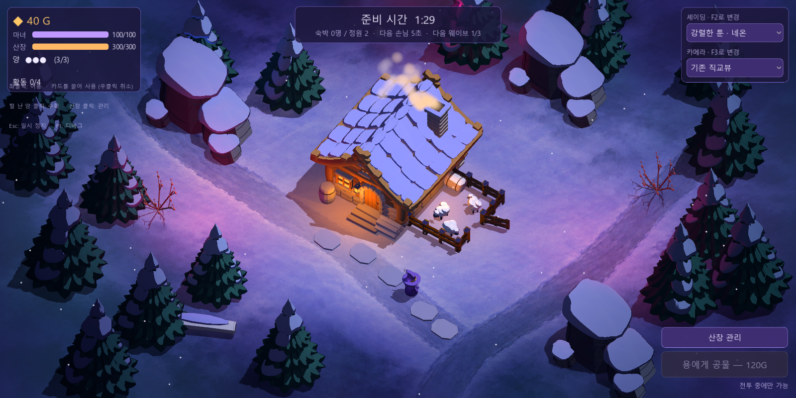
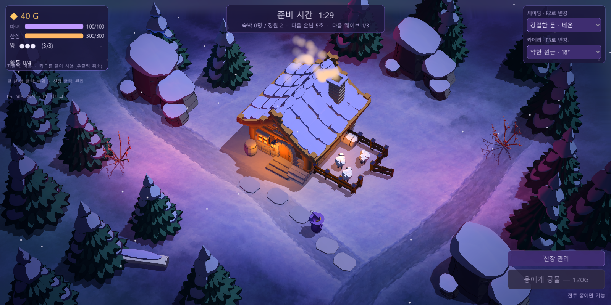
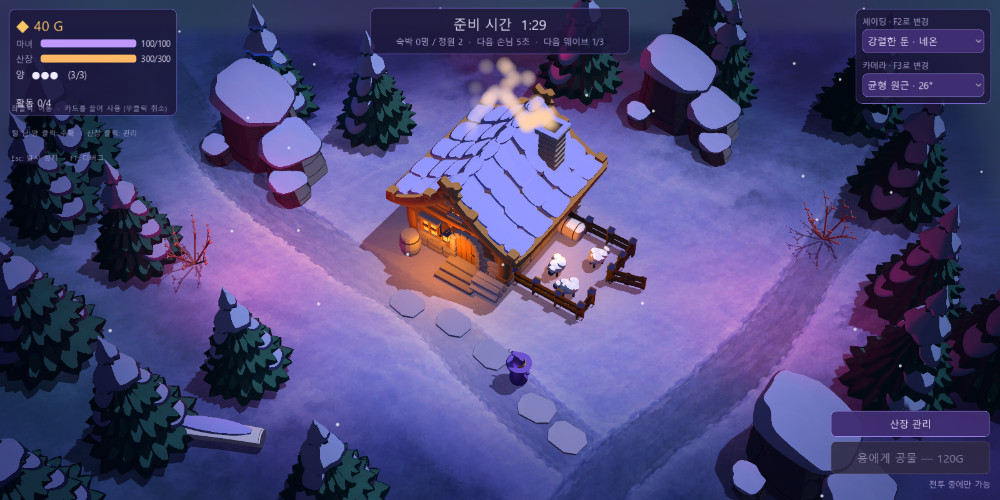
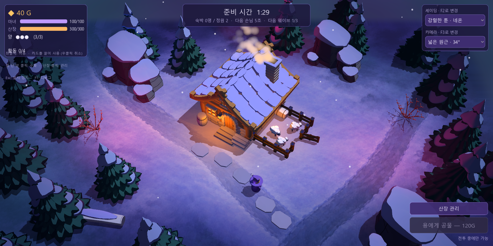
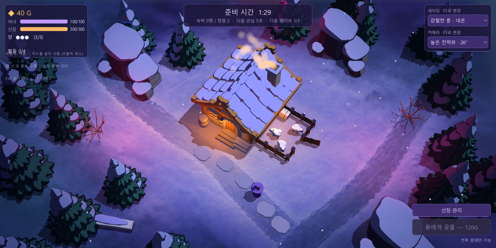
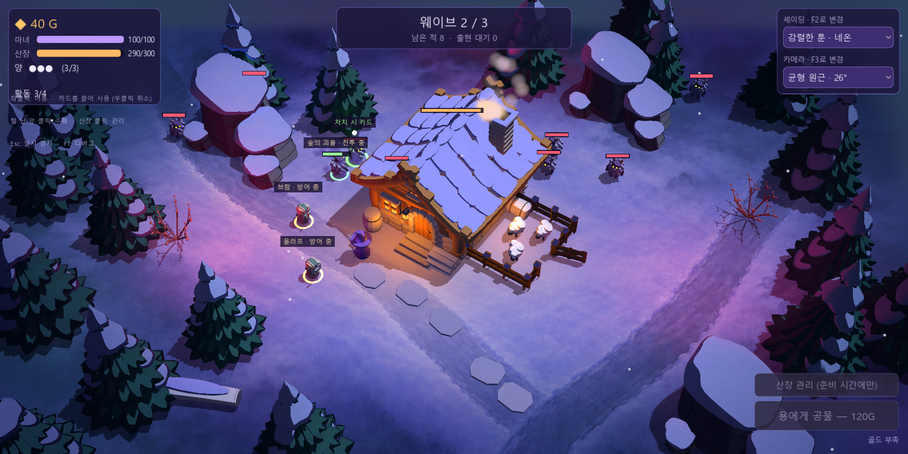
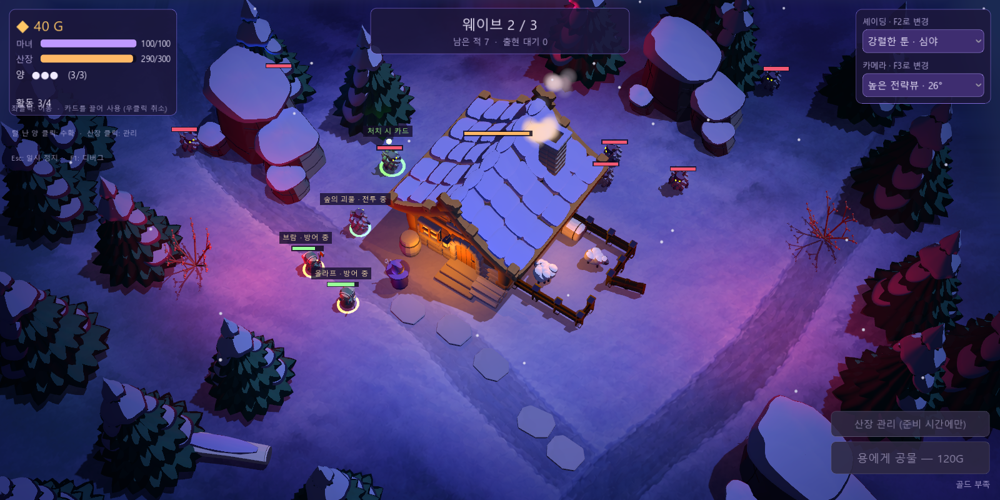
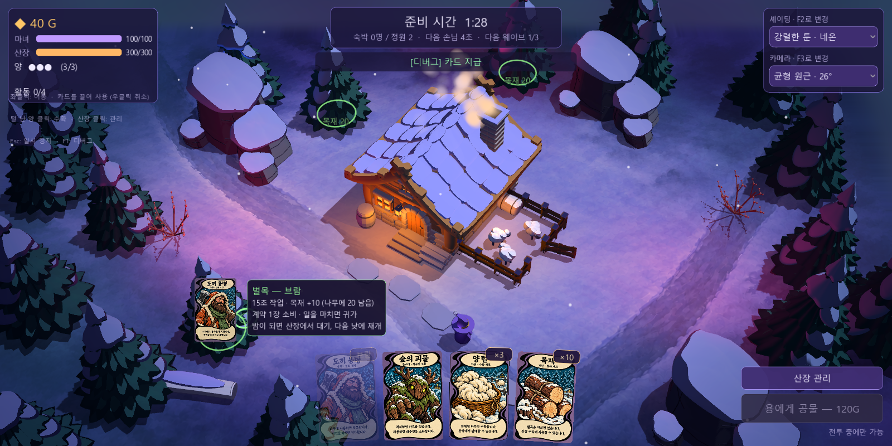
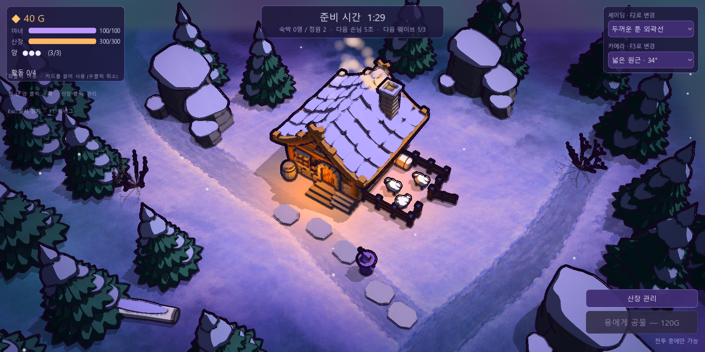

# 카메라 렌즈 프리셋과 독립 조합 메뉴

**현재 승인 기본값:** 2026-10-14 사용자 지정 화면에 맞춰 **강렬한 툰 · 심야 + 넓은 원근 34° + 극적인 공기**로 설정했다. 소스와 배포판 모두 새 실행에 자동 적용한다. 아래의 기존 직교뷰 기본값은 이전 기록이다.

**공기 원근 후속 적용:** 현재는 별도 **공기 원근 / F5** 메뉴도 제공한다. 기본값은 극적인 공기이며 11개 셰이딩 × 5개 렌즈 × 3개 공기 설정을 조합한다. 플레이어 추적과 줌에도 공기층을 맞춘다. [현재 전후 화면과 검증](aerial-perspective.md). 아래 이미지는 공기 원근 적용 전의 카메라 비교 기록이다.

**플레이어 탐색 추가:** 현재 기본은 마녀를 따라가는 카메라이며 휠로 줌을 조정한다. 아래 고정 구도·21m 프레이밍은 **F4 산장뷰**에서 유지한다. 추적 중 렌즈 전환은 마녀 위치와 줌을 유지한다. [플레이어 카메라·확장 맵](player-exploration.md).

적용일: 2026-10-14. 사용자의 LoL 같은 약한 소실점·원근감 요청을 참고해 실제 Godot 카메라에 원근 렌즈 4종을 추가했다. 기존 직교뷰를 포함해 **5개 카메라 × 11개 셰이딩·라이팅**을 독립적으로 조합한다. 특정 게임의 실제 내부 카메라 수치를 복제한 것은 아니며, 우리 산장 장면에 맞춘 비교값이다. 소스와 `build/WitchsLodge.exe`용 PCK에 적용했다.

## 조작

오른쪽 위에 두 드롭다운을 배치했다.

- **셰이딩 / F2:** 기존 11개 툰·색광 프리셋. 카메라 선택과 위치·렌즈를 바꾸지 않는다.
- **카메라 / F3:** 아래 5개 렌즈·시점. 선택한 셰이딩·조명·발광 설정을 바꾸지 않는다.

두 메뉴와 단축키 모두 일시 정지 중에도 작동한다. 같은 실행의 새 게임에서도 두 선택을 각각 유지한다. 새 실행의 기존 기본값은 강렬한 툰 셰이딩 + 기존 직교뷰다. 처음 비교할 조합으로 **강렬한 툰 · 네온 + 균형 원근 · 26°**를 권한다.

## 렌즈 비교

| 메뉴 이름 | 개발용 ID | 투영 / 수직 FOV | 하향 각도 | 중심점까지 거리 | 의도 |
| --- | --- | --- | --- | --- | --- |
| 기존 직교뷰 | `orthographic` | 직교 / 화면 높이 21 | 50° | 45.0 | 기존 화면 비교. 깊이에 따른 크기 변화 없음 |
| 약한 원근 · 18° | `lens_soft` | 원근 / 18° | 50° | 66.3 | 직교 느낌을 가장 많이 유지하면서 살짝 수렴 |
| 균형 원근 · 26° | `lens_balanced` | 원근 / 26° | 50° | 45.5 | 주변 나무·바위에 자연스러운 크기·방향 변화 |
| 넓은 원근 · 34° | `lens_wide` | 원근 / 34° | 50° | 34.3 | 앞쪽 프랍이 더 커지고 뒤쪽이 더 작아지는 비교 |
| 높은 전략뷰 · 26° | `lens_high` | 원근 / 26° | 58° | 45.5 | 지붕·길·전투 배치를 더 위에서 내려다봄 |

Yaw 35°와 지면 중심 `(1, 0, 1.3)`을 공통으로 유지한다. 원근 카메라는 `distance = 21 / (2 × tan(FOV/2))`로 거리와 렌즈를 함께 조절해 중심점 기준 확대율을 맞춘다. 깊이와 높이가 다른 물체는 원근 투영에 따라 자연스럽게 크기가 달라진다. 수직 화각을 유지하므로 창의 가로세로 비율이 달라져도 중심을 유지한다. [Godot Camera3D 공식 문서](https://docs.godotengine.org/en/4.7/classes/class_camera3d.html).

아래 이미지는 모두 갱신한 배포 실행판에서 직접 캡처했다. 셰이딩은 강렬한 툰 · 네온으로 통일했다.

### 기존 직교뷰



### 약한 원근



### 균형 원근



### 넓은 원근



### 높은 전략뷰



## 조합·입력 확인









## 구현과 검증

- [카메라 정의](../godot/scripts/visual/camera_style.gd)는 렌즈·각도·위치만 관리하며 [셰이딩 정의](../godot/scripts/visual/screen_style.gd)와 선택 상태를 분리했다. HUD가 각기 다른 월드 호출과 신호에 연결된다.
- 기존 단일 카메라를 재사용한다. 카메라 전환은 배우·콜라이더·내비메시·게임 상태를 재생성하지 않는다. 바닥 클린플레이트는 기존 월드 좌표에 고정해 렌즈 전환 때 미끄러지지 않게 했다.
- 원근뷰가 클린플레이트 바깥까지 볼 때 가장자리 픽셀이 늘어나던 부분은 월드 좌표 기반의 어두운 숲 바닥으로 부드럽게 이어지도록 보정했다.
- [55조합 렌더 통합 검증](../output/camera-presets/verification.json): 실제 HUD 선택 신호로 11×5를 렌더하고 두 선택·설정의 독립성, 불투명 HUD 보존, 게임 상태 보존을 확인했다.
- 같은 크기의 지면 선분을 앞/뒤에 두고 측정한 화면 폭의 비: 직교 1.00, 약한 원근 1.21, 균형 원근 1.33, 넓은 원근 1.46, 높은 전략뷰 1.26. 원근 수렴이 실제로 생기고 3단계로 커짐을 확인했다.
- 5개 렌즈에서 화면→지면 좌표 오차 0.001 미만, 실제 이동 클릭과 용병 카드의 나무 벌목 대상 선택 통과. 무효 ID 거부, 일시 정지 F2/F3 독립 동작, 창 크기 변경, 기존 카메라 정확한 복원, 장면 재시작 후 두 선택 유지도 통과했다.
- [배포판 검증](../output/camera-presets/pack-verification.json): 5개 렌즈 시작 화면, 두 전투 조합, 실제 카드 드래그 미리보기, 넓은 렌즈 + 외곽선을 실행파일에서 직접 캡처했다. 두 선택 ID·종료 코드·오류 로그·캡처와 현재 PCK 해시를 확인했다. 교체 전 PCK는 `build/WitchsLodge-before-camera-presets.pck`로 보존했다.

```text
.tools/Godot-4.7.2.exe --path godot --script res://tools/verify_camera_styles.gd
build/WitchsLodge.exe -- --style=toon_neon --camera=lens_balanced
build/WitchsLodge.exe -- --style=toon_midnight --camera=lens_high
```
