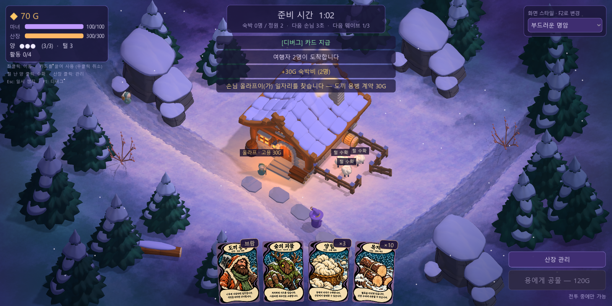
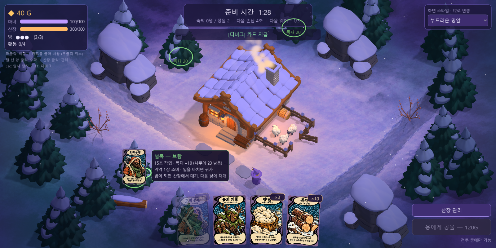
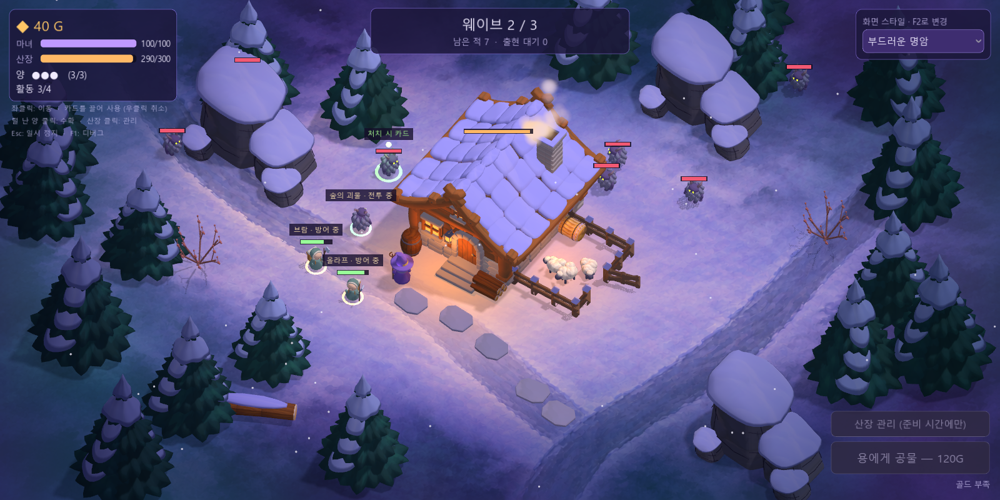

# 마녀산장 — 카드 코어 C0 구현 기록

구현일: 2026-10-14 · 기준: [카드 코어 기획서 v0.3](kingdom-integration-design.md) §15의 **C0 카드 코어** · 카드 이미지: [`art/cards/rounded`](../art/cards/README.md) → `godot/assets/cards/`

기존 실시간 월드(클릭 이동·자동 공격·3웨이브·용 공물)를 유지한 채 **하단 손패·드래그 사용·창고, 손님 고용 계약, 벌목/전투 양용 용병, 양털 생산·접근 수확·판매, 표식 괴물 카드·하수인**을 실제 게임에 넣었다. 세 획득 경로(고용·수확·처치)가 카드가 되고, 카드를 월드 대상에 끌어 쓰면 인물·작업·수리·판매로 돌아온다. 수치는 v0.3의 시험값이며 밸런스 검증 결과가 아니다.



## 1. 플레이에서 할 수 있는 것

| 카드 | 얻는 법 | 쓰는 법(드래그해서 놓기) | 결과 |
| --- | --- | --- | --- |
| 도끼 용병 | 숙박비를 낸 손님이 문가에서 10초 기다림 → `고용 30G`(패널 버튼 또는 손님 클릭) | 낮: **자원 나무** → 벌목 / **지면** → 오늘 밤 방어 배치. 밤: **적·지면** → 전투 | 계약 1장 소비. 벌목 15초 후 목재 ×10, 또는 밤 적 정리 후 걸어서 귀가. 카드는 돌아오지 않음 |
| 양털 | 2일차부터 낮마다 양에게 털이 자람 → **양 클릭**, 마녀가 다가가 1초 수확 | 낮: **산장**에 놓기 → 수량 선택 창 | 판매할 때만 1개 4G. 자동 판매 없음 |
| 목재 | 용병 벌목 완료 | 낮: 손상된 **산장**에 놓기 | 목재 5개 → 산장 체력 +100(최대 체력까지) |
| 숲의 괴물 | 웨이브마다 초록 표식이 붙은 괴물 1마리 처치(처치자 무관, 1회) | 낮/밤: **적·지면** | 아군 하수인 소환. 이번(낮 소환은 다음) 밤 전투가 끝나면 퇴장 |

- 카드에 마우스를 올리면 크게 보이고, 이름·분류·계약 인물·획득 경로·설명·**지금 가능한 사용법**을 보여준다.
- 끄는 동안 유효 대상(자원 나무와 남은 목재, 적, 산장)을 강조하고, **실제 소환·작업 위치**, 임무, 소비량, 종료 조건, 불가 사유를 미리 보여준다.
- 놓는 순간 같은 판정을 다시 한다. 무효 대상·손패 위에서 놓기·**우클릭/Esc 취소**는 소비하지 않는다. 카드 드래그는 마녀 이동으로 전달되지 않는다.
- 손패는 8장까지 보인다. 넘친 카드는 **창고**(손패 오른쪽 버튼)에 보관되며 버리지 않는다. 창고에서 손패와 교환한다.
- 아군 머리 위에 `이름 · 임무 상태`(벌목 n초, 밤 대기, 방어 중, 귀가)를 표시하고, 발밑 고리로 적과 구분한다. 용병+하수인 동시 활동은 4명까지다(미사용 카드는 제외). 왼쪽 위 상태판에 `활동 n/4`와 털 난 양 수를 표시한다.





## 2. 기획서 규칙의 구현 위치

| v0.3 항목 | 구현 |
| --- | --- |
| §5 고용: 정산 뒤 10초 대기, 하루 2명(첫 묶음 보장), 30G 1회 결제, 같은 인물 연결 | `lodge_economy.gd` — 첫·둘째 묶음에서 1명씩. 숙박비와 별도로 1회 처리. 이름은 계약 카드·월드 인물·상태 표시에 이어짐 |
| §6 벌목: 자원 나무만, 예약/고갈 불가, 15초·10개, 완료 후 귀가 | `contract_director.gd`, `ally.gd`. 자원 나무 3그루 × 목재 20(벌목 2회). 고갈된 나무는 낮아짐 |
| §6 일몰 중단: 산장 앞 대기 → 다음 낮 같은 계약으로 재개, 대기 중 피격 | 웨이브 시작 시 `interrupt()`, 다음 준비 시작 시 `resume()`. 사망 시 미완료 생산·계약 손실 |
| §6 전투: 지면·적 대상, 겹치지 않는 유효 위치, 적 대상 우선 공격, 밤 종료 시 귀가 | `card_use_resolver.gd`의 위치 보정(이동 가능 지면·숲 경계·건물·목장 제외). 낮 배치는 그날 밤 종료까지 |
| §7 양털: 첫날 0, 2일차부터 하루 1회, 오늘 산 양은 다음 날, 미수확 최대 1회분, 접근 수확, 중복 수확 불가 | `sheep.gd`, `pasture.gd`, `player.gd`. 마녀가 울타리 밖에 오면 양이 울타리 쪽으로 다가온다 |
| §8 지정 적 1종·지정 개체, 처치자 무관 1회, 하수인은 적 수에 미포함·재드롭 없음 | `wave_director.gd`(웨이브별 출현 순서 3·5·9번째), `monster.gd`. 하수인은 `allies` 그룹이라 밤 종료를 막지 않음 |
| §9 손패·창고·드래그 처리 순서 | `card_hand.gd`(UI), `card_inventory.gd`(소유·수량·구역) |
| §10 낮 창고·판매 창은 정지, 전투 창고는 정지 없음, Esc 정지 중 사용 불가 | `hud.gd`의 `refresh_pause()` 한 곳에서 계산 |
| §11 목재 수리 5개/+100, 유료 수리 10G 유지 | 목재는 카드, 골드 수리는 기존 산장 관리 패널 |
| §12 시작 40G | `config.gd`의 `START_GOLD` |

몬스터는 근접 거리에 들어온 용병·하수인과 맞붙는다(아군도 정상 피격). 용병 전투값은 v0.3이 비교값으로 든 체력40·공격8/1.5초를 쓰되, 도끼 용병에 맞춰 **근접(1.3m)·기준 지점 6m 안 적 추적**으로 구현했다. 하수인은 체력48·공격6/1.6초 시험값이다.

## 3. 기획서와 다르게 두었거나 남긴 것

- **용 공물은 현행 120G**를 유지했다. v0.3의 180G·하루 1회는 C1 비교 항목이라 이번 C0에 섞지 않았다.
- 객실 증축은 기존처럼 즉시 완성(60G)이다. v0.3의 건설 20초 관리 주문은 C1 범위다.
- 고용 기회 배정은 무작위가 아니라 첫·둘째 묶음 고정이다(재현 가능한 첫 비교판).
- 하수인 수명·활동 상한·가시 8장은 기획서대로 **시험값**이다. 탐험·방책·제작은 넣지 않았다.
- 시간 정지 방식(드래그 중 감속·전략 정지)은 넣지 않았다. 실시간 기준판이다.

## 4. 검증

```powershell
& '.tools/Godot-4.7.2.exe' --headless --path godot --script res://tools/verify_card_core.gd
& '.tools/Godot-4.7.2.exe' --headless --path godot --script res://tools/run_autoplay.gd
& '.tools/Godot-4.7.2.exe' --path godot -- --shot=out.png --scenario=cards   # cards | cards_drag | cards_combat
```

- `verify_card_core.gd`: 실제 게임 장면에서 v0.3 §16 항목 **34개 검사 통과**(3회 연속 실행). 고용→계약, 무효 대상·미발견 숲 미소비, 실제 마우스 드래그로 나무에 사용(마녀 미이동), 벌목 1회 지급·귀가·복구 없음, 목재 수리, 첫날 양털 0, 낮 배치, 활동 상한, 창고 넘침 무손실, 표식 괴물 카드 1장, 아군 생존 중 밤 종료, 2일차 털·접근 수확·중복 수확 불가·수량 묶음·판매 4G/개, 밤 판매 불가, 하수인 적 수 제외·퇴장·재드롭 없음, 우클릭 취소. 결과는 `godot/art_sources/card-core-verify.json`.
- 기존 자동 플레이(`run_autoplay.gd`): 3웨이브 **시연 완료**까지 정상(시작 40G 반영).
- 2026-10-15 보강: 검사가 이후 기능(무덤·하수인 퇴장 등)으로 **52항목**까지 늘었다. 이날 일부 실행이 처음부터 게임이 멈춘 상태로 진행되어 8항목이 실패하고 `card_core_check.gd`가 빈 고용 목록 접근 오류로 중단되었다. 소리 연결을 뺀 코드에서도 같았고, 재현되지 않아 원인은 확정하지 못했다(새 WAV `--import` 직후·실행판 재출력 전에만 발생해 에디터 캐시 상태가 의심된다). 게임 쪽의 정지 경로는 `hud.refresh_pause()`(Esc·산장·판매·창고 창)와 게임 종료뿐이며 검사 흐름에서 열리지 않는다. 검사를 고쳤다: ① 거부 판정 앞에 "게임이 멈춰 있지 않음" 항목을 두고 실패 시 열린 창을 기록 ② 산장·맵 밖 거부 검사가 "일시 정지" 사유로는 통과하지 않음(이전엔 멈춤 때문에 거부돼도 통과로 셌다) ③ 고용 기회가 없을 때 오류로 중단하지 않음. 수정 후 3회 연속 52/52 통과.
- 이 검증은 기능 동작 확인이다. 계약 가격·하수인 수명·야간 드래그 사용성 등 재미와 밸런스는 플레이테스트로 판단해야 한다(v0.3 §16 후반, C1).

## 5. 다음 단계(C1)

계약 공급·가격, 객실 건설 시간, 용 180G/하루 1회, 보관/벌목/전투/비축 경로 비교, 전투 중 카드 사용 속도(감속/정지 비교)를 3일판으로 측정한다.
