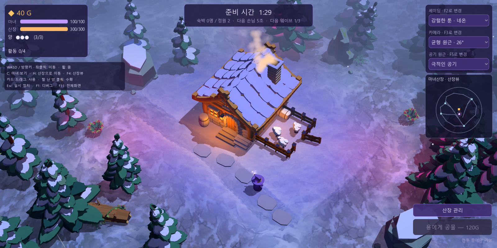
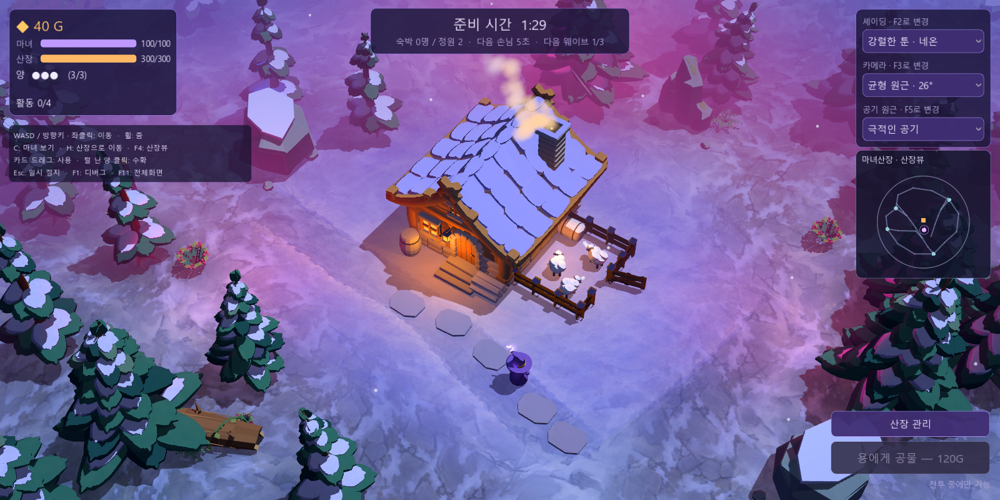

# 주변 조명색을 머금는 공기

2026-10-14 적용. 소스와 배포 실행판을 갱신했다. **공기 원근의 거리·밀도는 유지하고, 공기색이 주변 조명에 따라 달라지도록 변경**했다. 기존 공기 원근 메뉴/F5의 없음·은은한 공기·극적인 공기를 그대로 사용한다.

고정 공기색 비교:

주변 조명색 적용:

월드 안의 현재 OmniLight3D 광원을 최대 12개 수집해 위치·범위·색·세기를 전달한다. 공기 구간의 끝과 중간 위치에서 광원색을 혼합해 분홍 조명 쪽은 자주빛, 파란 조명 쪽은 청보라빛, 창문 주변은 앰버빛을 머금게 했다. 기본 공기색도 선택한 셰이딩의 환경광에 맞춘다. 실제 볼류메트릭 산란 대신 현재 쿼터뷰에 맞춘 색 혼합 근사다.

[공통 셰이더](../godot/shaders/colored_air.gdshaderinc)의 `FOG` 출력으로 조명 계산 뒤 색을 섞는다. 바닥·자연 프랍·산장·배우에 적용하며, 표준 재질·파티클은 같은 광원색의 중심 영역 평균을 사용한다. 가까운 물체의 거리 보호, 먼 외곽선 감쇠와 HUD 분리는 유지했다. 공기를 끄면 색 혼합도 사라진다.

- [색 반응 검증](../output/colored-air/color-verification.json): 조명을 직접 받지 않는 중성 표면에서도 광원을 분홍↔청록으로 바꾸면 공기색이 실제 렌더에서 변했다. 고정색 비교와 공기 원근 없음에서는 변화가 0이었다. 셰이딩 전환 갱신·꺼진 광원 정리·렌즈 독립성 통과.
- [거리/조합 회귀 검증](../output/colored-air/verification.json): 165개 조합, 가까운 표면 보호·먼 대비/채도 감소·HUD·추적/줌·F5·외곽선 검증 통과.
- [배포판 검증](../output/colored-air/pack-verification.json): 고정색 비교·네온·심야·기본 추적·전투·외곽선 6화면, 선택 ID·종료 코드·오류 로그·현재 PCK SHA-256 확인. 이전 PCK는 `build/WitchsLodge-before-colored-air.pck`에 보존했다.

Godot [Spatial shader의 FOG 출력](https://docs.godotengine.org/en/4.7/tutorials/shaders/shader_reference/spatial_shader.html)을 사용한다.
