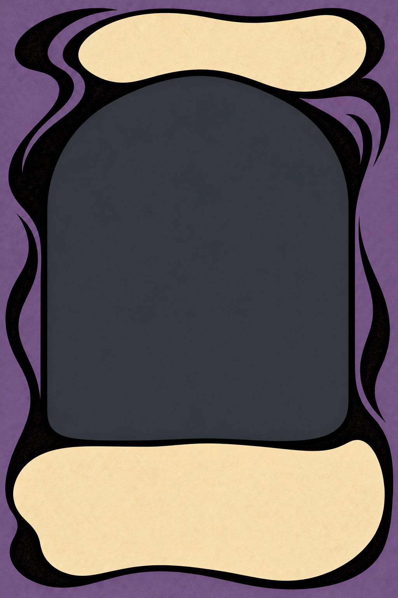
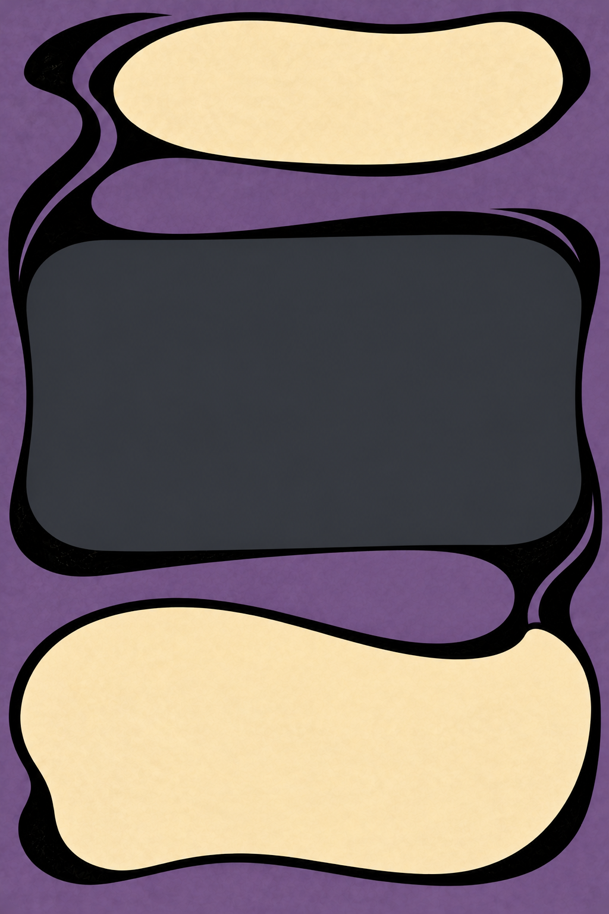
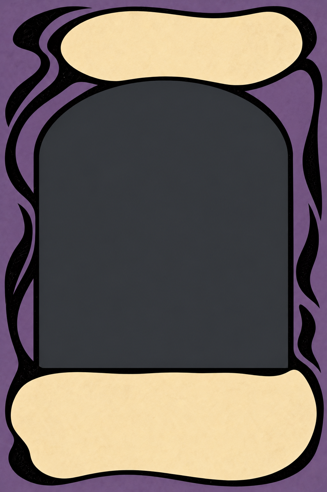
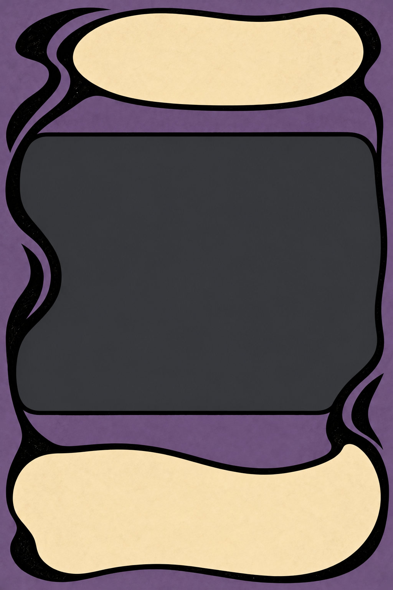
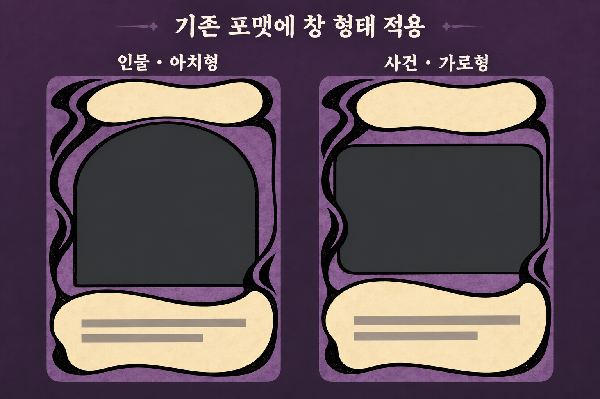
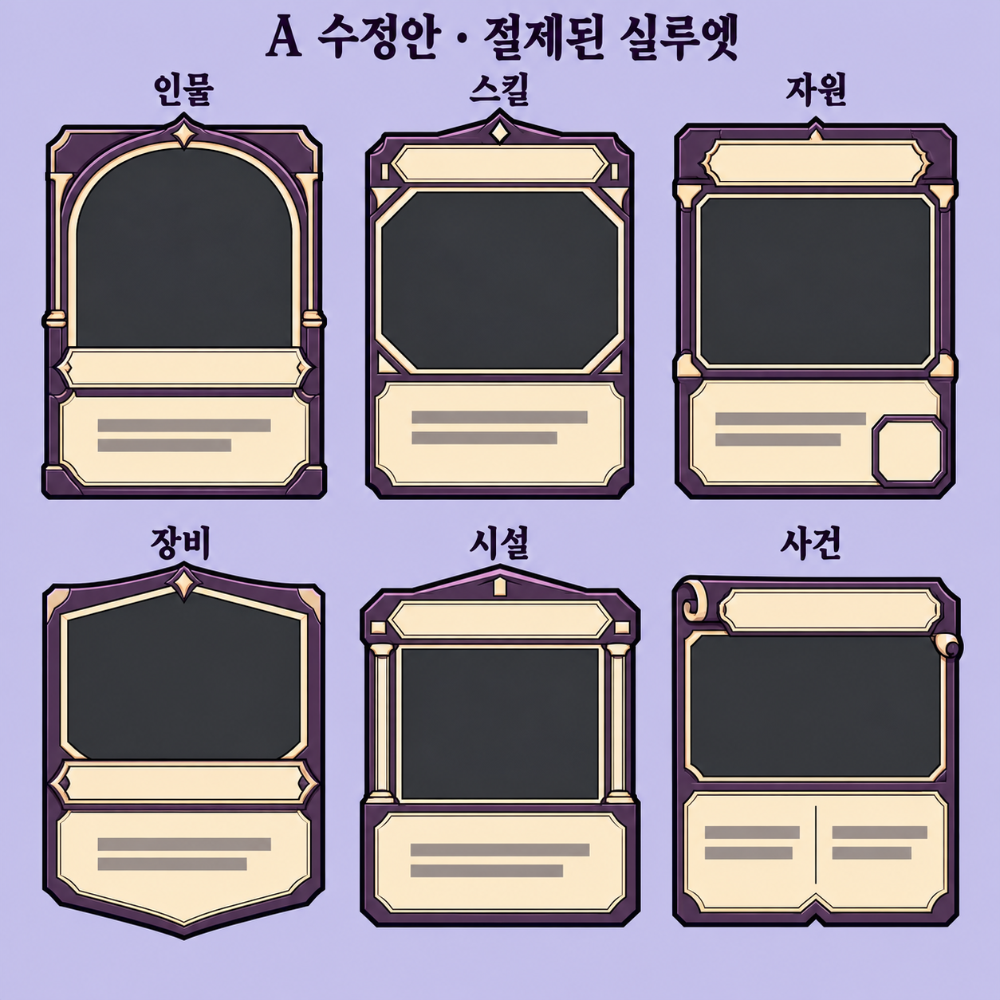
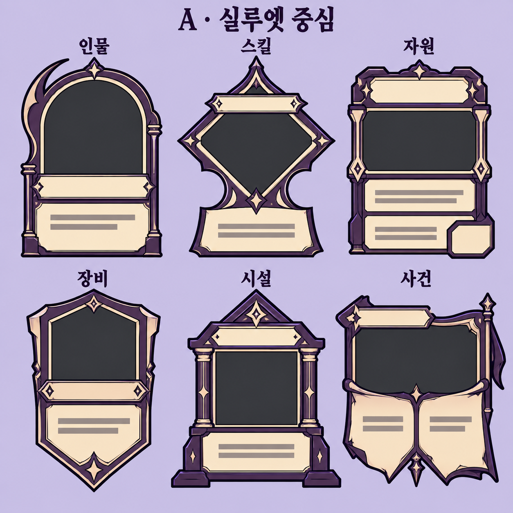
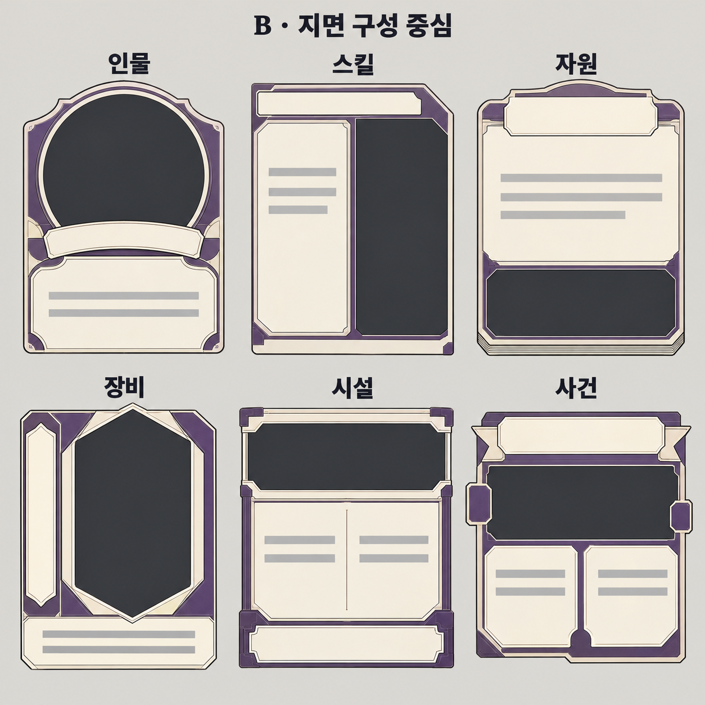
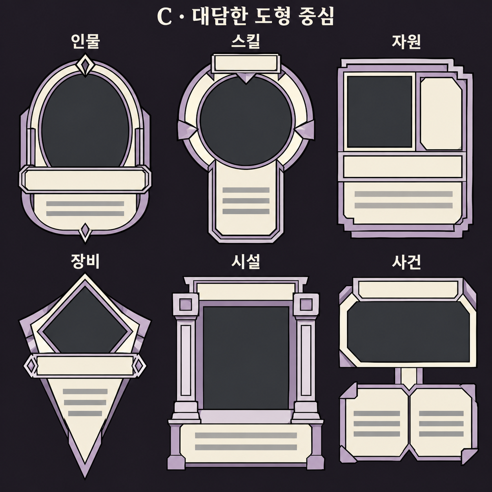

# 원화 없는 역할별 카드 포맷 탐색 v02

2026-10-16 · 내장 image_gen · 사용자 검토용

**최신 선호 변경:** 사용자는 아래 빈 프레임 실험을 돌아본 뒤 [기존 역할별 6종 원화 비교판 v02](world-races-card-formats-v01.md)가 전반적으로 더 마음에 든다고 밝혔다. 해당 비교판의 마름모 스킬 포맷으로 서리 룬을 개별 제작했다. 이 문서의 v03~v06은 탐색 이력으로 보존하며 현재 채택된 최종 포맷으로 취급하지 않는다.

**후속 개별화:** 비교판의 6종 전체를 다시 그린 [개별 카드·다국어 레이아웃 정리](individual-role-cards-layout-v02.md)를 현재 검토 자료로 사용한다. 목재의 중복 먹선·제단의 좁은 글칸·사건의 중앙 문양을 정리하고 이름과 설명의 여백을 확보했다.

사용자는 이전 역할별 카드 시안의 포맷 차이가 충분히 보이지 않는다고 평가했다. 이번에는 원화를 제외하고 해당 영역을 어두운 회색으로 채워, 포맷 자체를 새롭게 비교하도록 요청했다. 이전 ‘최종 비교판 v02’는 이전 라운드의 산출물로 보존하며 채택된 최종 포맷으로 취급하지 않는다.

## 비교 범위

각 시트는 인물·스킬·자원·장비·시설·사건 6종을 같은 순서로 배치한다. 위쪽은 인물/스킬/자원, 아래쪽은 장비/시설/사건이다. 원화 영역에는 인물·물건·배경을 그리지 않고 어두운 회색만 넣는다. 이름란은 비우고, 설명란은 회색 가로선으로 대체한다. 종족 장식·문장·카드 효과·능력 수치는 이번 비교에서 제외한다.

| 시안 | 주된 차이 | 비교 목적 |
| --- | --- | --- |
| A · 실루엣 중심 | 아치형 인물, 마름모 스킬, 적층 자원, 방패형 장비, 지붕·기단 시설, 갈라진 두루마리 사건 | 바깥 윤곽과 큰 창 형태로 역할을 구분 |
| B · 지면 구성 중심 | 원형 초상, 세로 분할 스킬, 아래쪽 원화 자원, 세로 장비 창, 상단 가로 창 시설, 두 칸 설명 사건 | 원화·이름·설명의 위치와 면적 비율로 역할을 구분 |
| C · 대담한 도형 중심 | 장식을 덜고 큰 도형·단차·분리된 블록으로 변형 | 축소된 손패에서도 큰 구조가 구분되는 방향 탐색 |

세 시안은 동일한 디자인을 조금씩 장식한 변형이 아니라, 서로 다른 설계 방향을 비교하는 원화다. 후속 피드백에서 사용자는 **A를 전반적으로 선호하지만 너무 진보적이므로 조금 더 보수적으로 접근**하도록 요청했다. A를 발전시킬 방향으로 정하고 아래 수정안을 제작했다. 수정안의 최종 채택은 아직 전이다.

## 최신 수정 · 먹선이 원화창을 형성하는 v06

사용자는 검은 웨이브가 카드의 핵심 디자인 요소임을 강조했다. 기존 선의 위치를 고정한 상태에서 새로운 원화창을 끼우는 방식 대신, **먹선의 위치·두께·방향·연결을 변형해 원화 영역의 경계 자체를 형성**하도록 요청했다.

인물에서는 먹선이 아치의 어깨와 옆면을 따라 부풀고 가늘어지며 위·아래 크림 패널의 경계로 이어진다. 사건에서는 먹선의 흐름을 가로로 넓은 창의 위·아래와 모서리에 맞춰 재구성했다. 별도로 둘러친 얇은 테두리와 독립된 장식을 줄이고 하나의 굵기 변화가 있는 먹선 구조로 연결한다. 원화가 들어갈 안쪽 면과 바깥쪽 웨이브의 흐름을 함께 설계하는 것이 후속 카드의 기준이다.

원화창은 회색이고 텍스트는 비어 있다. 두 PNG는 각각 1024×1536으로 비율을 확인했다. [실제 생성 프롬프트](prompts/cards/integrated-wave-apertures-v06-prompts.md) · [해상도·해시·복사 일치·검수 기록](../art/concepts/cards/roles-integrated-v06/manifest.json). 사용자 검토 전 시안으로 보존하며 게임에는 적용하지 않았다.

## 이전 비율 수정 · 각 카드 1024×1536 v05

사용자는 v04 비교판의 카드가 위아래로 찌그러져 보인다고 지적했다. 비교판 안 카드가 기존 2:3보다 넓고 낮게 표현되어, 이번에는 두 카드를 각각 별도의 1024×1536 이미지로 다시 생성했다. 기존 카드의 긴 비율·S자 먹선·상단 이름과 하단 설명 패널을 유지한다. 파일 치수와 2:3 비율은 실제 PNG에서 확인했다.

[실제 프롬프트](prompts/cards/original-s-ink-ratio-v05-prompts.md) · [치수·비율·해시 검사](../art/concepts/cards/roles-original-v05/manifest.json). 원화 영역은 어두운 회색이며 이름·설명은 비워뒀다. 아직 사용자 검토용이고 게임 에셋은 교체하지 않았다.

## 이전 접목안 · 기존 S자 포맷 + 원화창 모양 v04

사용자는 v03의 **인물과 사건의 일러스트 영역 모양**을 선호하고, 그 모양만 **기존 실사용 카드 디자인**에 적용하도록 요청했다. v03의 프레임·금속 장식·패널 배치를 기본으로 삼지 않는다.

기본 디자인은 실사용 채집가·숙박 초대장 카드다. 보라색 바탕, 굵은 검은 비대칭 S자 곡선, 위쪽 크림색 이름 패널과 아래쪽 크림색 설명 패널을 유지했다. 왼쪽 인물은 둥근 아치 상단·곧은 옆면·평평한 하단의 창, 오른쪽 사건은 가로로 넓은 직사각 창을 접목했다. 두 원화 영역은 계속 어두운 회색으로 비웠다. 사건 설명란은 기존처럼 하나의 크림 패널이며 v03의 두 칸 설명 구성을 가져오지 않았다.

이번 비교판은 두 형태의 접목 시안이며 아직 최종 승인이나 게임 적용을 뜻하지 않는다. [실제 프롬프트와 참고 이미지 역할](prompts/cards/original-s-ink-window-hybrid-v04-prompt.md), [해상도·해시·복사 일치·검수 기록](../art/concepts/cards/roles-original-v04/manifest.json)을 보존한다.

## 후속 A 수정안 · 절제된 실루엣 v03

같은 보라색·크림색·검은 윤곽을 유지하고 외곽을 익숙한 세로 직사각형 카드에 가깝게 모았다. 인물의 큰 돌출 곡선, 스킬의 독립 마름모와 잘록한 연결부, 장비의 긴 뾰족한 하단, 시설의 넓은 기단, 사건의 깊게 갈라진 두루마리 꼬리를 줄였다. 내부에서는 인물의 아치·스킬의 사선 모서리·자원의 작은 수량 칸·장비의 얕은 방패형·시설의 낮은 지붕과 기둥·사건의 작은 말림과 분할 설명란으로 차이를 남긴다.

원화 창은 여전히 어두운 회색이며 이름란은 비우고 설명란은 회색 선으로 대체했다. 카드 규칙·게임 에셋은 변경하지 않는다. [실제 수정 프롬프트](prompts/cards/empty-role-formats-a-refined-v03-prompt.md)와 [해상도·SHA-256·복사 일치·검수 기록](../art/concepts/cards/roles-empty-v02/A-conservative-v03.json)을 보존한다.

## 생성과 보존

### A · 실루엣 중심

### B · 지면 구성 중심

### C · 대담한 도형 중심

기존 원화는 입력 이미지로 사용하지 않고 세 시트를 새로 생성한다. 기존 게임 에셋·카탈로그·실제 카드 외곽과 판정은 수정하지 않는다. PNG는 평면 비교용 배경을 포함하며, 투명 프레임과 게임용 슬라이스·마스크는 별도 작업이다.

[실제 생성 프롬프트](prompts/cards/empty-role-formats-v02-prompts.md)

세 PNG는 각각 1254×1254이며 원본 그대로 프로젝트에 복사했다. [해상도·SHA-256·복사 일치·검수 기록](../art/concepts/cards/roles-empty-v02/manifest.json)을 보존한다. 총 18개 포맷의 원화가 비어 있는지와 역할의 수·순서, 제목·설명 구획의 차이를 직접 확인했다.

검수는 역할 6종의 수와 순서, 원화가 없는 회색 창, 서로 다른 외곽·구획·텍스트 위치를 직접 확인한다. 실제 손패 크기에서의 가독성·클릭 영역과 카드 겹침은 후속 검증 사항이다.
