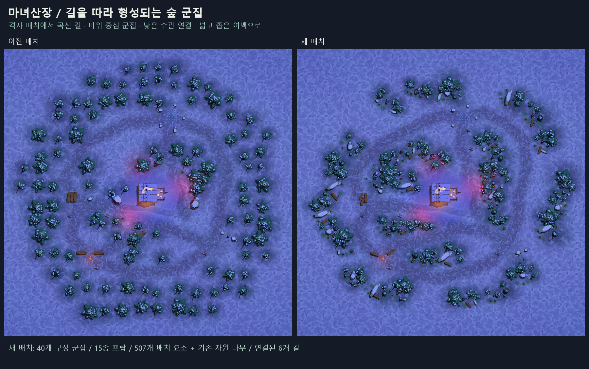
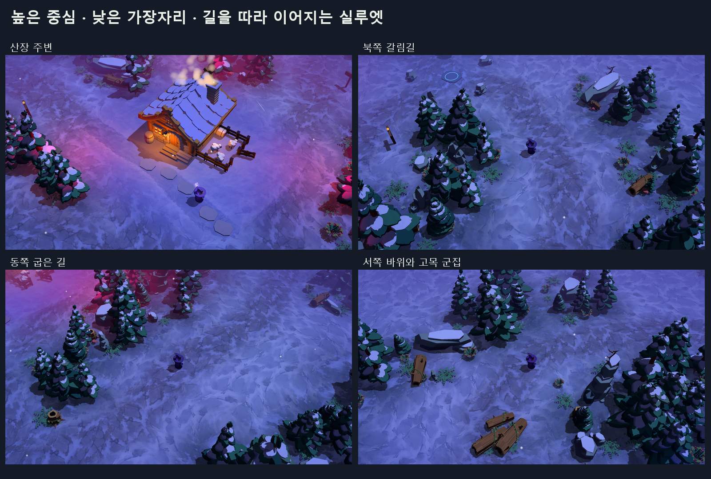
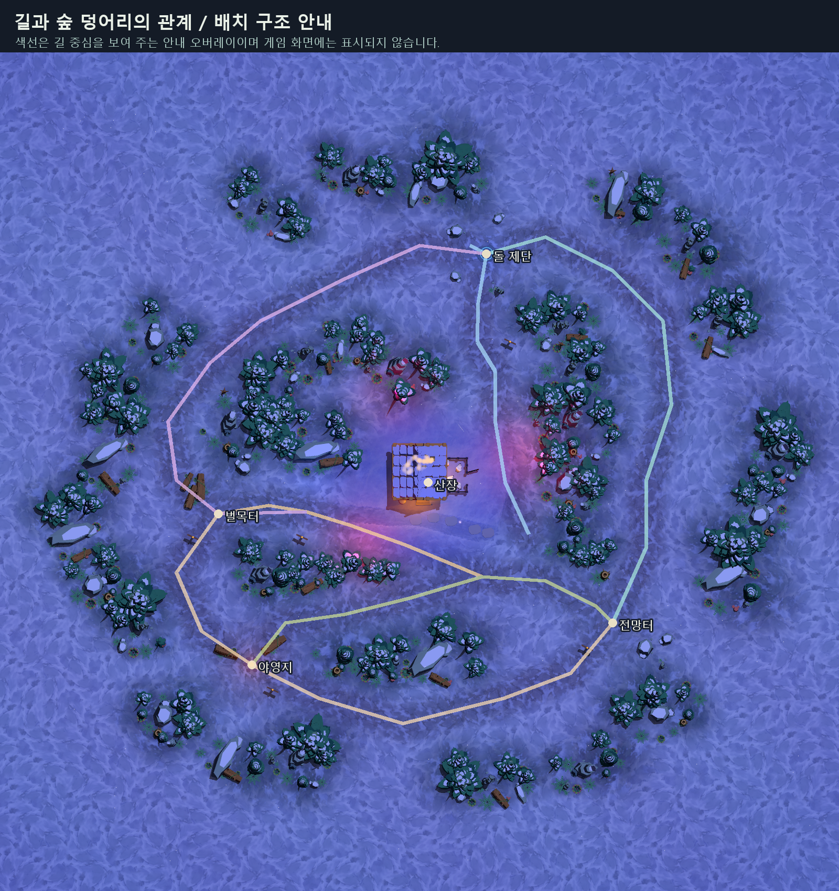

# 길을 따라 형성되는 배경 숲 군집

2026-10-14. 사용자 레퍼런스의 **길이 만드는 숲 덩어리, 바위와 높은 나무의 중심,
낮은 식생으로 풀리는 가장자리**를 따라 맵 전체 프랍을 재배치했다.
등간격 격자 숲을 제거하고, 연결된 6개 길과 크기가 다른 불규칙한 숲 덩어리를 구성했다.

## 구도와 리듬

- 산장과 네 공터를 잇는 길을 42개 구간으로 정리했다. 큰 루프, 굽은 길과 갈림길이
  숲을 여러 영역으로 나누며, 산장 앞 마당과 공터는 열린 공간으로 남긴다.
- **40개 구성 군집**을 초승달·길쭉한 능선·쐐기 형태로 설계했다.
  낮은 연결 군집은 이웃한 중심 군집을 이어 더 큰 숲의 실루엣을 만든다.
  각 군집이 동일한 둥근 덩어리로 흩어지는 구성을 피했다.
- 높은 나무와 큰 바위는 중심, 중간 크기 나무는 받침, 어린 나무와 관목·고사리·버섯은
  가장자리에 둔다. 시선이 높은 봉우리 → 낮은 연결부 → 다음 봉우리로 흐르게 한다.
- 바위의 크기를 먼저 확보한 뒤 나무를 배치해 바위가 수관 사이에서 읽히게 했다.
  길을 향하는 낮은 바위·고목·식생을 뒤의 높은 수관과 겹쳐 사용한다.
- 15종 프랍을 사용한다. 나무 150개, 바위 58개, 하층 식생/고목 등 299개로
  총 507개 요소가 명시적으로 배치되며, 기존 벌목 나무 3개도 인접 군집에 연결된다.
  나무 높이는 약 2~8m로 나누고, 회전·작은 기울기·폭과 높이 비율을 조절했다.
- 산장 앞과 공터의 넓은 여백, 굽은 길의 좁은 프레임, 큰 숲 덩어리 사이의 시야 창을
  교대로 배치한다. 벌목터의 통나무와 전망터 바위도 일렬 배치에서 비대칭 묶음으로 바꿨다.

## 편집 위치

`godot/assets/environment/forest_layout.json`이 배치 원본이다.
각 군집의 이름, 중심, 형태, 프랍 ID, 좌표, 회전, 크기, 역할을 명시한다.
`godot/art_sources/build_forest_layout.py`에는 큰 군집과 낮은 연결부의 설계값이 있다.
지금의 결과는 매 실행마다 흩뿌리는 방식이 아니라 고정된 배치 데이터로 재현된다.

`scripts/world/forest_composition.gd`가 프리팹을 연결하며, 트리·바위 충돌은 기존 World의
내비게이션 영역에 속한다. `layout.gd`의 길과 `exploration.gd`의 랜드마크 구도를 함께 적용한다.
기존 산장·목장·적 출현 위치와 세 벌목 나무 좌표, 보상·진행 규칙은 유지한다.

프랍을 옮긴 후 `tools/review_painted_ground.gd`로 새 위치를 추출하고
`art_sources/build_ground_masks.py`를 실행하면 이끼·서리·바위 접촉면도 새 배치에 맞춰진다.
이번 배치에서는 실제 프랍 524개를 기준으로 지면 혼합 마스크를 갱신했다.

## 검증

`tools/verify_forest_composition.gd`로 다음을 검사한다.

- 배치 데이터와 실제 런타임의 군집/프랍 수 일치, 종류와 높이 차이, 군집의 이차 식생층.
- 길 중심에서 나무/바위 충돌면까지 최소 3.6m 여유, 적 출현점에서 산장까지 경로 연결.
- 기존 벌목 나무 3개 좌표 유지.
- 실제 캐릭터가 네 공터와 산장에 차례로 걸어 도착하는 5회 이동.
- 소스와 내보낸 PCK에 같은 배치가 포함되는지 동일 검증.

맵 전체, 산장, 네 공터, 네 굽은 길을 실제 플레이 렌즈로 렌더해 군집과 열린 길을 확인했다.
`output/forest-composition/verification.json`, `pack-verification.json`에 검사 결과를 남긴다.
`after-map.png`는 오버레이 없는 실제 화면이다. `route-guide.png`는 구조 설명용 색선만 더한 안내다.

검증된 실행 데이터는 `build/WitchsLodge.pck`에 반영하고,
이전 데이터는 `build/WitchsLodge-before-forest-composition.pck`에 보존한다.
게임을 다시 실행하면 새 배치가 보인다.
