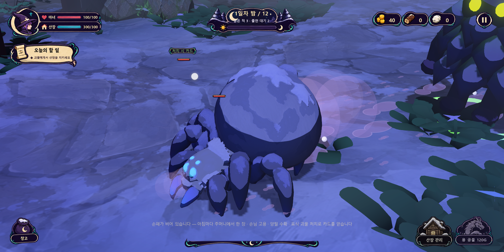
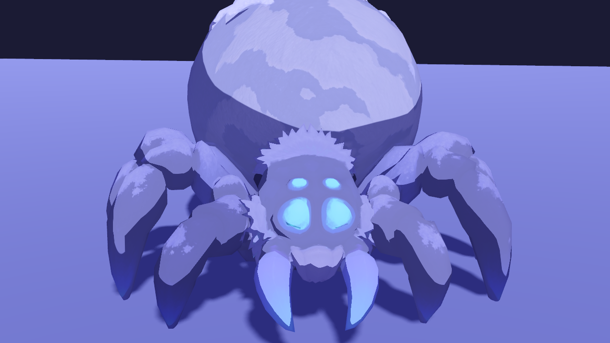
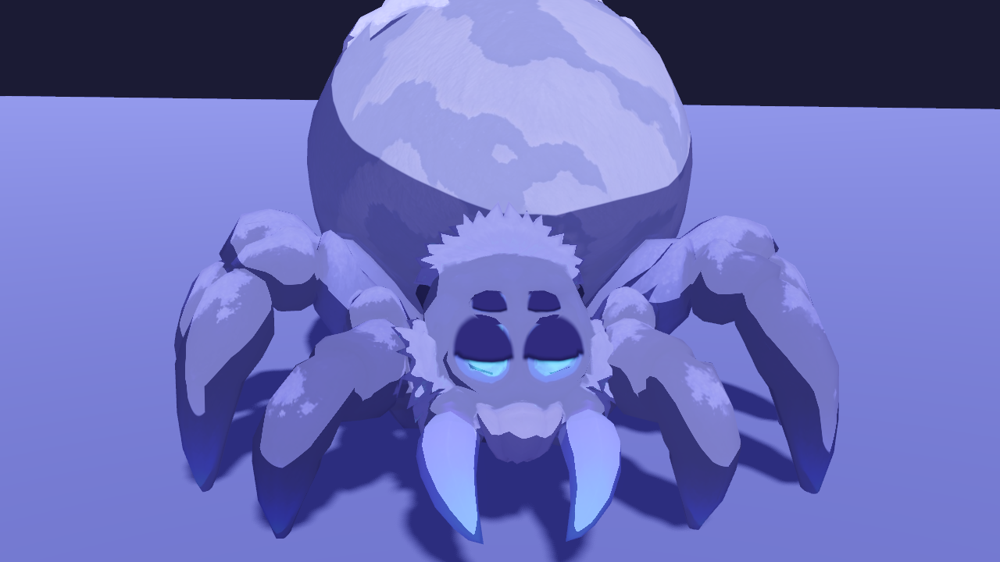
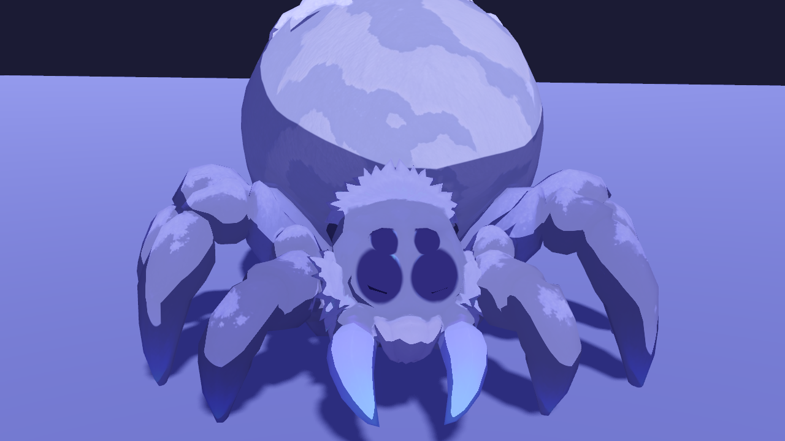
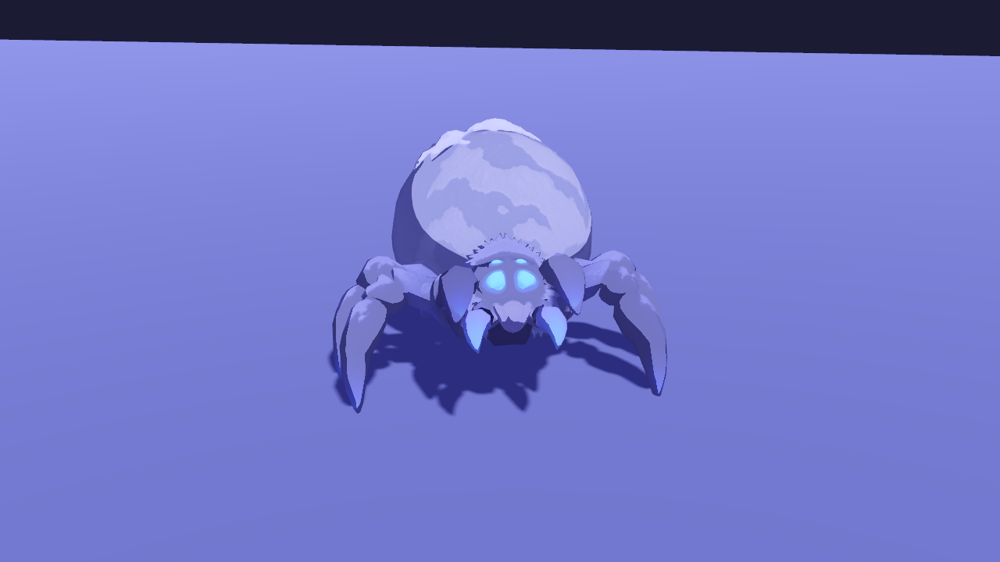
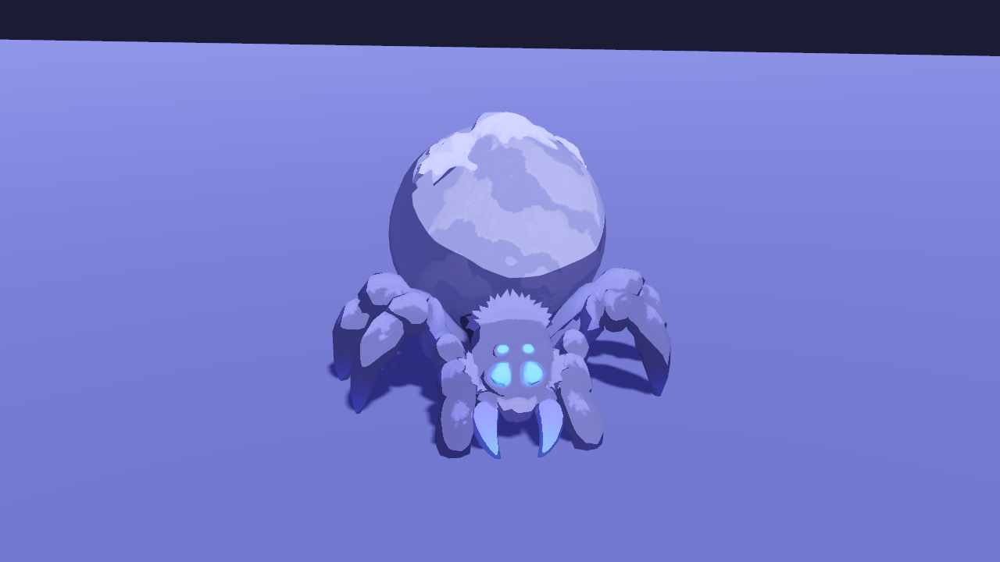
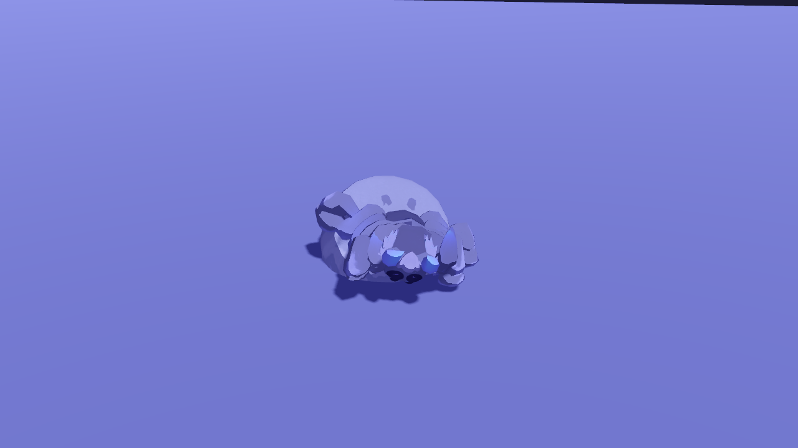

# 서리 거미 — 기본 몬스터 적용(2026-10-17)

사용자가 모델링한 `frozen+spider+3d+model.glb`(Tripo, 부품 19개·뼈 없음)를 게임의 **기본 적**으로 넣었다. 원화·모델링 참고는 [winter-forest-spider-v01](../art/concepts/monsters/winter-forest-spider-v01/generation.md), [모델링 참고 v01](../art/concepts/monsters/winter-forest-spider-model-reference-v01/generation.md).

## 게임 규칙

| 항목 | 내용 |
| --- | --- |
| 적 종류 | `spider` "서리 거미" (`config.gd` `ENEMY_KINDS`). 체력 배율·공격력·간격·사거리는 기존 숲의 괴물과 같다. |
| 등장 | 밤 구성에서 종류를 생략한 그룹은 모두 서리 거미(`chapter_data.gd` `group_kind`). 보스의 부름도 서리 거미를 불러낸다. |
| 표식 개체 | 기본 적 자리의 표식 개체는 여전히 **큰 숲의 괴물**로 나와 숲의 괴물 카드를 준다(`wave_director.gd`). |
| 양 노리기 | 서리 거미도 양 목표를 따른다. |
| 이동 | 0.9~1.6초 내달리고 0.18~0.32초 얼어붙는 '달리다 멈칫'. 달리는 구간을 빠르게 해 평균 속도는 1.7 그대로(`monster.gd` `_scuttle`). |
| 숲의 괴물 | 침식된 자·맹독 곤충·공성 괴물·보스·하수인·시연 스크립트가 만드는 기본 개체는 기존 모델 그대로. |

## 시각 모델 `scripts/visual/spider_visual.gd`

- **자동 리깅:** 다리 부품마다 UV 이음매를 합쳐 표면 그래프를 만들고 엉덩이에서 측지 거리로 중심선을 뽑는다. 현에서 가장 위로 솟은 점을 무릎으로, 앞다리처럼 곧은 다리는 중간에 무릎을 두고 관절 4개(밑마디·넓적마디·종아리·발끝마디)에 가중치를 나눠 스키닝한다. 스킨·메시는 정적 캐시로 모든 개체가 공유한다.
- **다리 8개:** 모델은 다리가 6개라 원화 기준(4쌍)에 맞춰 3번 다리를 엉덩이 기준 52° 뒤로 돌린 복제로 뒷다리 한 쌍을 만들었다. 바깥 다리 발끝이 원점보다 7cm 떠 있어 몸 전체를 5.5cm 내려 8발이 땅을 딛는다.
- **IK:** 엉덩이 요 회전 + 무릎이 위로 꺾이는 2관절 해석 IK. 휴식 자세의 무릎 방향을 저장해 서 있을 때 모델 원형을 그대로 재현한다. 착지점은 다리가 닿는 원 안으로 당긴다.
- **보행:** 교대 4족 보행(L1·R2·L3·R4 ↔ R1·L2·R3·L4)을 위상으로 돌린다. 공중 비율 0.36, 같은 무리 안에서는 뒷다리→앞다리로 0.04씩 늦게 뜨는 물결. 디딘 발은 월드에 고정되고 착지점은 '착지 때의 자세 + 디딤 시간 절반만큼 앞'이라 발이 몸 밑을 고르게 지나간다. 멈추면 어긋난 발만 이웃과 겹치지 않게 하나씩 고쳐 딛는다. 발자국은 실제 착지점에 찍힌다.
- **2차 움직임:** 공중 다리 수에 따른 몸 출렁임과 착지 튐, 가속 방향 기울기·회전 시 기울기, 배의 스프링 지연(가속·회전에 늦게 따라옴)과 숨쉬기, 머리의 짧게 끊기는 시선 이동, 송곳니 씹기, 앞다리로 땅 두드리기.
- **공격:** 앞다리를 들고 몸을 세웠다가(송곳니 벌림) 내리찍으며 송곳니를 닫는다. **피격:** 몸이 뒤로 움찔하고 배가 출렁, 두 발을 고쳐 딛는다. **죽음:** 살짝 튀어 옆으로 뒤집히며 다리를 오므리고(0.62초) 그 뒤 기존 사라짐 효과.
- **눈 깜빡임:** `shaders/spider_eyes.gdshader`. 텍스처에 그려진 청록 눈 4개(정면 실측 타원) 위로 눈꺼풀이 위→아래로 덮인다. 2~5.5초 간격, 22%는 두 번 연달아, 14%는 위 눈→아래 눈 물결. 뜬 눈은 약하게 빛난다(밤 가독성).
- **재질:** 기존 `painted_prop` 셰이더. 화면 스타일이 텍스처를 45%만 남기므로 바탕색을 부품 텍스처의 평균색(정점 UV 표본)으로 두고 밝은 부품은 자기 밝기만큼 흰색 쪽으로 올렸다 — 짙은 남색 다리·흰 배가 툰 화면에서도 남는다.

## 검증

- 헤드리스 `tools/verify_spider.gd` **22/22**: GLB·다리 8·뼈 32·부품 연결, 스킨 가중치, 관절 추출, 정지 자세 IK 오차 0, 5초 걷기·원 돌기(디딘 발 미끄럼 0, 발끝 오차 <3cm, 두 무리 동시 공중 <10%, 다리 늘어남 없음), 정지 후 정리, 15초 깜빡임, 공격·피격·죽음, 달리다 멈칫 평균 0.995, 기본 적 데이터, 실제 게임 1일차 밤(서리 거미 4 + 표식 큰 숲의 괴물 1)·이동·처치 후 제거.
- `tools/verify_chapter.gd`의 5일차 구성·표식 순번 검사를 서리 거미 기준으로 갱신(두 항목 통과).
- 실제 렌더 캡처(헤드리스 더미 렌더러로 확인 불가한 눈 셰이더 컴파일·눈꺼풀 모양·스키닝·움직임·게임 조명 색): `tools/capture_spider.gd` → `godot/screenshots/spider/spider_showcase.avi`(10초 영상)와 정지 화면, `tools/capture_spider_ingame.gd` → `ingame-*.png`.
- 부품·눈 위치 산출 도구: `tools/inspect_spider_parts.gd`(부품 색 구분 렌더), `tools/inspect_spider_eyes.gd`(눈 정점).

| 눈 뜸 | 반쯤 | 감음 |
| --- | --- | --- |
|  |  |  |

| 공격 준비 | 내리찍기 | 죽음 |
| --- | --- | --- |
|  |  |  |

## 남은 것

- 거미 전용 효과음(발걸음 사각거림·쉭 소리)은 없다. 지금은 기존 몬스터 소리를 쓴다.
- 서리 거미 카드·원화 카드는 만들지 않았다(표식 개체 보상은 숲의 괴물 카드 그대로).
- 수치는 숲의 괴물과 같다. 거미답게 더 빠르고 약하게 할지는 플레이테스트 후 정한다.
