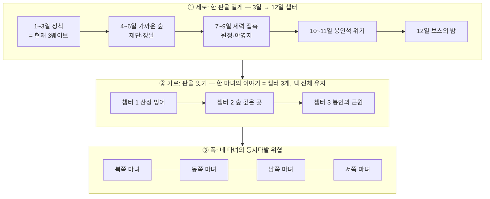

# 마녀산장 — 게임 볼륨 확장 계획 v0.2

2026-10-17 · 기획 제안(미구현) · Claude · v0.2: 사용자 결정 8건 반영(§9)

> **v0.2 결정 요약**
> - **이야기의 뼈대**: 고대 존재의 봉인이 무너졌다. 네 마녀는 봉인석을 하나씩 나눠 갖고 있다. 고대 존재가 힘을 완전히 되찾으려면 봉인석 네 개가 모두 필요하다. 그래서 고대 존재는 세상의 괴물들을 보내 네 마녀를 **동시에** 공격한다. 플레이어는 네 마녀를 차례로 플레이하며, 각자가 그 위협을 어떻게 헤쳐 나갔는지 직접 겪는다.
> - **한 판**: 12일 이상의 장기 챕터.
> - **판과 판 사이**: 덱(주머니·유물) 전체를 유지한다. 한 마녀의 이야기 안에서 챕터와 챕터 사이를 말한다.
> - **계절 캠페인 없음**: 계절은 챕터를 잇는 축이 아니다. 계절은 마녀·지역의 배경이나 변주로만 쓴다.
> - **마녀별 카드 구분 보류**: 당분간 공용 시작 덱 하나를 쓴다. 이야기상의 네 마녀는 확정이다.
> - **침식 카드**: 도입한다.
> - **새벽 보상과 장날 상점**: 둘 다 도입한다.
> - **1차 마일스톤**: E0~E3.
>
> 아래 본문은 v0.1 제안을 바탕으로 결정 사항에 맞게 고쳤다. §5는 계절 캠페인 대신 **마녀 이야기 구조**로 바꿨다.

## 0. 이 문서의 위치

- 현재 실행판은 낮 90초 → 밤 웨이브를 3번 반복하면 끝난다(`Cfg.WAVES` 3개, "시연 완료"). 한 판은 약 8~10분이다.
- 이 문서는 그 3일을 **게임 전체의 첫 장(프롤로그)**으로 두고, 그 위에 쌓을 구조를 제안한다.
- 지금 있는 카드·시스템에 국한하지 않고, 기획·내러티브 문서에 이미 적힌 확장 후보를 모아 하나의 진행 구조로 엮었다.
- 근거 문서:
  - [narrative.md](narrative.md)
  - [narrative-forest-occult-ideas.md](narrative-forest-occult-ideas.md)
  - [world-races-card-formats-v01.md](world-races-card-formats-v01.md)
  - [region-season-pocket-design.md](region-season-pocket-design.md)
  - [region-season-pocket-priorities.md](region-season-pocket-priorities.md)
  - [map-boss-trophy-cards-design.md](map-boss-trophy-cards-design.md)
  - [mercenary-jobs-design.md](mercenary-jobs-design.md)
  - [kingdom-integration-design.md](kingdom-integration-design.md) (카드 코어 v0.3)
  - [toxic-regions.md](toxic-regions.md)
  - [guest-roster.md](guest-roster.md)
- 모든 수치는 시험값이다. 확정한 결정과 남은 결정은 §9에 모았다.

---

## 1. 핵심 관찰: 지금의 3일은 이미 "북쪽 마녀 · 숲 · 겨울"이다

기획 문서의 시작 선택은 **마녀 → 지역 → 계절 → 시작 드로우**다. 현재 실행판을 이 틀에 대 보면 이미 한 칸에 해당한다.

| 선택 축 | 현재 실행판 | 근거 |
| --- | --- | --- |
| 마녀 | 서리 룬·수호 등불이 시작 카드 → **북쪽(서리·보호·봉인)** | `STARTER_CARDS`, 네 마녀 성향표 |
| 지역 | 숲(나무 141그루, 맹독 서식지, 숲의 괴물) | `layout.gd`, `hazard_sites.gd` |
| 계절 | 보랏빛 설경 → **겨울** | `narrative.md` §2 |

그래서 볼륨 확장은 새 게임을 만드는 일이 아니다. **이 한 칸을 세 방향으로 늘리는 일**이다.

이 표는 관찰일 뿐이다. v0.2에서 마녀별 카드 구분은 보류했고, 계절도 캠페인 축으로 쓰지 않는다.

### 볼륨 목표치 (추정)

| 단위 | 길이 | 비고 |
| --- | --- | --- |
| 현재 | 3일, 약 8~10분 | 챕터 1의 1~3일로 흡수 |
| 챕터 | 12일, 약 40~50분 | 1차 목표 |
| 한 마녀의 이야기 = 챕터 3개 | 약 2~2.5시간 | 2차 목표 |
| 전체 = 4 마녀 + 최종장 | 약 9~11시간 + 반복 플레이 | 장기 목표 |

---

## 2. ① 세로 확장: 12일 챕터

[narrative-forest-occult-ideas.md](narrative-forest-occult-ideas.md)의 4단계(정착 → 가까운 숲 → 세력 접촉 → 깊은 비밀)를 하루 단위로 펼친다. 지금의 3웨이브는 그대로 1막이 된다.

### 2.0 챕터의 중심 목표: 봉인석

- 산장 안에 마녀의 **봉인석**이 있다. 괴물들이 산장을 노리는 이유가 바로 이 봉인석이다. 내러티브 문서의 열린 질문 "산장이 표적이 되는 이유"에 대한 답이 된다.
- 기존 패배 조건 "산장 파괴"는 "봉인석 탈취"로 서사를 바꿔 입힌다. 규칙은 그대로다.
- 챕터 후반에는 봉인석을 노리는 특수 적과 의식이 늘어난다.
- 봉인석이 약해지거나 균열이 나는 연출로 챕터의 긴장을 만든다.
- 마녀의 의식·권능은 봉인석에서 나오는 힘이라는 해석으로 연결할 수 있다(제단 ↔ 봉인석, 미정).

### 2.1 하루 일정표 (챕터 1 · 숲 기준, 12일)

v0.1의 10일안에 **10~11일차 "봉인석 위기"**를 끼워 넣어 12일로 늘렸다.

| 일 | 막 | 낮(준비)의 새 할 거리 | 밤의 종류 | 남기는 떡밥 |
| --- | --- | --- | --- | --- |
| 1 | 정착 | 현재와 같음(숙박·고용·양) | 일반 습격 | 괴물 몸의 이상한 문양 |
| 2 | 정착 | 아침 드로우 시작 | 일반 습격 | 손님 이야기 1차 |
| 3 | 정착 | 현재와 같음 | **큰 습격**(현재 웨이브 3) | 문양이 제단과 같다 |
| 4 | 가까운 숲 | 달빛 돌 제단 복구(목재) → **제단 해금** | 고요한 밤(적 적음) + 손님 사건 | 폐허의 같은 문양 |
| 5 | 가까운 숲 | 첫 의식, 폐허 조사 | **의식 방어의 밤** | 침식된 자의 첫 등장 |
| 6 | 가까운 숲 | **장날**(세라의 행상) | 안개의 밤 | 장부·익숙한 손님 사건 |
| 7 | 세력 접촉 | 전진 등불 설치 → 활동 반경 확장 | 일반 + 침식된 자 | 야영지 위치 발견 |
| 8 | 세력 접촉 | **원정**: 야영지 습격 또는 식물 군락 돌파 | 원정 후 역습 | 신상의 문양 |
| 9 | 세력 접촉 | 사건 카드 발동 | **포위의 밤**(공성 개체) | 고대 존재의 예고 |
| 10 | 봉인석 위기 | 봉인석 균열 → 수리 의식(공물 경쟁) | 봉인석 탈취의 밤(봉인석만 노리는 적) | 다른 마녀들도 공격받고 있다는 소식 |
| 11 | 봉인석 위기 | 원정: 보스 은신처 정화, 마지막 장날 | 고요한 밤 + 손님 결산 사건 | 보스의 정체 |
| 12 | 보스의 밤 | 마지막 준비, 의식 비축 | **보스의 밤** → 전리품 카드 | 다음 챕터로 가는 단서 |

### 2.2 페이싱 원칙

- **3일마다 한 번 새 시스템을 연다.** 4일차 제단, 6일차 상점, 7일차 반경 확장 순이다. 한 번에 다 주지 않는다.
- **밤의 강도는 파도처럼 오르내린다.** 큰 습격(3) → 고요(4) → 의식(5) → 안개(6) → … → 봉인석 탈취(10) → 고요(11) → 보스(12). 매일 더 세지기만 하면 밤 배치가 고정된 반복으로 굳는다는 v0.1 검토 지적([kingdom-design-review.md](kingdom-design-review.md) 7번)을 피한다.
- **고요한 밤**은 손님 이야기와 장부 같은 내러티브 사건을 보여 주는 숨 고르기 칸이다.

### 2.3 밤의 종류 (웨이브에 "규칙"을 붙인다)

현재 웨이브는 적 수와 HP만 바뀐다. 웨이브마다 하나의 규칙을 붙이면 같은 적으로도 다른 밤이 된다.

| 밤 | 규칙 | 살아나는 카드·시스템 |
| --- | --- | --- |
| 일반 습격 | 현재와 같음 | — |
| 큰 습격 | 출현 그룹 수 증가 | 용 공물 |
| 안개의 밤 | 전장의 안개가 짙어지고 적이 안개 속에서 나옴 | 수호 등불(안개 제거)의 가치 상승 |
| 양 도둑의 밤 | 양을 노리는 적 비율이 높음 | 목장 방어, 가시 방책 |
| 의식 방어의 밤 | 제단에서 의식을 진행하면 적이 제단으로 몰림. 버티면 권능 해금 | 제단, 의식 원 |
| 침식 의식의 밤 | 침식된 자들이 맵 위에 의식 원을 세움. 다 차면 다음 그룹 강화 | 마녀가 방어를 비우고 끊으러 갈지 고민 |
| 포위의 밤 | 산장만 노리는 느린 공성 개체 | 방책, 산장 수리, 목재 |
| 고요한 밤 | 적 적음 또는 없음, 손님 사건 발생 | 대화, 장부 |
| 보스의 밤 | 지역 보스 1 + 호위 | 전리품 카드 |
| 계절 날씨 밤 | 폭우(여름: 이동 느림), 첫서리(가을: 적·아군 감속) 등 | 계절 카드 |

### 2.4 적 로스터 확장 (적 1종 → 역할별 6~8종)

같은 숲의 괴물에서 HP만 올리지 않는다. 적마다 **역할**을 하나씩 준다. 문서에 이미 있는 적 소재를 우선 쓴다.

| 적 | 역할 | 출처 | 처치 시 카드(표식 개체만) |
| --- | --- | --- | --- |
| 숲의 괴물 | 기본 근접 | 구현됨 | 숲의 괴물(하수인) |
| 큰 숲의 괴물 | 탱커 | 구현됨(`make_big`) | — |
| 침식된 자 · 신도 | 원거리 저주, 의식 원 설치 | 오컬트 문서 | 침식된 기도문(아래 §4.3) |
| 침식된 자 · 사제 | 주변 적 강화(버프 오라) | 오컬트 문서 | 검은 촛불 |
| 맹독 곤충 · 보행 / 비행 | 빠른 돌격, 비행으로 방책 무시 | 구현됨(서식지 적) → 웨이브 편입 | 독날개 하수인 |
| 무서운 식물 · 덩굴 | 이동하지 않고 퍼짐, 길을 막음 | 오컬트 문서 | 맹독 식물 씨앗 |
| 양 도둑(여우 계열) | 양만 노리고 도망 | 신규(계절 문서의 "불씨를 훔친 여우") | — |
| 공성 괴물 | 느림, 산장 피해 큼 | 신규 | — |
| 망령 | 무덤에서 일어남(서쪽 마녀 지역) | 의식 "망자의 부름" 반대편 | 망령 하수인 |

### 2.5 지역 보스와 전리품 카드

[map-boss-trophy-cards-design.md](map-boss-trophy-cards-design.md)의 "공략하면 그 능력이 담긴 카드"를 챕터의 12일차에 둔다. 보스는 모두 고대 존재가 보낸 괴물이다.

| 챕터(북쪽 마녀 · 숲 예) | 보스 | 전리품 카드(예) |
| --- | --- | --- |
| 챕터 1 산장 방어 | **빈 굴의 주인**(고대 존재에게 깨워진 거대 짐승) | 겨울잠 털가죽: 한 밤 동안 산장 피해 절반 |
| 챕터 2 숲 깊은 곳 | **맹독 식인 식물 여왕** 또는 **알을 품은 고목** | 맹독 식물 씨앗(설치형 독 방책) / 고목의 알(2일 뒤 부화하는 수호 하수인) |
| 챕터 2 대안 | **침식된 자 대사제** | 뒤집힌 기도문: 적 의식 원을 아군 것으로 바꿈 |
| 챕터 3 봉인의 근원 | **오래된 신상의 촉수**(고대 존재의 한 조각) | 끝없는 촉수: 쓸 때마다 촉수 카드 1장 생성 |

- 전리품 카드는 기존 규칙대로 손패에 먼저 들어간다.
- 무제한 재사용과 버림패 재순환은 하지 않는다(보스 문서 §제약).
- 다만 v0.2 결정으로 덱 전체가 다음 챕터로 이어지므로, **전리품 카드도 그 마녀의 다음 챕터까지 남는다**. 마녀가 바뀌면 이어지지 않는다(§5).

---

## 3. 낮의 볼륨: 새로 열리는 시스템 5가지

밤만 늘리면 반복이 된다. 낮에 할 일의 **종류**를 늘려야 12일이 버틴다.

### 3.1 마녀의 제단과 의식 (4일차 해금)

[narrative-forest-occult-ideas.md](narrative-forest-occult-ideas.md)의 제단 루프를 그대로 가져온다.

- 루프: 벌목 → 목재로 제단 복구 → 탐험으로 공물 확보 → 의식 → 새 힘.
- 위치: 달빛 돌 제단 랜드마크(8, −26). 이미 맵에 있다.
- 자원 경쟁:
  - 목재: 증축·수리와 경쟁
  - 몬스터 카드: 하수인 소환과 경쟁
  - 양·양털: 판매와 경쟁
- 보상 두 종류:
  - **권능**: 처음 완성하면 그 판 동안 새 카드(스킬)를 얻는다.
  - **밤의 축복**: 다시 바치면 그날 밤 버프만 받는다.

| 의식 | 공물 | 권능(첫 완성) | 밤의 축복(반복) |
| --- | --- | --- | --- |
| 수의의 의식 | 양털 3 | 수의 카드: 아군 1명 치명타 1회 방어 | 그날 밤 아군 전원 1회 방어 |
| 가시의 봉헌 | 몬스터 카드 1 | 가시 속박 카드: 범위 속박 | 가시 방책 공격력 +50% |
| 붉은 만찬 | 양 1마리 | 붉은 잔 카드: 흡혈 | 그날 밤 마녀 흡혈 |
| 저주의 의식 | 검은 털 2 + 큰 괴물 처치 | 불길한 낙인 카드 | 표식 적이 죽으면 주변 피해 |
| 망자의 부름 | 무덤에 공물 | 망령 소환 카드(죽은 용병) | — |

첫 권능이 아군의 죽음을 요구하지 않도록 4일차 의식은 수의의 의식으로 고정한다.

### 3.2 탐험 반경과 원정 (7일차 해금)

- 지금은 반경 38m 맵의 랜드마크 4곳을 채집가만 돈다.
- 확장안:
  - **전진 등불**(시설 카드): 랜드마크에 세우면 그 주변 안개가 걷히고 채집·벌목 범위가 넓어진다.
  - **원정**: 낮에 미사용 전투 계약·하수인 카드를 원정에 배정한다. 산장에 남길 카드와 경쟁한다(v0.3 §13).
  - **원정 목표**:
    - 침식된 자 야영지: 부수면 다음 밤 침식 의식이 사라진다.
    - 식물 군락: 막힌 길을 연다. 잘라낸 덩굴은 제단 공물이 된다.
    - 맹독 서식지 둥지: 둥지 3개를 부수면 서식지가 정화되고 엘린(엘프 손님) 보상 조건이 열린다.
- **정화**를 지역 진행도로 쓴다. 서식지·야영지·군락을 하나씩 정화할 때마다 맵의 오염이 걷히고 보스의 은신처가 드러난다.

### 3.3 장날과 상점 (6일차 해금)

- 지금 골드는 수리·회복·증축·용에만 쓴다. 카드를 사는 곳이 없다.
- **장날**에는 세라(교역상)나 니브(고블린 행상인)가 와서 카드 3~4장을 판다. 골드로 덱을 고르는 선택이 생긴다.
- 장날에는 카드 **팔기**도 받는다. 주머니를 정리하는 수단이다(버림패 회수와는 별개).

### 3.4 새벽 보상 선택

- 큰 밤(3·5·9일차) 뒤 새벽에 카드 3장 중 1장을 고른다(오래된 마법서적 UI 재사용).
- 후보 풀은 그 판의 지역·계절 카드 풀에서 뽑는다. 덱빌딩 로그라이트의 기본 볼륨 장치다.

### 3.5 손님 이야기 회수와 사건 카드

- 현재 7명의 대화는 모두 결론 없는 떡밥이다(브람의 목소리, 오스윈의 문양, 세라의 일곱 번째 병 등).
- **고요한 밤과 사건 날**에 그 떡밥을 회수하는 후속 사건을 붙인다.

| 떡밥 | 회수 사건(예) | 게임 보상 |
| --- | --- | --- |
| 브람: 숲에서 자기 목소리 | "숲에서 들린 자기 목소리": 마녀가 침대를 옮겨 줄지 결정 | 따라가면 랜드마크 하나가 드러남 |
| 오스윈: 달라지는 문양 | 문양 단서 5단계와 연결 | 제단 의식 하나 미리 해금 |
| 세라: 늘어난 유리병 | "분실물 보관실이 열리는 날" | 주인 없는 그림자 카드 |
| 네리: 받는 사람 없는 편지 | "지나치게 잘 아는 손님" | 다음 계절 손님 예고 |
| 미라: 숲을 향하는 약초 | 동쪽 마녀 복선 | 마녀의 새싹 카드 |

- 대화 선택은 지금처럼 보상에 직접 연결하지 않는다. 사건을 **열지 말지**만 바꾼다. 그래야 대화가 정답 찾기가 되지 않는다.
- 사건 카드 4종(금지된 수확제, 가면무도회, 겨울을 빌리러 온 손님, 분실물 보관실)은 계절별 9일차 이벤트로 배치한다.

---

## 4. 카드 확장 로드맵 — 앞으로 생길 카드 계열

현재 카드는 26종이다. 확장할 카드는 **어디서 얻는지**로 계열을 나눈다. 계열이 곧 콘텐츠 제작 단위다.

### 4.1 획득 경로별 카드 계열

| 계열 | 얻는 곳 | 1차(숲 챕터) 목표 | 장기 목표 |
| --- | --- | --- | --- |
| 마녀 고유 | 시작 덱 | 북쪽 마녀 6장(현재) | 마녀당 6장 × 4 |
| 지역 | 채집, 새벽 보상, 상점 | 숲 8장 | 지역당 8장 × 5 |
| 계절 | 아침 드로우 풀, 새벽 보상 | 계절당 4장 × 4 | 같음 |
| 지역 × 계절 조합 | 특정 조합의 사건·보스 | 숲 × 4계절 각 2장 | 조합당 2장 |
| 의식·권능 | 제단 | 5장 | 마녀별 의식 차별화 |
| 하수인 | 표식 적 처치 | 4장 | 지역 적마다 |
| 계약(손님) | 고용 | 4직업 + 종족 손님 3명 | 12종족 |
| 사건 | 사건 날 | 4장 | 계절·지역별 |
| 전리품 | 보스 | 5장 | 보스마다 |
| 유물 | 보물상자 | 5종(현재) + 5 | 마녀·지역별 |
| **침식(부정 카드)** | 적 의식, 저주, 독 | 3장 | 아래 §4.3 |

### 4.2 숲 챕터 1차 신규 카드 후보 (약 35장)

**마녀 고유 — 보류(v0.2 결정)**

당분간 현재 시작 덱 6장을 **공용 시작 덱**으로 쓴다. 아래 표는 나중에 마녀별 카드를 나눌 때 참고할 방향으로만 남긴다.

| 마녀 | 시작 덱의 축 | 카드 예 |
| --- | --- | --- |
| 북쪽(서리·보호·봉인) | 감속·설치·봉인 | 서리 룬, 수호 등불(현재), 얼음 봉인, 서리 여왕의 눈물(유물) |
| 동쪽(생명·약초·성장) | 회복·성장·식물 | 마녀의 새싹, 치유 약초, 가시 씨앗, 알을 품은 고목 |
| 남쪽(불·솥·변환) | 자원 변환·화력 | 끓는 솥(자원 2 → 다른 자원), 불씨, 용의 공물 할인 |
| 서쪽(저주·계약·망령) | 희생·망령·계약 | 저주 낙인, 망자의 부름, 피의 계약(체력으로 카드) |

현재 시작 덱의 가시 씨앗·검은 양은 동쪽·서쪽에 가깝다. 마녀를 나누는 시점에 중립으로 둘지 옮길지 다시 정한다.

**숲 지역 카드**: 숲의 고목, 반딧불이 떼, 덩굴 덫, 이끼 붕대, 버섯 고리(소환진), 여우 길잡이(루카), 송진 횃불, 낙엽 아래 덫.

**계절 카드**(숲 예시, [region-season-pocket-design.md](region-season-pocket-design.md) §안개 숲). 계절 캠페인은 하지 않으므로, 계절 카드는 그 마녀·지역의 배경 계절 풀이나 챕터별 사건 카드 소재로 쓴다.

| 봄 | 여름 | 가을 | 겨울 |
| --- | --- | --- | --- |
| 봄비 | 여름밤 | 첫서리 | 얼어붙은 수액 |
| 마녀의 새싹 | 덩굴 | 도토리 도둑 | 불씨를 훔친 여우 |
| 잠에서 덜 깬 곰 | 반딧불이 떼 | 마지막 독버섯 | 빈 굴의 주인 |
| 알을 품은 고목 | 폭우 | 낙엽 아래 덫 | 겨울 장작 |

**종족 손님 계약**: 고블린 행상인 니브(등장 시 드로우), 엘프 사절 엘린(정화된 곳 채집 보상), 여우 수인 루카(운반 협력). 시안이 이미 있는 세 명부터 넣는다.

### 4.3 새 기믹 키워드

카드 수를 늘리는 것보다 **조합 규칙**을 늘리는 쪽이 볼륨이 크다. 다음 키워드를 단계적으로 연다.

| 키워드 | 규칙 | 처음 쓰는 카드 |
| --- | --- | --- |
| 종족 조건 | 대상이 특정 종족이면 추가 효과 | 따뜻한 환대(고블린), 숲길의 약속(엘프) |
| 봉헌 | 카드·양·자원을 바쳐 효과 | 제단 의식, 검은 털(이미 있음) |
| 성장 | N일 뒤 다른 카드나 개체로 바뀜 | 새끼양(이미 있음), 고목의 알, 씨앗류 |
| 계절 변화(후순위) | 배경 계절에 따라 효과가 달라짐 | 마녀의 새싹(봄 강화, 겨울 약화) |
| 정화 | 오염 지역·침식 카드를 지움 | 이끼 붕대, 엘린 |
| **침식** | 적이 내 주머니에 쓸모없는 카드를 넣음. 손패를 막고 정화해야 사라짐 | 침식된 기도문, 독 포자, 저주의 속삭임 |
| 생성 | 카드를 쓰면 다른 카드가 생김 | 끝없는 촉수 |
| 소환진 | 설치한 자리에서만 다른 카드를 쓸 수 있음 | 버섯 고리 |

**침식 카드**가 특히 중요하다. 지금 주머니 규칙(버림패 비순환, 손패 8장)은 "손패가 막히면 손해"인 구조라, 적이 내 덱을 오염시키는 압박이 자연스럽게 생긴다. 침식된 자의 세력감도 전투 밖에서 느껴진다.

---

## 5. ② 가로 확장: 한 마녀의 이야기 — 챕터 3개, 덱 전체 유지

v0.2 결정: 계절 캠페인은 하지 않는다. 판과 판 사이에는 덱 전체를 유지한다. 그래서 "판을 잇는 축"을 계절이 아니라 **한 마녀가 위협을 헤쳐 나가는 이야기의 막**으로 잡는다.

### 5.1 한 마녀 = 챕터 3개

[narrative-forest-occult-ideas.md](narrative-forest-occult-ideas.md)의 "초반 방어 → 이후 탐험, 킹덤처럼 반경 확장" 방향을 챕터 단위로 나눈다.

| 챕터 | 무대 | 중심 | 보스(북쪽 마녀 · 숲 예) |
| --- | --- | --- | --- |
| 1. 산장 방어 | 산장과 공터(현재 맵) | 정착, 봉인석을 노리는 첫 습격, 제단 | 빈 굴의 주인 |
| 2. 숲 깊은 곳 | 바깥 고리 확장(새 랜드마크·서식지) | 원정, 정화, 침식된 자 세력 | 식물 여왕 또는 침식된 자 대사제 |
| 3. 봉인의 근원 | 신상이 있는 깊은 숲 | 고대 존재의 조각과 대결, 봉인석 지키기 | 오래된 신상의 촉수 |

- 챕터마다 12일 안팎이다. 챕터 2·3은 위험 지역·랜드마크 배치만 바꿔 같은 산장 공터를 재사용할 수 있다(§6.2).
- 산장을 옮기지 않는다. 챕터가 넘어가면 **활동 반경과 바깥 고리가 바뀐다**고 표현한다.

### 5.2 챕터 사이에 이어지는 것 (덱 전체 유지)

| 이어짐 | 정리됨(안) |
| --- | --- |
| **주머니·손패·버림패의 카드 전부** | 활동 중인 설치물(등불·하수인)은 챕터 종료 시 정리 |
| 유물 전부 | — |
| 전리품 카드 | — |
| 침식 카드도 그대로 남음 | 챕터 사이 "정화의 시간"에 일부 제거 기회 |
| 산장 증축·목장·묘지 상태 | 골드는 일부만(안: 절반) |
| 고용 중인 용병, 손님 관계, 열린 사건 | — |

- 덱 전체를 들고 가므로 **덱이 무한히 커지는 문제**와 **후반 밸런스**가 핵심 위험이다. 대응안:
  - 챕터 사이에 **정화의 시간**(카드 1~2장 제거 또는 침식 정화)을 둔다. 상점의 카드 판매와 함께 덱을 다듬는 수단이다.
  - 다음 챕터의 적 강도는 이전 챕터 종료 시 덱 규모·유물 수를 기준으로 맞추지 않고, 챕터 고정 난이도로 먼저 시험한다.
  - 버림패 비순환 규칙이 이미 덱 순환을 제한하므로, 덱이 커져도 "필요한 카드가 안 나온다"는 압박이 자연스럽게 생긴다.
- 마녀가 바뀌면 아무것도 이어지지 않는다. 각 마녀는 자기 봉인석을 지키는 독립된 이야기다.

### 5.3 프롤로그의 역할

현재 3일은 북쪽 마녀(가칭) 챕터 1의 1~3일이 된다. 3일차 큰 습격을 넘기면 "시연 완료" 대신 **4일차 제단 해금 연출**로 넘어간다. 데모용 3일 모드는 따로 남길 수 있다.

### 5.4 계절의 쓰임

계절 캠페인은 없다. 계절은 다음 중 하나로만 쓴다(미정).

- 마녀별 고정 배경: 북쪽 = 겨울, 동쪽 = 봄 등.
- 판 시작 변주: 같은 마녀·챕터에 계절 규칙(날씨 밤, 계절 카드 풀)을 얹는 반복 플레이 요소.

---

## 6. ③ 폭 확장: 네 마녀와 동시다발 위협

### 6.1 이야기의 뼈대 (v0.2 확정)

- 고대 존재의 봉인이 무너졌다.
- 살아남은 네 마녀는 봉인석을 하나씩 나눠 갖고 있다. 고대 존재가 힘을 완전히 되찾으려면 봉인석 네 개가 모두 필요하다.
- 그래서 고대 존재는 세상의 괴물들을 보내 **네 마녀를 동시에** 공격한다.
- 플레이어는 네 마녀를 각각 플레이하며, 같은 시기에 각 마녀가 그 위협을 어떻게 헤쳐 나갔는지 직접 겪는다.

### 6.2 동시다발 구조를 게임에 녹이는 방법

| 장치 | 내용 |
| --- | --- |
| 같은 시간대, 다른 장소 | 네 마녀의 이야기는 같은 날짜에 일어난다. 마녀 A의 10일차 "다른 마녀들도 공격받는다는 소식"이 마녀 B 이야기의 실제 사건이 된다. |
| 교차 손님 | 손님이 다른 마녀의 산장 소식을 전한다. 한 마녀 이야기에서 떠난 용병이 다른 마녀 이야기에 손님으로 나타날 수 있다. |
| 교차 떡밥 | 한 마녀가 남긴 단서(문양, 편지, 봉인석 균열)가 다른 마녀 이야기에서 의미를 얻는다. |
| 고대 존재의 조각 | 각 마녀의 챕터 3 보스는 같은 고대 존재의 서로 다른 조각이다(숲 = 촉수, 해안 = 다른 신체 부위 등). |
| 최종장 | 네 마녀를 다 깨면 네 봉인석이 모이는 최종장이 열린다. 네 마녀의 결과(봉인석 상태, 살아남은 손님)가 최종장에 반영될 수 있다(미정). |

### 6.3 네 마녀 (마녀별 카드는 보류)

| 마녀 | 기본 지역 | 축 | 그 지역의 주적 | 고유 시스템(안, 보류) |
| --- | --- | --- | --- | --- |
| 북쪽 | 숲 | 서리·보호·봉인 | 짐승·침식된 자·신상 | 봉인: 보스·둥지를 처치 대신 봉인하면 다른 보상 |
| 동쪽 | 들판·숲 가장자리 | 생명·약초·성장 | 식물 군락, 곤충 | 정원: 씨앗 카드를 심어 키우는 밭 |
| 남쪽 | 해안·화산 | 불·솥·변환 | 표류물 괴물, 바다의 존재 | 솥: 자원 두 장을 다른 카드로 바꿈 |
| 서쪽 | 강·늪, 폐도시 | 저주·계약·망령 | 망령, 물의 존재 | 묘지: 죽은 용병이 망령 카드로 돌아옴 |

- 마녀별 카드 구분은 보류했다. 그래서 첫 마녀 이야기는 공용 시작 덱으로 만든다. 마녀별 차이는 우선 **지역·적·보스·이야기**로 낸다.
- 워록의 행방은 열린 떡밥으로 남긴다. 네 이야기에 단서를 나눠 둘 수 있다.

### 6.4 지역 추가 비용을 줄이는 방법

현재 지역은 `layout.gd`·`hazard_sites.gd`·`world.gd`에 하드코딩되어 있어 새 맵이 가장 비싼 작업이다. 그래서:

- **산장 공터는 모든 지역에서 공용**으로 둔다(산장·목장·묘지·공터 지름).
- 지역이 바꾸는 것은 **바깥 고리**다: 지형 재질, 나무·소품 세트, 숲길 2개의 경로, 랜드마크 4곳, 위험 지역 3곳, 적 출현 지점.
- 이것을 `RegionData` 리소스 하나로 묶으면, 두 번째 지역부터는 데이터와 소품만 추가하면 된다.
- 해안·강처럼 물이 필요한 지역은 그 뒤에 한다.

---

## 7. 제작 순서

각 단계는 독립된 플레이 가능 결과를 내고, 단계마다 `tools/verify_*.gd` 헤드리스 검증을 추가한다(CLAUDE.md 원칙).

| 단계 | 결과 | 주요 작업 | 검증 |
| --- | --- | --- | --- |
| **E0. 데이터화** | 웨이브·하루를 데이터로 정의 | `WAVES`에 적 종류·밤 규칙 필드 추가, 날짜별 준비 시간·손님 일정, `ChapterData` 리소스, HUD "n / 12" | `verify_chapter_data.gd` |
| **E1. 12일 챕터 1 뼈대** | 3일 → 12일, 봉인석, 보스 1종 | 밤 규칙(큰 습격·고요·안개·포위·봉인석 탈취), 적 3종 추가(침식된 자 신도, 공성 괴물, 곤충 편입), 보스 "빈 굴의 주인" + 전리품 카드 | `verify_chapter_flow.gd`, `verify_enemies.gd` |
| **E2. 제단과 의식** | 4일차 해금, 의식 3종 | 제단 복구, 수의·가시·붉은 만찬, 의식 방어의 밤 | `verify_altar.gd` |
| **E3. 덱빌딩 볼륨** | 카드를 고르는 재미 | 새벽 보상 선택, 장날 상점(구매·판매), 숲 지역 카드 8장, 침식 카드 3장 + 정화 수단 | `verify_rewards_shop.gd`, `verify_corruption.gd` |
| E4. 탐험과 원정 | 활동 반경 확장 | 전진 등불, 원정 배정, 야영지·식물 군락·둥지 정화 | `verify_expedition.gd` |
| E5. 이야기 회수 | 떡밥 회수 사건 5개, 사건 카드 4종 | 고요한 밤 사건, 니브·엘린·루카, 다른 마녀 소식 | `verify_story_events.gd` |
| E6. 챕터 연결 | 챕터 1 → 2 → 3, 덱 전체 유지 | 챕터 전환, 정화의 시간, 저장, 챕터 2 바깥 고리 | `verify_chapter_carry.gd`, `verify_save.gd` |
| E7. 두 번째 마녀 | 다른 지역의 마녀 이야기 | `RegionData`, 마녀 선택 화면, 교차 떡밥 | `verify_region_data.gd` |

- **E0~E3이 1차 마일스톤**이다(v0.2 결정). **2026-10-17 구현 완료** — 세부와 검증은 [chapter-expansion-e0-e3.md](chapter-expansion-e0-e3.md). 5일차 "의식 방어의 밤"은 "침식된 자들의 밤"으로 대신했고, 새 적·카드 원화는 임시다. 완료하면 다음이 갖춰진다.
  - 12일짜리 챕터 1이 약 40~50분 분량이 된다.
  - 봉인석 위협과 문양의 비밀이 플레이 안에 들어온다.
  - 새벽 보상·상점·침식으로 덱을 운영하는 재미가 생긴다.
- E6에서 처음으로 **저장**이 필요해진다. 그 전까지는 챕터 하나 단위로 검증한다.
- 아트 부담이 가장 큰 작업:
  - E1: 새 적 3종, 보스, 봉인석
  - E2: 제단 모델
  - E3: 카드 원화 약 15장
  - 카드 원화는 [card-design-guide.md](card-design-guide.md)의 역할 포맷을 따른다. 침식 카드는 새 역할 포맷이 필요할 수 있다(미정).

---

## 8. 기존 시스템과의 연결 점검

| 기존 시스템 | 확장 후 역할 | 주의할 점 |
| --- | --- | --- |
| 용 공물 120G | 큰 습격·보스의 밤 보험 | 보스에게 용 불덩이 피해 상한 필요 |
| 용병 4직업 | 원정 병력과 산장 방어의 경쟁 | 원정 배정 카드는 산장 활동 상한 6에서 빠짐 |
| 마녀의 주머니 | 침식 카드, 새벽 보상, 상점이 모두 이곳에 작용 | 손패 8장이 침식에 너무 쉽게 막히는지, 덱 전체 유지로 덱이 지나치게 커지지 않는지 측정 |
| 보물상자 · 유물 5종 | 12일 판, 덱 유지 구조에서는 5종을 금방 다 모음 | 챕터·지역별 유물 추가, 유물 상한 검토 |
| 맹독 서식지 | 원정·정화 대상, 챕터 2 적 공급원 | 지금은 웨이브 판정 밖. 편입 시 그룹 분리 유지 |
| 산장 HP 0 패배 | 봉인석 탈취로 서사 재해석 | 규칙은 그대로 |
| 가시 방책 · 검은 양 | 공용 시작 덱 유지 | 마녀 구분 시 재검토 |
| 손님 대화(보상 없음) | 사건을 여는 열쇠 | 선택이 보상에 직결되지 않게 유지 |

---

## 9. 결정 기록

### 9.1 확정 (2026-10-17, 사용자 객관식 응답)

| # | 항목 | 결정 |
| --- | --- | --- |
| 1 | 한 판(챕터) 길이 | **12일 이상** |
| 2 | 판 사이 보존 | **덱 전체 유지**(주머니·유물). 한 마녀 이야기 안의 챕터 사이에 적용 |
| 3 | 현재 시작 덱과 마녀 | **마녀별 구분 보류**. 공용 시작 덱 유지 |
| 4 | 침식(부정) 카드 | **도입** |
| 5 | 상점 · 새벽 보상 | **둘 다 도입** |
| 6 | 계절 캠페인 | **없음**. 계절은 배경·변주로만 사용 |
| 7 | 모종의 사건 | **고대 존재의 봉인 붕괴.** 네 마녀가 봉인석을 나눠 갖고 있어 고대 존재가 괴물을 보내 동시에 공격하고, 플레이어는 네 마녀를 각각 플레이하며 그 위협을 헤쳐 나간 과정을 직접 겪는다 |
| 8 | 1차 마일스톤 | **E0~E3** |

### 9.2 남은 결정

1. 한 마녀 이야기의 챕터 수: 이 문서의 안은 3개(산장 방어 → 숲 깊은 곳 → 봉인의 근원)다.
2. 챕터 사이에 골드·용병을 얼마나 남길지, 그리고 "정화의 시간"으로 카드를 제거할 수 있게 할지.
3. 계절의 쓰임: 마녀별 고정 배경으로 할지, 판 시작 변주로 할지.
4. 첫 마녀를 누구로 할지: 현재 서리 룬·설경 기준이면 북쪽이 자연스럽다. 다만 마녀 구분을 보류한 상태다.
5. 네 마녀 이야기의 플레이 순서: 고정 순서로 할지, 자유 선택으로 할지. 최종장 조건도 함께 정해야 한다.
6. 침식 카드의 세부: 몇 장을 넣을지, 무엇이 넣는지(적 공격·의식·독), 어떻게 제거하는지(정화 카드·제단·상점).
7. 봉인석과 제단의 관계: 같은 시설로 볼지, 별개로 둘지.
