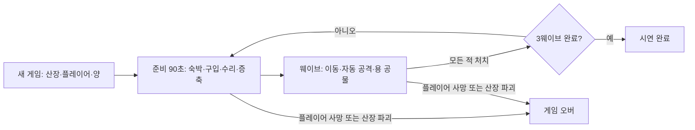

# 마녀산장 — Godot 프로토타입 기획 인수인계

> **기존 실행판의 초기 기준:** 이 문서는 카드 전환 이전 프로토타입의 설계·결정 기록이다. 2026-10-13 채택한 다음 방향은 [카드 코어 v0.3](kingdom-integration-design.md)이다. 아래의 양 생산 없음·처치 보상 없음·버튼 조작·경제표는 새 카드판의 요구사항이 아니다. [충돌 검토](card-core-design-review.md)와 [현재 실행판 설명](../godot/README.md)을 함께 본다. 카드 코어 C0는 [구현 기록](card-core-c0-implementation.md)대로 적용되었으며 실제 엔진·모델 상태는 실행판 설명을 우선한다.

작성·결정 반영일: 2026-10-13. 첫 실행 환경: **Windows PC**. 이 문서는 대화의 게임 컨셉과 사용자의 답변을 기준으로 작성했다. 현재 [Godot 프로토타입](../godot/README.md)이 구현되었으며 [원화에 맞춘 프랍 수정](art-refinement-progress.md)이 진행 중이다.

**확정**은 사용자가 정한 방향, **초기 설계**는 제작을 진행할 수 있도록 작성자가 정한 프로토타입 규칙이다. 초기 설계의 수치는 플레이테스트 후 조정한다. **미정**은 이 문서만으로 최종 제품의 요구사항으로 해석하면 안 된다.

## 1. 게임 한 줄과 플레이 목표

눈 내리는 숲속에서 작은 산장을 운영하는 SD 마녀가 여행자의 숙박비로 거처를 증축하고, 준비 시간 뒤 몰려오는 괴물로부터 자신·산장·양을 지키며, 위급할 때 모아 둔 골드를 용에게 바쳐 산장 지붕 위에 소환하는 게임.

작은 거처의 평온함, 손님을 통해 쌓이는 골드, 증축과 방어 사이의 소비 선택, 거대한 용이 불덩이를 한 발씩 쏘아 위기를 정리하는 순간을 검증한다. 마녀의 과거·세계의 고유명·최종 결말은 아직 만들지 않았다.

## 2. 확정된 사항

| 항목 | 확정 내용 |
| --- | --- |
| 엔진·플랫폼 | Godot로 프로토타입 제작, Windows PC에서 실행 |
| 시점·형태 | 최신 승인 원화의 더 높은 고정 쿼터뷰, 워크래프트·하스스톤식으로 살짝 과장한 간결한 3D 프랍, 인물은 2~3등신 SD |
| 시작 장면 | 화면 가운데의 작은 단순 산장, 앞의 플레이어 한 명, 옆에 딸린 아주 작은 양 목장 |
| 공간 | 거의 평지, 넓고 비어 있는 눈밭과 산장 주변 공터, 간격을 둔 주변 나무와 적은 장식 프랍, 약 두 갈래 숲길 |
| 분위기 | 퍼플·인디고 설경, 나무의 짙은 초록, 조금 음산한 숲, 따뜻한 창문과 굴뚝 연기 |
| 조작·일반 전투 | 클릭 이동 + 가까운 적 자동 공격 |
| 여행자·수입 | 이따금 방문, 일정 시간 숙박한 뒤 자동으로 숙박비 지불 |
| 성장 | 골드로 산장을 점점 증축 |
| 몬스터 | 준비 시간 뒤 웨이브로 출현 |
| 패배 | **산장 파괴 또는 플레이어 사망**. 후속 답변에서 플레이어 사망도 패배로 추가됨 |
| 목장 | 몬스터로부터 보호하는 대상. 죽은 양은 사라지며 골드로 다시 구입 |
| 용 | 골드 공물로 산장 지붕 위에 거대한 용 소환. 강력한 독립 불덩이를 한 발씩 발사해 주변 몬스터 처치 |
| 밸런스 | 증축·소환 등의 초기 비용과 수치는 작성자가 제안하고 테스트로 조정 |

## 3. 가장 먼저 볼 원화

사용자가 2026-10-13에 승인한 이 수정 이미지를 **프로토타입의 카메라·시작 배치·건물 규모·프랍 수와 배치 밀도·텍스처 표현의 최우선 시각 기준**으로 삼는다. 중앙의 작은 산장, 앞의 SD 마녀, 오른쪽에 붙은 작은 목장과 양 3마리, 넓은 눈밭, 두 숲길을 유지한다. 첫 프레임에는 손님·몬스터·용·증축 건물이 없다.

프랍은 나무·바위·낮은 수풀·통나무와 최소한의 생활 소품을 드문드문 배치한다. 텍스처는 큰 색면과 넓은 명암, 절제된 붓질로 만들고 촘촘한 균열·나뭇결·눈밭의 작은 색조각을 줄인다. 이는 텍스처 해상도를 무조건 낮추거나 화면을 흐리게 만들라는 뜻이 아니라 **표면 무늬의 시각적 밀도를 낮추는 기준**이다.

기존 `model-sheets/starter/scene-reference.png`와 12종 시트는 개별 구조·축·피벗 참고로 사용한다. 시트의 세부 묘사나 이전 시안의 밀도가 충돌하면 이번 승인 원화를 우선한다. 오래된 높은 탑 산장 시트로 본채를 제작하지 않는다.

- [기존 시작 장면 12종 모델링 시트 — 구조 참고](../art/model-sheets/starter/README.md)
- [모델링 인수인계와 에셋 규격](modeling-handoff.md)
- [여행자 방문](../art/concepts/gameplay/01-travelers-arrival.png), [증축](../art/concepts/gameplay/02-lodge-expansion.png), [일반 위협](../art/concepts/gameplay/03-forest-encounter.png), [용 방어](../art/concepts/gameplay/04-dragon-gold-defense.png)

게임플레이 원화의 수레·공사 골조·괴물 종류·전투하는 여행자는 연출 예시다. 그 요소가 전부 필수 시스템인 것은 아니다.

## 4. 첫 프로토타입 범위 — 초기 설계

한 장면, 한 번의 실행으로 **방문 → 골드 수입 → 객실 1회 증축 → 일반 방어 → 큰 웨이브 → 용 소환**을 확인한다. 3웨이브를 모두 정리하면 시연 완료 화면을 표시한다. 약 5~8분을 목표로 하되 실제 전투 시간에 따라 달라진다.

| 포함 | 후속 검토 |
| --- | --- |
| 클릭 이동, 자동 단발 마법 공격, 체력 | 직접 조준, 스킬 트리, 장비·마나 시스템 |
| 자동 숙박, 골드, 객실 1회 증축 | 접객 미니게임, 대화·호감도, 여러 종류의 객실 |
| 준비·웨이브·승리·실패 상태 | 무한 웨이브, 여러 지역, 캠페인 |
| 산장·플레이어·양 방어, 양 재구입 | 목장 생산, 번식, 배고픔, 장기 경제 |
| 지붕 위 용, 단발 불덩이, 공물 차감 | 여러 용, 성장·장비, 다른 공물 |
| 재시작 버튼과 밸런스 디버그 메뉴 | 세이브, 메타 성장, 플랫폼 배포 |

미제작 모델은 기본 도형으로 시작할 수 있다. 첫 검증의 핵심은 경제와 방어 선택이며, 원화가 곧 `.glb` 모델이라는 뜻은 아니다.

## 5. 장면·카메라·밀도 — 초기 설계

- 산장 바닥 중심을 월드 원점으로 두고, 반지름 약 12m의 둥근 관리 공터를 만든다. 바닥 높이는 거의 동일하게 유지한다.
- 목장은 화면상 산장 오른쪽에 바로 붙여 배치한다. 산장과 공유하는 울타리 측면 또는 좁은 연결부로 부속 목장임을 읽히게 한다. 양은 처음 3마리다.
- 두 길은 화면 왼쪽 위와 오른쪽 위 숲으로 이어진다. 두 진입 경로를 모두 읽을 수 있게 전경 나무를 줄이거나 가림 처리를 한다.
- 카메라는 공터 중심을 바라보는 고정 `Camera3D`로 시작한다. 직교 투영, 약 45°의 수평 회전과 수평면 기준 약 65~70°의 하향 각도는 **새 블록아웃 시작값**이다. 승인 원화처럼 지붕 윗면·목장 바닥·마녀 모자 윗면이 충분히 보이도록 실제 화면을 비교하며 조정한다. 이 수치는 원화에서 측정한 카메라 값이 아니다. 산장을 화면 가운데에 둔다.
- 나무 사이에 눈밭이 보이는 간격을 남기고 작은 장식 군집을 반복해 화면을 채우지 않는다. 바위·수풀·통나무와 집 옆 장작·통 정도로 시작하며, 원화 속 개수를 고정 에셋 예산으로 해석하지 않는다.
- 눈밭·지붕·나무·돌의 표면을 큰 색면과 단순한 명암으로 읽히게 한다. 버섯·꽃·잔가지·자갈·룬석 군집과 촘촘한 표면 무늬가 있던 이전 시안의 밀도를 복원하지 않는다.
- 창문·벽등의 앰버색은 작은 면적에 집중한다. 눈을 완전한 흰색으로 채우거나 녹색 숲 조명으로 퍼플 분위기를 없애지 않는다.
- 첫 화면에 여행자와 몬스터를 미리 세워 두지 않는다. 숙박객은 건물에 들어간 동안 숨겨서 공터가 북적이지 않게 한다.
- 목장, 클릭 가능한 공터, 증축 위치, 두 길 사이에 동선이 남아야 한다. 장식 돌·수풀에는 필요한 경우에만 충돌을 둔다.

직교 투영의 원거리 물체 크기 유지와 `size` 속성은 [Godot Camera3D 공식 문서](https://docs.godotengine.org/en/stable/classes/class_camera3d.html)를 따른다. 위 각도와 공간 크기는 이 게임을 위한 제안이며 알비온의 실제 카메라 수치가 아니다.

## 6. 한 판의 상태와 시간 — 초기 설계

- 준비 시간은 첫 웨이브 전에도 90초 제공한다. 웨이브 종료는 해당 웨이브의 **출현 예약이 모두 끝나고 살아 있는 적이 0명**인 시점이다. 첫 묶음을 잡았다고 조기 종료하지 않는다.
- 웨이브 중에는 신규 숙박을 받지 않는다. 준비 시간 안에 모든 손님이 요금을 지불하고 퇴장한 뒤 전투를 시작한다.
- 다음 준비 시간으로 넘어갈 때 체력과 양 상태를 자동으로 초기화하지 않는다. 유료 수리·회복·재구입 선택에 의미를 남긴다.
- 준비 중 산장 패널을 여는 동안에는 타이머를 일시 정지한다. 전투 중 용 버튼은 시간을 멈추지 않는다. Escape는 전체 일시 정지 메뉴다.
- 게임 오버와 완료 화면에서는 게임 시간을 멈춘다. 새 게임은 골드 0, 본채, 체력 최대, 양 3마리로 초기화한다. 양 사망의 영구성은 우선 **현재 실행 내**로 적용하고 장기 저장은 후속 범위로 둔다.

## 7. 조작·자동 공격·피해 — 초기 설계

| 요소 | 초기 규칙·값 |
| --- | --- |
| 이동 입력 | 지면 좌클릭, 목적지 표시, 이동 속도 3.5m/s |
| 전투 입력 | 별도 공격 클릭 없이 사거리 안의 가장 가까운 살아 있는 적 자동 공격 |
| 일반 공격 | 마법 투사체 1발, 피해 12, 간격 1초, 사거리 4m, 속도 10m/s |
| 이동 중 공격 | 이동을 멈추지 않고 발사. 공격 애니메이션 때문에 이동 명령을 취소하지 않음 |
| 플레이어 | 체력 100. 0이면 즉시 게임 오버 |
| 산장 | 최대 체력 300. 0이면 즉시 게임 오버. 증축해도 최대 체력은 동일 |
| 양 | 체력 30, 목장 안에서 짧게 배회. 0이면 사라짐 |
| 몬스터 이동·근접 | 속도 1.7m/s, 근접 거리 1.2m, 피해 5, 공격 간격 2초 |
| 선택·UI | UI 클릭은 이동 명령으로 전달하지 않음. 울타리 밖·숲 속 도달 불가 지점을 클릭하면 가까운 유효 지면으로 보정 |

거리와 이동은 수평 XZ 평면 기준이다. 투사체는 대상 사망 시 중복 피해를 만들지 않는다. 자동 공격은 장애물 너머의 적에게 발사하지 않으며, 타깃 변경 시 공격 간격을 초기화해 연속 발사하지 않는다.

몬스터는 출현 시 산장 또는 양을 목표로 배정한다. 플레이어가 근접 거리 안에 오면 플레이어를 공격하고, 벗어나면 원래 목표로 돌아간다. 양이 모두 죽으면 해당 몬스터의 목표를 산장으로 바꾼다. 건물의 공격 위치와 목장 입구까지 실제로 이동할 수 있어야 하며 목표 중심점 안으로 관통하지 않는다.

## 8. 숙박·증축·소비 — 초기 설계

숙박객은 각 준비 시간의 **5초·30초·60초**에 묶음으로 방문한다. 첫 프레임에는 손님이 없다. 본채의 객실 정원은 2명이다. 각 묶음의 도착 인원은 객실 정원과 같고, 여행자는 입실 후 20초를 머물러 **1명당 15골드**를 지불한다. 지급은 25초·50초·80초이며, 마지막 10초는 구매 결정 시간이다.

| 구매 | 비용 | 효과·조건 |
| --- | --- | --- |
| 첫 객실 증축 | 60골드, 한 번 | 정원 2→3명. 다음 도착 묶음부터 적용. 본채 한쪽에 작은 객실 모듈 표시 |
| 용에게 공물 | 120골드 | 전투 중 해당 웨이브가 끝날 때까지 용이 방어. 웨이브당 1회 |
| 산장 수리 | 10골드 | 체력 50 회복, 최대 체력 제한. 준비 중에만 가능 |
| 플레이어 회복 | 10골드 | 체력 50 회복, 최대 체력 제한. 준비 중에만 가능 |
| 양 재구입 | 20골드/마리 | 빈 자리에 체력 최대의 양 1마리 추가. 최대 3마리, 준비 중에만 가능 |

객실은 첫 프로토타입에서 즉시 완성된다. 복잡한 건설 시간과 건설 자원은 추가하지 않는다. 골드 부족·이미 완료·빈자리 없음·체력 최대일 때는 버튼을 비활성화하고 이유를 보여준다. 반복 클릭으로 공물이나 구입 비용이 두 번 차감되지 않는다.

초기에는 몬스터 처치 보상과 양의 생산 수입을 넣지 않는다. 양은 생존 현황과 재구입 비용을 가진 보호 목표다. 이것으로 보호 동기가 약하면 후속 테스트에서 생존 보상 또는 숙박 만족도를 검토한다. 해당 연동은 아직 확정하지 않았다.

### 경제 계산 예시

첫 준비 시간의 마지막 수입까지 받은 뒤 증축하고, 이후 준비 시간에는 정원 3명을 유지한다고 가정한다. 수리·양 구매·용 소환을 제외한 기준 계산이다.

| 시점 | 이번 준비 수입 | 소비 예시 | 잔액 |
| --- | --- | --- | --- |
| 시작 | 0 | 없음 | 0 |
| 준비 1 종료 | 2명 × 3회 × 15 = 90 | 객실 증축 60 | 30 |
| 준비 2 종료 | 3명 × 3회 × 15 = 135 | 용 공물 120 | 45 |
| 준비 3 종료 | 135 | 용 공물 120 + 수리 10 + 회복 10 + 양 1마리 20 | 20 |

증축하지 않으면 준비 2까지 180골드를 모으므로 공물을 바칠 수 있다. 수리나 양 재구입을 많이 하면 공물 비축이 줄어드는 선택이 생긴다. 이 계산은 플레이 난이도를 입증한 결과가 아니라 **수입과 소비가 성립하는지 확인한 초안**이다.

## 9. 웨이브 — 초기 설계

첫 버전은 몬스터 외형 1종과 체력 단계만 사용한다. 공격 피해는 웨이브마다 올리지 않는다. 두 숲길 입구 밖에서 출현해 걸어 들어오며, 공터·목장 안에서 갑자기 나타나지 않는다.

| 웨이브 | 적 수 | 1명 체력 | 산장 목표 / 양 목표 | 출현 방식 | 의도 |
| --- | --- | --- | --- | --- | --- |
| 1 | 5 | 36 | 4 / 1 | 시작 3명, 8초 뒤 2명 | 이동·자동 공격과 보호 대상을 학습 |
| 2 | 9 | 48 | 6 / 3 | 3명씩 5초 간격 | 두 방향 방어, 용을 사용할지 판단 |
| 3 | 18 | 60 | 14 / 4 | 3명씩 3초 간격 | 압도적인 무리와 용의 위력 검증 |

양 목표의 비율은 두 길에 나누어 배치한다. 길이 막힌 적을 방치하지 않도록 경로 실패를 표시하고, 디버그 메뉴에서 적 위치와 공격 지점을 확인한다. 전투 중 적의 수나 체력을 플레이어 골드에 맞춰 몰래 늘리지 않는다.

플레이테스트에서 1웨이브부터 양이 일방적으로 죽거나 산장이 빠르게 무너지면, 먼저 출현 간격·양 공격자의 수·경로 길이를 조정한다. 용 없이 3웨이브도 지나치게 쉽게 정리되면 동시에 접근하는 수를 늘려 비상 수단의 의미를 만든다.

## 10. 용 소환 — 초기 설계

1. HUD의 `용에게 공물 — 120G`를 누른다. 살아 있는 적 또는 남은 출현 예약이 있고, 골드가 충분하며, 이번 웨이브에 아직 소환하지 않았을 때만 작동한다.
2. 골드 차감과 소환 상태 변경을 한 번의 처리로 완료한다. 본채의 `DragonAnchor`에 거대한 용을 표시한다. 증축으로 앵커가 이동하지 않는다.
3. 1초의 등장 연출 뒤 가장 밀집한 적 무리를 겨냥해 **불덩이 한 발**을 발사한다. 이후 2초마다 한 발씩 발사한다. 투사체가 날아가는 동안 연속 불기둥을 연결하지 않는다.
4. 불덩이는 피해 200, 폭발 반경 5m, 사거리 30m, 속도 12m/s로 시작한다. 현재 3웨이브의 일반 몬스터는 한 방에 죽는다. 폭발은 적에게만 피해를 주고 산장·플레이어·양에는 피해를 주지 않는다.
5. 웨이브의 모든 적을 정리하면 용이 3초 동안 퇴장한다. 이 전환 연출이 끝난 뒤 다음 준비 시간 또는 완료 화면으로 넘어간다. 다음 준비 시간에는 용이 없다. 다음 웨이브에는 새 공물이 필요하다.

공물은 플레이어나 산장의 체력을 회복시키지 않는다. 소환 연출 중에도 적의 공격은 계속되므로 파괴 직전에 누르면 늦을 수 있다. 용이 이미 발사한 투사체는 타깃이 죽어도 마지막 목표 지점에 폭발하고, 새 공격은 살아 있는 적에게 향한다.

공터와 진입로의 전투 구역을 사거리 안에 두어 주변 적을 모두 정리할 수 있게 한다. 불덩이는 지형 장식에 막혀 무효화하지 않는다. 숲 안쪽의 접근 불가능한 생성 지점에는 적을 남기지 않는다. 효과음·섬광·흔들림은 강하게 짧게 사용하고 플레이 영역과 상태 UI를 가리지 않는다.

## 11. 구현 구조 제안

Godot **4.x 안정 버전 하나를 선정해** 프로젝트와 제작자 모두 동일 버전으로 고정한다. 정확한 패치 버전과 렌더러는 착수 시 기록한다. PC용 첫 블록아웃은 Compatibility 렌더러를 출발안으로 두되, 필요 효과와 테스트 PC에서 비교 후 확정한다.

아래는 만들 파일의 제안이며 현재 저장소에 이미 존재하는 코드가 아니다.

| 책임 | 제안 장면·모듈 |
| --- | --- |
| 상태·승패·타이머 | `GameSession`, 준비/전투/완료/실패 상태 |
| 웨이브·출현 예약 | `WaveDirector`, 두 출현 지점, 설정 데이터 |
| 숙박·골드·구입 | `LodgeEconomy`, 예약·입실·퇴실·지급의 단일 기록 |
| 이동·공격·피해 | `Player`, `Monster`, 공통 체력 처리 |
| 양·구입 슬롯 | `Pasture`, 양 3개 슬롯, `Sheep` |
| 용·불덩이 | `DragonDefense`, 지붕 앵커, `Fireball` |
| 입력·표시 | `HUD`, 골드·체력·양·준비 시간·웨이브·구매·공물 버튼 |
| 환경 | `World`, 바닥·본채·목장·숲·조명·카메라·내비게이션 |

지면 클릭은 카메라에서 지면 충돌로 레이를 쏘고 유효 이동 목적지로 변환한다. 정적 건물·숲 경계·울타리를 반영한 이동 영역을 만들고 캐릭터가 우회하게 한다. 작은 장면이라도 마녀와 적을 시각 모델의 좌표에 직접 종속시키지 않는다.

모델은 GLB와 별도의 Godot 래퍼 장면으로 구성해 체력·충돌·앵커·행동을 연결한다. 시각 모델 교체가 경제 상태를 초기화하지 않게 한다. 입력·피해·구매·웨이브 종료의 결과가 같은 프레임에 겹치면 사망/파괴를 먼저 판정하고 완료·새 구매를 진행하지 않는다.

## 12. 제작 순서와 완료 기준

1. **평지 블록아웃:** 최신 승인 원화와 나란히 비교해 산장 중앙, 옆 목장, 두 길, SD 플레이어 상대 크기, 더 높은 고정 카메라와 넓은 빈 눈밭을 승인한다.
2. **한 웨이브:** 클릭 이동·자동 공격·적 경로·피해·산장/플레이어 패배·양 사망을 연결한다.
3. **준비와 경제:** 숙박료 1회 지급, 증축, 수리·회복·양 구매를 연결한다.
4. **용과 3웨이브:** 공물 차감, 지붕 소환·단발 불덩이·웨이브 종료·완료 화면을 연결한다.
5. **모델 교체와 분위기:** 12종 시트를 구조 참고로 모델을 적용하고, 승인 원화의 낮은 프랍 밀도·간결한 표면 무늬·보라 눈·초록 숲·따뜻한 빛에 맞춘다. 눈/연기 VFX도 플레이 영역을 읽을 수 있게 조정한다.

필수 확인 시나리오:

- 승인 원화와 같은 높은 시점에서 지붕·목장 바닥·마녀가 읽히고, 프랍 사이의 넓은 눈밭과 두 길이 보인다. 눈·돌·나무·지붕이 잔무늬로 채워지지 않았는지 같은 화면 크기로 비교한다.
- 첫 프레임에 중앙의 작은 산장·플레이어·옆 목장만 보이고 첫 손님은 5초 뒤 등장한다.
- 클릭으로 건물과 울타리를 우회한다. UI를 눌러도 이동하지 않는다. 두 진입로를 모두 방어할 수 있다.
- 2명 × 3묶음 숙박으로 90골드를 한 번씩만 지급한다. 객실 증축 후 다음 준비에서 135골드를 얻는다.
- 출현 예약이 남아 있으면 화면의 적이 잠시 0명이어도 웨이브가 끝나지 않는다.
- 양 1마리 사망은 게임 오버가 아니며, 다음 준비에 20골드로 빈자리에 재구입한다.
- 플레이어 체력 0과 산장 체력 0 각각에서 게임 오버가 된다. 동시 패배·웨이브 완료에서도 실패를 우선한다.
- 120골드 미만일 때 소환 불가, 연속 클릭에도 1회 차감, 용은 지붕에 나타나며 불덩이가 분리되어 날아간다.
- 용이 양과 산장에 피해를 주지 않고 해당 웨이브의 남은 적을 정리한 뒤 퇴장한다.
- 수리·회복은 실제 회복량을 최대 체력으로 제한하고 필요 없을 때 비용을 쓰지 않는다.
- 실패/완료 뒤 새 게임에서 적·손님·용·골드·죽은 양·증축 상태가 남지 않는다.

디버그 전용으로 골드 지급·웨이브 즉시 시작·용 강제 소환·피해 부여를 제공한다. 시연 진행이 경제 선택 때문에 막혀도 용의 구현을 따로 검증할 수 있다. 디버그 기능은 정상 플레이의 지급 규칙과 분리한다.

## 13. 남은 공백과 처리 방침

| 공백·위험 | 현재 인수인계 방침 |
| --- | --- |
| 정확한 Godot 버전·렌더러·테스트 PC | 착수 시 고정·기록. 현재 Godot 프로젝트와 실행 결과 없음 |
| 양 보호의 장기 보상 | 기존 실행판에는 생산 없음. 다음 기획은 하루 한 번 생산·접근 수확으로 양털 카드 획득 |
| 한 판 이후 성장·저장 | 새 게임 초기화로 시작. 사망한 양과 증축을 다음 실행까지 유지할지는 미정 |
| 산장 실내·조작 범위 | 외부 한 화면에서 숙박을 추상화하는 초기 설계. 실내 탐험은 미정 |
| 증축 위치와 비용 회수 기간 | 객실 1종만 구현. 60골드/추가 수입 45골드로 약 1.33회 준비 구간에 회수 |
| 여행자의 전투·피해 | 기존 실행판에서는 숙박 뒤 퇴장. 다음 기획에서는 고용한 손님을 계약 카드로 얻어 생산·전투에 사용 |
| 소환 비용으로 방어가 막히는 경우 | 용 사용을 강제 승리 조건으로 만들지 않음. 연출은 디버그로 독립 검증 |
| 스폰·경로·가림 | 두 길의 통행과 목장 공격 위치를 블록아웃 단계에서 검증 |
| 새 모델 누락 | 여행자·몬스터·용·객실은 아직 3면도 없음. 기본 도형으로 기능 검증 후 제작 |
| 실전 난이도 | 경제 산술만 확인. 전투 수치·시간·양 손실률은 플레이테스트 필요 |

이 문서의 조작·수입·웨이브·패배·플랫폼·양 규칙은 최초 제작 당시 기준이다. 이후 채택한 카드 조작·용병 계약·양털 생산·몬스터 하수인은 [카드 코어 v0.3](kingdom-integration-design.md)을 따른다. 이 초기 제작 순서로 새 코어를 진행하지 않는다. 장기 저장·실내 플레이는 여전히 미정이다.
