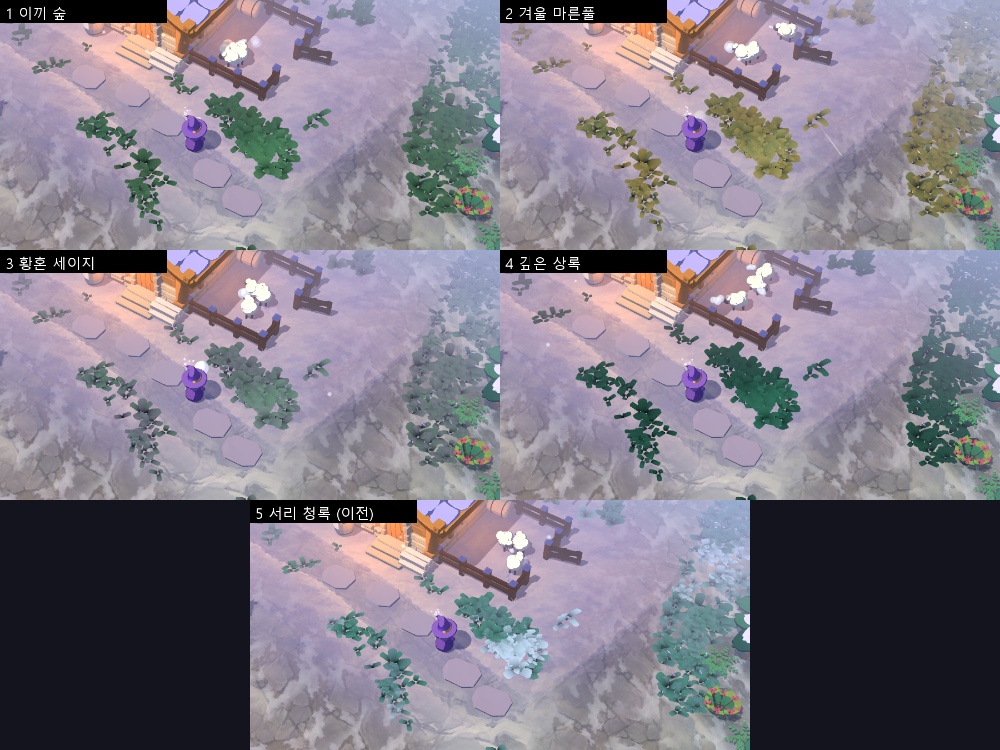
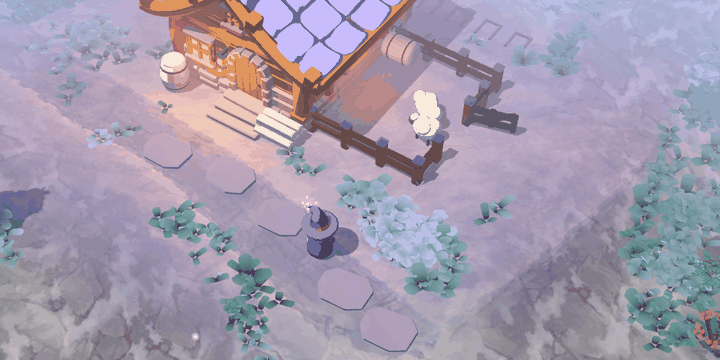
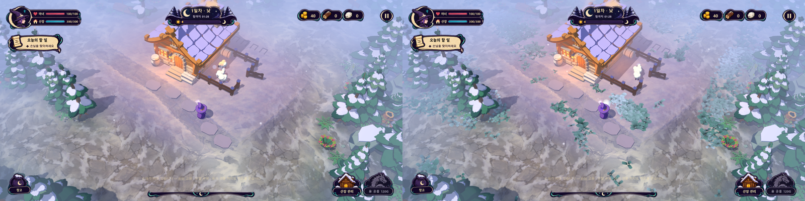
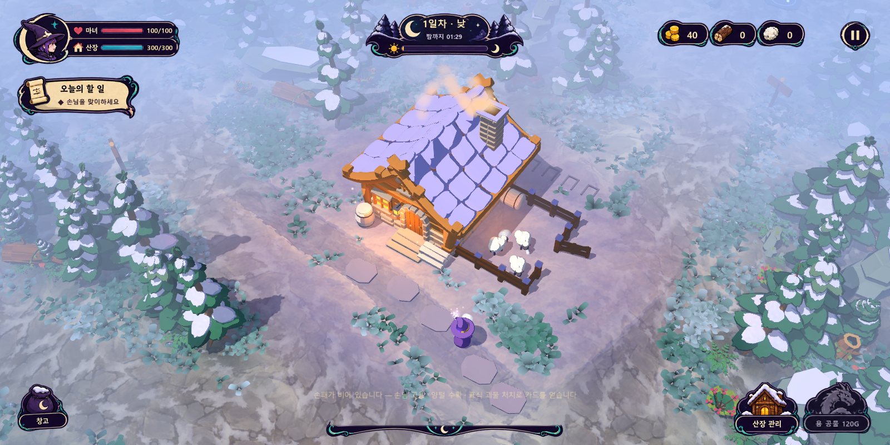
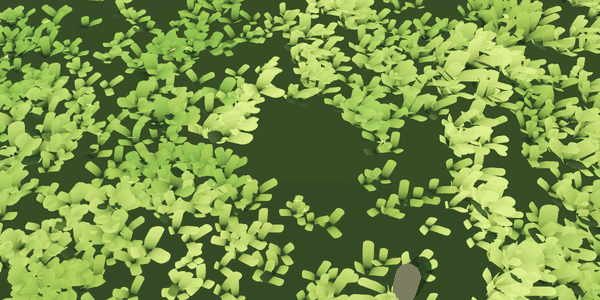
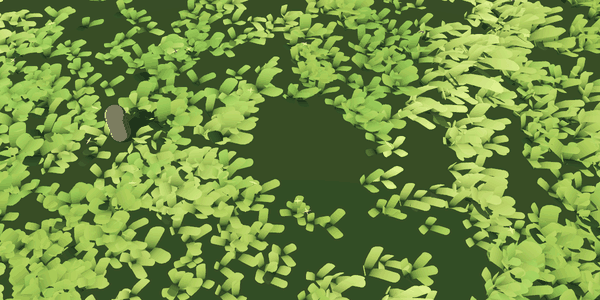
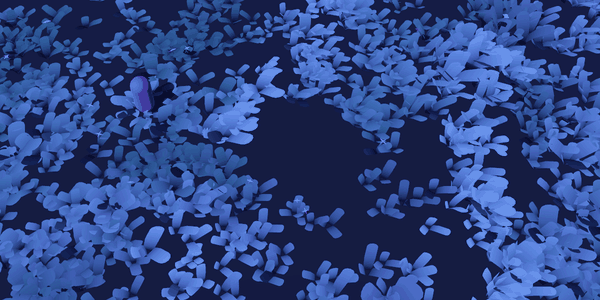

# 바람에 파도치는 군집 잔디 (GrassField)

2026-10-14(같은 날 둥근 잎으로 수정, 산장 주변 맵에 적용). 단순한 잎 메시를 군집으로 배치하고, 바람이 큰 덩어리로 지나가며 들판 전체가 파도치듯 일렁이게 하는 잔디 시스템이다. 재사용 가능한 노드·독립 미리보기 장면과 함께, 실제 게임의 산장 주변 맵에 배치했다(소스·배포 실행판).

## 색 톤 프리셋 (F6)

바람 마루를 흰색에 가깝게 칠하던 방식이 플라스틱처럼 보여서 바꿨다. 이제 마루는 잎끝 색과 가까운 색으로 조금만 밝아지고, 바람이 약한 골은 살짝 어두워진다. 흰 번쩍임 없이 명도 차이로 파도가 읽힌다. 잔디의 툰 명암 경계는 부드럽게 섞고(`toon_mix`), 잎끝에 빛이 비쳐 보이는 효과(`translucency`)를 더했다.

게임에서 **F6**을 누르면 톤이 바뀌고 화면에 이름이 표시된다. 캡처할 때는 `-- grass_tone=<id>`를 쓴다. 정의는 `scripts/world/grass_meadow.gd`의 `TONES`에 있다.



| 순서 | id | 이름 | 인상 |
| --- | --- | --- | --- |
| 1 (기본) | `moss` | 이끼 숲 | 차분한 녹청, 마루는 밝은 초록 |
| 2 | `winter_straw` | 겨울 마른풀 | 청록 뿌리에서 올리브·짚색 끝으로 이어지는 겨울 풀 |
| 3 | `dusk_sage` | 황혼 세이지 | 세이지 녹색에 연보라 군집이 섞여 청보라 공기와 어울림 |
| 4 | `evergreen` | 깊은 상록 | 어두운 상록. 눈 위에서 대비가 가장 강함 |
| 5 | `frost` | 서리 청록 (이전) | 비교용 이전 톤. 마루가 흰색으로 빛남 |

톤별 움직임: `godot/screenshots/grass-wind/tones/1-moss.gif` … `5-frost.gif`.

## 게임 적용 — 산장 주변 설원







- 구현: `godot/scripts/world/grass_meadow.gd`. `world.gd`가 숲·랜드마크 배치 직후 `GrassMeadow.build(self)`를 호출하고, 마녀가 생기면 `push_target`으로 연결한다. 충돌·내비게이션에는 영향이 없다.
- 범위: 맵 중심 반경 30m 원형 필드, 가장자리로 갈수록 성기고 낮아진다. 키 높이 0.13–0.58m(SD 마녀 무릎 높이), 군집 사이에 눈이 충분히 보이도록 공터 비율 38%.
- 비우는 곳: 산장·증축 자리(+0.7m), 최대 단계 목장(+0.6m), 묘지 8기 자리, 정문→디딤돌→동쪽 숲길 동선(1.5m), 모든 숲길(1.8m), 네 랜드마크 공터(4m), 나무·바위 충돌체(반경+0.45m).
- 색: 소나무와 같은 청록에 마루가 서리처럼 희게 반짝이는 설경 팔레트. 꽃은 연보라·하늘색. 바람 방향은 눈발(`WeatherVfx.WIND`)과 같다.
- 카메라가 약 45m 떨어져 있어 거리 컬링은 끄고(`visibility_end = 0`), 성긴 필드라 청크를 15m로 키웠다.
- 검증 `tools/verify_grass_meadow.gd`: 3,428묶음·44청크, 비우는 곳 위반 0, 밀어내기 대상 = 마녀, 1초 사이 바람으로 바뀐 화소 7,053개, **잔디 켬/끔 프레임 5.58 / 5.28ms (+0.30ms)**. 모두 통과.
- 실행판: `build/WitchsLodge.pck` 갱신, 이전 판은 `build/WitchsLodge-before-grass-meadow.pck`, 이번 판 사본은 `WitchsLodge-grass-meadow.pck`.



| 강풍 · 초원 | 산들바람 · 달빛 숲 |
| --- | --- |
|  |  |

## 파일

| 파일 | 역할 |
| --- | --- |
| `godot/scripts/visual/grass_field.gd` | `GrassField` 노드. 군집 배치·메시 생성·청크 분할 (`@tool`, 에디터에서도 보임) |
| `godot/shaders/grass_wind.gdshader` | 바람·밀어내기·거리 페이드·색. 기존 툰 라이팅(`card_style`)과 공기 원근(`colored_air`) 사용 |
| `godot/scenes/props/grass/grass_showcase.tscn` | 미리보기. 열고 F6 |
| `godot/tools/verify_grass_wind.gd` | 성능·움직임 검증 |
| `godot/scripts/world/grass_meadow.gd` | 산장 주변 맵 배치·비우는 곳·설경 팔레트 |
| `godot/tools/verify_grass_meadow.gd` | 실제 게임 배치·비용·움직임 검증 |

## 구조

**잎 이미지 없이 메시 3종만 쓴다.** 모든 잎은 뿌리가 좁고 위가 넓은 통통한 주걱형에 끝이 반원으로 둥글다(뾰족하지 않음). 3장 묶음(풀), 3장 더 넓은 잎(잡초), 잎 2장 + 줄기 + 십자 꽃잎(꽃). 높이 1m로 정규화하고 인스턴스 스케일로 크기를 정한다. 색은 뿌리→끝 그라데이션과 인스턴스별 변화값으로 셰이더가 칠한다.

**군집 배치.** 지터 격자로 군집 중심을 뽑고 저주파 노이즈가 낮은 칸은 비워 공터를 만든다. 군집 안에서는 중심이 가장 높고 가장자리로 갈수록 낮아지며 밀도도 줄어 부드러운 테두리가 된다. 군집 사이에는 낮은 잔풀을 얇게 깐다. 잡초는 군집 중심, 꽃은 가장자리에 주로 놓인다.

**바람 = 이동하는 바람장.** 버텍스마다 개별로 흔드는 대신, 묶음의 뿌리 위치에서 하나의 바람 세기를 읽는다.
1. 바람 방향으로 흘러가는 노이즈 텍스처(큰 돌풍 덩어리)
2. 바람 방향으로 진행하는 마루 띠 `pow(sin, 3)`(규칙적인 파도) — 돌풍이 센 곳에서 더 강하다
3. 묶음마다 다른 위상의 작은 떨림

이웃한 묶음이 같은 값을 읽으므로 같이 눕고, 그 패턴이 초속 `wave_speed`m로 지나가며 파도가 된다. 휘어질 때 잎 길이를 유지하도록 끝이 내려앉아 호를 그린다. 마루가 지나가는 잎 끝은 `color_sheen`으로 밝아져 위에서 내려다봐도 파도가 읽힌다.

## 최적화

- 청크(기본 8m)·종류별 `MultiMeshInstance3D` → 카메라 밖 청크는 통째로 컬링, `visibility_range_end`로 먼 청크 제거
- 먼 거리 잎은 셰이더에서 땅으로 가라앉혀 끊김 없이 사라진다(`fade_distance`)
- 잔디는 그림자를 드리우지 않는다(받기만 함). 잎 텍스처·알파 테스트 없음 → 오버드로 비용이 적다
- 매 프레임 CPU 작업은 밀어내기 위치 uniform 1개뿐. 나머지는 모두 GPU
- `world_vertex_coords`로 역행렬 계산 없이 월드 공간에서 바로 휘게 한다
- 바람 오프셋만큼 넓힌 `custom_aabb`로 흔들리는 끝이 잘못 컬링되지 않게 했다

**측정 (RTX 3060, 1600×800, 미리보기 장면 48×48m):** 10,664묶음 · 약 23만 폴리곤 · 드로우콜 99 · **프레임 2.54ms(약 390fps)**, 그림자 있는 태양광 포함. 실제 게임에서 쓰는 범위(카메라 주변 수십 m)라면 여유가 크다. 더 낮춰야 하면 `clump_density`, `meadow_density`, `visibility_end` 순으로 줄인다.

**더 저렴한 방법과 비교.** 잎을 그린 텍스처 카드(빌보드)는 장당 폴리곤은 적지만 알파 테스트 오버드로가 커서 위에서 내려다보는 쿼터뷰 밀집 잔디에서는 오히려 느려지기 쉽다. 이 방식은 불투명 삼각형만 쓰므로 Early-Z가 그대로 동작한다.

## 게임에 놓는 법

```gdscript
var grass := GrassField.new()
grass.size = Vector2(30, 30)
grass.holes = [Vector3(0, 0, 4.0)]      # 산장·길 자리 비우기 (x, z, 반경)
grass.push_target = witch               # 마녀가 지나가면 풀이 비켜남
# grass.height_at = func(p: Vector2) -> float: return terrain_height(p)  # 평지가 아니면
world.add_child(grass)
grass.shader_material.set_shader_parameter("wind_direction", Vector2(.93, .37))  # 눈발과 같은 방향
```

색·바람은 `material`에 ShaderMaterial을 넣어 인스펙터에서 고정하거나 런타임에 `shader_material`로 바꾼다. 미리보기의 `달빛 숲` 팔레트가 현재 게임의 청보라 밤 화면에 맞춘 값이다.

| 주요 파라미터 | 의미 |
| --- | --- |
| `wind_strength` / `base_lean` | 돌풍 때 기울기 / 바람이 없을 때 기본 기울기 |
| `wave_speed` / `wave_length` / `wave_amount` | 파도 진행 속도(m/s) / 마루 간격(m) / 규칙적인 띠의 비중 |
| `gust_scale` | 돌풍 덩어리 크기(작을수록 큼) |
| `sheen_amount` | 마루의 밝아짐 |
| `fade_distance` | 잎이 가라앉기 시작·끝 거리 |

## 미리보기 조작과 검증

미리보기: `1/2/3` 잔잔함·산들바람·강풍, `P` 초원/달빛 숲, 마우스로 밀어내기 표식 이동(가만히 두면 원을 그림), 휠 줌.

```
Godot-4.7.2.exe --path godot --script res://tools/verify_grass_wind.gd -- <출력 폴더>
```

인스턴스 생성, 16.6ms 이하 프레임, 1초 뒤 화면 변화(흔들림), 화면 구역별 움직임 차이(균일한 떨림이 아니라 돌풍 띠)를 확인한다. 2026-10-14 실행 결과 모두 통과.
