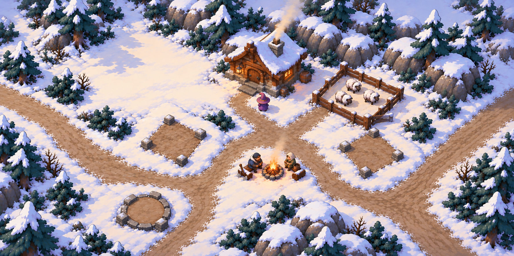

# 산장 주변 맵 구성 인수인계 — A안

작성일: 2026-10-17  
상태: **사용자 승인 원화·배치 방향 확정 / 실제 맵 재배치 구현은 별도 작업**  
대상: 레벨 디자인, 환경 아트·모델링, Godot 월드·이동·건설 담당자

## 1. 인계 요약과 기준 자료

산장 뒤를 자연물로 막고, 산장 앞의 넓은 생활·방어 마당을 중심으로 동선을 재정리한다. 산장 왼쪽은 증축용으로 비워두고 오른쪽에는 양 목장을 둔다. 마당 중앙에 일꾼 쉼터인 모닥불, 그 양옆에 감시탑 건설 공터 두 곳, 왼쪽 아래에 제단 건설 공터 한 곳을 마련한다. 좌우의 숲길은 몬스터 웨이브 진입로이면서 시설 접근 동선으로 이어진다.

**최우선 기준은 아래 최신 승인 원화다.** 사용자는 A안을 선택한 뒤 실제 게임에 가까운 카메라를 요청했고, 카메라 수정 과정에서 달라진 색감·표현을 최초 A안처럼 되돌린 최종 결과에 “좋아”라고 답했다.

| 자료 | 용도와 우선순위 |
| --- | --- |
| [최신 승인 원화 v03](../../art/concepts/environment/layout-a-game-camera-v03-style/01-layout-a-style-restored.png) | 현재 맵 구성·배치 관계·톤·재질 표현의 종합 기준. 1774×887, 2:1 |
| [최초 A안](../../art/concepts/environment/lodge-layout-options-v01/01-central-courtyard.png) | 색감·굵직한 페인터리 표현의 대조 기준. 이전의 더 낮고 크게 보이는 시점을 다시 가져오지 않음 |
| [최신 제작 기록](../../art/concepts/environment/layout-a-game-camera-v03-style/README.md) | 실제 이미지 입력, 수정 의도, 프롬프트·파일 검증 |
| [아트 가이드](../art-direction.md) · [세계관 기준](../world-races-card-formats-v01.md) | 중세 기반 판타지, 공통 재료·분위기 |
| [기존 모델링 인수인계](../modeling-handoff.md) | 에셋의 축·피벗·납품 규격. 산장 주변 배치·후면 통행·증축 방향은 이번 문서의 최신 결정을 우선 |

B안과 카메라·화풍 수정 중간본은 이력이다. 기존 원화나 과거 문서와 충돌하는 **산장 주변 배치**는 본 문서와 최신 승인 원화를 우선한다. 다른 지역 전체를 재설계하거나 기존 게임 규칙을 변경한다는 결정은 아니다.

## 2. 확정 사항과 해석 범위

| 구분 | 내용 |
| --- | --- |
| 확정 | A안 채택, 산장 뒤 통행 차단, 중앙 모닥불, 감시탑용 공터 2곳, 제단용 공터 1곳, 좌우 웨이브 길, 산장 증축 여유 확보 |
| 확정 | 실제 게임의 원근 카메라에 가깝게 구성. 최초 A안의 컬러톤·표현 방식을 유지 |
| 원화에 표현된 기준 | 오른쪽의 작은 목장과 양 3마리, 모닥불 옆의 쉬는 일꾼 2명·통나무 의자·도끼·바구니 |
| 구현 시 구체화 | 정확한 월드 좌표·공터 면적·길 폭·시설 크기·앵커 위치·충돌과 내비메시 |
| 이번에 확정하지 않음 | 감시탑 모델·공격/사거리/비용, 제단 신설·이전 방식과 해금 변경, 모닥불의 버프·회복·수용 인원, 증축 단계·최대 크기 |

원화의 일꾼 2명과 양 3마리는 장면 구성 참고다. 이 숫자를 전체 게임의 일꾼·가축 상한으로 해석하지 않는다. 모서리 돌·원형 둘레 돌은 건설 자리를 읽히게 한 시각 표현이며 별도의 자원·건설 규칙을 뜻하지 않는다.

## 3. 구역별 배치와 역할

이 절의 좌·우·위·아래는 **승인 원화를 보는 화면 기준**이다. Godot 월드의 X/Z와 그대로 대응시키지 않는다.

| 구역 | 배치 | 역할과 확보할 공간 |
| --- | --- | --- |
| 산장 본채 | 화면 위쪽 중앙 | 기존의 작은 단일 박공지붕·굴뚝·현관 계단 유지. 현관 앞은 빈 도착·회전 공간 |
| 후면 자연물 경계 | 산장 뒤를 감싸며 외곽 숲에 연결 | 눈 덮인 바위·침엽수·관목을 불규칙하게 묶어 산장 배후 통행 차단 |
| 증축 예약 영역 | 산장 **왼쪽 벽에 직접 이어진** 넓은 눈밭 | 작은 장식·자원 나무·모닥불·주동선을 넣지 않음. 증축 후에도 앞마당 연결 유지 |
| 양 목장 | 산장 오른쪽 | 기존의 작은 부속 목장. 문 앞 접근과 양 수확 공간을 확보 |
| 모닥불 쉼터 | 산장 앞마당 중앙 | 나무꾼·채집가 등이 밤에 모여 쉬는 생활 중심. 불·의자·소품 주변으로 접근 가능 |
| 왼쪽 감시탑 자리 | 모닥불 왼쪽의 사각 공터 | 왼쪽 웨이브 길을 바라보는 건설 예약지. 길과 겹치지 않음 |
| 오른쪽 감시탑 자리 | 모닥불 오른쪽의 사각 공터 | 오른쪽 웨이브 길을 바라보는 건설 예약지. 목장 문과 겹치지 않음 |
| 제단 자리 | 화면 왼쪽 아래의 원형 공터 | 주동선 옆의 짧은 가지 길로 접근. 초기 원화에서는 비어 있는 건설 공간 |
| 좌우 진입로 | 산장 기준 왼쪽·오른쪽 숲에서 전면으로 연결 | 몬스터 접근을 읽을 수 있는 굽은 길. 두 방향의 연결과 현관·시설 접근을 함께 검토 |

### 후면 차단

산장 뒤에 가느다란 샛길이나 한 명만 통과하는 틈이 남지 않도록 한다. 반듯한 성벽이나 높은 절벽을 새로 만드는 대신, 서로 겹치는 바위와 낮고 높은 식생의 조합으로 자연스럽게 감싼다.

이 요구는 장식 배치만으로 완료되지 않는다. 바위·지형 충돌과 내비메시 경계를 함께 조정하여 마녀·일꾼·적 모두 산장 바로 뒤를 통과하지 못하게 한다. 관목은 시각 마감으로 쓸 수 있으나 기본 충돌이 없는 관목 메시만으로 길을 막았다고 판단하지 않는다.

현재 게임에는 벌목으로 사라지는 자원 나무가 있다. 후면 차단을 자원 나무에만 의존해 나무를 베면 우회로가 열리게 만들지 않는다. 산장 뒤의 고정 경계와 수확 가능한 숲을 구분해 구현한다.

### 증축 예약 영역

단순히 산장과 떨어진 빈 공터를 두는 것이 아니라 **본채 측벽에 모듈을 붙일 수 있는 연속 공간**을 남긴다. 본채·증축 최대 외곽·전면 통로·후면 차단 띠를 함께 블록아웃한다. 이번 A안의 기본 증축 방향은 목장 반대편인 왼쪽이다. 과거 문서의 후면 증축 가능 문구를 근거로 새 후면 통로를 만들지 않는다.

최종 증축 크기는 미정이다. 현재 코드의 증축 사각형이나 원화 픽셀 면적을 새 최종 치수로 그대로 확정하지 않는다.

### 모닥불·건설 공터

모닥불 1곳에 통나무 의자, 도끼와 바구니 등 필요한 소품만 소량 배치한다. 새 쉼터는 밤의 작업자 집결 장소라는 목적을 갖지만 회복·버프·자원 생산 기능은 이번 결정에 포함하지 않는다.

감시탑은 **공터 2곳을 예약**하는 단계다. 초기 배치에 완성된 탑을 임의로 세우지 않는다. 향후 탑 본체·계단·충돌·공격 목표 지점이 들어와도 이동로가 유지될 여유를 잡는다. 제단도 빈 원형 건설 자리를 확보하는 것까지 확정이며, 완성 외형과 기존 제단 시스템의 연결은 별도로 정한다.

## 4. 이동과 웨이브 동선

기본 연결은 **좌우 숲길 → 열린 앞마당 → 현관·목장·쉼터·건설 자리**다. 불·의자·공터의 중앙을 길로 쓰지 않고 그 주변을 지나도록 한다.

| 이동 주체/상황 | 확인할 동선 |
| --- | --- |
| 마녀의 생활 이동 | 현관 ↔ 모닥불, 현관 ↔ 목장 문과 양 수확 위치, 앞마당 ↔ 제단 자리 |
| 밤에 복귀하는 나무꾼·채집가 | 작업 지역 → 좌우 접근로 → 앞마당 → 모닥불 주변의 개별 대기 자리 |
| 숙박 손님 | 기존 방문 경로 → 현관 앞 도착 지점. 모닥불 대기 인원과 충돌하지 않음 |
| 왼쪽 웨이브 | 왼쪽 숲길 → 왼쪽 감시탑 근처 방어 구역 → 기존 규칙에 따른 유효 목표 |
| 오른쪽 웨이브 | 오른쪽 숲길 → 오른쪽 감시탑 근처 방어 구역 → 기존 규칙에 따른 유효 목표 |
| 증축·시설 건설 이후 | 같은 생활 연결이 유지되고, 시설 때문에 후면 우회나 막힌 골목으로 몰리지 않음 |

길은 완전히 대칭인 도형보다 자연스럽게 굽은 흙·눈 길로 만든다. 다만 외형 때문에 불필요한 지그재그·긴 우회를 넣지 않는다. 현관에서 각 시설로 가는 짧은 연결과 모닥불 양옆 회피 공간을 우선한다.

길 폭은 아직 수치 확정하지 않았다. 실제 에이전트 반경, 일꾼·방문객의 교행, 적 군집, 건설 후 충돌을 넣고 결정한다. 화면상 넓어 보여도 실제 이동 면이 좁으면 완료로 보지 않는다.

좌우 길은 **진입 방향의 확정**이다. 적의 스폰 시각·수·속도·공격 대상·난이도 변경은 별도다. 외곽 전체 탐험길을 없앤다는 뜻도 아니다. 산장 뒤의 근거리 통과 경로를 차단하면서 기존 탐험 지역의 연결 영향을 별도로 확인한다.

## 5. 카메라·색감·표현 유지

### 카메라

현재 코드 기준 기본 카메라는 직교/아이소메트릭이 아닌 **원근 카메라**다.

| 항목 | 현재 구현에서 확인한 값 |
| --- | --- |
| 기본 프리셋 | `lens_wide` |
| FOV | 34° |
| 하향각 / Y 회전 | 약 50° / 35° |
| 플레이어 추적 | 기본 활성 |
| 추적 화면 높이 시작값 | 18 |
| 게임 화면 비율 | 기본 뷰포트 1774×887, 창 1600×800, 모두 2:1 |

이 값은 현재 코드 기준이며 원화에서 역산한 값이 아니다. 시설을 전부 잘 보이게 하려고 카메라를 낮추거나 멀리 빼고, 물체를 같은 크기의 아이콘처럼 보이게 바꾸지 않는다. 기본 추적 카메라에서 먼저 배치를 검토하고, 기존 휠 줌과 실제 HUD가 차지하는 영역도 확인한다.

승인 원화 역시 생성형 이미지이므로 정확한 3D 투영도·치수 도면은 아니다. 원화를 통째로 바닥 텍스처처럼 복제하지 말고, **실제 카메라 아래의 3D 배치**로 옮긴다.

### 색감과 재질

사용자가 지적한 회귀를 반복하지 않도록 **카메라·배치 수정과 컬러톤·표현 변경을 분리**한다. 산장 크기나 시점을 조정해도 아래 기준은 유지한다.

- 눈: 크림빛 밝은 면과 절제된 청보라 그림자. 화면 전체를 진한 파랑·분홍·회색으로 바꾸지 않는다.
- 식생: 짙고 차분한 청록·초록 덩어리. 나무와 관목의 큰 형태가 먼저 읽혀야 한다.
- 산장·소품: 따뜻한 목재, 두툼한 회갈색 석재, 제한된 앰버 창문·등불·모닥불.
- 형태·표면: 옛날 워크래프트·LoL을 떠올리는 굵직한 과장, 큰 색면과 부드러운 페인터리 명암. 촘촘한 눈 반점·낱잎·나뭇결·흠집으로 채우지 않는다.
- 대비: 눈이 번쩍이거나 파란 그림자가 튀지 않는 편안한 톤. 형태 판독에 필요한 경계는 유지하고, 블러나 전체 안개로 대신하지 않는다.
- 시대: 중세 기반 판타지. 목재·돌·직물·가죽·바구니·등불 등 생활 소재를 바탕으로 판타지적 각색을 허용한다.

낮 승인 원화가 이번 직접 기준이다. 밤은 같은 재질·채도 감각을 이어가면서 낮/밤을 구별하고, 모닥불·창문 주변에만 따뜻한 빛을 모으는 구현 비교가 필요하다. 이 A 배치의 별도 밤 원화가 이미 승인된 것으로 취급하지 않는다.

## 6. 구현 착수 시 확인할 기존 코드

작성일 현재 소스를 읽어 확인한 연결 지점이다. 아래 목록은 수정 지침용이며 이번 문서 작성으로 해당 구현이 바뀌었다는 의미가 아니다.

| 파일 | 확인·변경 대상 |
| --- | --- |
| [layout.gd](../../godot/scripts/world/layout.gd) | 산장 기준 좌표, `EXTENSION_RECT`, `DOOR_FRONT`, `PATH_A/B`, `SPAWN_A/B`, 방문객 경로, 외곽 랜드마크 |
| [world.gd](../../godot/scripts/world/world.gd) | 월드 조립·장애물·기본 카메라 연결·내비메시 생성 |
| [forest_composition.gd](../../godot/scripts/world/forest_composition.gd) · [forest_layout.json](../../godot/assets/environment/forest_layout.json) | 자연물 군집과 충돌. 후면 경계 및 통로·예약 공간을 침범하는 기존 군집 재검토 |
| [grass_meadow.gd](../../godot/scripts/world/grass_meadow.gd) | 앞마당·길·증축/건설 예약 영역에 반복 식생이 다시 채워지지 않는지 확인 |
| [lodge.gd](../../godot/scripts/world/lodge.gd) | 본채·증축 충돌, 공격 위치와 건물 외곽 |
| [pasture.gd](../../godot/scripts/world/pasture.gd) | 오른쪽 목장, 문·수확 접근, 목장 성장 범위 |
| [wave_director.gd](../../godot/scripts/game/wave_director.gd) | 좌우 스폰과 경로 참조. 기존 스폰/공격 규칙의 의도치 않은 변경 방지 |
| [contract_director.gd](../../godot/scripts/game/contract_director.gd) | 기존 `YARD` 대기 자리와 작업·귀환 연결. 새 모닥불 집결과 역할 구분 |
| [chapter_director.gd](../../godot/scripts/game/chapter_director.gd) · [altar.gd](../../godot/scripts/world/altar.gd) | 기존 제단 위치 조회·해금·복구·사용 반경·클릭 이동과 새 공터의 관계 |
| [exploration.gd](../../godot/scripts/world/exploration.gd) | 기존 외곽 야영지·제단 장식과 산장 앞 새 시설의 중복·연결 |
| [camera_style.gd](../../godot/scripts/visual/camera_style.gd) · [player_camera.gd](../../godot/scripts/visual/player_camera.gd) | 승인 기준과 실제 기본 원근 카메라·추적·줌 유지 |

현재 좌표 규칙은 산장 중심을 기준으로 Y가 위, 건물 정면이 +Z다. `EXTENSION_RECT`는 현재 -X 쪽에 있으나, 새 배치 좌표는 실제 카메라에서 다시 확인한다. 원화의 화면 좌표를 월드 X/Z로 바로 대입하지 않는다.

특히 다음 기존 요소를 구분한다.

- `LANDMARKS.camp`는 이미 존재하는 **외곽 숲속 야영지**다. 새 **산장 앞 일꾼 모닥불**과 같은 장소로 자동 간주하지 않는다.
- 기존 `ChapterDirector.altar_pos()`는 `LANDMARKS`의 `shrine`에서 위치를 가져온다. 새 원형 공터로 제단을 이전할지, 별도 시설로 둘지 정한 뒤 월드 표시·이동 목표·사용 판정·지도 표시를 함께 맞춘다. 같은 기능의 제단을 중복 생성하지 않는다.
- 기존 묘지 등 산장 뒤편 콘텐츠는 후면 차단과 충돌할 수 있다. 새 배치에서 접근 가능한 위치가 필요한지 검토하고, 뒤 통로를 다시 여는 방식으로 임의 해결하지 않는다.

## 7. 권장 제작 순서

1. 기본 게임 카메라와 기존 본채·목장을 고정하고, 최신 승인 원화를 옆에 둔다.
2. 후면 차단 띠, 본채, 왼쪽 증축 최대 범위의 임시 블록을 먼저 놓는다.
3. 중앙 모닥불 1곳·감시탑 자리 2곳·제단 자리 1곳과 좌우 길을 간단한 바닥·충돌 도형으로 배치한다.
4. 현관·목장·쉼터·공터 간 이동과 좌우 적 진입을 검사한다. 후면 통과, 교착, 긴 우회부터 수정한다.
5. 감시탑·제단의 예상 건설 외곽과 증축 상태를 임시로 넣어도 통로가 유지되는지 확인한다.
6. 바위·식생 세트와 필요한 생활 소품을 얹고, 빈 공간을 불필요하게 채우지 않는다.
7. 낮/밤 실제 플레이 캡처를 승인 원화와 비교해 카메라·색·표현을 검수한다.

작업용 권장 앵커는 `LodgeEntrance`, `ExtensionReserve`, `Campfire`, `WorkerRestSlots`, `TowerSiteLeft/Right`, `AltarSite`, `WaveEntryLeft/Right`, `RearBlocker`다. 이 이름은 구현 편의를 위한 제안이며 현재 코드에 존재한다고 가정하지 않는다.

## 8. 완료 검수와 미정 항목

다음 체크리스트는 **향후 실제 구현 담당자의 완료 기준**이며 현재 통과 기록이 아니다.

- [ ] 최신 승인 A안 기준으로 산장·왼쪽 증축 여유·오른쪽 목장·중앙 모닥불의 관계가 유지된다.
- [ ] 감시탑 건설 공터가 정확히 2곳, 제단 건설 공터가 1곳이며 초기에는 예약 공간으로 읽힌다.
- [ ] 산장 뒤로 마녀·일꾼·적의 경로가 생기지 않고, 경계 자원 나무를 수확해도 후면 우회가 열리지 않는다.
- [ ] 좌우 웨이브가 의도한 길로 들어오고, 스폰 지점이 경계 밖 고립 지역이나 장애물 안에 놓이지 않는다.
- [ ] 현관·목장 수확·모닥불 집결·제단 사용 동선이 짧고 연결되어 있으며 일꾼·손님 교행 시 막히지 않는다.
- [ ] 산장 증축 및 시설 건설 전후에 도달 가능 영역과 사용·공격 지점이 유효하다.
- [ ] 기본 원근 카메라·추적·줌·실제 하단 손패 상태에서 길, 인물, 클릭/드래그 대상이 보인다.
- [ ] 큰 나무·바위가 주요 시설과 배우를 지속적으로 가리지 않는다.
- [ ] 낮·밤 캡처에서 원본 A안의 부드러운 팔레트와 큰 색면·간결한 재질 표현이 유지된다.
- [ ] 외곽 야영지·기존 제단·묘지·탐험 경로와의 관계를 정리했고 중복·접근 불능을 남기지 않았다.
- [ ] 실제 배치 좌표·시설 크기·충돌/내비메시 변경·플레이 검증 결과를 구현 기록으로 추가했다.

아직 정해야 할 사항은 정확한 월드 배치와 길 폭, 최대 증축 크기, 감시탑 외형·건설/전투 규칙, 모닥불 휴식 상태·집결 시점·인원 배분, 기존 제단/외곽 야영지/묘지와 새 배치의 연결이다. 이 문서의 승인을 해당 세부 기능·수치 승인으로 확대 해석하지 않는다.

## 9. 후속 완성형 원화 — 최대 증축·시설 건설 3종

2026-10-17 사용자 요청으로, 같은 A 배치에 산장 최대 증축과 감시탑 2개·제단 1개를 모두 채운 [완성형 콘셉트 3종](../../art/concepts/environment/layout-a-max-upgrade-v01/README.md)을 추가 제작했다. 목조 숙박 산장 / 석조 수호 거점 / 숲의 마녀 성소를 비교한다.

이 원화들은 성장 완료 모습의 **선택 전 후보**다. 위의 승인 기본 배치·색감·게임 카메라 방향은 유지하며, 시작 시 모든 시설이 이미 건설되어 있다는 뜻은 아니다. 최대 증축의 정확한 치수·모듈 수·건설 규칙도 아직 확정하지 않았다.
