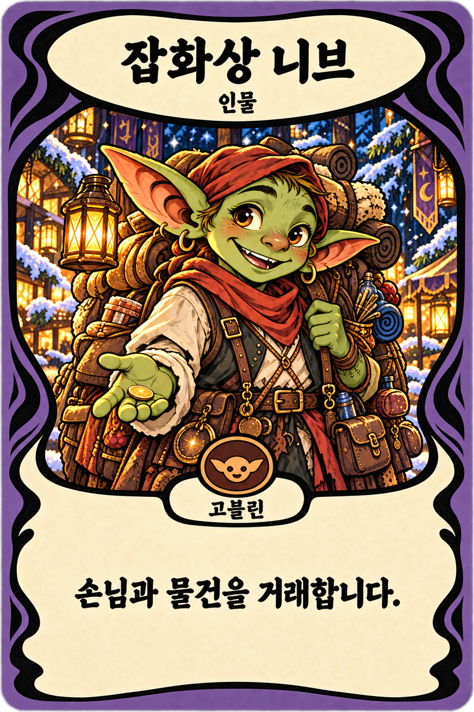
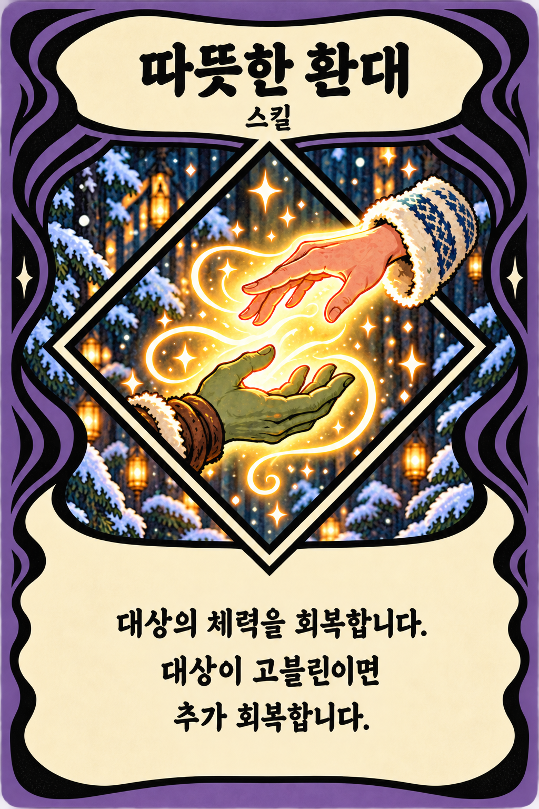
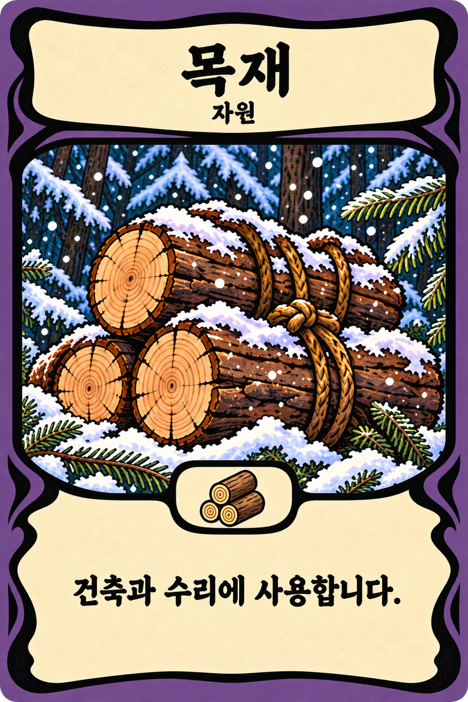
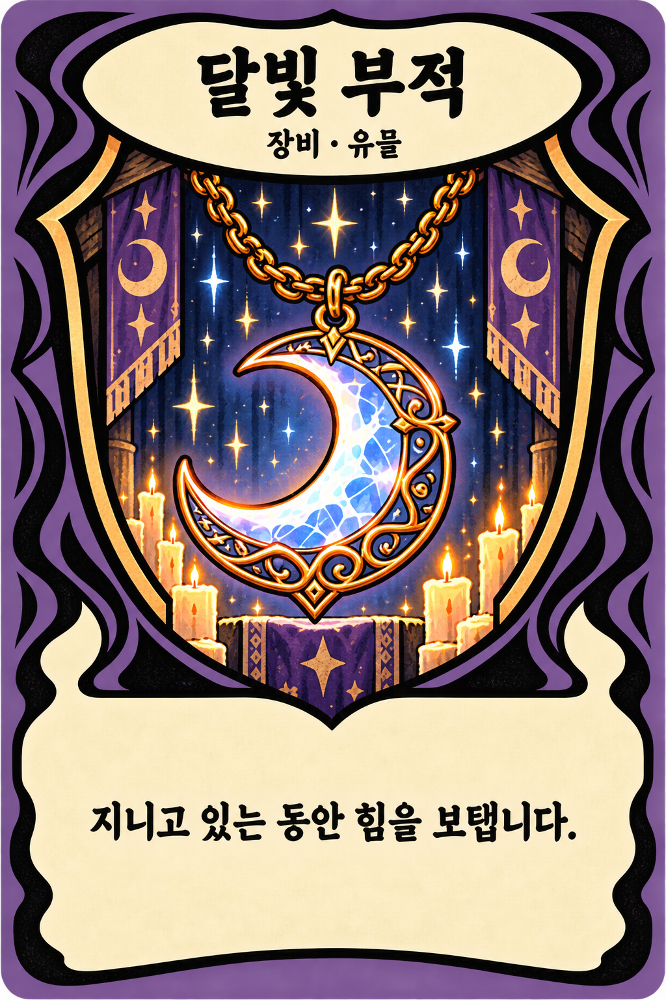
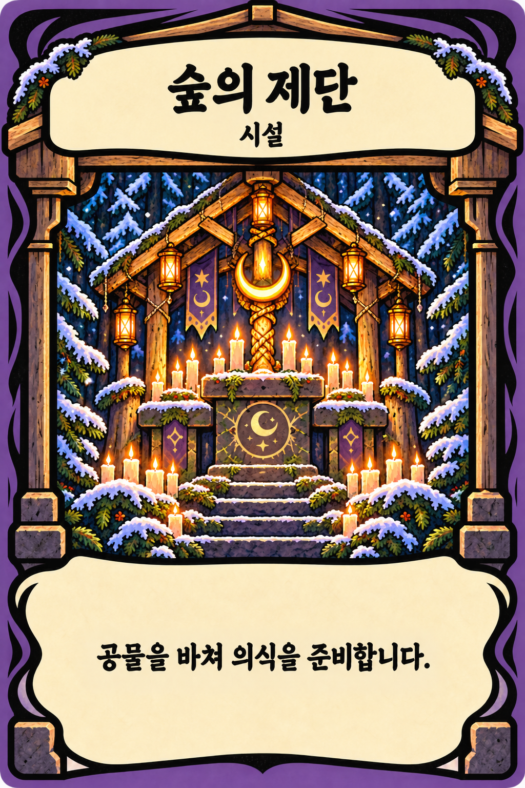
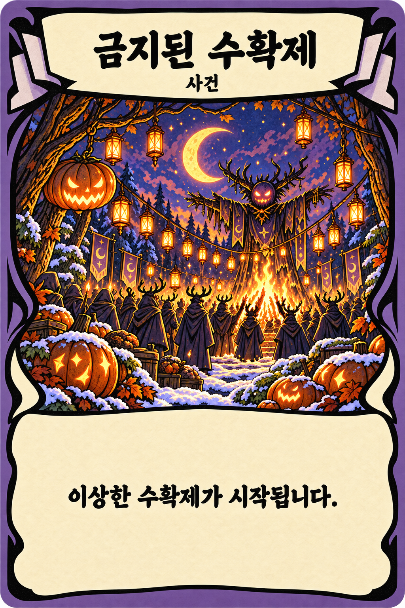

# 역할별 6종 카드 개별화와 다국어 레이아웃 정리 v02

2026-10-16 · 내장 image_gen · 비교판에서 개별 카드로 다시 제작

**제작 기준 승인:** 사용자가 이 6종의 포맷을 앞으로 생성하는 카드에도 지키도록 디자인 가이드에 기록하라고 지시했다. 따라서 이 문서의 최종 개별 PNG 6종은 승인된 시각 참조다. 신규 제작 규칙은 [카드 디자인 가이드](card-design-guide.md)를 따른다. 게임 적용 여부와 예시 카드의 효과 확정은 별개다.

## 기준과 범위

사용자가 전반적으로 선호한 [6종 비교판](../art/concepts/cards/roles-races-v01/01-role-formats-v02.png)을 기준으로 **잡화상 니브·따뜻한 환대·목재·달빛 부적·숲의 제단·금지된 수확제**를 각각 한 장의 카드로 다시 그린다. 비교판을 잘라 확대하는 작업이 아니다. 이후에 탐색한 빈 프레임 v03~v06을 기본 디자인으로 사용하지 않는다. 최근 서리 룬은 별도 스킬 예시로 보존하며 이 여섯 장의 따뜻한 환대를 대체하지 않는다.

사용자는 카드 이름과 설명의 다국어 대응을 위해 최소 영역을 확보하고, 장식 때문에 글칸이 나뉘거나 좁아지는 부분을 면밀하게 정리하도록 요청했다. 이번 범위는 개별 카드 원화·레이아웃 시안과 제작 기준이다. 기존 게임 카드·카탈로그·코드·배포 파일을 교체하지 않는다.

## 공통 여백과 문자 배치 기준

1024×1536, 세로 2:3을 공통 규격으로 사용한다. 카드마다 그림·테두리의 역할별 차이를 유지하면서 이름과 설명의 사용 가능 폭·높이를 우선 확보한다.

| 구역 | 제작 목표 | 용도 |
| --- | --- | --- |
| 제목 | x=110..914, y=72..236, 804×164 | 약 70px/행간 76px 기준 최대 2줄 |
| 분류 | y=267..307 부근, 제목과 별도 줄 | 인물·스킬·자원·장비/유물·시설·사건 |
| 원화 | y=350..1080 부근 | 역할별 창 형태와 주제 유지 |
| 작은 배지 | y=1020..1120 이내 | 종족·자원 표식. 글 영역을 가리지 않음 |
| 설명 패널 | x=55..970, y=1120..1495 부근 | 모든 종류에 하나로 이어진 넓은 크림색 패널 |
| 설명 안전 영역 | x=110..914, y=1185..1445, 804×260 | 약 48px/행간 60px 기준 최소 4줄의 공간 |

짧은 한국어 문구에 맞춰 패널을 줄이거나 글꼴을 과도하게 확대하지 않는다. 다른 언어에서 길어져도 사용할 수 있는 여유를 보인다. 그림의 마름모·방패 끝, 검은 먹선, 종족·자원 아이콘, 제단의 돌·기둥, 종이 접힘과 중앙 문양이 이름·설명 안전 영역에 들어오지 않게 한다.

위 좌표는 이미지 생성에 지시한 **목표 레이아웃**이며, 이미지의 모든 곡선과 여백을 좌표 단위로 강제한 런타임 마스크가 아니다. [레이아웃 목표 JSON](card-role-layout-v02.json)에 동일 기준을 기록한다. 실제 다국어 대응은 프레임·원화·동적 텍스트를 분리하고 언어별 줄바꿈·글꼴·오버플로를 검증할 때 완료할 수 있다. 이번 PNG의 한국어는 시안용 인쇄 문구다.

## 카드별 정리 사항

| 카드 | 유지하는 핵심 | 정리하는 부분 |
| --- | --- | --- |
| 잡화상 니브 | 비교판의 붉은 모자·목도리·초록 고블린 행상인, 초상창·종족 배지 | 종족 배지는 원화 하단에 작게 두고 설명의 폭·높이를 확보 |
| 따뜻한 환대 | 손과 손 사이 회복의 빛, 마름모 스킬 창 | 아래 꼭짓점은 설명 위에서 끝내고 종족 배지를 붙이지 않음. 설명은 3줄로 배치 가능 |
| 목재 | 눈 덮인 묶음 통나무, 단순 직사각 원화창·목재 표식 | 표식 양옆의 중복 먹선·빈 가로 띠·겹친 구획 제거. 설명란은 하나로 합침 |
| 달빛 부적 | 초승달 목걸이, 세로 방패형 원화창 | 방패 끝이 설명란 안으로 내려오지 않게 짧게 정리 |
| 숲의 제단 | 목조 제단·촛불·눈·건축적 프레임 | 원화·계단 높이를 조절해 충분한 설명 높이 확보. 기둥·돌은 글 영역 밖. 제목은 좁은 마름모 표찰 대신 넓은 패널 |
| 금지된 수확제 | 등불·호박·기묘한 축제 장면, 접힌 종이의 외곽 포인트 | 설명 중앙의 갈래 화살표 문양과 V자 홈·분할 제거. 넓고 연속적인 설명 패널 |

카드 문구와 그림의 효과는 비교판 시안의 내용이다. 구체적인 게임 효과나 수치를 새로 확정하지 않는다.

## 생성·검수

[실제 생성 프롬프트](prompts/cards/individual-role-cards-layout-v02-prompts.md)로 카드 6종을 각각 생성하고 기존 파일을 덮어쓰지 않는 새 경로에 저장했다. 제단은 [제목 패널 추가 수정](prompts/cards/individual-role-cards-facility-title-repair-v02.md), 스킬은 [마름모·설명란 여유 추가 수정](prompts/cards/individual-role-cards-skill-footer-repair-v02.md)을 거쳤다. 두 첫 생성본은 같은 폴더의 `drafts/`에 보존한다.

| 카드 | 최종 단일 PNG | 최종 검토 |
| --- | --- | --- |
| 잡화상 니브 | [인물](../art/concepts/cards/roles-individual-v02/01-character-nib.png) | 종족 배지와 설명 영역 분리 |
| 따뜻한 환대 | [스킬](../art/concepts/cards/roles-individual-v02/02-skill-warm-welcome.png) | 마름모 아래 끝을 올리고 설명을 3줄로 배치 |
| 목재 | [자원](../art/concepts/cards/roles-individual-v02/03-resource-timber.png) | 중복 띠·먹선 제거, 자원 표식 하나와 연속 설명 패널 |
| 달빛 부적 | [장비·유물](../art/concepts/cards/roles-individual-v02/04-relic-moonlit-charm.png) | 방패 끝과 설명 분리 |
| 숲의 제단 | [시설](../art/concepts/cards/roles-individual-v02/05-facility-forest-altar.png) | 설명 확대, 돌·기둥은 바깥으로, 제목은 넓은 이름판으로 재수정 |
| 금지된 수확제 | [사건](../art/concepts/cards/roles-individual-v02/06-event-forbidden-harvest.png) | 중앙 문양·분할·V자 홈 제거 |

[최종 PNG 6장 ZIP](../art/concepts/cards/roles-individual-v02/six-role-cards-v02.zip) · [해상도·파일 해시·생성 원본·검수 기록](../art/concepts/cards/roles-individual-v02/manifest.json)

여섯 장 모두 실제 PNG에서 **1024×1536, 2:3**을 확인하고 생성 원본과 복사본의 SHA-256 일치를 검사했다. 최종 제목·분류·인쇄 문구를 원본 크기로 직접 읽고, 목재의 중복 먹선 제거·제단의 넓어진 두 패널·사건 문양 제거·스킬 아래 꼭짓점 여유를 확인했다. ZIP에는 선택된 최종 PNG 6장만 넣었다. 한글 문구는 비교용으로 인쇄된 상태이며 다국어 동적 텍스트 구현은 별도다.

검수 기준은 개별 2:3 파일, 카드 역할·이름·분류·설명 문구, 원화 주제와 창 형태, 제목과 설명 패널의 여유, 사용자가 지적한 불필요한 먹선·중앙 문양·좁은 제단 설명란의 해소다. 한국어 시안의 시각 검수와 파일 치수 검증을 언어별 실제 렌더 검증으로 대신하지 않는다.
