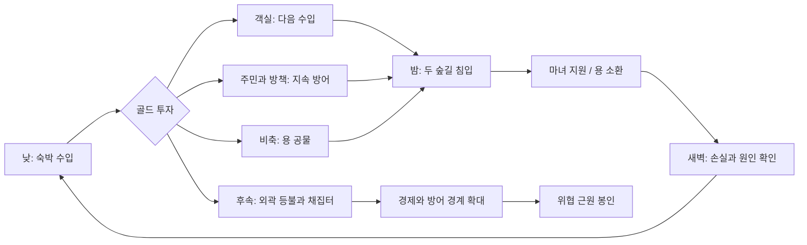
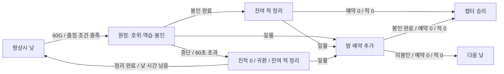

# 마녀산장 × 킹덤 코어 접목 기획서 v0.2

> **변경 전 보존 기록:** 카드 방향 채택 이전의 영구 주민 기반 설계다. 다음 제작 기준은 [카드 코어 v0.3](kingdom-integration-design.md)이며, 인력·양모·야간 제한·경제·원정의 변경은 [충돌 검토](card-core-design-review.md)를 본다. 아래 수치·제작 순서를 최신 요구사항으로 사용하지 않는다.

작성·수정일: 2026-10-13 · 상태: **검토 결과를 반영한 설계 제안** · 대상: Windows PC / 기존 Godot 프로토타입

이 문서는 [킹덤 코어 리서치](kingdom-core-research.md)를 바탕으로 다음 게임플레이를 제안한다. 기존 사용자 결정은 유지 사항으로 명시하고, 신규 규칙과 수치는 최종 확정과 구분한다. 게임 코드는 이번 작성에서 변경하지 않았다.

[v0.1 검토](kingdom-design-review.md)의 9개 항목을 반영했다. 주민 재훈련·후퇴·수리 비용·양의 수입·원정 상태를 구체화하고, 용 공물과 경제 예시를 수정했다. 규칙의 누락은 보완했으나 재미와 전투 밸런스가 검증되었다는 의미는 아니다. 현재 실행판의 공물 120G와 양 생산 없음은 그대로이며, 아래 180G·양모 생산은 다음 구현을 위한 변경안이다.

## 1. 제안의 핵심

**여행자의 숙박비로 산장을 키우고, 일부 여행자를 주민으로 고용해 두 숲길을 지키며, 감당하기 어려운 밤에는 성장을 미루고 용에게 골드를 바치는 게임.**

플레이어는 마녀 한 명을 직접 움직인다. 낮에는 객실·주민·시설에 골드를 투자하고, 밤에는 주민의 자동 방어가 부족한 방향을 지원한다. 살아남은 다음 날에는 복구와 다음 투자 사이에서 다시 판단한다. 이후 숲길의 등불을 복구해 활동 경계를 넓히고, 마지막에는 위협의 근원을 봉인한다.

가져올 구조는 원작의 주민 모집·경제 투자·밤 방어·경계 밖 탐험이다. 공식 Two Crowns 설명도 건설·탐험·방어·공세를 연결한다. [원작 근거](https://store.steampowered.com/app/701160/Kingdom_Two_Crowns/)

**추천 방향:** 기존 쿼터뷰와 자동 공격을 유지하는 접목. 신규 기능의 목적은 마녀 혼자 처리하던 방어를 주민과 투자 판단으로 넓히는 것이다.

## 2. 유지하는 결정과 새로 제안하는 결정

| 구분 | 내용 |
| --- | --- |
| 기존 유지 | 눈 덮인 숲, 중앙의 작은 산장, 작은 양 목장, 따뜻한 창문과 보라 설경 |
| 기존 유지 | 높은 고정 쿼터뷰, 간결한 3D 프랍, SD 마녀, 클릭 이동·가까운 적 자동 공격 |
| 기존 유지 | 여행자의 일정 시간 숙박과 자동 숙박비, 골드 증축, 준비 후 웨이브 |
| 기존 유지 | 산장 파괴 또는 마녀 사망 시 패배. 양 사망은 재구입 가능한 손실 |
| 기존 유지 | 골드 공물, 산장 지붕의 거대한 용, 독립 불덩이를 한 발씩 발사 |
| 신규 제안 | 낮밤 표현, 정착 주민·역할·재훈련·후퇴, 주민이 수행하는 건설 시간, 두 길의 방책 |
| 신규 제안 | 초기 운영금 40G, 길별 병력 배치와 침입 예고 |
| 신규 제안 | 양모 수입, 하루 1회 환대/주민 식사 선택, 바깥 등불·채집터·근원 봉인 |
| 수정 수치 | 용 공물 120→180G, 방책 수리·재건 비용 변경. 기존 확정 콘셉트를 유지한 시험값 |
| 시험 수치 | 고용·도구·방책 가격, 주민 피해량, 작업 시간, 적 분배 등 아래 초기값 |

기존 [인수인계](godot-prototype-handoff.md)의 ‘현재 프로토타입’과 본 문서의 ‘다음 제안’을 함께 보되, 본 문서를 이미 승인되거나 구현된 요구사항으로 해석하지 않는다.

## 3. 설계 목표

| 목표 | 플레이 중 확인할 장면 |
| --- | --- |
| 같은 골드로 서로 다른 미래를 선택 | 객실을 지으면 오늘 용 공물이 부족해짐 |
| 주민의 역할이 눈에 보임 | 목수가 방책을 완성하고, 사냥꾼이 그 뒤에서 적을 잡음 |
| 마녀의 지원 방향이 중요 | 한 길은 주민에게 맡기고 다른 길의 양 공격자를 막음 |
| 손실을 복구할 수 있음 | 방책 파괴·주민 이탈 뒤 다음 날 다시 고용·수리 |
| 산장 운영과 방어가 연결 | 손님에게 받은 돈으로 그 산장과 양을 지킴 |
| 밖으로 나갈 이유가 있음 | 등불 너머의 채집터로 경제를 키우되 외곽을 보호해야 함 |

마녀의 공격이 약하다는 인상을 만드는 것이 목표는 아니다. 준비를 잘한 판과 준비가 부족한 판의 차이가 마녀 조작만으로 완전히 사라지지 않아야 한다.

## 4. 한 판의 흐름

첫 실험은 현재 3웨이브를 사용해 3일/3밤을 검증한다. 이후 영역 확장과 근원 봉인을 붙여 한 챕터를 8~12일, 약 20~30분으로 만드는 것을 장기 출발안으로 제안한다. 실제 시간은 전투와 일시 정지에 따라 달라지며 아직 측정하지 않았다.



- 낮은 90초. 평상시 낮에는 적이 없고 신규 손님이 방문한다. P1에서 플레이어가 봉인 원정을 시작하면 예고된 원정 전투가 발생한다(§11).
- 밤에는 신규 숙박·고용·재훈련·증축·수리·양 구입을 중단한다. 마녀 이동·자동 공격, 길별 후퇴 명령, 용 소환은 가능하다.
- 밤은 고정 시간 만료가 아니라 **출현 예약 0 + 살아 있는 적 0**일 때 끝난다. 도망친 적을 시간으로 삭제하지 않는다.
- 새벽 정리는 2~3초. 손실과 수입을 표시한 뒤 다음 낮으로 넘어간다.
- 3번째 밤 생존은 첫 실험의 시연 완료다. 양·주민 전원 생존이나 용 사용은 필수 승리 조건이 아니다.
- 산장 또는 마녀 사망이 웨이브 완료와 동시에 발생하면 기존처럼 패배를 우선한다.
- 관리 패널의 일시 정지는 첫 실험에 유지한다. 정지 중에는 수입·작업·이동·준비 타이머가 모두 멈춘다. 작업은 창을 닫은 뒤 진행하므로 정지 상태에서 건설을 완료할 수 없다. 준비 시간 자체의 압박은 패널 정지를 없앤 별도 비교판에서 검증한다.
- 전투가 시작되면 관리 패널을 닫고 예약한 공사·재훈련을 중단한다. 낮 원정의 잔여 적이 있을 때에도 관리 패널을 열거나 작업을 재개할 수 없다. Esc의 전체 일시 정지는 언제든 가능하다.
- 하루는 낮 시작부터 다음 낮 시작 전까지다. 용 사용과 운영 선택의 1회 플래그는 낮 시작에 초기화한다. 원정과 밤이 이어져도 같은 하루로 센다.

## 5. 공간과 조작

중앙 산장과 오른쪽 목장을 유지한다. 두 숲길을 A·B로 식별하고, 각 길에 산장 가까운 **안쪽 방책 슬롯 1개**를 둔다. 방책 뒤에는 사냥꾼 자리 2개를 둔다. 시설은 지정 슬롯만 사용하고 자유 건축은 넣지 않는다.

```text
외곽 A: 등불·채집터 ─ A 방책·사냥꾼 ─┐
                                       중앙 산장 ─ 작은 양 목장
외곽 B: 등불·단서   ─ B 방책·사냥꾼 ─┘
```

이 그림은 연결 관계다. 화면에서는 기존 두 갈래 숲길의 실제 배치에 맞춰 좌우 위쪽으로 읽히게 한다. 외곽 A·B는 후속 단계이며 첫 화면에는 마녀·산장·양만 보인다.

| 입력·대상 | 제안 동작 |
| --- | --- |
| 빈 지면 좌클릭 | 기존 클릭 이동 |
| 주민 후보·건설 슬롯·산장 클릭 | 대상으로 이동. 1.5m 이내에서 간단한 행동 UI 표시 |
| 행동 버튼 | 정확한 비용·효과·작업 시간을 확인하고 결제 |
| 사냥꾼 클릭 | 낮에 A/B 배치 변경. 병사의 이동은 자동 수행 |
| 길별 후퇴 버튼 | 전투 중 그 길의 사냥꾼을 한 단계 안쪽으로 후퇴. 무료, 시간은 계속 진행 |
| 용 공물 버튼 | 밤 또는 P1 원정에 결제와 소환 요청, 세계 시간 계속 진행 |

처음에는 기존 관리 패널을 재사용해 주민과 방책 선택의 가치를 확인할 수 있다. 현장 접근 조작은 다음 단계에서 추가한다. 서로 겹치는 대상은 건설/주민 선택을 우선하고, 이동 명령이 결제를 자동 실행하지 않게 한다.

## 6. 숙박객과 정착 주민

숙박객은 돈을 내고 떠나는 수입원이다. 정착 주민은 별도로 고용한 작업·방어 인력이다. **같은 방문자를 수입과 주민 수에 중복 집계하지 않는다.** 첫 실험의 후보는 숙박 묶음과 함께 오는 별도 NPC로 표시한다.

| 규칙 | 초기 제안 |
| --- | --- |
| 숙박객 | 기존 5·30·60초 도착, 20초 뒤 1인 15G 지급 |
| 후보 도착 | 첫 낮 5초에 2명, 이후 낮 5초에 1명. 미고용 후보는 낮 종료 시 퇴장 |
| 주민 정원 | P0 최대 4명. 무직·이탈·재훈련 주민도 포함. P1은 주민 숙소 증축으로 최대 6명 |
| 고용 | 10G. 주민이 공용 도구대로 이동 |
| 역할 도구 | 목수 또는 사냥꾼 20G. 고용+도구 합계 30G |
| 배치 | 사냥꾼은 낮에 A/B 선택. 명령 이후 이동을 완료해야 방어 시작 |
| 역할 변경 | 낮에 새 도구 20G + 도구대에서 8초 재훈련. 고용료를 다시 받지 않음 |

도구 구매는 즉시 해당 주민에게 예약한다. 지급 전 무직 주민이 없으면 구매 불가다. 여러 주민이 같은 도구를 중복 가져가지 않는다.

### 역할 변경과 정원 복구

활동 주민은 20G로 다른 역할을 배운다. 전환 시작부터 완료까지 작업·공격을 하지 않고, 완료할 때 역할을 바꾼다. 밤이 오면 도구대/산장 안에서 대기하고 다음 낮에 남은 시간을 이어간다. 취소하면 기존 역할로 돌아가고 전액 환불한다. 기존 도구를 팔아 골드를 얻지는 않는다.

이탈 주민도 20G를 내고 원래 역할 또는 다른 역할을 선택해 8초 뒤 복귀한다. 도구 복구와 재훈련을 중복 결제하지 않는다. 무직 주민의 첫 도구도 도구대에서 8초 지급 시간을 사용한다. 완료 시 체력은 그 역할의 기본 최대치까지 회복한다.

마지막 목수를 전환할 때는 미완성 공사 목록을 경고한다. 전환을 허용하되 작업은 진척을 보존한 채 대기하고, 새 목수가 생기면 재할당한다. 새벽에 이탈 주민을 정원에서 지우지 않는다. 잘못 고용한 목수 4명도 60G와 순차 작업으로 목수1·사냥꾼3 구성을 만들 수 있다.

### 목수

건설·복구 작업을 예약 순서대로 1개씩 수행한다. 여러 목수가 한 작업을 가속하지 않고 다른 작업을 맡는다. 목수가 없으면 신규 공사 결제를 막고 ‘목수 필요’를 보여준다. 작업 대상까지 이동하는 시간은 작업 시간에 추가된다.

밤이 시작되면 공사를 중단하고 산장으로 귀환한다. 진척은 유지하며 다음 낮에 이어서 작업한다. 미완성 방책은 방어력을 제공하지 않고, 미완성 객실은 정원을 늘리지 않는다. 예약 중인 같은 슬롯에 중복 결제할 수 없다.

낮 원정이 시작될 때도 같은 귀환 규칙을 적용한다. 원정/잔여 적 정리 후 낮 시간이 남으면 작업을 재개한다. 무직·재훈련 주민은 산장 내부에 머물며 적의 공격 대상이나 공격을 유도하는 미끼로 등록하지 않는다. 목수가 귀환하는 이동 중에는 피해를 받을 수 있다.

### 사냥꾼

지정 길의 가장 바깥쪽 완성 방책 뒤에 서서 범위 내 적을 자동 공격한다. 목표는 해당 길에서 방책/산장에 가장 가까운 적을 우선하며 양을 향해 빠져나온 적도 범위 내면 공격한다. 첫 실험에는 낮의 사냥 수입을 추가하지 않는다.

초기 전투값은 체력 40, 공격 8, 간격 1.5초, 사거리 6m, 이동 2.5m/s다. 마녀의 기존 공격 12/1초, 사거리 4m는 첫 비교의 기준으로 유지한다. 사냥꾼을 강하게 키워 마녀 지원을 불필요하게 만드는지 함께 확인한다.

목수·채집꾼도 기본 체력 40, 이동 2.5m/s로 시작하며 전투 공격은 하지 않는다. 무직·이탈·재훈련 주민은 산장 내부 비전투 상태다. 주민 식사로 활동 주민 최대 체력이 50이 되는 효과와 이 기본값을 구분한다.

### 방책 파괴와 후퇴

사냥꾼은 **현재 방책 → 같은 길의 살아 있는 안쪽 방책 → 산장 방어 자리** 순서로 후퇴한다. 처음부터 방책이 없으면 산장 방어 자리에서 시작한다. 외곽/안쪽 방책마다 자리 2개를 사용하고, 자리가 꽉 차면 다음 안쪽 자리를 선택한다. 산장에는 주민 정원만큼의 예비 방어 자리를 둔다.

방책이 파괴되거나 플레이어가 길별 후퇴 명령을 누르면 해당 길의 사냥꾼이 한 단계 후퇴한다. 이동 중 공격하지 않으며 정상적으로 피격된다. 공격 대기시간은 이동 중에도 흐르지만 멈췄을 때 한 발만 발사하고 밀린 공격을 몰아서 쏘지 않는다. 전투 중 바깥으로 재전진하거나 다른 길로 바꾸는 명령은 없다. 반복 후퇴는 산장 자리에서 멈춘다.

낮에 정한 희망 방어 위치와 현재 위치를 따로 저장한다. 다음 낮에는 살아 있는 주민이 희망 위치로 돌아가되, 그 방책이 아직 파괴되어 있으면 안쪽에서 대기한다. 복구 완료 후 재전진한다. 후퇴 명령은 피격 무효·체력 회복 효과를 주지 않는다.

### 주민 손실과 회복

주민은 체력이 0이 되면 역할 도구를 잃고 비전투 ‘이탈 주민’ 상태로 산장에 귀환한다. 이탈 중에는 다시 공격받지 않는다. 다음 낮에 20G·8초로 도구를 재지급/변경하면 체력 최대로 역할을 복구한다. 이미 고용된 주민이므로 다시 10G를 받지 않는다. 다른 주민의 밤 피해는 다음 낮 시작에 기본 체력 최대로 회복하는 단순 규칙을 사용한다.

목수가 이탈하면 진행 중 작업의 진척은 유지하고 다음 낮 복구된 목수에게 재예약한다. 모든 주민이 이탈해도 산장·마녀가 살아 있으면 계속 플레이한다. 주민 회복은 신규 제안이며 기존 양의 **사망 후 20G 재구입**과 구분한다.

## 7. 시설과 건설

| 항목 | 비용 | 작업 시간 | 효과 |
| --- | --- | --- | --- |
| 목수 고용+도구 | 30G | 도구대에서 8초 + 이동 | 건설·복구 가능 |
| 사냥꾼 고용+도구 | 30G | 도구대에서 8초 + 배치 이동 | 지정 길 자동 방어 |
| 재훈련/이탈 주민 복귀 | 20G | 도구대에서 8초 + 이동 | 선택한 역할·기본 최대 체력으로 복귀 |
| 안쪽 방책 | 길마다 20G | 목수 8초 | 체력 100, 침입을 지연 |
| 방책 강화 | 길마다 30G, 1회 | 목수 12초 | 최대 체력 180으로 증가, 완성 시 체력 최대 |
| 객실 1회 증축 | 기존 60G | 목수 20초 | 완성 후 도착 묶음부터 정원 2→3 |
| 산장 수리 | 기존 10G | 목수 5초 | 체력 +50, 최대치 제한 |
| 방책 수리 | 손실 체력 50당 5G, 올림 | 구간당 목수 2초 | 예약 시 손실 체력만큼 회복, 최대 체력 제한 |
| 방책 재건 | 기본20G / 강화30G | 목수 8초 / 12초 | 기존 등급 보존, 체력 최대 복원 |
| 마녀 회복 | 기존 10G | 즉시 | 체력 +50 |
| 양 재구입 | 기존 20G | 즉시 | 기존 빈 슬롯, 최대 3마리 |
| 용 공물 | 수정안 180G | 기존 등장 1초 | 현재 전투 종료까지 중앙 방어, 하루당 1회 |
| 주민 숙소 증축(P1) | 60G, 1회 | 목수 20초 | 주민 정원4→6. 숙박객 정원은 그대로 |

모든 시간은 월드가 진행하는 동안의 작업 시간이다. 구매할 때 한 번 결제한다. 효과는 완료할 때 한 번 적용한다. 전액 결제와 효과를 분리해 기록하며, 정지·낮밤 전환·주민 이탈로 다시 결제하지 않는다. 부분 결제·경매·유지 급여는 첫 실험에 없다.

방책 수리는 손상되어 있으나 파괴되지 않은 경우에만 선택 가능하다. 기본 방책의 완전 수리는 최대 10G·4초, 강화 방책은 최대 20G·8초이므로 파괴 후 재건보다 저렴하고 빠르다. 손실량·회복량·비용은 예약 시 확정한다. 완료할 때 예약한 회복량을 더하고 최대 체력으로 제한한다. 전투 전 중단된 작업이 밤을 지나면 새 피해까지 무료로 복구하지 않으며, 남은 피해는 다음 작업으로 수리한다.

원정/밤에 수리 대상이 파괴되면 작업을 취소하고 해당 결제액을 자동 환불한다. 다음 낮에 재건을 새로 예약한다. 강화 작업 중인 기본 방책이 파괴되어도 강화 작업을 취소·환불하고, 재건 후 다시 강화해야 한다. 부분 공사 진척만으로 방어 등급이 올라가지 않는다.

재건은 파괴된 경우에만 제공하며 강화 이력을 유지한다. 불필요한 수리·이미 완성/예약된 공사·빈 양 슬롯 없음·골드 부족은 사유와 함께 비활성화한다. 완성 전 공사 취소는 낮에만 허용하고 결제액을 전액 환불한다. 완료 후 철거·환불은 첫 실험에 없다.

취소한 작업의 진척은 폐기한다. 전액 환불을 받은 뒤 진척만 재사용할 수 없다. 낮밤 전환으로 중단된 작업은 취소와 구분하며 진척과 결제를 그대로 유지한다. 파괴에 따른 자동 환불도 해당 작업의 진척을 폐기한다.

### 양의 보호 보상

2일차부터 낮 시작에 살아 있는 양 1마리당 양모 판매 4G를 한 번 지급한다. 첫날에는 지급하지 않는다. 최대3마리이면 하루12G이며, 오늘 구입한 양은 다음 낮부터 생산한다. 양20G의 단순 회수 기간은 생산5회다. 손실 기록과 일일 지급 플래그로 같은 양의 중복 지급을 막는다.

양이 전멸해도 숙박비·손님 수를 줄이지 않는다. 양을 버려 당장20G를 아끼는 선택과, 장기 생산을 회복하는 선택을 남긴다. 첫 3일판만으로 5회 생산의 가치를 판정하지 않고 장기판에서 검증한다.

### 하루 한 번 산장 운영 선택

낮 10초에 공용 식재료로 할 일을 선택하는 작은 요청을 표시한다. 별도 재료 인벤토리는 만들지 않는다. 60초 전까지 시작해 마녀가 산장 문가에서10초 준비한다. 이동하면 준비가 취소되고 다시 선택할 수 있으며, 완료 후에는 같은 날 변경하거나 보상을 반복 수령할 수 없다. 전투 시작 시 미완료 준비는 취소된다.

| 선택 | 효과 | 선택할 이유 |
| --- | --- | --- |
| 여행자 환대 | 완료 시 추가 접객비15G | 공물·증축·수리 자금이 필요함 |
| 주민 식사 | 완료 후 도구를 든 주민의 오늘 최대 체력·현재 체력 +10 | 사냥꾼 이탈과 도구 복구 비용을 줄이고 싶음 |

식사 효과는 그날 나중에 역할을 얻은 주민에게도 적용한다. 이탈 후 새로 복귀해도 중복으로 +10을 더하지 않는다. 다음 낮에 효과를 제거하고 기본 최대 체력으로 정상 회복한다. 산장·마녀·양에는 적용하지 않는다. 손님 기본 입실·숙박비는 선택하거나 요청을 무시해도 유지한다. 원정과 밤은 같은 날의 효과를 공유한다.

이 선택은 하루15G와 주민의 생존 여유 사이의 시험안이다. 낮 유휴 시간이 줄고 두 선택의 사용 상황이 생기는지 확인하며, 숫자만 다른 필수 반복 클릭으로 굳으면 작업을 자동화하거나 요청 방식을 조정한다.

## 8. 두 숲길의 밤 방어

적은 경로별로 산장 또는 양 목표를 가진다. 완성된 방책이 해당 경로를 막으면 먼저 방책을 공격한다. 방책이 무너지면 기존 산장/양 목표로 진행한다. 마녀가 근접할 때 마녀를 공격하는 기존 규칙을 유지한다. 사냥꾼은 방책 뒤에 배치하고, 돌파한 적이 사거리 내 주민과 마주치면 주민을 공격할 수 있게 한다.

방책은 단순 장식 충돌체가 아니라 **경로의 통과 상태를 가진 방어 노드**로 구현한다. 적이 공격 위치로 이동하고 파괴 후 통과하도록 한다. 좁은 길을 우회해 방책을 무시하거나, 내비메시가 막혀 영구 정지하지 않아야 한다. 아군과 손님에게는 방책의 통과 지점을 제공한다.

| 밤 | 기존 총수·체력 | 제안 A/B 분배 | 검증 목적 |
| --- | --- | --- | --- |
| 1 | 5명 / 36 | 3 / 2 | 주민·방책 효과, 한 길 마녀 지원 |
| 2 | 9명 / 48 | 3 / 6 | 적은 방향은 주민에게 맡기고 강한 방향 지원 |
| 3 | 18명 / 60 | 10 / 8 | 영구 방어 투자와 용 비축의 비교 |

첫 비교판의 출현 예약은 다음처럼 고정한다. 같은 판에서 전략만 바꾸어 비교하며, 일반 HUD는 낮에는 길별 총강도를 보여주고 각 묶음이 출현하기 5초 전에 방향을 알린다. 밤 시작 0초 묶음은 낮 종료 5초 전에 예고한다.

| 밤 | 시각: 길·인원 | 양 목표 수 A/B |
| --- | --- | --- |
| 1 | 0초:A3, 8초:B2 | 0 / 1 |
| 2 | 0초:A3, 5초:B3, 10초:B3 | 1 / 2 |
| 3 | 0초:A3, 3초:B3, 6초:A3, 9초:B3, 12초:A4, 15초:B2 | 2 / 2 |

A의 초반 무리→B의 후속 무리처럼 지원 위치를 바꿀 이유를 만든다. 양 목표는 해당 길의 예약에 고르게 분산한다. 표는 기존 총인원·체력을 유지하면서 출현 방향을 수정한 안이다. 고정 위치로도 같은 결과가 나면 실제 접근 시간을 측정해 간격을 조정한다.

양 목표 적 수는 기존 1·3·4명을 첫 비교값으로 유지한다. 적 종류·피해·공격 간격도 기존값으로 시작한다. 길별 배정은 고정 비교표를 사용하고, 보유 골드에 따라 몰래 적을 강화하지 않는다. 위 분배로 실제 생존이 가능한지는 아직 검증하지 않았다.

낮 시작부터 오늘 밤 A/B의 상대적 위협을 표시하고, 마지막 15초에는 방향별 강도를 강조한다. 첫 버전은 정확한 수까지 디버그에서 확인하고 일반 HUD에서는 ‘적음/많음’을 사용한다. 마녀가 실제로 양쪽 사이를 이동할 시간을 확보한다.

## 9. 용: 영구 성장과 경쟁하는 비상 선택

용은 지붕 위 등장, 강력한 단발 불덩이, 해당 전투가 끝날 때까지 방어하는 기존 정체성을 유지한다. **다음 버전의 시험 공물은180G**이며 하루당1회다. P0에는 밤에만, P1에는 낮 원정 또는 밤에 사용한다. 낮 원정에 사용했으면 같은 날 밤에는 다시 부를 수 없다. 새로운 마나 비용이나 지속 시간 제한은 붙이지 않는다.

용을 쓰면 현재 밤은 편해지지만 골드가 소모되고 객실·주민·경계 확장을 미루게 된다. 용은 피해를 되돌리는 회복기가 아니므로 파괴 전에 판단해야 한다. 소환 중에도 공격은 계속된다. UI는 현재 골드뿐 아니라 ‘소환 후 잔액’을 표시한다.

중앙 경제의 최대 일일 수입은 숙박135 + 양모12 + 환대15 = **162G**다. 공물180G를 매일 쓰면 외곽 수입과 손실을 제외해도 하루18G씩 비축이 줄어든다. 식사를 선택하면147G 수입으로 하루33G가 줄어든다. 용을 몇 밤 연속 쓰는 것은 허용하지만 중앙 산장의 수입만으로 무한 반복 소환이 자급되지는 않는다.

P1의 용은 산장을 중심으로 반경12m의 중앙 방어권에서만 목표를 잡는다. P0의 안쪽 방책·목장·산장 공격 위치는 모두 그 안에 배치한다. 외곽 등불·채집터·봉인 장소는 바깥에 배치하고 용 사거리 밖임을 UI에 표시한다. 중앙으로 들어온 적은 용이 처리하지만 외곽 주민과 원정 호위까지 대신 지켜주지는 않는다. 아군 피해는 없다.

외곽 생산을 키우면 하루 수입이180G를 넘을 수 있다. 그때의 반복 소환을 금지하지 않고, 외곽을 유지하는 주민·시설 투자와 출정에 남길 골드가 필요한 선택으로 검증한다. 중앙 방어권은 P1의 범위 변경안이며 현재 실행판의30m 사거리와 구분한다.

‘매일 용’ 전략을 비교군에서 제외하지 않는다. 생존률·완료 시간·최종 잔액·유지한 병력/시설을 함께 비교한다. 주민 방어보다 모든 지표에서 우세하면 일반 방어 효율과180G의 비용을 다시 조정한다. 위 산술은 반복 자급의 문제를 보완한 것이며 재미와 생존 난이도를 입증한 결과는 아니다.

## 10. 경제 계산과 첫 3일 예시

### 공통 초기값

- **신규 제안:** 시작 골드 40G. 첫 화면에는 주민 없이 기존 산장·마녀·양만 표시한다.
- **기존 기준:** 손님은 낮 5·30·60초 도착, 요금 지급은 25·50·80초. 묶음 인원은 도착 때 확정한다.
- 기본 수입은 2명 × 3묶음 × 15G = 90G/낮. 증축 완료 후 모든 묶음이 3명이면 135G/낮.
- 입실 후 증축되어도 이미 정해진 묶음 인원을 늘리지 않는다. 채집 수입·적 처치 보상은 첫 3일 계산에서 0이다. 양 3마리 생존 시 2일차부터 낮 시작에 12G를 추가한다.
- 아래 기본 비교는 주민 식사 선택 또는 운영 요청 미완료로 환대 15G를 받지 않는 경우다. 환대를 완료한 날은 그날 잔액에 15G를 더하되 주민 체력 보너스는 없다.
- 아래 잔액은 시설·주민 손실과 수리·회복·양 재구입이 없는 산술 예시다. 생존 보장이나 실제 테스트 결과가 아니다.

### 1일차 공통 예시

| 낮 시점 | 행동·수입 | 잔액 |
| --- | --- | --- |
| 시작 | 운영금 | 40G |
| 5초 이후 | 후보 1명 고용+목수 도구 30G | 10G |
| 25초 | 첫 숙박비 +30G, A 방책 20G 예약 | 20G |
| 50초 | 두 번째 숙박비 +30G, 사냥꾼 30G와 B 방책 20G | 0G |
| 80초 | 세 번째 숙박비 +30G | 30G |
| 밤 | 사냥꾼 A 배치, 마녀 B 지원 | 30G |

방책 작업 8초에 이동 시간을 더해도 해질 때까지 완성될 수 있도록 슬롯·도구대를 가까이 둔다. 목수의 A→B 총 이동이 길면 예약 시 ‘해지기 전 완료 예상’을 보여준다. 이 예시가 첫날 필수 구매 순서를 강제하는 튜토리얼이 되어서는 안 된다.

### 2~3일차 선택의 갈림길

| 경로 | 2일차 | 2번째 밤 뒤 | 3일차 | 3번째 밤 뒤 |
| --- | --- | --- | --- | --- |
| 영구 방어 | 이월30 + 양모12 + 숙박90 =132. 사냥꾼30 + A방책 강화30 | 72G, 용 사용 불가 | 이월72 + 양모12 + 숙박90 =174. 사냥꾼30 + B방책 강화30 | 114G, 목수1·사냥꾼3·강화 방책2개 |
| 성장 후 비상 공물 | 낮 시작 이월30 + 양모12 =42. 25초 숙박비30을 받아 객실60 예약. 60초 전 완료하면 숙박105. 사냥꾼30 추가 | 57G, 용 사용 불가 | 이월57 + 양모12 + 숙박135 =204. 용180 | 24G, 목수1·사냥꾼2·객실·용 사용 |

성장 경로의 2일차 객실 완성 시점은 **목수 이동을 포함해 60초 도착 전**이라는 전제다. 30초 묶음은 증축 전에 도착하므로 2명이다. 60초 이후라도 해지기 전에 완성하면 오늘 숙박 수입은 90G, 밤 잔액은 42G가 되고, 3일차 180G 공물 후 잔액은 9G다.

밤에 중단된 공사가 3일차 5~30초 사이에 완성되면 그날 숙박 수입은 120G, 양모 포함 잔액은 174G로 공물이 부족하다. 이때 환대 15G를 택하면 189G를 모을 수 있다. 완성이 30초 이후로 더 늦으면 수입도 더 줄어들므로 환대만으로 공물을 확보한다고 보장하지 않는다. 기존 ‘즉시 증축’ 계산을 건설 시간 추가 후 그대로 사용하지 않는다.

2일차에는 두 경로 모두 사냥꾼 2명으로 A/B를 나누고 마녀가 강한 B를 지원한다. 영구 방어는 강화 방책으로 버티고, 성장 경로는 기본 방책으로 버티며 3번째 밤의 용을 준비한다. **두 경로 모두 실제로 생존 가능한지** 비교한다. 한 경로만 가능하면 선택이 아니라 정답 순서가 된다.

180G 공물은 첫날의 공통 구매를 따른 경우 2번째 밤까지 모이지 않는다. 조기 공물이 필요하면 첫날의 사냥꾼·방책 투자를 줄여 비축해야 하므로 첫밤이 더 위험해진다. 조기 공물 경로는 별도 비교군이며 정상 신규 사용자에게 필수로 요구하지 않는다.

끝의 현금 114G와 24G만 비교하지 않는다. 영구 방어는 사냥꾼 3명·강화 방책 2개를 유지하고, 성장 경로는 객실을 통해 다음 낮부터 45G의 추가 숙박 수입을 얻는다. 최종 시설·주민·양·피해와 장기 소환 가능성을 함께 평가한다.

완전 가동 객실의 추가 수입은 하루 45G다. 비용 60G의 단순 회수 기간은 약 1.33일이지만, 실제로는 완성 시점·남은 일수·손실 비용을 포함해야 한다. 첫 3일 실험은 장기 경제의 충분한 증거가 아니다.

## 11. 영역 확장과 근원 봉인 — 코어 완성 단계

이 단계는 첫 3일 실험 다음에 필요하다. 주민과 방책만 넣고 이 단계가 없으면 ‘산장 주변의 경제형 방어 실험’까지 구현한 것이며, 탐험·경계 확장·공세를 포함한 전체 접목이 완성된 것은 아니다.

### 바깥 등불과 전진

- 두 길의 기존 안쪽 방책 너머에 복구 가능한 등불 노드를 둔다. 낮에 마녀가 접근해 발견하고 40G로 목수에게 15초 복구를 맡긴다.
- A 등불 완성은 채집터, B 등불 완성은 봉인 단서를 공개한다. 바깥 방책 슬롯은 각 길에 1개씩 공개한다. 두 길 모두 생산을 주어 같은 선택으로 만들지 않고, A의 추가 수입과 B의 목표 접근을 구분한다. 몬스터 생성 예약은 유지하고 방어선을 더 바깥에 세울 수 있다.
- 방어선을 자동으로 이동시키지 않는다. 바깥 방책 20G를 완성한 뒤 낮에 사냥꾼 배치를 전진시킨다. 안쪽 방책은 돌파 후의 예비선으로 남는다.
- 외곽 등불 체력은 출발값 100. 적이 바깥 방책을 돌파하면 등불을 공격할 수 있다. 파괴 시 채집 생산을 멈추고 이미 공개한 지형·단서는 다시 숨기지 않는다.
- 등불은 기본 방책과 같은 수리 공식(손실 체력 50당 5G·2초)을 사용한다. 파괴되면 20G·목수 10초로 복구한다. 공개한 건설 슬롯은 유지되며 남은 바깥 방책도 사라지지 않는다. NPC의 이동·생산 상태와 조명 상태를 분리한다.

현재 고정 카메라와 투영된 지면 이미지는 넓은 탐험을 그대로 지원한다고 가정할 수 없다. 외곽은 한 화면 가장자리의 짧은 구간으로 먼저 시험한다. 화면 밖으로 확장할 때는 제한된 카메라 이동과 지면 표현을 별도 검토하고, 기존 승인 원화의 시작 구도를 보존한다.

### 추가 수입: 채집꾼

새 역할인 채집꾼은 고용 10G+도구 20G·8초로 시작한다. A 등불이 살아 있는 낮에 채집터로 이동해 15초 일하고, 산장으로 귀환해 30G를 한 번 지급한다. 채집터는 1일 1회 생산하며 여러 채집꾼을 고용해도 총수입은 30G다. 주민의 중복 출발을 막기 위해 작업자 1명을 예약한다. 일반 주민과 마찬가지로 다른 역할로 재훈련할 수 있다.

해질 때 미완료면 지급하지 않고 귀환한다. 원정이 시작되어도 작업을 중단하고 귀환한다. 지급 전 등불이 파괴되거나 작업자가 이탈하면 해당 운반은 실패하며, 이미 지급한 골드는 회수하지 않는다. 다음 낮에 새 작업을 시작한다. 완료·실패 상태는 채집터의 일일 플래그로 기록한다. 첫 3일 실험에는 이 역할이 없다.

등불 40 + 채집꾼 30의 경제 투자 70G는 손실·이동을 제외하면 수입 30G 기준 약 2.33회 성공 작업으로 회수된다. 방책 20과 사냥꾼 30을 추가하면 신규 투자 120G, 작업 4회다. 정원 확대까지 필요하면 숙소 60G를 더해 180G, 작업 6회다. 8~12일 목표 챕터에서 늦은 확장이 이득이 없는 선택이 될 수 있으므로 남은 일수와 실제 생산 실패를 함께 본다. 이미 있는 주민의 재훈련·재배치를 사용하면 신규 고용 비용이 달라진다.

### 장기 목표: 위협 근원 봉인

B 등불을 복구해 단서를 발견하면 봉인 장소가 공개된다. A 등불 복구나 특정 일수 도달은 필수 조건이 아니다. 최소 준비로 조기 출정하는 것도 허용하고 실제 전투 위험으로 판단하게 한다. 8~12일은 목표 플레이 길이이며 강제 대기 일수가 아니다.

| 항목 | P1 출발 규칙·시험값 |
| --- | --- |
| 출정 조건 | 평상시 낮, 오늘 원정 미시도, B 등불 생존, 단서 발견, 낮 남은 시간 60초 이상, 활동 사냥꾼 1명 이상, 60G 이상 |
| 결제 | 출정 확정 시 60G. 원정 예약을 동시에 등록. 후퇴·실패에는 환불 없음 |
| 병력 | 활동 사냥꾼 중 호위 인원 선택. 나머지는 기존 길·산장 방어 유지. 호위 2명 이상 권장 표시 |
| 이동 | 마녀는 클릭 이동, 호위는 봉인 장소로 자동 이동. 산장에서 봉인 장소까지 편도 10초 이내를 배치 검증 기준으로 사용 |
| 봉인 | 장소 1.5m 이내에서 버튼을 눌러 15초 작업. 작업 중 마녀 자동 공격 중단. 피격은 작업을 끊지 않으며 이동하면 진행 0으로 중단 |
| 시간 한도 | 출정부터 60초 안에 봉인 작업 완료. 시간 초과면 시도 실패·진척 0, 호위 자동 귀환. 낮 타이머는 계속 진행 |
| 봉인 완료 | 봉인 플래그 영구 유지. 남은 전투 중 마녀·산장 파괴 시에는 여전히 패배 |
| 후퇴 | 미완료 상태에서 언제든 원정 중단. 호위 귀환, 마녀 이동은 직접 조작. 같은 날 재출정 불가, 다음 낮 다시 60G로 시도 |

평상시 낮을 위험한 낮으로 몰래 바꾸지 않는다. 출정 화면에서 **외곽 수호병 12명 + 산장 역습 6명**과 병력 분할을 예고한다. 원정 시작부터 일반 건설·재훈련·채집은 중단되고 비전투 주민은 귀환한다. 기존 숙박 도착·지급과 낮 타이머는 계속 진행하며 손님은 적의 공격 대상이 아니다. 주민 식사 효과는 호위와 산장 병력 모두에 적용한다.

원정 시간 8·20·35초에 봉인 쪽에서 수호병 4명씩(체력 60)을 예약한다. 산장 역습은 10·25초에 A/B 3명씩(체력 48)을 예약한다. 수호병은 봉인 구역의 마녀/호위를 먼저 공격하고, 해당 구역에 아군이 없으면 B길을 따라 산장으로 내려온다. 원정 역습은 양을 목표로 삼지 않고 해당 길 방책→산장을 노린다. 접전·공격값은 일반 적과 같고, 예약 적을 한곳에 겹쳐 생성하지 않는다.

실패하거나 중단해도 이미 등록한 출현 예약을 취소하거나 적을 삭제하지 않는다. 남은 적을 정리해야 평상시 낮으로 복귀하고 공사를 재개한다. 다음 원정은 다음 낮에만 가능하다. 부대 이동 중에는 공격하지 않고 정상 피격되며, 도구를 잃은 호위는 산장에 귀환한다.

해가 지면 일반 밤 출현 예약을 추가하고 원정 잔여 적과 함께 관리한다. 봉인이 아직 미완료면 일몰에 시도를 실패 처리한다. 남은 시간 60초 이상의 출정 조건 때문에 정상 흐름에서는 60초 한도까지 작업할 수 있지만, 디버그·타이머 변경에서도 일몰 처리를 정의한다. 봉인이 완료되어 있어도 이미 시작된 밤/원정의 예약과 적을 모두 정리해야 승리한다.

**승리:** 봉인 완료 + 등록된 모든 출현 예약 0 + 살아 있는 적 0 + 산장·마녀 생존. 이 조건을 충족하면 미래의 아직 등록하지 않은 밤을 생성하지 않고 챕터 종료한다. 적이 있는 상태의 봉인 완료나 시간 만료만으로 승리하지 않는다. 같은 프레임의 패배 판정이 항상 우선한다.

용은 원정에도 180G로 소환할 수 있지만 중앙 반경 12m만 방어한다. 산장 역습을 맡길 수 있고 외곽 호위는 직접 준비해야 한다. 낮에 썼다면 밤에는 재소환할 수 없으며, 원정 잔여 전투와 밤이 이어지면 현재 용도 전투 전체가 끝날 때까지 남는다. 원정을 낮에 모두 정리해 용이 퇴장했더라도 하루 사용 플래그는 유지한다.



P1에서는 3번째 밤에 자동 승리하지 않는다. 장기 비교판의 4일차 이후에는 적 체력 60을 유지하고 총인원을 `18 + 2 × (일수 - 3)`으로 늘려 12일차에 36명으로 시험한다. 3명 단위, 4초 간격으로 A/B에 번갈아 예약하고 마지막 잔여 인원도 등록한다. 양 목표는 총인원의 약 1/5을 올림해 두 길에 나눈다. 이 증가 곡선은 초안이며 8~12일 승리 목표를 실제로 달성하는지 검증한다. 12일을 넘겨도 즉시 패배시키지 않고 같은 증가식을 이어 쓰되 디버그에서 장기 플레이를 기록한다.

## 12. HUD·피드백·초반 안내

| 상황 | 반드시 전달할 정보 |
| --- | --- |
| 평상시 | 골드, 산장·마녀 체력, 양 수, 낮 남은 시간/밤 수 |
| 주민 선택 | 역할, 체력/이탈, 현재 작업, A/B 배치, 변경 가능 여부 |
| 건설 선택 | 비용, 필요한 목수, 예약/진행/완료, 완료 예상과 해질 때 중단 |
| 해질 무렵 | A/B 위협, 준비되지 않은 슬롯, 목수 귀환 |
| 침입 | 방책 체력과 돌파 방향, 양·산장 위험 |
| 운영 요청 | 환대15G / 주민 체력+10, 준비10초, 완료·취소 여부 |
| 후퇴 | 희망 배치와 현재 위치, 다음 후퇴 위치, 이동 중 피격·공격 중단 |
| 원정 | 출정60G, 호위/잔류 병력, 수호병·산장 역습, 남은60초, 봉인 진척과 완료 여부 |
| 용 | 공물180G·소환 후 잔액, 오늘 사용 여부, 중앙 방어권과 범위 밖 시설 |
| 새벽 결과 | 숙박 수입, 지출, 파괴·이탈·양 손실, 오늘 미완성 공사 |
| 패배 | 최초 치명 원인과 경로: 마녀 사망 또는 산장 파괴 |

첫 안내는 ‘손님이 돈을 낸다 → 목수를 고용하면 공사를 한다 → 사냥꾼은 지정 길을 지킨다 → 밤에는 마녀가 다른 길을 지원한다’ 정도로 제한한다. 첫 낮의 목수 후보에 설명을 붙이되 구매를 강제하지 않는다. 비용·조건은 명시하고 숲의 숨은 내용은 발견하도록 남긴다.

밤 색상은 기존 퍼플·인디고를 유지하고 낮은 같은 설경의 밝기와 따뜻한 빛을 조절한다. 주민 모자·도구와 등불로 역할·영역을 구분한다. 전체 UI와 화면을 공사 아이콘으로 채우지 않는다. 방책·외곽 프랍은 기존 장식 일부를 대체해 공터 밀도를 유지한다.

## 13. 제작 순서와 범위

| 단계 | 필수 작업 | 완료 판단 |
| --- | --- | --- |
| P0: 3일 규칙·조작 실험 | 목수·사냥꾼, 재훈련·후퇴, 건설·수리/재건, 양모, 운영 선택, 공물180G, 두 투자 경로 | 고용 실수와 손실을 복구 가능. 두 경로의 조작·생존 가능성을 검증 |
| P1: 코어 완성·장기 비교 | 외곽 등불·방책, 채집꾼, 정원6명, 현장 투자, 원정·봉인, 시야/카메라 | 영구 방어/용 반복/외곽 투자의 장기 결과와 원정 성공·후퇴를 검증 |
| P2: 반복성 확대 | 여러 경로 배치와 사건, 다른 주민, 챕터 구조·저장 | P0/P1 검증 결과에 따라 선정 |

P0에서는 기존 패널·적 종류·원화 에셋을 최대한 재사용하고 주민·시설은 식별 가능한 블록아웃으로 시작한다. 준비 단계가 바뀌므로 기존 자동 플레이 스크립트의 ‘증축 즉시 정원 증가’ 가정도 새 실험에 맞게 바꿔야 한다. 기존 프로토타입 검증 결과를 새 기능 검증으로 재사용하지 않는다.

협동·실내 접객·인테리어 점수·다중 재료·장비 트리·여러 용·영구 성장·자유 건축은 P0/P1 필수 범위가 아니다. 개발 기간은 담당 인력과 기능 검증 전에는 추정하지 않는다.

## 14. 현재 구현에서의 인수인계

아래 파일은 변경 책임을 파악하기 위한 현재 구조다. 신규 모듈명은 제안이며 기존 코드의 계약으로 확정하지 않는다.

| 현재 위치 | 다음 책임 |
| --- | --- |
| `scripts/game/game_session.gd` | 낮밤·새벽·원정·정리, 작업 중단/재개, 하루 사용 플래그, 승패 우선순위 |
| `scripts/game/lodge_economy.gd` | 숙박·양모 기록, 운영 선택, 주민/도구/공사/원정의 골드 결제와1회 처리 |
| 신규 `ResidentDirector` | 후보·정원·역할·재훈련, A/B 희망·현재 배치, 후퇴·원정 호위·이탈 |
| 신규 `ConstructionDirector` | 슬롯, 예약, 목수 할당, 진척·완성·취소/환불 |
| 신규 `DefenseLane` | 방책의 완성/파괴/통과, 공격 위치, 안쪽·바깥쪽 연결 |
| `scripts/game/wave_director.gd` | 명시적 A/B 배정, 양 목표 유지, 예약 완료 판정 |
| `scripts/actors/monster.gd` | 길의 방책→돌파→기존 목표, 주민 교전, 경로 실패 처리 |
| `scripts/actors/player.gd` | 기존 이동·공격, 현장 상호작용 거리 |
| `scripts/ui/hud.gd` / `scripts/main.gd` | 비용·사유·배치·공사·길 위험 표시와 입력 |
| `scripts/world/layout.gd` / `world.gd` | 방책·대기 위치, 내비게이션, 외곽 공간·카메라 검토 |
| `scripts/dragon/` | 공물180G, 하루1회, P1 중앙 반경12m, 전투 종료 판정, 아군 피해 없음 |
| 신규 `FrontierDirector` | 등불·채집터 일일 생산, 목표 해금, 출정·봉인·취소/완료 플래그 |

시설 판정·예약·경제와 시각 표현을 별도 책임으로 둔다. 게임 결과를 변경하는 규칙은 위 시스템에서 처리하고 모델·조명·효과는 상태를 표현한다. 이 프로젝트는 마녀산장 Godot 프로젝트이며 SlimeForge 전용 규칙을 적용한 작업이 아니다.

## 15. 검증 계획과 통과 기준

수치의 균형과 기능의 정확성을 따로 검증한다. 아래는 **앞으로 수행할 검사**이며 이번 문서 작성에서 통과했다고 보고하지 않는다.

| 검사 | 통과 조건 |
| --- | --- |
| 결제·상태 | 연속 클릭·정지·낮밤 전환에도 고용·공사·용이 1회만 결제됨 |
| 작업 | 이동 후 작업, 원정/밤 중단, 다음 낮 재개, 목수 이탈/전환 재할당, 취소 환불이 정확함 |
| 정원·수입 | 완료 전 도착 묶음은 2명 유지. §10 성장 예시의 수입 105G 재현 |
| 경로·방책 | 양쪽 적이 방책에 접근·공격하고 파괴 후 통과. 양·손님·주민의 동선 정상 |
| 복구 | 주민20G·8초 복귀/재훈련, 양20G 재구입 구분. 주민4명 목수 구성도 변경 가능 |
| 후퇴 | 바깥→안쪽→산장, 자리 포화, 방책 없는 시작, 이동 중 공격 중단·피격, 다음 낮 재전진 |
| 수리 | 체력1 강화 방책 보존 수리20G·8초 < 재건30G·12초. 수리 대기 중 파괴 시 중복 효과·결제 없음 |
| 양모 | 첫날0, 다음 낮부터 생존 양당4G·하루1회. 오늘 구입한 양은 다음 낮부터 생산 |
| 운영 | 환대15G와 주민체력+10 중 하루1개. 이동 취소·새 역할·이탈 복귀·다음 낮 초기화 시 중복 보상 없음 |
| 승패 | 예약이 남으면 밤 종료 안 됨. 산장/마녀 사망은 동시 완료보다 우선 |
| 용 | 180G·하루1회, 현재 전투 종료까지. 원정 사용 후 밤 재소환 불가, 중앙12m 밖은 공격 안 함, 아군 피해 없음 |
| 초기화 | 재시작하면 주민·예약·도구·진척·등급·손실 기록이 모두 초기화됨 |
| P1 | 정원6명, 채집터 총1일1회 지급, 등불 파괴 때 지급 중단. 봉인 완료와 전체 예약·적 정리 후 승리 |
| 원정 예외 | 출정료 환불·같은 날 재출정 불가, 시간 초과·후퇴·일몰·수호병 진격·산장 역습·동시 패배를 정의대로 처리 |

### 플레이테스트

개발 비교판은 같은 적 예약과 구매 조건을 사용하고 마녀 조작 수준을 최대한 맞춘다. ‘방책 없음/있음’, ‘사냥꾼 없음/1명/2명’, ‘용 사용/미사용’을 비교해 산장 피해·양 손실·밤 길이·골드를 기록한다. 마녀를 가만히 세우는 검사는 경로와 기초 방어 효율 확인용이며 재미의 근거로 삼지 않는다.

다음에는 소규모 첫 테스트 5~8명을 대상으로 다음을 확인한다. 표본은 초기 사용성 확인 수준이다.

- 절반 이상이 두 길 배치와 마녀 지원의 이유를 자기 말로 설명할 수 있는가.
- 영구 방어와 성장 후 공물 두 경로가 모두 실제로 3번째 밤까지 도달할 수 있는가. 숙련 플레이 검증과 신규 사용자 검증을 나눈다.
- 첫날 구매 순서 하나를 강제하지 않아도 주민과 방책의 역할을 이해하는가.
- 실패한 사용자가 손실 방향과 미완성 공사·골드 부족 중 원인을 설명할 수 있는가.
- 산장·손님·양·용이 기억에 남는가. 전투에 묻혀 기존 콘셉트가 약해지지 않았는가.

기록 항목: 일수별 입실 인원/수입/구매/잔액, 주민 역할·이탈, 공사 완료 시각, 길별 적 수·방책 피해, 마녀 길별 체류, 양 손실, 용 사용 시각, 승패·최초 치명 원인. 테스트 수치가 나오기 전에는 통과율을 주장하지 않는다.

### 장기 경제와 회복의 별도 비교

3일판은 역할·공사·지원의 이해와 기능 검증에 사용한다. 8~12일 비교판에서는 ‘중앙 영구 방어’, ‘증축 후 가능한 한 매일 용’, ‘A 채집터 투자 후 B 원정’을 같은 예약으로 비교한다. 승리 시간·손실·잔액·병력·시설을 함께 기록하며, 양모5회·외곽 생산4~6회의 회수 기간을 실제로 관찰한다.

손실 비교판에는 양 전멸, 주민4명 목수, 마지막 목수 이탈/전환, 골드0·손상 산장, 강화 방책 고의 파괴, 객실의 다음 낮 완성, 원정 일몰·후퇴·봉인 직후 사망을 넣는다. 골드0·양0·주민 전원 이탈이어도 기본 숙박은 유지한다. 첫25초 지급30G로 목수20G 복구와 산장수리10G를 예약할 수 있고, 다음50·80초에 추가 복구 자금을 얻는다. 이는 자금 경로가 남는다는 산술이며 다음 밤 생존은 별도 검증한다.

후반 원정은 기능 확인용 준비된 저장 상태에서도 시험할 수 있지만, 정상 플레이에서 단서·병력·60G를 확보해 도달하는 시험도 반드시 수행한다. 낮 유휴 시간, 운영 선택의 사용 비율, 후퇴·마녀 지원 변경도 기록한다.

## 16. 주요 위험과 판단 기준

| 위험 | 우선 대응 |
| --- | --- |
| 마녀 혼자 방어를 모두 해결 | 주민 유무별 피해를 먼저 비교하고 동시 침입·지원 동선을 조정 |
| 주민 자동 방어로 밤이 무의미 | 적 분배와 양 목표, 돌파 후 마녀 지원 필요성 조정 |
| 외곽 수입 후 매일180G 용이 정답 | 중앙/외곽 범위와 출정 비용 포함, 주민 방어와 승리 시간·자산 비교 |
| 건설이 매번 해지기 전에 끝나지 않음 | 작업 시간보다 먼저 이동 거리·예약 상태 표시 확인 |
| 손실 뒤 회복 불가 | 수입은 산장 생존 동안 유지, 후보 재방문과 저렴한 도구 복구 경로 확인 |
| 작은 공터가 전투 시설로 가득 참 | P0 주민4·P1 주민6, 지정 슬롯과 예비 자리, 장식 대체 |
| 영역 확장에 경제상 이득이 없음 | 남은 일수 대비 회수 기간과 실제 생산 실패율 조정 |
| 고정 카메라·투영 지면이 탐험을 제한 | 한 화면 외곽부터 시험하고 P1 공간 표현을 별도 검토 |
| 초안이 기존 확정 규칙을 덮음 | 유지/신규/시험/미정을 구분하고 구현 시 대상 버전 명시 |

## 17. 이번 기획의 다음 실행 단위

가장 먼저 제작할 것은 **첫 3일에 목수·사냥꾼·양쪽 방책을 추가한 경제 비교판**이다. 기존 용의 위력과 효과를 유지하고, §10 두 경로와 §15 정확성 검사를 검증한다. 그 결과로 가격·방어 효율을 조정한 뒤 영역 확장과 근원 봉인에 착수한다.

재훈련·후퇴·양모·운영 선택·수리 비용도 P0에 함께 반영한다. P1의 봉인 60G·작업 15초·시도 60초·적 12+6명은 구현 가능한 출발 규칙으로 정했으며 최종 난이도 확정값은 아니다.

남은 검증 항목은 마녀/주민 전투 효율, 공물180G의 체감, 양모4G와 운영 선택의 가치, 챕터 길이, 원정 난도, 탐험 카메라 방식, 세이브·영구 성장이다. 이 문서는 수정된 기획서이며 게임 구현 완료 보고가 아니다.

## 18. 검토 9개 항목의 반영 결과

| 검토 항목 | v0.2 반영 | 남은 확인 |
| --- | --- | --- |
| 잘못된 주민 구성 | 20G·8초 재훈련, 정원 집계와 마지막 목수 전환 규칙 | 잘못된 구성의 실제 복구·다음 밤 생존 |
| 방책 파괴 후 행동 | 단계별 자동 후퇴·자리 포화·수동 후퇴·다음 낮 복귀 | 이동·피격·병목과 가독성 |
| 양 재구입 동기 | 다음 낮부터 양모4G/마리, 기본 숙박 보장 | 장기판의 보호·재구입 가치 |
| 고의 파괴가 더 저렴 | 손실량 기준 수리와 더 비싼 재건, 대기 작업 피해·파괴 처리 | 비용·시간·환불 경계 검사 |
| 반복 용 전략 | 공물180G > 중앙 최대수입162G, P1 중앙 방어권 | 외곽 수입 이후 전략 우열 |
| 낮의 운영 대기 | 하루1회 환대15G 또는 주민 체력+10 | 두 선택의 실제 사용 상황·유휴 시간 |
| 밤의 고정 배치 | 방향별 후속 무리와 후퇴 명령 | 고정 대기보다 지원 이동이 유효한가 |
| 원정·봉인 누락 | 조건·비용·시간·적 예약·일몰·후퇴·승패 흐름 | 정상 진행·실패·재도전 난도 |
| 짧은 검증의 한계 | 3일 규칙판과 8~12일 전략판, 손실·후반 도달 비교 | 실측 데이터 수집 |
