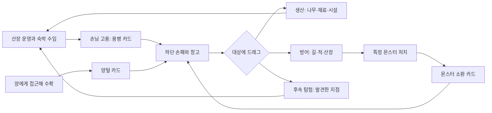

# 마녀산장 — 카드 기반 코어 기획서 v0.3

수정일: 2026-10-13 · 대상: Windows PC / Godot · 상태: **사용자가 채택한 카드 방향을 반영한 다음 기획. 세부 규칙·수치는 시험안. 2026-10-14 C0 카드 코어를 실행판에 적용 — [구현 기록](card-core-c0-implementation.md).**

C0(§15)의 손패·용병 계약·양털 수확·몬스터 카드는 실행판에 구현되었다. C1 이후 항목은 아직 기획 단계다. 이전 [킹덤 접목 기획서 v0.2](kingdom-integration-design-v0.2.md)는 변경 전 기록으로 보존하며, [카드 전환 충돌 검토](card-core-design-review.md)에 변경 이유와 미정 사항을 정리했다. 카드 코어의 제작 기준은 이 v0.3이다.

## 1. 게임의 핵심

**산장을 운영하며 맺은 계약과 얻은 자원이 카드로 손에 들어오고, 그 카드를 원하는 때에 세계의 대상에 사용하여 생산·방어·탐험을 선택하는 게임.**

손님을 맞이하면 골드와 고용 기회가 생긴다. 고용한 용병은 손패에서 기다리다가 나무에 사용하면 벌목하고, 전투 장소에 사용하면 방어한다. 양에게 다가가 털을 수확하면 양털 카드가 들어온다. 특정 몬스터를 처치하면 소환 카드를 얻어 다음 위기에 하수인으로 사용할 수 있다.

핵심 판단은 ‘무슨 카드를 얻을까’와 ‘같은 카드를 지금 어디에 쓸까’다. 벌목에 사용한 용병은 그 일을 마치고 귀가하므로 같은 계약으로 밤 방어까지 맡길 수 없다. 산장을 잘 운영할수록 손에 가능한 행동이 늘어나지만 한 번의 사용은 다른 기회를 포기하는 선택이 된다.

손패 표현과 마우스 드래그는 하스스톤·슬레이 더 스파이어 같은 카드게임에서 참고한다. 턴제 전투·랜덤 드로우·덱 순환·매 턴 손패 폐기·마나를 함께 도입하는 결정은 아니다. 첫 비교판은 기존 실시간 월드와 마녀의 클릭 이동·자동 공격을 유지한다.

## 2. 채택된 방향과 시험안

| 구분 | 내용 |
| --- | --- |
| 사용자 채택 방향 | 화면 하단 손패, 마우스로 카드를 직접 드래그하여 월드에 사용 |
| 사용자 채택 방향 | 숙박 손님을 용병으로 고용하면 용병 카드 획득. 원하는 때와 유효한 위치에 소환 |
| 사용자 채택 방향 | 나무에 용병 카드 사용 → 일정량/시간 벌목 → 목재 획득 → 용병 귀가·퇴장. 계약 소모 |
| 사용자 채택 방향 | 양은 하루 한 번 털 생산. 마녀가 다가가 수확하면 양털 카드 획득 |
| 사용자 채택 방향 | 특정 몬스터 처치 시 카드 획득. 보관하다 하수인으로 소환 |
| 유지하는 기존 방향 | 작은 산장·목장, 퍼플 설경·따뜻한 빛, 높은 쿼터뷰와 SD 캐릭터 |
| 유지하는 기존 방향 | 자동 숙박비, 골드 증축, 준비 후 웨이브, 마녀/산장 사망 시 패배, 양 재구입 |
| 유지하는 기존 방향 | 용은 골드 공물을 받고 지붕에 등장하며 독립 불덩이를 한 발씩 발사 |
| 이번 정리의 시험안 | 낮밤·두 숲길 유지, 계약당 한 임무, 자원 수량 묶음, 산장 창고, 야간 소환 허용 |
| 아직 확정하지 않은 것 | 계약 가격·공급, 벌목량·시간, 하수인 수명, 손패 가시 장수·활동 상한, 시간 정지 방식, 장기 저장 |

구체값은 제작과 비교를 위한 출발안이다. 사용자 채택 방향과 수치의 최종 승인을 혼동하지 않는다.

## 3. 핵심 순환과 한 판의 흐름

첫 실험은 낮 90초와 기존 3웨이브를 사용한다. 낮에는 숙박·고용·양털 수확·벌목·정비를 하고, 밤에는 보관한 용병과 몬스터를 필요한 위치에 소환하며 마녀가 이동해 지원한다. 전날 카드를 아끼거나 사용한 결과가 다음 판단으로 이어진다.

밤은 출현 예약 0과 살아 있는 적 0일 때 종료한다. 남은 아군·귀가 중 용병은 밤 종료를 막지 않는다. 3번째 밤 생존은 첫 비교판의 시연 완료다. 양 전원 생존·용 소환·몬스터 카드 사용은 필수 승리 조건이 아니다. 산장/마녀 사망과 완료가 겹치면 패배를 우선한다.

8~12일과 근원 봉인은 후속 챕터의 제안이다. 첫 3일만으로 반복 계약 비용·양 생산 가치·몬스터 카드 비축의 장기 균형을 판정하지 않는다.

## 4. 카드의 종류와 획득

| 종류 | 획득 경로 | 사용 대상·효과 | 소비·보관 |
| --- | --- | --- | --- |
| 용병 계약 | 숙박한 고용 가능 손님에게 골드 지급 | 나무: 벌목 / 방어 지점·적: 전투 / 후속 탐험 지점: 원정 | 사용 확정 시 계약 1장 소비. 임무 완료 후 귀가 |
| 양털 | 하루 한 번 생산된 양에게 접근해 수확 | 산장 교역: 판매 / 후속 제작 시설: 침구·의복 등 | 사용 수량만 차감. 같은 종류는 한 카드에 수량 표시 |
| 목재 | 벌목 임무 생산물 | 산장: 재료 수리 / 후속 제작·건설 | 자원 수량 차감. 골드와 별도 기록 |
| 몬스터 소환 | 카드 획득 대상인 적 처치 | 유효한 지면·방어 지점에 아군 하수인 소환 | 사용 시 1장 소비. 소환체는 적이 아닌 아군 |
| 후속 제작물·지원 | 재료 제작이나 사건 해결 | 손님·산장·아군 등에 해당 효과 | 레시피와 효과는 별도 설계. 첫 실험 필수 아님 |

골드는 결제·공물에 사용하는 공용 수치로 유지한다. 동전 하나마다 카드를 만들지 않는다. 첫 실험의 증축·유료 수리·마녀 회복·양 재구입·용 공물은 기존 관리 UI를 사용한다. 획득 카드의 핵심을 검증한 뒤 이런 관리 행위도 대상에 끌어 쓰는 관리 카드로 확장할지 검토한다.

매일 덱에서 자동으로 카드를 뽑는 구조를 만들지 않는다. 획득 원인은 월드의 사건으로 확인할 수 있어야 한다. 여러 행동을 카드로 표현한다는 방향 때문에 의미 없는 소모 카드를 늘리지 않는다.

## 5. 숙박 손님과 용병 계약

고용 대상은 별도로 오는 정착 주민 후보가 아니라 **실제로 숙박한 손님 중 고용 가능한 사람**이다. 손님의 이름·모습·능력이 계약 카드와 소환 캐릭터에 이어져 산장에서 만난 사람이라는 인상을 유지한다.

시험안은 숙박비 정산을 마친 손님에게 퇴실 전 고용 기회를 주는 방식이다. 고용하지 않으면 떠난다. 고용하면 계약 카드가 들어오고 해당 방문자는 월드에서 퇴장한다. 이후 카드 사용 시 같은 인물이 다시 나타난다. 카드에 보관되는 것은 한 번의 고용 약속이다.

- 도착 5·30·60초, 숙박 20초, 1인 15G를 비교 기준으로 유지한다. 고용 기회가 생긴 손님은 정산 뒤 10초 동안 문가에서 기다린다. 이 대기는 객실 정원과 다음 묶음 입실을 막지 않는다.
- 고용 가능한 손님은 하루 최대 2명으로 먼저 시험하고 첫 묶음에서 최소 1명의 기회를 보장한다. 고용하지 않고 기회를 놓쳐도 기본 숙박 수입은 유지한다.
- 이미 정산한 숙박비를 고용 때문에 취소하지 않는다. 같은 방문자의 숙박비·계약 생성은 각각 한 번만 처리한다. 고용한 사람을 영구 주민 수에 중복 집계하지 않는다.
- 계약은 고용 시 한 번 결제한다. 소환할 때 고용료를 다시 받지 않는다. 시험 가격은 범용 용병 30G이며 이전 ‘고용10G+도구20G’ 영구 인력 가격과 다른 의미다.
- 미사용 계약은 다음 날에도 유지하며 첫 실험에는 만료를 두지 않는다. 동일 인물의 계약 복제와 같은 사람이 소환된 동안의 중복 고용은 막는다.
- 사용 시 벌목 또는 전투 중 한 임무를 선택한다. 범용 용병은 둘 다 가능해야 첫 카드부터 선택이 성립한다. 전문 용병의 효율·임무 차이는 후속 다양화다.

동시 활동 상한은 용병과 하수인을 합해 4명으로 시험한다. 미사용 계약은 상한을 차지하지 않는다. 임무 수행·중단 대기·귀가 중은 상한에 포함하고 퇴장 또는 사망 시 해제한다. 카드 총 소유량과 월드 활동 상한을 구분한다. 상한·고용 공급은 확정 수치가 아니다.

## 6. 용병 카드의 대상별 행동과 수명

### 나무에 사용: 벌목

벌목 가능한 나무를 대상 태그로 구분한다. 장식용 숲 전체를 자원으로 취급하지 않는다. 작업자가 예약한 나무·길이 막힌 나무·고갈한 나무에는 사용할 수 없다.

사용을 확정하면 나무 옆 유효 작업 위치에 용병이 소환되고 자동으로 작업한다. 시험값은 작업15초, 목재10개이며 완료 시 한 번 손패/창고에 지급한다. 이후 용병은 산장 앞 귀가 지점을 지나 숲길로 퇴장한다. 계약 카드는 돌아오지 않는다. 나무의 자원량은 차감하며 자원 나무의 공급·재생은 장기판에서 별도로 정한다.

벌목은 평상시 낮에만 시작한다. 일몰·원정 전투 시작으로 중단되면 진척을 보존해 산장에 대기하고 다음 안전한 낮에 같은 계약으로 재개한다. 추가 계약료는 없다. 대기한 용병을 새 카드로 만들거나 무료 전투 인력으로 바꾸지 않는다. 중단 대기와 모든 이동 중 정상 피격된다. 용병 사망 시 계약과 미완료 생산을 잃는다. 대상 파괴 또는 플레이어의 임무 포기는 생산 없이 귀가하는 실패로 처리한다. 자동 대기·실패·사망을 UI에서 구분한다.

### 적이나 지면에 사용: 전투

이미 발견한 이동 가능 지면, 방어 지점 또는 살아 있는 적에 사용할 수 있다. 적 위에 놓았을 때도 겹쳐 생성하지 않고 가까운 유효 아군 위치를 미리 보여준다. 미발견 숲·건물 내부·막힌 울타리·화면 바깥에는 소환하지 않는다. 마녀가 그곳에 접근해야 하는 제한은 첫 시험에 붙이지 않는다.

적을 대상으로 쓰면 해당 적을 우선 공격하고 사망 후 선택 지점 주변의 적을 자동 공격한다. 지면/방어 지점에 쓰면 그 자리를 기준으로 공격한다. 공격은 자동이며 아군에게 피해를 주지 않는다.

전투 계약은 **현재 전투 한 번**으로 시험한다. 밤이나 진행 중 원정에서 소환할 수 있고 예약과 적이 모두 정리되면 귀가한다. 평상시 낮에 지면 배치하면 오늘 밤까지 대기하고 그 밤의 종료에 계약을 마친다. 대기 중 낮 원정이 시작되면 그 원정이 계약의 전투다. 원정과 밤이 적 정리 없이 연결되면 하나의 연속 전투로 본다.

방책 파괴 시 같은 길의 안쪽 방어 지점, 없으면 산장 앞으로 후퇴한다. 이동 중 공격하지 않고 정상 피격된다. 전투 중 무료 후퇴는 허용하되 카드 회수·체력 초기화·임무 교체는 허용하지 않는다. 쓰러지면 제거되고 계약은 복구되지 않는다. 생존 귀가와 사망을 결과 화면에서 구분한다. 전투값은 기존 사냥꾼의 체력40·공격8/1.5초·사거리6m를 첫 비교값으로 쓰되 소모 계약에 맞는 효율을 다시 검증한다.

### 후속 탐험 임무

발견한 탐험 지점에 계약을 사용해 탐험 후 전리품을 가져오고 귀가하는 안을 검토한다. 같은 계약을 벌목·전투·탐험에 중복 사용하지 않는다. 이동·산장 잔류 병력·실패·일몰 조건을 닫은 뒤 도입하며 첫 실험에서 탐험 보상을 약속하지 않는다.

## 7. 양털: 생산·수확·사용의 분리

양은 세계에 남는 생산자이고 양털이 카드로 들어온다. 생산되었다는 이유만으로 손패나 골드가 자동 증가하지 않는다.

1. 첫날은 수확 준비가 없는 상태로 시작한다. 2일차부터 낮 시작에 생존 양마다 하루 한 번 수확 가능 상태를 만든다. 오늘 구입한 양은 다음 낮부터 생산한다.
2. 미수확 양은 최대 한 번분을 유지한다. 여러 날의 양털을 한꺼번에 쌓지 않는다. 수확을 놓치면 추가 생산 기회를 잃는 시험안이다.
3. 양 클릭 시 마녀가 접근하고 1.5m 안에서 수확한다. 수확 중 양이 죽으면 획득하지 않는다. 연속 클릭으로 같은 생산분을 두 번 받을 수 없다.
4. 양 한 마리의 한 번 수확은 양털1개로 시험한다. 기존 수량과 합쳐 ‘양털 ×3’처럼 표시한다. 이후 양이 죽어도 수확한 재료는 사라지지 않는다.
5. 양털 카드를 산장 교역 대상으로 드래그해 수량을 골라 판다. 초기 교환가는 1개4G다. 판매할 때만 골드가 생기며 자동 판매 수입을 동시에 지급하지 않는다.

양털은 판매와 향후 침구·선물 제작 사이의 선택으로 발전시킨다. 제작 레시피·효과는 아직 정하지 않았고 첫 실험은 판매 경로부터 닫는다. 양 전멸은 패배가 아니고 기본 숙박비를 줄이지 않으며 빈 슬롯20G 재구입은 유지한다.

## 8. 몬스터 처치와 하수인 카드

카드가 되는 몬스터는 외형/표식으로 구분한다. 모든 일반 적이 매번 카드가 되는 규칙으로 만들지 않는다. 첫 비교판은 지정한 적1종의 지정 개체를 처치하면 해당 종류의 카드1장을 확정 지급한다. 획득 확률·일일 상한·도감은 이후 비교한다.

마녀·용병·용 중 누가 처치했든 같은 획득 규칙이다. 적 사망 처리를 식별자별 한 번 수행하고 카드가 꽉 찼다는 이유로 보상을 버리지 않는다. 소환 몬스터는 아군이며 적의 출현 예약·살아 있는 적 수에 포함하지 않는다. 하수인이 죽어도 같은 카드를 다시 드롭하지 않는다. 아군끼리 카드 복제나 하수인 때문에 밤이 끝나지 않는 경우를 막는다.

사용 대상은 용병 전투 소환과 동일하다. 하수인 수명은 **소환 이후 현재 전투 종료까지, 평상시 소환은 다음 전투 종료까지**로 먼저 시험하고 종료 후 사라진다. 이는 영구 하수인 여부에 대한 사용자 결정이 아니라 시험안이다. 영구 유지·시간제·재사용 방식 중 최종 방식은 장기 경제와 함께 비교한다. 첫 종은 전투용으로 제한하며 생산 능력은 후속 특성이다.

## 9. 손패·창고·드래그 입력

손패는 화면 하단에 펼친다. 용병·하수인은 초상과 능력, 재료는 아이콘과 수량으로 읽힌다. 설명은 마우스를 올렸을 때 보여주고 하단 UI가 목장·두 길을 가리지 않도록 월드 영역을 확보한다. 가시 장수8장은 출발안이며 소유 상한이 아니다.

남는 카드는 산장 창고에 보관하고 손패와 교환한다. 같은 자원은 수량을 묶고 공간이 부족하면 새 획득분을 창고에 넣어 획득 알림을 남긴다. 카드 폐기·자동 판매·보상 손실을 기본 처리로 두지 않는다. 첫 비교판에서는 위치에 관계없이 창고를 열며 손패 관리 압박은 이후 검토한다.

드래그 처리 순서:

1. 카드를 잡으면 유효 대상과 소환 구역을 강조한다.
2. 대상 위에서는 실제 소환 위치, 임무, 소비 수량, 시간/종료 조건, 예상 효과를 보여준다. 불확실한 전투 결과를 확정 보상으로 표시하지 않는다.
3. 놓는 순간 대상 생존·경로·자원·활동 상한·현재 상태를 다시 검사한다.
4. 유효하면 소비와 임무/소환 등록을 한 번에 확정한다. 등록 실패에는 소비하지 않는다. 무효 대상·우클릭·Esc 취소는 손패로 돌아온다.
5. 확정 전 대상이 죽거나 선점되어도 카드가 사라지지 않는다. 확정 후의 사망·임무 실패는 정상 손실이며 입력 취소와 구분한다.

카드와 UI의 누르기·드래그·놓기는 마녀 이동에 전달하지 않는다. 빈 지면 일반 좌클릭만 이동이다. 수확은 양 클릭 접근, 카드 사용은 대상 드래그다. 먼 곳에 놓아도 유효 위치 제약을 지키며 화면 좌표를 그대로 소환 위치로 사용하지 않는다.

## 10. 낮밤·정지·야간 사용

| 상태 | 가능한 행동 | 불가능한 행동 |
| --- | --- | --- |
| 평상시 낮 | 숙박·고용·수확·판매·벌목 시작·정비·전투 카드 사전 배치 | 미발견 지점 사용·조건 미충족 소환 |
| 밤/원정 전투 | 이동·자동 공격, 보유 용병/하수인 전투 소환, 후퇴, 용 공물 | 신규 고용·건설·재구입·벌목 시작·판매·수확 |
| 전체 일시 정지 | 정보 확인·메뉴 | 카드 소비·생산·피해·작업 진행 |
| 패배/시연 완료 | 결과 확인·재시작 | 신규 임무·수입·소환 |

낮의 관리 패널·창고를 여는 동안은 첫 비교판에서 정지한다. 손패 정리·관리 주문 예약은 가능하지만 실행 효과·작업은 창을 닫은 뒤 진행한다. 월드 드래그는 패널을 닫은 상태에서 수행하며 시간을 자동으로 멈추지 않는다. 전투 창고는 정지 없이 열고 정리한다. Esc 전체 정지에서는 사용을 막는다.

전투에서 카드를 읽고 끌어 쓰기 어려우면 ‘드래그 중 감속’ 또는 ‘전략 정지 후 명령 예약’ 비교판을 만든다. 다른 시간 방식을 같은 기준판에 섞지 않는다. 미사용 카드는 새벽에도 유지하고 생산·고용 기회·용 사용 플래그만 새 낮에 갱신한다.

## 11. 산장 성장·목재·방책·용

시설은 지속 자산이고 용병 계약은 소모 자산이다. 이전 영구 목수·공용 도구대·재훈련·주민 숙소는 카드 코어의 기본값에서 제외한다. 소모 계약 한 장을 다음 날 자동 복구하지 않는다.

첫 실험의 객실 증축은 60G, 건설20초의 관리 주문으로 시험한다. 상주 목수 없이 서비스 비용에 작업이 포함되는 추상 방식이다. 완료 이후 도착 묶음부터 정원2→3, 밤에는 진행 중지·다음 낮 재개, 취소는 진척 폐기·전액 환불을 사용한다. 용병을 건설에 반드시 소비하는 규칙은 아직 도입하지 않는다.

목재의 첫 사용처는 산장 재료 수리다. **목재5개로 체력 최대100 회복**을 시험하며 실제 회복량을 미리 표시한다. 준비 중에만 사용 가능하고 체력 최대에서는 사용 불가다. 유료 수리10G/+50도 남겨 용병·목재를 전부 잃어도 기본 숙박비로 복구할 수 있게 한다. 목재10개는 손상이 충분할 때 최대200체력, 즉 유료 수리40G를 대체하지만 손상이 적으면 실제 절감액도 작다. 계약30G와 생산을 선택할 이유가 생기는지 비교한다. 수리 즉시 적용은 이번 시험안이며 이전 목수 작업시간과 구분한다. 목재 판매는 첫 실험에 넣지 않는다.

두 길의 방책·바깥 등불은 카드 기본 순환 검증 뒤 도입한다. 유지할 경우 영구 시설의 체력·돌파·안쪽 후퇴는 남기되 공사에 영구 주민을 요구하지 않는다. 수리보다 파괴 후 재건이 싸고 빠른 역전은 다시 만들지 않는다. 첫 카드 실험에는 방책이 없어도 나무·목장·두 길의 선택을 시험할 수 있다.

용은 별도 비상 공물 방식이다. 시험 공물180G·하루1회, 지붕 소환과 독립 불덩이, 현재 전투 종료까지 방어한다. 현재 실행판120G를 문서 수정으로 변경했다고 표현하지 않는다. 용까지 카드로 표시할지는 후속 UI 결정이며 일반 몬스터 포획에 섞지 않는다.

후속 외곽 단계에서는 중앙 방어권12m를 시험하고 외곽 호위·생산을 용이 전부 대신하지 않게 한다. 첫 비교판 전투 구역은 그 안에 둔다. 낮 원정에 용을 쓰면 같은 날 밤에는 재소환할 수 없고 원정과 밤이 이어지면 전체 전투 종료까지 남는다. 소모 용병·성장·비축과의 비용 경쟁을 다시 비교한다.

## 12. 경제: 영구 주민 계산의 교체

v0.2 §10의 영구 방어 병력과 §11의 채집꾼 일일30G는 새 계약에 적용하지 않는다. 반복 방어·채집에는 새 계약이 필요하다. 자동 양모12G·무료 환대15G를 합친 기존 하루162G도 새 기획의 확정 수입이 아니다. 환대/주민 식사 선택은 후속 제작·지원 카드로 재설계 전까지 제외한다.

산술 기준은 시작40G, 기본 숙박90G/낮, 증축 후 완전 가동135G/낮, 계약30G, 양털4G/개다. 첫날 양털0, 이후 양3마리를 모두 수확·판매하면 최대12G다. 목재는 현금으로 더하지 않는다. 카드 획득 자체를 골드와 중복 계산하지 않는다.

| 1일차 예시 | 골드 변화 | 잔액·보유물 |
| --- | --- | --- |
| 시작 | +40G | 40G |
| 25초 첫 숙박 정산, 계약 구매 | +30G -30G | 40G, 미사용 계약1 |
| 나무에 사용, 작업 완료 | 현금 변화 없음 | 40G, 목재10, 해당 계약 소모·귀가 |
| 50초 두 번째 정산, 전투 계약 구매 | +30G -30G | 40G, 계약1·목재10 |
| 80초 세 번째 정산 | +30G | 70G, 전투에 쓸 계약1 |
| 밤에 전투 계약 사용 | 추가 결제 없음 | 70G, 종료/사망 후 계약은 남지 않음 |

손실·증축·수리·용 사용을 제외한 산술 예시다. 첫/둘째 묶음에 고용 손님을 배정하는 비교 시나리오이며 일반판에서 구매 순서를 강제하지 않는다. 벌목 용병을 밤에 재사용하거나 새벽 무료 병력으로 되살리지 않는다. 방어 성공을 입증한 표도 아니다.

비교 경로는 ‘같은 계약을 벌목’, ‘전투’, ‘다음 위기까지 보관’, ‘고용 대신 객실/공물 비축’이다. 하루2계약 구매는60G의 반복 비용이다. 몬스터 카드로 계약을 대체하는 경로도 측정하되 보상이 무한 병력으로 증가하지 않는지 본다.

중앙 최대 현금 유입은 모든 양털을 판매했을 때135+12=147G이며 실제 유입은 수확·판매·증축 시점·양 생존에 따라 낮아진다. 다른 보상 없는 기준에서 매일180G 공물은 적어도 하루33G의 비축을 줄이고 계약을 함께 사면 지출이 커진다. 산술만으로 전략 균형을 판정하지 않는다.

양20G의 단순 회수는 양털을5번 생산·수확·판매했을 때다. 제작에 쓰거나 수확을 놓치면 현금 회수는 달라진다. 후속 채집은 생산 가치에서 계약료와 복구 비용을 뺀 순이익으로 계산한다. 기존 보상30G와 새 계약료30G를 그대로 붙이면 투자 회수가 성립하지 않는다. 새 보상·비용을 정하기 전 외곽 회수 기간을 제시하지 않는다.

## 13. 후속 확장과 근원 봉인

두 숲길 A/B, A 등불의 생산 거점과 B 등불의 봉인 단서는 월드 구조의 출발안으로 유지한다. 탐험 지역은 발견 뒤 카드 사용 대상으로 열린다. 승인 원화의 시작 구도를 보존하고 현재 고정 카메라·투영 지면이 넓은 탐험을 지원한다고 가정하지 않는다.

원정 병력은 영구 주민 수가 아니라 **원정에 할당한 미사용 전투 계약·하수인 카드**로 계산한다. 산장에 남길 카드와 출정 카드가 경쟁한다. 출정60G·봉인15초·한도60초·외곽12명/산장6명은 이전 후보값이며 새 카드 경제에서 재검증 전 필수 조건으로 고정하지 않는다.

계승할 상태 규칙은 출정 전 위협 예고, 일몰 시 밤 예약 추가, 후퇴 후 잔여 적 유지, 봉인 완료 뒤 전체 예약·적 정리, 산장/마녀 생존과 동시 패배 우선이다. 실패 임무를 손패로 환불하거나 원정/밤 경계에서 병력을 무료 생성하지 않는다. 호위 배정·소비·귀가 시점을 닫은 뒤 제작한다.

## 14. HUD·초반 안내·표현

| 상황 | 보여줄 정보 |
| --- | --- |
| 손패 | 종류·수량·가능 임무, 창고 초과 획득 알림 |
| 고용 | 정산 여부·계약료·능력·한 임무 후 귀가·기회 종료 |
| 드래그 | 유효 대상·실제 위치·소비량·시간·효과·불가 사유 |
| 용병 활동 | 임무·작업 진척·체력·대기/귀가·계약 종료 조건 |
| 양 | 수확 가능·오늘 수확·재구입 비용 |
| 전투 | A/B 침입 예고·활동 상한·후퇴·산장/양 위험 |
| 새벽 | 수입·획득/사용/보관 카드·판매·사망/귀가·미완료 작업 |
| 용 | 공물·소환 후 잔액·오늘 사용·방어권 |

첫 안내는 ‘손님 고용→카드 획득→나무/전투 중 선택→드래그 소환→임무 후 귀가→양 접근 수확→다음 밤에 카드 사용’ 순서다. 처음부터 창고 정리·여러 재료·덱 편집을 요구하지 않는다.

카드가 실제 캐릭터로 나타나는 연결, 양털이 손패 수량으로 합쳐지는 표현, 완료한 용병이 걸어서 떠나는 장면을 우선한다. 귀가를 죽음처럼 표현하지 않는다. 미사용 계약 보관과 영구 정착을 구분하며 이름·도구·초상이 월드와 카드 사이에 이어져야 한다.

## 15. 제작 순서와 변경 책임

| 단계 | 작업 | 완료 판단 |
| --- | --- | --- |
| C0: 카드 코어 | 하단 손패·드래그·창고, 손님 계약, 벌목/전투 양용 용병, 양털 생산·접근 수확·판매, 지정 적 카드·하수인 | 세 획득 경로와 세계→카드→세계, 소비·귀가가 실제 동작 |
| C1: 3일 비교 | 계약 공급·가격, 목재 수리·증축, 두 길·용, 보관/벌목/전투/비축 비교, 시간 방식 | 여러 사용처가 선택되고 손실 뒤 재진입 가능 |
| C2: 장기 코어 | 제작, 등불·채집·방책, 계약 원정·봉인, 카메라·8~12일 경제 | 반복 비용·비축·외곽 순이익·원정 상태 검증 |
| 후속 | 전문 용병·몬스터 능력, 사건, 저장·챕터 | 앞 단계 결과로 범위 선정 |

현재 코드의 다음 책임은 제안이다. 이번 문서 업데이트에서 게임 코드·실행파일은 수정하지 않았다.

| 현재/신규 모듈 | 다음 책임 |
| --- | --- |
| scripts/game/game_session.gd | 낮밤·전투 종료, 미사용 카드 유지·임무 종료, 패배 우선 |
| scripts/game/lodge_economy.gd | 손님 정산·고용, 계약료·판매·관리 주문, 중복 지급 방지 |
| 신규 CardInventory | 소유·수량·손패/창고, 생성·예약·소비의 한 번 처리 |
| 신규 CardUseResolver | 대상 태그·조건 재검사, 소비와 임무 등록의 일괄 확정 |
| 신규 ContractDirector | 인물/계약 연결, 벌목·전투·대기·귀가·사망, 활동 상한 |
| scripts/actors/sheep.gd / scripts/world/pasture.gd | 일일 생산·접근 수확, 사망·재구입과 수확 상태 |
| scripts/actors/monster.gd | 지정 적 보상, 적/아군 구분, 하수인 재드롭 금지 |
| scripts/game/wave_director.gd | A/B 예약, 적만 종료 집계, 보상 대상 배치 |
| scripts/ui/hud.gd / scripts/main.gd | 손패·창고·대상 강조·입력 소비·미리보기 |
| scripts/world/layout.gd / world.gd | 소환/작업 위치·자원 나무·귀가 경로·하단 UI 공간 |
| scripts/dragon/ | 기존 용 표현, 공물 시험값·하루 사용·전투 종료 |

소유·경제·임무 판정은 게임 시스템이 처리하고 카드 이동·소환·귀가 효과는 그 상태를 표현한다. 마녀산장 Godot 기획이며 SlimeForge 전용 작업이 아니다.

## 16. 검증 계획

다음 구현의 통과 기준이며 이번 문서 작성에서 수행하거나 통과한 게임 테스트가 아니다.

| 검사 | 통과 조건 |
| --- | --- |
| 세 획득 경로 | 고용→계약, 접근 수확→양털, 지정 적 처치→몬스터 카드 재현 |
| 계약 선택 | 같은 종류 한 장으로 벌목/전투를 선택하고 중복 수행하지 않음 |
| 소비·취소 | 무효 드롭·대상 소멸·상한 초과·취소는 미소비. 유효 드롭은1회 소비·1체 생성 |
| 임무 종료 | 벌목 생산1회 후 귀가, 전투 종료 후 귀가, 새벽 사용 계약 복구 없음 |
| 중단·사망 | 일몰 대기 후 추가 결제 없이 재개. 사망 시 미완료 생산·계약 손실. 포기와 대기 구분 |
| 양 생산 | 첫날0·다음 낮부터 하루1회, 구입 다음 날 생산, 미수확 최대1회, 죽음/연속 클릭 중복 없음 |
| 교환 | 수확 시 골드0, 판매 시 선택 수량 차감·4G/개, 판매한 재료 재사용 불가 |
| 몬스터 | 지정 적 사망1회·처치자 무관 지급, 아군 재드롭0, 아군을 밤 적 수에서 제외 |
| 소유·상한 | 창고 초과 획득 무손실, 미사용 계약 상한 제외, 활동·대기·귀가·사망 집계 일관 |
| 입력·시간 | 드래그로 마녀 이동 없음, 창고·Esc·전투 드래그가 §10대로 동작 |
| 경제·회복 | §12 재현, 무료 주민 회복 없음, 골드0·카드0·양0에서도 기본 숙박으로 재고용/수리 가능 |
| 승패·초기화 | 예약 남으면 밤 지속, 동시 패배 우선, 재시작 카드·계약·생산 상태 초기화 |

초기 사용성 검증에서 같은 용병을 나무/적 중 어디에 쓸지 설명하는지, 귀가 후 카드가 돌아올 것으로 오해하지 않는지, 손패가 월드를 가리지 않는지, 야간 카드 정보를 읽고 쓸 시간이 있는지 본다. 수확이 선택과 보상 인지에 도움이 되는지, 매일 반복하는 번거로운 작업인지도 확인한다.

3일판은 동일 웨이브·조작 조건에서 계약 사용처·고용하지 않기·객실·공물·몬스터 카드 보관을 비교한다. 수입/지출, 계약 획득/소비/임무/종료, 재료 수확/판매/수리, 카드 보관, 길별 피해, 승패·원인을 기록한다. 통과율이나 재미를 산술로 주장하지 않는다.

장기판에서는 매일 계약 구매, 여러 날 비축, 하수인 방어 대체, 외곽 생산과 용 반복을 비교한다. 양 회수5회, 활동 상한, 귀가 경로 피격, 밤을 넘긴 벌목, 카드 없이 재진입, 원정/밤 연결을 실패 사례로 포함한다.

## 17. 위험과 열린 결정

| 위험/열린 결정 | 다음 확인 |
| --- | --- |
| 카드가 단순 행동 버튼으로 보임 | 같은 계약의 벌목·방어 가치가 상황에 따라 달라지는가 |
| 소모 용병의 반복 비용이 너무 큼 | 공급·30G·전투 효율·용180G를 함께 비교 |
| 처치 보상이 무한 방어를 만듦 | 지정 적 공급·하수인 수명·활동 상한·재드롭 금지 |
| 비축이 항상 유리 | 당일 생산·생존 포기 비용과 장기 보유량 측정 |
| 양털 판매 외 용도가 부족 | 기본 순환 후 제작·선물 중 실제 선택 하나 추가 |
| 손패·창고·수확이 정리 노동 | 수량 묶음·넘침 보관·수확 자동화 필요성 비교 |
| 실시간 이동과 드래그 충돌 | 입력 분리·정보 읽는 시간·감속/전략 정지 비교 |
| 하수인 최종 수명·손패 규모 | 시험값을 최종 승인으로 취급하지 않고 장기판에서 결정 |
| 기존 원정/채집 경제 재사용 | 반복 계약 비용으로 순이익·호위·출정 조건 재작성 후 C2 착수 |

## 18. 이번 업데이트의 결과

중심을 영구 주민과 도구 투자에서 **월드에서 얻고 소비하는 손패**로 바꿨다. 용병 고용·벌목 후 귀가, 양털 접근 수확, 지정 몬스터 카드·하수인 소환을 하나의 순환으로 정의하고 UI·시간·소비·획득·회복·검증 조건을 연결했다.

다음 제작 단위는 C0 카드 코어다. 영구 주민·재훈련·도구대부터 만드는 이전 P0 순서는 사용하지 않는다. 현재 실행판의 버튼 조작·120G 공물·양 생산 없음은 별도 보존하며 세부 시험안을 구현 완료로 표시하지 않는다.
