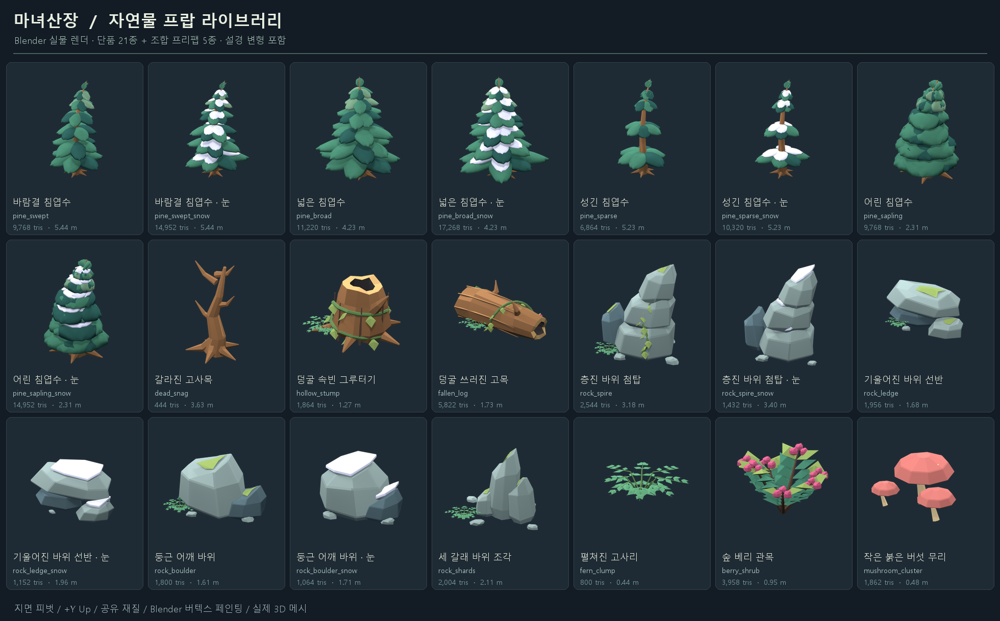
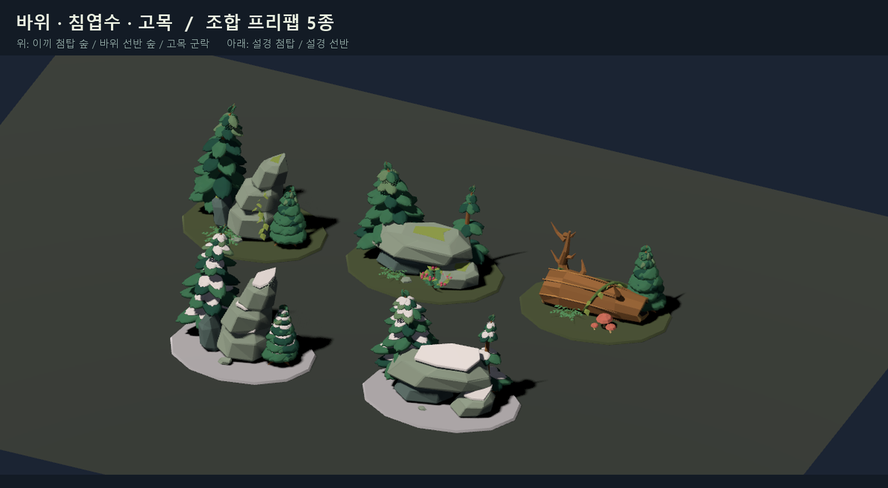

# 자연물 프랍 키트 · Blender 제작

## 야생 동물 추가 · 2026-10-15

직업 업데이트용 토끼와 사슴을 동일한 버텍스 팔레트·평면 색 스타일로 추가했다. 기존 자연물 21종/조합 5종은 보존했다. 동물은 각각 몸/머리 2메시이며 GLB와 tscn에서 `Body/Head` 피벗을 유지한다. 편집용 원본은 `godot/art_sources/wildlife.blend`. [치수·파일·노드·검증 기록](wildlife-assets-v01.md)을 참고한다.

아래 21종 자연물 키트 설명과 예전 내보내기 기록은 당시 납품 범위다.

2026-10-14. 사용자 레퍼런스 4장의 휘어진 침엽수, 큰 면을 가진 층진 바위,
덩굴 고목을 기준으로 만든 실제 3D 모델. **단품 21종 + 조합 프리팹 5종**.
침엽수는 기존 모델의 부드러운 느낌에 맞춰, 두께가 있는 넓은 곡면 잎 덩어리와
둥근 끝·완만한 처짐을 사용한다. 날카로운 침 모양 잎은 제거했다.
눈도 가지를 따라 둥글게 쌓인다. 잎은 닫힌 메시이며 알파 카드가 아니다.
바위는 비대칭 단면, 어긋난 지층과 기울어진 정상으로 실루엣을 구분한다.
고목은 실제 속빈 메시와 두께가 있는 절단면, 부러진 가지와 덩굴을 사용한다.

## 파일과 배치

- 원본: `godot/art_sources/nature_kit.blend`. 21개 이름별 컬렉션이 라이브러리 격자로 배치된다.
  컬렉션의 `*_GroundPivot` 아래에서 줄기·가지·잎·눈·바위·덩굴을 각각 편집할 수 있다.
- GLB: `godot/assets/nature/*.glb`. 각 단품은 메시 1개·표면 1개로 통합한 내보내기용 모델.
- 프리팹: `godot/scenes/props/nature/*.tscn`. FileSystem에서 3D 장면에 끌어 놓는다.
  `.glb`는 기본 재질, `.tscn`은 게임 셰이딩 프리셋에 연결된 공유 재질을 사용한다.
- 조합 예시: `godot/scenes/props/nature/nature_showcase.tscn`을 열고 **F6**으로 실행.
  조합 프리팹 안의 구성물은 각각 이동·회전·스케일을 바꿀 수 있다.
- 실물 렌더: `output/nature-kit/`. Blender 개별 PNG와 Godot 조합/게임 캡처.
- 전체 납품 묶음: `output/nature-kit/WitchsLodge-NatureKit.zip`.
- `build/WitchsLodge.pck` 실행 데이터에도 적용했다. `WitchsLodge.exe`를 다시 실행하면
  부드러운 나무와 신규 바위·관목·통나무를 사용한다. 이전 데이터는
  `build/WitchsLodge-before-nature-kit.pck`에 보존했다.

**1단위 = 1m, +Y 위, 지면 피벗, 기본 회전/스케일 초기값**.
뿌리와 통나무 밑면은 지면에 살짝 묻히도록 설계했다.
나무는 Y축 회전과 0.85–1.15배 균일 스케일로 반복을 분산한다.
큰 바위와 고목은 0.7–1.25배 스케일, 고사리·관목은 0.6–1.2배로 사용한다.

## 구성

| 종류 | 파일 ID | 개수 |
| --- | --- | --- |
| 침엽수 | `pine_swept`, `pine_broad`, `pine_sparse`, `pine_sapling`와 각 `_snow` | 8 |
| 나무 잔해 | `dead_snag`, `hollow_stump`, `fallen_log` | 3 |
| 바위 | `rock_spire`, `rock_ledge`, `rock_boulder`와 각 `_snow`, `rock_shards` | 7 |
| 하층 식생 | `fern_clump`, `berry_shrub`, `mushroom_cluster` | 3 |
| 조합 | `cluster_spire_grove`, `cluster_ledge_forest`, `cluster_ancient_log`, `cluster_snow_spire`, `cluster_snow_ledge` | 5 |

## 색과 셰이딩

Blender의 `Col` 코너 버텍스 컬러로 숲의 청록·올리브, 따뜻한 목재,
차가운 회청 바위와 라벤더 눈을 페인팅했다. 밝기 변화는 큰 메시 면을 따른다.
래스터 텍스처 맵은 사용하지 않는다. 모든 메시에는 추가 텍스처링용 평면 UV가 있다.
Blender Material Preview/Rendered 모드에서 색을 확인하고 Vertex Paint에서 편집한다.

Godot 공유 재질: `assets/nature/materials/nature_paint.tres`.
`shaders/nature_prop.gdshader`는 glTF `COLOR_0`와 현재 게임의 공용 셰이딩 값을 사용한다.
다른 Godot 프로젝트로 옮길 때는 `card_style.gdshaderinc`와 `project.godot`의
`card_style_shading`, `card_style_surface`, `card_style_palette`, `card_style_ink` 전역 값도 필요하다.
다른 엔진에서는 GLB의 버텍스 컬러를 사용하는 재질을 적용한다.

## 게임 연결과 검증

`scripts/visual/nature_models.gd`가 프리팹을 캐시하고 기존 `models.gd`의
나무·바위·관목·통나무 생성 위치에 연결된다. 기존 나무/바위의 게임플레이 래퍼는 유지한다.
프리팹 자체는 **장식용**이며 충돌·벌목·보상 스크립트가 없다.
충돌이 필요한 신규 배치는 용도에 맞는 기존 게임 래퍼를 사용한다.

Blender 내보내기: 단품 21개 모두 non-manifold edge 0.
Godot 검증: 프리팹 26개 모두 로드·실제 메시·UV·버텍스 색·공유 재질 유지 확인.
소프트/강렬한 툰 렌더 및 현재 게임 시작 화면 캡처, 벌목 나무 래퍼의 연결과 충돌 레이어 확인.
별도 카드 코어 검사 34건에서는 양털 수확 관련 3건이 실패했다. 동일 게임 코드에
기존 시각 모델을 적용한 격리 비교에서도 같은 3건이 실패하여 이번 모델 교체와
무관한 기존 상태임을 확인했다. 프랍 검증의 실패는 0건이다.
수치와 증거는 `assets/nature/catalog.json`, `prefab_manifest.json`,
`output/nature-kit/verification.json`, `delivery-manifest.json`에 기록한다.

재생성: Blender로 `art_sources/build_nature_kit.py` 실행 → Godot import →
`--headless --script res://tools/build_nature_prefabs.gd`.
검증은 `--script res://tools/verify_nature_kit.gd`로 실행한다.
시각 확인에는 Forward+와 실제 GPU가 필요하며 headless 검증은 리소스만 검사한다.

## 바람 아이들 모션 (2026-10-14)

식생은 모두 `shaders/nature_prop.gdshader`의 정점 바람으로 흔들린다. 밑동은 고정되고 높이에 따라(지수 1.6) 휘며, 숲을 가로지르는 느린 돌풍과 나무별 위상차, 가지 단위의 작은 떨림이 겹친다. 바람 방향은 눈 내리는 방향을 따른다. 그림자도 같이 움직인다.

| 머티리얼 | 대상 | 끝 흔들림 / 기준 높이 / 속도 / 떨림 |
| --- | --- | --- |
| `nature_wind_tree.tres` | 침엽수 8종(어린 나무 포함) | 0.22m / 5m / 0.9 / 0.035m |
| `nature_wind_bare.tres` | 고사목 | 0.09m / 4m / 0.8 / 0 |
| `nature_wind_undergrowth.tres` | 고사리·베리 관목 | 0.07m / 1m / 1.35 / 0.03m |
| `nature_paint.tres` | 바위·통나무·그루터기·버섯 | 정지 |

매핑은 `tools/build_nature_prefabs.gd`의 `WIND`에 있어 프리팹을 다시 생성해도 유지된다. 수치는 머티리얼 파일에서 바로 조정한다. 검증: `tools/verify_vegetation_wind.gd`가 실제 게임을 1.6초 간격으로 두 번 렌더해 나무는 움직이고 바위는 정지했는지 확인한다(`output/vegetation-wind/`).
