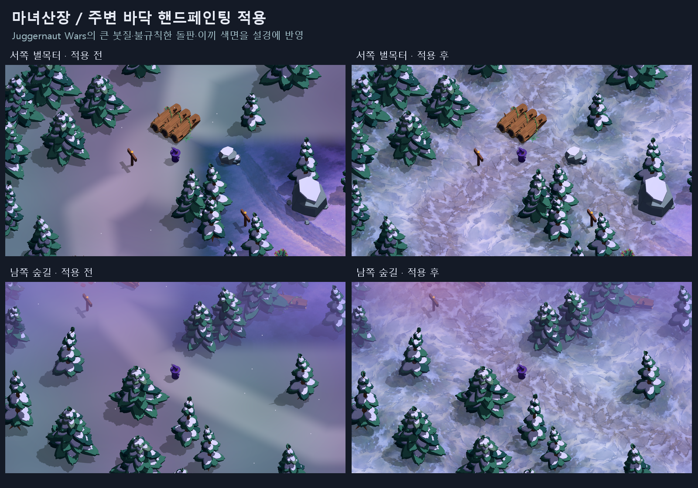
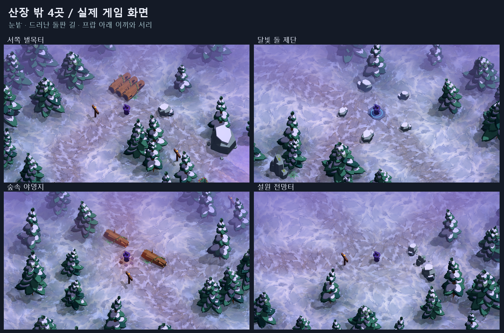

# 산장 주변 전체 바닥 · 핸드페인팅 텍스처

2026-10-14. 산장에만 있던 그림식 바닥을 외곽 숲·길·네 랜드마크까지 확장했다.
사용자 지정 `Juggernaut Wars` 폴더의 **Ice Peake, Magic Forest, Forest**를
직접 확인해 큰 붓질, 불규칙한 돌판, 눈과 풀의 끊어진 경계를 참고했다.
마녀산장에 맞춰 라벤더 눈과 회보라 돌길, 청록 이끼와 서리로 새 텍스처를 제작했다.

## 적용 범위와 에셋

시각 지면 120×120m 전체에 월드 좌표로 적용된다. 산장 중심은 기존 이미지와
새 표면을 섞고, 바깥쪽은 새 텍스처로 덮는다. 서쪽 벌목터, 달빛 돌 제단,
숲속 야영지, 설원 전망터와 연결된 모든 길에 동일한 방식이 적용된다.

| 에셋 | 역할 |
| --- | --- |
| `godot/assets/ground/painted_snow_v1.png` | 넓게 칠한 눈, 얼음, 옅게 드러난 슬레이트 |
| `godot/assets/ground/painted_trail_v1.png` | 눈 사이로 드러난 불규칙한 돌판과 흙길 |
| `godot/assets/ground/painted_forest_v1.png` | 나무·관목·고목 밑의 이끼, 침엽수 낙엽, 서리 |
| `godot/assets/ground/prop_blend_mask.png` | 현재 실제 프랍 배치 위치를 따른 2048² 혼합 마스크(군집 재배치 후 524개) |

세 컬러 PNG는 **imagegen 내장 도구**로 새로 제작했다. 원본 레퍼런스를 지면에
투영하거나 잘라 붙이지 않았다. [전체 제작 프롬프트](prompts/painted-ground-v1.md)를 보존했다.
`output/painted-ground/asset-manifest.json`에 출처 파일명과 결과 SHA-256을 기록했다.

`shaders/painted_ground.gdshader`는 눈/길/숲바닥을 길 거리, 공터와 프랍 접촉면에 따라
섞는다. 원본 PNG의 내부 영역을 무작위 회전한 패치로 겹쳐 쓰고,
주요 붓질과 돌판이 흐려지지 않도록 대부분의 영역에서는 한 패치가 지배한다.
소스 이미지 경계는 샘플링하지 않아 반복 사각형의 경계를 피한다.
명시적 미분과 mipmap/anisotropic 필터로 이동·줌 시 샘플링을 안정화한다.

`scripts/world/world.gd`에서 세 텍스처와 마스크를 기존 지면 재질에 연결한다.
지면 충돌, 내비메시, 프랍 위치와 게임 진행 코드는 이번 바닥 작업으로 바꾸지 않았다.
현재 공기 원근과 국소광에 의한 안개 색도 지면 재질에 계속 적용된다.

## 검증과 실행

`tools/verify_painted_ground.gd`에서 외곽 네 방향, 네 랜드마크, 북쪽/남쪽 길의
10개 지점을 실제 GPU로 렌더했다. 지면만 표시한 캡처에서도 모두 디테일을 확인했다.
11개 셰이딩 프리셋에서 텍스처 바인딩과 디테일 유지, 카메라 높이 변경 시 동일 월드
픽셀의 오차 0 확인. 소스와 내보낸 PCK를 각각 같은 범위로 검증한다.
결과는 `output/painted-ground/verification.json`, `pack-verification.json`에 남긴다.

부가 탐험 검사에서는 네 공터와 산장으로 실제 이동하는 5회 모두 도착했다.
다만 첫 벌목터의 초기 경로 조회 검사 1개가 실패해 이 별도 검사의 전체 판정은
실패다. 위 바닥/패키지 렌더 검증과 구분하며, 이번 바닥 작업에서는 이동 코드를 수정하지 않았다.

배치가 바뀌면 `tools/review_painted_ground.gd`로 실제 프랍 위치를 다시 추출하고
`art_sources/build_ground_masks.py`로 혼합 마스크를 재생성한다.
이 Python 스크립트는 위치 가중치만 생성하며 컬러 아트 제작에 사용하지 않는다.

`build/WitchsLodge-painted-ground.pck`에서 패키지 로드와 시작 화면을 확인한 뒤
검증된 데이터를 `build/WitchsLodge.pck`에 반영한다. 게임을 다시 실행하면 적용된다.
수정 전 데이터는 `build/WitchsLodge-before-painted-ground.pck`에 보존한다.
