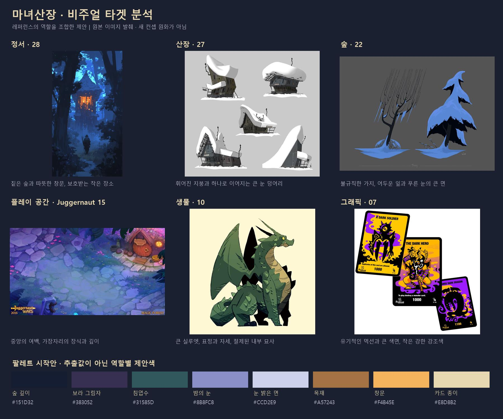

# 마녀산장 — 레퍼런스 분석과 아트 가이드 제안

작성일: 2026-10-14. 마녀산장 보드 36개 핀의 이미지 35장·영상 표지 1장, 별도로 모은 Juggernaut Wars 배경 18장, 기존 승인 원화·실사용 카드·저장된 게임 캡처를 직접 비교했다. Snow는 표지만 검토했으며 영상의 움직임은 분석하지 않았다. 여기의 신규 디자인 방향과 수치는 제안이다. 기존 승인 기준을 변경하거나 게임 모델·셰이더를 수정한 문서가 아니다.

## 1. 제안하는 비주얼 타겟

**차갑고 수상한 설산 숲 속에서, 따뜻한 빛이 새어 나오는 작은 마녀의 산장을 지키는 동화적 3D 게임. 산장과 생물은 손으로 빚은 듯한 형태로, 계약과 자원은 개성이 강한 삽화 카드로 보여준다.**

플레이어가 첫 화면에서 느껴야 하는 것은 산장의 온기, 주변 숲의 깊이, 그 온기를 지키고 싶은 마음이다. 숲에 대한 경계심과 손님을 맞는 생활감이 함께 있어야 한다. 괴물과 용의 위험은 표정·자세·규모·행동으로 표현하고, 일상 화면에서는 마녀와 양의 작은 움직임이 장소에 생기를 준다.

위 보드는 각 레퍼런스에서 가져올 역할을 정리한 비교 자료다. 장면 전체를 하나의 레퍼런스 화풍으로 바꾸는 지시가 아니다. 대표 이미지를 임의로 새 승인 원화로 지정하지 않는다.

## 2. 보드에서 읽히는 취향과 근거

보드는 서로 다른 매체의 자료를 묶고 있다. 카드와 인물 삽화, 건축·나무 에셋, 밤 숲의 분위기 원화를 각각의 역할로 읽을 때 방향이 선명해진다. 아래 ‘의도’는 이미지의 반복된 특징으로부터 추론한 것이며 사용자가 각 핀의 목적을 직접 설명한 기록은 아니다.

| 레퍼런스 번호 | 직접 관찰한 특징 | 마녀산장에 적용할 역할 |
| --- | --- | --- |
| 01 | 기울어진 건축, 갑옷 인물, 크고 작은 괴물, 굵은 선과 작은 발광 눈 | 음산함과 유머를 함께 가진 인물·괴물의 개성 |
| 02 · Deck of Haunts | 어두운 입체 공간 위에 명확한 카드 손패와 선택 카드 | 3D 월드와 삽화 카드가 함께 있는 화면 구성. 어둠의 강도와 실내 설정은 별도 판단 |
| 03 | 곡선 문양과 초록 강조색이 이어지는 카드·토큰 | 카드·아이콘·상태 표시를 한 문법으로 연결하는 방법 |
| 04 | 카드마다 이미지·글 영역이 반복되고 원화가 크게 보임 | 카드 정보 계층과 시리즈 일관성 |
| 05 | 긴 인물 실루엣, 어두운 큰 면, 크림색 여백, 제한된 붉은색 | 초상의 큰 명암과 단순한 배경. 긴 등신은 현재 SD 월드에 직접 적용하지 않음 |
| 06 | 용병마다 다른 몸 덩어리·도구·자세, 따뜻한 배경과 밝은 설명란 | 얼굴·직업·도구로 계약 인물을 구별 |
| 07 | 검은 유기적 선, 노랑·보라의 큰 면, 비대칭 캐릭터 | 카드의 즉각적인 시각적 힘과 유머. 월드 전체의 색상 규칙은 기존 설경을 우선 |
| 08 | 아치형 틀, 동물·문양의 중심 기호, 반복되는 카드 뒷면 구성 | 공용 뒷면과 소수의 상징. 기존 확정 S자 포맷 위에 장식을 누적하지 않음 |
| 09–11 | 용의 큰 머리·몸·꼬리, 강한 자세, 소수 색면과 절제된 비늘 | 작은 게임 화면에서도 살아 있는 용의 개성과 몸 덩어리 |
| 12–13 · Albion 자료 | 굵은 구조재, 큰 지붕, 읽기 쉬운 건물 덩어리 | 3D 건물의 부재 두께·구조 가독성·증축 단위 |
| 14–16 | 휘어진 처마, 기울어진 지붕 끝, 두꺼운 목재, 불균형한 큰 형태 | 산장의 손맛과 동화적 성격. 탑·여러 지붕은 성장 이후 후보 |
| 17 | 좁고 긴 줄기, 서로 다른 나무 높이, 드문 하층 식생 | 숲의 리듬과 여백. 실제 에셋 제작 방식은 이미지로 단정하지 않음 |
| 18 · Palia 자료 | 잎을 큰 묶음으로 나눈 침엽수, 큼직한 바위와 색면 | 가지·바위 형태를 정리하는 방법. 꽃과 장식의 양은 공터에 맞춰 축소 |
| 19–21 | 풍성함이 서로 다른 침엽수, 빈 가지와 잘린 줄기, 비대칭 | 반복되는 나무의 종류·밀도·방향을 바꾸는 방법 |
| 22–23 | 푸른 눈, 짙은 잎, 불규칙한 눈 가장자리와 굽은 가지 | 겨울 숲의 큰 명암과 눈·잎의 형태 대비 |
| 24–26 | 깊은 푸른 밤, 작은 창문 빛, 넓은 설경과 먼 실루엣 | 차가운 공간과 온기의 대비. 26의 청록 마법은 특별 사건의 후보 |
| 27 | 지붕과 눈이 큰 곡선을 만들고, 건물마다 무게중심이 다름 | 산장 눈 덮개의 연속성·처짐·무게감 |
| 28–32 | 어두운 숲의 프레임, 먼 공간의 푸른 층, 작은 따뜻한 집 | 산장이 숲속 피난처로 보이는 정서와 초점 |
| 33 · Moonlighter 팬아트 | 뾰족하고 긴 침엽수, 앞·중간·뒤 숲 층, 작은 인물 | 배경의 깊이와 높이 차이. 삽화 카메라는 게임 시점과 구분 |
| 34 | 청록 오로라와 앰버 창문, 눈 덮인 큰 지붕 | 특별한 밤의 색 변주. 평상시 팔레트는 보라·인디고 유지 |
| 35 | 휘어진 줄기, 청록 안개, 드문 노랑 빛, 숲의 존재 | 숲의 미스터리와 짧은 마법 연출 |
| 36 | 보라·남색 산장, 여러 지붕의 실루엣, 따뜻한 창문 | 기존 퍼플 설경과 가까운 분위기. 복합 건축은 초기 본채와 분리 |

전체 비교 이미지: [01–09](../output/art-guide-review/references-1.jpg), [10–18](../output/art-guide-review/references-2.jpg), [19–27](../output/art-guide-review/references-3.jpg), [28–36](../output/art-guide-review/references-4.jpg). 각 번호는 [다운로드 출처 목록](../마녀산장_핀터레스트/sources.csv)에 대응한다. 작품명이 없는 자료의 제작자·게임명은 추측하지 않았다.

## 3. 화면 전체를 묶는 다섯 원칙

### 온기는 중앙에, 미스터리는 바깥에

산장 입구·창문·등불·생활 소품을 작은 따뜻한 영역으로 묶는다. 숲은 인디고·짙은 보라·어두운 청록의 층으로 이어져 공간이 더 깊게 느껴지게 한다. 같은 보라색이라도 중앙 눈밭과 숲 끝의 명도·색상·선명도를 달리한다. 위협이 오는 두 길은 어둠 속에서도 방향이 보여야 한다.

### 큰 형태가 성격을 만든다

지붕의 곡률, 처마 끝, 기둥의 휨, 나무의 중심선, 용의 머리와 목처럼 멀리서 읽히는 특징을 먼저 만든다. 작은 나뭇결·비늘·장식은 큰 실루엣이 정리된 뒤 필요한 곳에만 둔다. 외곽선을 검게 채워도 산장·나무·용을 구별할 수 있어야 한다.

### 질서는 구조에, 불규칙함은 외형에

산장 문과 계단은 사람이 드나들 수 있게 안정적으로 연결한다. 그 위의 목재·지붕·눈은 크기와 곡률을 달리해 손으로 만든 인상을 준다. 나무는 가지 묶음의 높이·방향·빈 공간을 바꾼다. 눈의 가장자리는 중력에 따라 처지고, 기울어진 가지에 얹힌다. 무작위 작은 울퉁불퉁함보다 몇 개의 의도적인 큰 차이가 중요하다.

### 플레이 공간에는 여백을 준다

Juggernaut Wars 18장에는 대체로 중앙의 활동 공간을 넓게 남기고 돌·수풀·건축을 가장자리에 두는 공통점이 있다. 지면의 넓은 색면과 소수의 돌 경계가 공간을 설명한다. 마녀산장에서는 산장·목장·진입로를 유지하면서 이 원리를 사용한다. 등장인물이 없는 배경에서도 마녀가 움직일 곳과 적이 들어올 곳이 보여야 한다.

[Juggernaut 배경 비교 1](../output/art-guide-review/juggernaut-1.jpg) · [비교 2](../output/art-guide-review/juggernaut-2.jpg). 이 이미지들은 비어 있는 배경이므로 실제 전투의 시인성이나 게임 카메라 값을 증명하지 않는다.

### 월드와 카드는 같은 세계의 다른 거리다

월드는 한눈에 공간과 행동을 읽는 거리이고, 카드는 인물·재료·계약을 가까이 보는 거리다. 같은 인물의 모자·도구·외투색, 같은 괴물의 뿔·눈·몸 덩어리를 양쪽에서 반복한다. 카드의 강한 먹선과 인쇄 질감은 확대된 그림에 사용하고, 월드는 큰 색면과 부드러운 입체감을 유지한다. 화면을 묶는 핵심은 동일한 선 굵기보다 색·형태·인물 정체성이다.

## 4. 요소별 제작 가이드

| 요소 | 형태와 표현 | 게임 화면에서 확인할 기준 |
| --- | --- | --- |
| 시작 산장 | 작은 단일 박공지붕, 넓은 지붕 덩어리, 굵고 약간 휜 목재, 약한 비대칭, 아치 문과 작은 창 | 문·창·계단이 읽히고 목장을 가리지 않음. 작은 크기에도 고유한 지붕 곡선이 보임 |
| 지붕 눈 | 지붕을 따라 이어진 큰 패치, 완만한 처짐, 일부 목재가 보이는 틈 | 같은 크기의 눈 타일·베개가 반복되는 인상을 줄임. 눈의 두께와 지붕 구조를 함께 읽음 |
| 증축 | 본채 재료·처마 곡선·창문 문법을 반복한 작은 공간 | 성장 전후를 형태로 구별하고 본채 입구·목장·용의 자리를 유지 |
| 침엽수 | 아래로 쓸리는 큰 가지 묶음, 곧거나 약간 굽은 줄기, 성긴 부분과 풍성한 부분 | 같은 나무의 크기만 바꾼 인상 완화. 3종의 실루엣 변형부터 비교 |
| 숲 배치 | 가까운 나무는 실루엣, 중간은 가지·줄기, 먼 숲은 색과 안개 층 | 중앙의 이동·소환 공간 확보. 길 입구가 큰 가지에 가려지지 않음 |
| 바위 | 낮고 넓은 덩어리, 몇 개의 비대칭 절단면, 틈새의 접촉 음영 | 원통 기둥·일정한 둥근 뚜껑처럼 보이는 반복 완화 |
| 지면 | 넓은 라벤더 눈 면, 큰 그림자, 드문 발자국·길 흔적 | 입체 프랍보다 낮은 세부 대비. 작은 붓질이 전역에 균일하게 깔리지 않음 |
| 마녀 | 기존 2~3등신, 큰 굽은 모자, 짧은 몸, 눈에 띄는 지팡이 끝과 외투 덩어리 | 뒤에서 봐도 주인공이 식별됨. 눈밭·그림자 둘 다에서 모자와 몸 구분 |
| 여행자·용병 | 두꺼운 방한복, 직업별 큰 도구, 체격·모자·짐의 차이 | 방문자·계약 초상·소환체에서 같은 인물로 보임 |
| 양 | 둥근 한 덩어리의 양털, 작은 얼굴·다리, 부드러운 명암 | 밝은 눈 위에서도 얼굴과 몸 경계가 보임. 수확 가능 상태를 작은 동작·표시로 전달 |
| 숲 괴물 | 목재·뿌리·잎의 익숙한 재료를 뿔·눈·굽은 팔다리로 낯설게 조합 | 배경 나무와 실루엣·움직임이 달라야 함. 아군 소환은 색 이외의 표식도 사용 |
| 용 | 큰 머리와 가슴, 목의 곡선, 날개의 명확한 막, 표현력 있는 얼굴 | 지붕 위 존재감과 고개·발사 방향이 읽힘. 개별 비늘은 확대 시 소수만 |
| 카드 | 승인된 보라 S자 프레임, 크림 패널, 굵고 변화하는 먹선, 큰 초상 | 작은 손패에서는 종류·주요 도구·수량이 읽힘. 본문은 확대 상태에서 읽음 |

현재의 작은 본채를 유지하면서 레퍼런스의 굽은 형태를 약하게 더하는 것이 우선이다. 14·15·30·36의 높은 탑과 다중 지붕은 성장 단계·키아트 후보로 보관한다. 27의 심하게 기울어진 집은 지붕과 눈의 형태 참고이며 초기 건물의 안정성까지 바꾸는 기준은 아니다.

## 5. 색·명암·재질

아래 HEX는 레퍼런스에서 픽셀을 추출한 값이 아니라 역할별 팔레트 시작안이다. 실제 조명 아래의 화면색과 텍스처 기본색은 다르므로 최종 알베도 값으로 바로 사용하지 않는다.

| 역할 | 제안색 | 사용 방향 |
| --- | --- | --- |
| 숲 깊이·가장 어두운 영역 | `#151D32` | 숲 틈·먼 경계. 플레이 중인 지면 전체에 덮지 않음 |
| 유색 그림자 | `#383052` | 눈·나무·건물의 어두운 면을 연결 |
| 침엽수·숲 생물 기본 덩어리 | `#31585D` | 잎의 짙은 초록과 청록을 남김 |
| 밤 눈의 중간 면 | `#8B8FC8` | 퍼플 설경 유지. 중앙·외곽은 다른 밝기로 조절 |
| 눈의 밝은 면 | `#CCD2E9` | 지붕·길·캐릭터 주변의 큰 밝은 면 |
| 목재 | `#A57243` | 그림자 속에서는 갈색으로 낮추고 국소광에서 온기를 보임 |
| 창문·등불 | `#F4B45E` | 작은 면적으로 초점을 만듦 |
| 카드 종이 | `#E8D8B2` | 밝은 설명 영역과 월드의 온기를 연결 |

마법의 청록·황록과 위험의 적색은 상태별 작은 강조색으로 둔다. 용의 불꽃은 발사·피격 순간에 큰 강조가 허용된다. 아군·적·유효 대상 구분은 색과 함께 아이콘·테두리·모양으로 전달한다.

**명암 계층:** 숲 깊이는 가장 어둡게, 산장과 공터는 읽을 수 있는 중간 면으로, 창문과 필요한 상호작용은 작은 강한 초점으로 둔다. 눈밭의 밝은 면적이 크므로 밝기만으로 초점을 만들기보다 따뜻한 색·국소 대비를 함께 쓴다. 카드 선택 순간에는 선택 카드와 대상 피드백이 잠시 시선의 우선권을 갖는다.

**재질:** 목재·돌은 넓은 2~3단 명암과 짧은 접합 그림자, 눈·양털은 더 부드러운 경계, 잎은 어두운 큰 면과 소수의 밝은 끝으로 구별한다. 반복 재질의 모든 면에 같은 검은 선·균열·종이 무늬를 넣지 않는다. 선은 문틀·박공·부재 연결 등 형태를 설명하는 곳부터 사용한다.

**조명:** 달빛은 숲과 눈의 큰 방향성을 만들고, 창문·등불은 작은 안전 영역을 만든다. 안개는 숲의 깊이를 표현하되 유효한 카드 대상과 적의 예고를 덮지 않아야 한다. 기존 고정 카메라 지면의 색 마스크를 실제 체적 안개로 오해하지 않는다.

기존 ‘부드러운 명암’ 프리셋을 비교 기준으로 권한다. 강렬한 툰·두꺼운 외곽선은 별도 비교용으로 유지하고, 신규 기본 화풍으로 확정하지 않는다. 새 셰이더 수치의 적합성과 성능은 이번 이미지 분석으로 검증하지 않았다.

## 6. 카메라·구도·카드 화면

기존 높은 정사영 쿼터뷰와 산장·목장·두 길의 구조를 유지한다. 28–36의 낮은 삽화 시점은 숲의 정서와 큰 명암 참고로 사용한다. 게임 화면에서 긴 전경 나무와 낮은 시점을 그대로 가져오면 문·양·적·드래그 대상이 겹칠 수 있다.

문서에 기록된 실제 카메라는 수평 35°·하향 50°·size 21·2:1이다. 기존 아트 방향의 65~70°는 과거 블록아웃 제안이다. 이 분석에서 어느 수치를 새 정답으로 확정하지 않고, 현재 카메라에서 형태·가림·손패 여백을 먼저 비교한다.

상단의 상태 정보, 중앙의 산장과 활동 공간, 하단의 손패가 시선을 나눠 가져야 한다. 처음에는 화면 하단 약 20%를 손패·드래그 조작의 시험 영역으로 잡고 실제 카드 수·확대 상태·비율에 따라 조정할 수 있다. 이 비율은 제작 제안이다. 카드가 줄어든 상태와 확대된 사용 상태를 각각 검사한다.

카드를 잡으면 유효 대상의 윤곽·바닥 표식·간단한 효과 설명을 연결한다. 소환 미리보기는 실제 캐릭터와 같은 형태여야 한다. 자원은 스택 수량으로, 계약은 초상과 큰 도구로 구별한다. 지형 장식과 카드 대상의 표시가 같은 색·문양으로 경쟁하지 않게 한다.

## 7. 세 장면으로 정의하는 목표 화면

| 장면 | 보고 싶은 결과 | 확인할 항목 |
| --- | --- | --- |
| 평상시 방문 | 눈 쌓인 작은 산장, 따뜻한 문, 마녀·양·접근하는 손님, 주변의 깊은 숲 | 산장이 첫 초점이고 마녀·목장·두 길이 곧바로 보임. 손패를 둬도 문과 양을 가리지 않음 |
| 카드 사용 | 용병 카드를 나무 또는 방어 지점으로 가져가는 순간 | 카드 인물과 소환 미리보기의 도구·색·형태 일치. 유효 위치·취소·사용 결과를 식별 |
| 용의 방어 | 산장 지붕의 큰 용이 독립 불덩이를 한 발 발사하고 숲에서 적이 접근 | 용의 얼굴과 발사 방향, 피해 범위, 마녀·양·잔여 적이 함께 읽힘. 강한 화염이 지나면 차가운 설경이 다시 보임 |

새 원화를 만들 경우 이 세 장면을 같은 산장·나무·캐릭터 디자인으로 제작한다. 기분 좋은 정지 원화 한 장만으로 카드 드래그와 전투 시인성을 완료 판단하지 않는다.

## 8. 현재 화면과의 차이, 수정 우선순위

비교한 게임 화면은 [v24 소스의 UI 없는 캡처](../godot/screenshots/art-refinement/v24-source-clean.png)와 [v23 배포 용 전투 캡처](../godot/screenshots/art-refinement/v23-pack-dragon.png)다. 이번에 게임을 새로 실행한 결과는 아니다. v24 산장 수정은 중단 상태로 기록돼 있으며 배포 데이터는 v23이라는 [리디자인 기록](lodge-redesign.md)을 따른다.

**이미 맞는 부분:** 중앙의 작은 산장과 목장, 높은 게임 시점, 보라 설경·짙은 녹색 나무·앰버 창문의 조합, 마녀와 양의 SD 방향이다. 이 기반은 보드의 밤 숲과 피난처 정서에 잘 맞는다.

| 우선순위 | 캡처에서 보이는 차이 | 제안 작업 | 완료 판단 |
| --- | --- | --- | --- |
| 1 · 산장과 눈 | 눈이 유사한 크기의 작은 덩어리로 반복돼 지붕보다 패턴이 먼저 보임 | 큰 연속 눈 패치와 처마 처짐, 지붕 곡선·박공 두께 정리 | 작은 화면에서 패턴보다 산장 실루엣이 먼저 읽힘 |
| 2 · 나무와 바위 | 나무 단·눈·외곽이 반복되고 바위의 평평한 둥근 윗면이 비슷함 | 나무 3개 실루엣 변형과 낮고 넓은 비대칭 바위부터 비교 | 숲에 높이·방향·빈 공간의 리듬이 생김. 새 장식을 늘리지 않아도 차이가 보임 |
| 3 · 지면과 조명 | 중앙 지면에도 작은 질감 변화가 많고, 주변 프랍의 밝은 눈이 초점을 분산 | 공터 질감의 작은 대비를 줄이고 외곽 눈·잎의 밝기 계층 조절 | 축소·흑백 화면에서도 산장→마녀·활동 공간→숲 순으로 읽힘 |
| 4 · 카드와 인물 | 실사용 카드의 도끼 용병은 풍부한 초상인 반면 기존 월드 인물은 역할 차이가 작음 | 방문자·계약·소환체 한 인물을 같은 도구·외투·모자 특징으로 맞춤 | 카드와 월드의 동일 인물을 별도 설명 없이 연결 가능 |
| 5 · 용과 전투 | 용의 존재감은 있으나 몸과 날개의 덩어리·표정이 원화보다 단순함 | 머리·목·가슴과 날개막 실루엣, 발사 전 자세, 화염의 짧은 강조 | 지붕과 겹쳐도 얼굴·공격 방향이 보이고 전장 정보가 남음 |

현재 차이의 큰 부분은 형태와 반복감에 있다. 조명 강도·외곽선을 올리는 것만으로 해결할 문제로 보지 않는다. 먼저 산장·침엽수·바위 세 에셋을 현재 카메라에서 고치고, 같은 구도의 전후 캡처로 평가하는 순서가 효율적이다.

## 9. 비주얼 타겟 통과 기준

아래는 후속 작업에서 사용할 검사안이다. 이번 검토에서 이미 통과했다는 뜻은 아니다.

1. 1920×1080 게임 화면과 가로 480px 축소 화면에서 산장·마녀·목장·두 진입로를 구별한다.
2. 흑백으로 보았을 때 공터의 행동 주체와 숲 배경이 분리되고, 작은 창문·입구의 초점이 유지된다.
3. 산장·나무·용을 검은 실루엣으로 보아도 종류와 주요 방향을 구별한다.
4. 지붕·나무의 눈이 규칙적인 작은 패치보다 큰 무게와 처짐으로 보인다.
5. 카드 3장·6장의 시험 손패, 확대 카드, 드래그 미리보기에서 마녀·문·양·필수 대상이 읽힌다. 장수는 시험 사례이며 확정 손패 한도가 아니다.
6. 같은 용병의 카드·방문자·소환체에서 큰 도구와 색·모자가 연결된다. 아군 괴물과 적 괴물은 색만으로 구분하지 않는다.
7. 용의 화염과 여러 적이 있는 순간에도 공격 방향·피해 예고·주인공의 위치가 보인다.
8. 새로운 변형을 넣은 뒤 시작·방문·증축·일반 전투·용 장면을 같은 스타일로 비교한다. 모델 변경 시 문 접근·목장 가림·지붕 용 자리도 함께 확인한다.

## 10. 기존 결정과 이번 제안의 관계

| 구분 | 내용 |
| --- | --- |
| 기존 승인 기준 유지 | [04 승인 원화](../art/concepts/environment/04-prototype-reference-simplified.png)의 높은 시점·작은 본채·낮은 밀도·절제된 텍스처, [07 숲 분위기](../art/concepts/environment/07-colored-forest-darkness.png), SD 2~3등신, [확정 S자 카드](card-format-design-summary.md) |
| 이번 분석에서 구체화한 제안 | 큰 연속 눈 형태, 3종 나무 실루엣부터의 변형, 깊이별 명암 계층, 카드와 월드 인물의 시각 연결, 세 목표 장면, 팔레트 시작안과 검사안 |
| 별도 결정이 필요한 확장 | 높은 탑·여러 지붕을 가진 후기 산장, 오로라와 마법의 상시 사용, 배경 전체의 강한 인쇄 화풍, 카메라 구조 변경 |

제작 지침을 한 문장으로 표현하면 **“큰 형태에 동화적 성격을 주고, 차가운 숲과 따뜻한 생활의 대비를 살리며, 월드의 행동과 카드의 인물이 한눈에 이어지게 한다.”**

## 검토 자료

- [마녀산장 보드 다운로드 출처·해상도](../마녀산장_핀터레스트/sources.csv)
- [Juggernaut Wars 다운로드 출처](../Juggernaut%20Wars/sources.csv)
- [기존 아트 방향](art-direction.md), [내러티브](narrative.md), [카드 기반 코어 v0.3](kingdom-integration-design.md)
- [실사용 카드 갤러리](../godot/screenshots/cards/asset-gallery.png), [라이팅 검토](card-lighting-shading-review.md), [화면 프리셋](screen-style-presets.md)
- [현재 3D 수정 기록](art-refinement-progress.md), [산장 리디자인 상태](lodge-redesign.md)

해석의 근거는 저장된 이미지와 프로젝트 문서다. 보드의 개별 그림을 사용자가 최종 채택한 것으로 단정하지 않았으며, 레퍼런스 제작 과정·영상 움직임·플레이 성능은 이번 분석 범위에서 확인하지 않았다.
