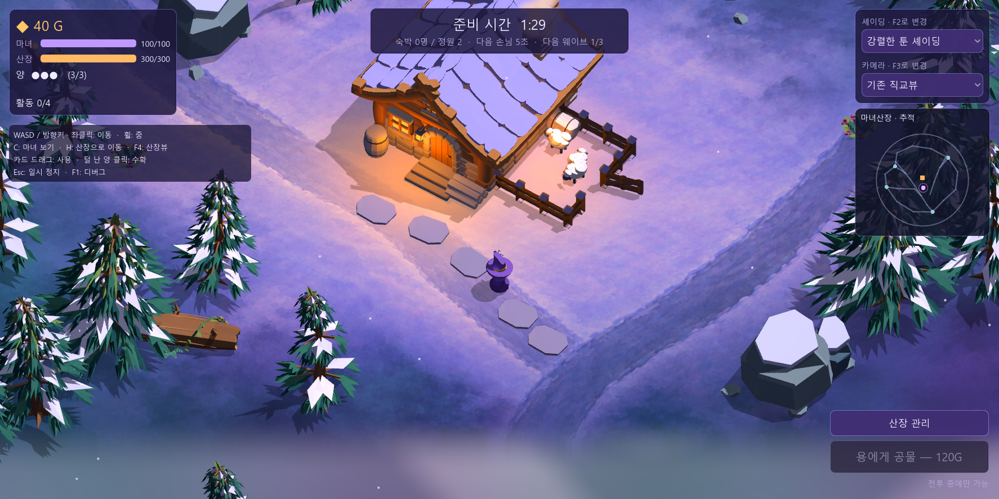
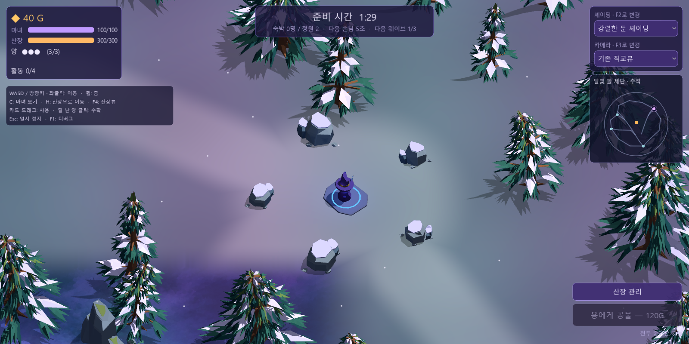

# 플레이어 카메라와 확장 설산 숲

2026-10-14. 소스와 Windows 실행 데이터에 플레이어 추적 카메라·키보드 이동·확장 맵을 적용했다.



## 플레이

`게임실행.bat` 또는 `build/WitchsLodge.exe`로 실행한다. 이미 열린 게임은 다시 실행한다.

| 입력 | 동작 |
| --- | --- |
| F11 | 전체화면 ↔ 창모드. 창 크기와 위치를 복원하며 일시 정지 중에도 가능 |
| WASD / 방향키 | 화면 방향 기준 이동. 대각선 속도는 동일하며 클릭 이동을 취소한다 |
| 지면 좌클릭 | 장애물을 피해 목적지까지 이동 |
| 오른쪽 위 작은 지도 클릭 | 먼 탐색 지점으로 이동 |
| 마우스 휠 | 줌. 화면 높이 12–28m |
| C | 마녀로 카메라 재정렬 |
| H | 산장 정문으로 걸어서 복귀 |
| F4 | 추적 카메라 ↔ 기존 산장 전체뷰 |
| F3 / 카메라 메뉴 | 기존 5개 렌즈 유지. 추적 위치와 줌을 유지하며 전환 |
| F2 / 셰이딩 메뉴 | 기존 11개 셰이딩·라이팅 유지 |

추적 카메라의 기본 높이는 18m, 내려다보는 각도는 기존 50°다. 프레임 시간에 독립적인 보간으로 마녀를 화면 중앙보다 약간 아래에 둔다. 마녀를 가리는 나무만 부드럽게 투명해지고, 산장 전체뷰에서는 복원된다. 관리·일시 정지·카드 드래그·창고·판매·프리셋 팝업 중에는 키보드로 새 이동을 시작하지 않는다.

## 맵

이전 반경 16m 경계를 제거하고 **반경 38m**의 닫힌 숲 경계를 만들었다. 명목 원형 면적은 약 5.6배다. 바닥 충돌과 내비게이션 베이크를 104×104m로 넓혔으며, 기존 산장·목장·자원 나무·괴물 출현 지점은 유지했다.

| 탐색 지점 | X, Z | 환경 |
| --- | --- | --- |
| 서쪽 벌목터 | −24, 5 | 쌓인 통나무, 표지판, 바위 |
| 달빛 돌 제단 | 8, −26 | 원형 돌 무리, 푸른 빛과 제단 |
| 숲속 야영지 | −20, 23 | 통나무, 화로와 따뜻한 빛 |
| 설원 전망터 | 23, 18 | 바위 능선, 표지판과 열린 눈밭 |

기존 두 길에서 갈라진 길과 바깥 순환길로 지점을 연결했다. 길 주변 8m와 지점 주변 약 12m를 비워, 기존 GLB를 사용한 성긴 숲을 배치했다. 작은 지도는 실제 월드·카메라 방향을 사용하며 산장·마녀·적·탐색 지점을 표시한다. 지역명은 도착한 위치에 따라 바뀐다.



지면의 기존 원화 투영은 월드에 고정되어 있다. 원화 영역 바깥은 월드 좌표로 그리는 눈과 길·공터로 이어진다. 확장 지역은 탐색용 환경이며, 새 보상·퀘스트·수집 규칙은 추가하지 않았다. 준비 시간과 웨이브는 탐색 중에도 기존 규칙으로 진행된다.

## 구현과 검증

- `scripts/visual/player_camera.gd`: 추적·줌·산장뷰·나무 가림 처리.
- `scripts/actors/player.gd`, `scripts/main.gd`: 화면 방향 이동, 내비게이션 보정, 클릭 이동, 단축키.
- `scripts/world/layout.gd`, `exploration.gd`, `world.gd`: 길·지점·확장 숲·경계·내비게이션.
- `scripts/ui/exploration_map.gd`, `hud.gd`: 위치 안내·지도 클릭과 조작 안내.
- `shaders/painted_ground.gdshader`: 확장 눈밭·길·공터.

실제 물리 이동으로 네 지점을 방문하고 산장으로 복귀했다. 다섯 렌즈에서 확장 구역 클릭·카드 지면 좌표를 검증하고, 키보드 방향·대각선 속도·키 해제·충돌·8방향 외곽 경계·지도 클릭·줌 제한·가림 복원·일시 정지·화면 크기 변경을 확인했다. 실제 Forward+ 화면도 캡처해 확인했다.

기존 카메라/셰이딩 **55조합** 검증과 카드 코어 **34항목** 회귀 검증도 통과했다. 두 기존 검증은 산장뷰로 실행한다. 카드 검증의 경계 밖 좌표는 넓어진 맵에 맞춰 갱신했다.

검증 기록: [소스 탐색 검증](../output/exploration/verification.json), [실행 데이터 탐색 검증](../output/exploration/pack-verification.json), [카메라 55조합](../output/camera-presets/verification.json), [카드 코어](../godot/art_sources/card-core-verify.json).

```text
Godot-4.7.2.exe --headless --path godot --script res://tools/verify_exploration.gd
Godot-4.7.2.exe --path godot --script res://tools/verify_exploration.gd -- --render
```

새 실행 데이터는 `build/WitchsLodge-exploration.pck`이며 검증 후 `build/WitchsLodge.pck`에도 반영했다. 교체 전 데이터는 `build/WitchsLodge-before-exploration.pck`에 보존했다.
