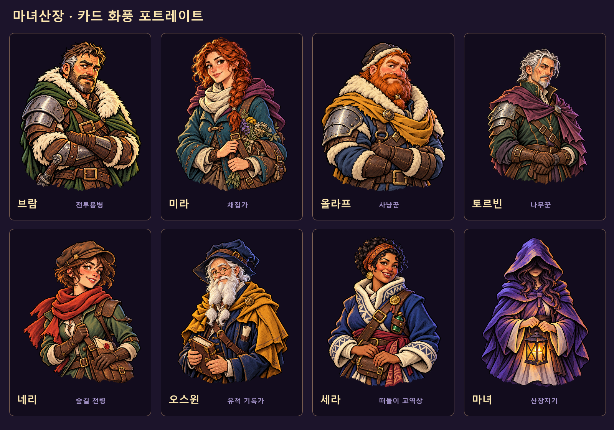

# 포트레이트 전체 카드 화풍 통일

2026-10-18. 사용자 승인 브람 v02를 공통 화풍·구도·마감 기준으로 현재 게임에서 사용하는 인물 포트레이트 전체를 갱신했다. 내장 image_gen으로 제작했고 기존 인물의 외형·나이·복장·소품·표정을 정체성 참조로, 승인 브람과 승인 인물 카드 니브를 그림체 참조로 입력했다. 중세 기반 판타지의 재료와 분위기를 유지한다.

## 제작·적용 범위

| 인물·용도 | 제작 원본 | 현재 게임 경로 |
| --- | --- | --- |
| 브람 · 전투용병 | [bram.png](../art/portraits/card-style-v01/bram.png) · 승인 v02 재사용 | `godot/assets/portraits/guest_bram_cutout.png` |
| 미라 · 채집가 | [mira.png](../art/portraits/card-style-v01/mira.png) | `godot/assets/portraits/guest_mira_cutout.png` |
| 올라프 · 사냥꾼 | [olaf.png](../art/portraits/card-style-v01/olaf.png) | `godot/assets/portraits/guest_olaf_cutout.png` |
| 토르빈 · 나무꾼 | [torbin.png](../art/portraits/card-style-v01/torbin.png) | `godot/assets/portraits/guest_torbin_cutout.png` |
| 네리 · 전령 | [neri.png](../art/portraits/card-style-v01/neri.png) | `godot/assets/portraits/guest_neri_cutout.png` |
| 오스윈 · 유적 기록가 | [oswin.png](../art/portraits/card-style-v01/oswin.png) | `godot/assets/portraits/guest_oswin_cutout.png` |
| 세라 · 교역상 | [sera.png](../art/portraits/card-style-v01/sera.png) | `godot/assets/portraits/guest_sera_cutout.png` |
| 마녀 · 선택 화면·HUD 공용 | [witch.png](../art/portraits/card-style-v01/witch.png) | `godot/assets/ui/ftue/witch_portrait.png` |
| 잠금 마녀 · 3칸 공용 | [witch-locked.png](../art/portraits/card-style-v01/witch-locked.png) | `godot/assets/ui/ftue/witch_locked.png` |
| HUD 초상을 분리한 기존 배경 | [player-status-frame.png](../art/portraits/card-style-v01/player-status-frame.png) | `godot/assets/ui/moon_runes/runtime/player_status.png` |

일곱 손님은 도착·입실 모션, 대화 알림·대화창, 산장 관리 목록에서 같은 프로필 경로를 공유하므로 해당 경로에서 모두 교체된다. 마녀는 선택 화면과 HUD가 같은 새 초상을 공유한다. 잠금 슬롯은 익명 실루엣과 게임이 그리는 물음표를 유지한다. 사용하지 않는 배경 포함 옛 브람·미라 원본과 카드 원화는 이 작업의 포트레이트 바인딩이 아니다.

## 화풍과 마감

- 굵고 가늘어지는 검은 먹선, 큰 색면과 분명한 명암, 페인터리 인쇄 질감.
- 상반신 구도, 완전한 머리·어깨·팔·손·소품. 사방 투명 여백과 자연스러운 하단 외곽.
- 브람·올라프의 팔짱, 미라의 약초 가방, 토르빈의 겹친 손, 네리의 편지 가방, 오스윈의 책, 세라의 허리 주머니, 마녀의 후드와 등불을 유지한다.
- 토르빈 최초 생성본은 하단 여백 검사에서 보정이 필요해 `drafts/torbin-tight-v01.png`로 보존하고 별도로 다시 생성했다.
- 도착·대화창의 추가 하단 알파 페이드를 제거해 새 원화에 그린 마감을 보존한다. 모든 표시 부품은 비율 유지 모드를 사용한다.
- HUD의 옛 모자 마녀는 배경에서 제거하고, 전체 상반신이 들어가는 독립 초상 레이어를 추가했다. 체력·산장 게이지·숫자·텍스트 기능을 보존한다.

## 보존 자료

- [실제 개별 생성 프롬프트](../art/portraits/card-style-v01/prompts/)와 [제작 전 원본 10개](../art/portraits/card-style-v01/originals/).
- [적용 경로·원본/런타임 해시·검증·실행파일 기록](../art/portraits/card-style-v01/manifest.json)과 [실제 알파·치수·SHA-256 검사](../art/portraits/card-style-v01/alpha-verification.json). 외곽 판정은 알파 8/255 초과 영역으로 하고, 미세한 투명 경계 노이즈와 실제 잘림을 구별한다.
- [재실행 가능한 원본 검사](../art/portraits/card-style-v01/verify-assets.ps1) 및 [실제 UI·배포 픽셀 검증](../godot/tools/verify_portrait_rollout.gd).

## 실제 게임 확인

[전체 초상](../output/portrait-card-style-v01/source/00-all-portraits.png) · [마녀 선택](../output/portrait-card-style-v01/source/01-witch-selection.png) · [HUD](../output/portrait-card-style-v01/source/02-hud.png) · [대화창](../output/portrait-card-style-v01/source/03-dialogue-mira.png).

도착 UI는 `source/arrival-<id>.png` 7장으로 모두 렌더링했다. 게임 텍스처의 투명 배경·외곽 잘림, 원본 알파 마감 유지, 선택 화면의 초상 연결, HUD의 새 초상 재사용과 960×540·1280×720·1920×1080 배치를 검사한다. 소스 렌더 검증은 72항목, 실제 이틀간 손님 7명 로테이션·대사·고용·숙박비 검증은 106항목 통과했다.

기존 `verify_guest_roster.gd`는 현재의 미라 고용 가능 로테이션에 맞춰 둘째 날의 세 도착 배치를 모두 검사하도록 보완했다. 게임의 등장 순서·비용·고용·대사는 변경하지 않았다.

## 배포 완료

루트의 [WitchsLodge.exe](../WitchsLodge.exe)를 Windows Desktop 릴리스로 다시 내보냈다. 게임 데이터를 포함한 단일 EXE이며 별도 실행파일·PCK·런처를 만들지 않았다.

- [내장 PCK 검증](../output/portrait-card-style-v01/packed/verification.json): 83항목 통과. 실제 EXE의 내장 PCK를 Godot 엔진에 직접 로드해 새 텍스처 10개의 디코딩 픽셀 SHA-256을 소스 검토본과 대조했고, 선택·HUD·도착 7명·대화창을 다시 렌더링했다.
- [도착·대화·산장 관리 회귀 검증](../output/portrait-card-style-v01/events/verification.json): 132항목 통과. 알림, 초상 이동, 대화 선택지, 관리 목록, 고용·숙박비와 화면 크기 대응을 확인했다.
- [실행파일 직접 실행 화면](../output/portrait-card-style-v01/direct-exe-startup.png): 별도 프로젝트나 PCK 인자 없이 루트 EXE 자체를 실행해 시작 손패와 새 HUD 초상을 확인했다. 릴리스 템플릿은 외부 `--script` 검증을 실행하지 않으므로, 픽셀 대조는 위의 내장 PCK 직접 로드 방식으로 수행했다.

포트레이트 원본 10개와 실제 런타임 PNG의 SHA-256도 모두 일치한다. 외곽·투명 영역 검사, 소스·배포 렌더 비교, 실제 등장 로테이션 검증 기록은 위 매니페스트에 연결했다.
