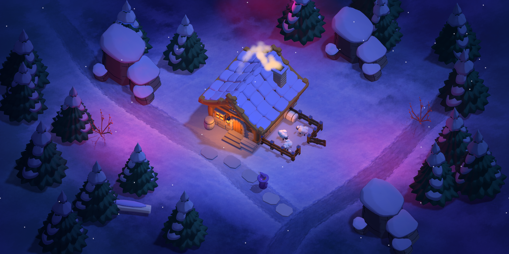
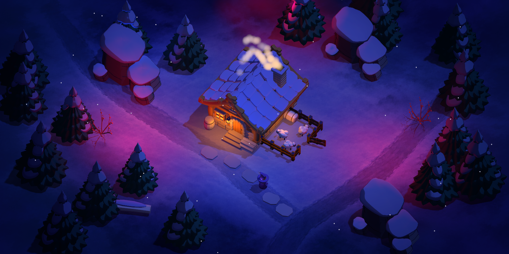
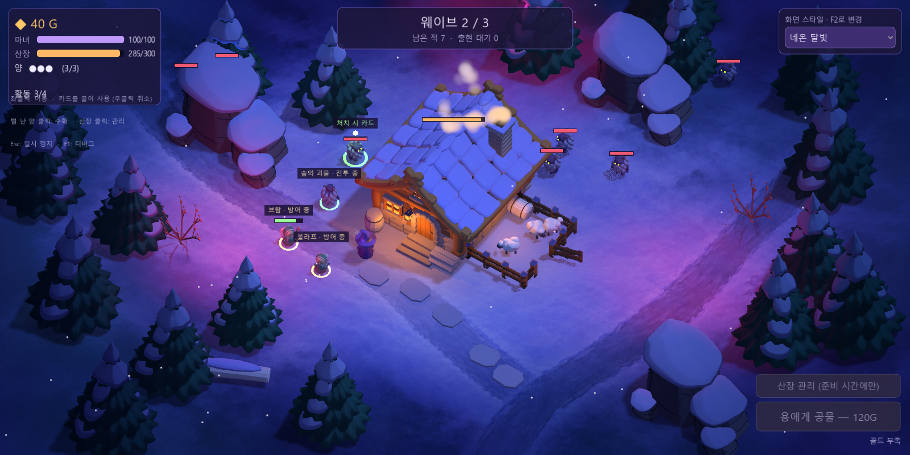
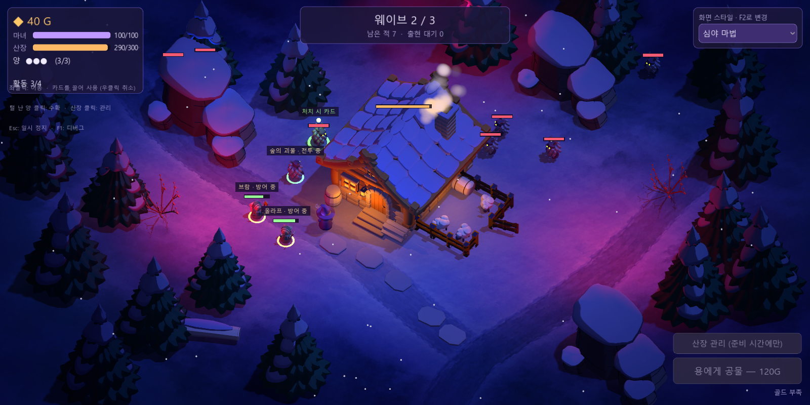
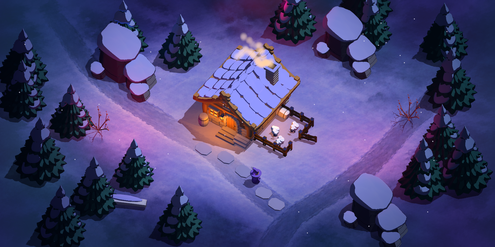
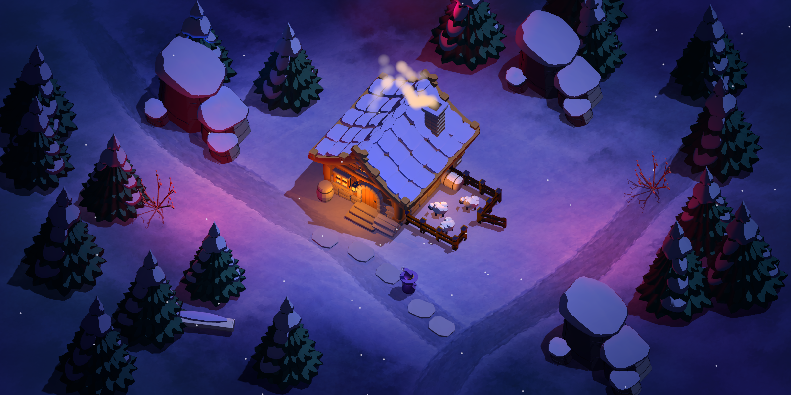
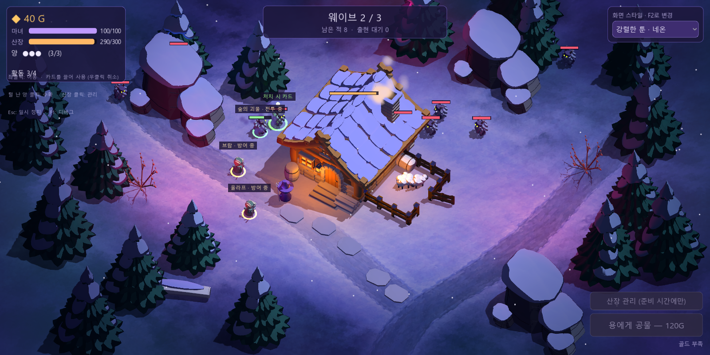
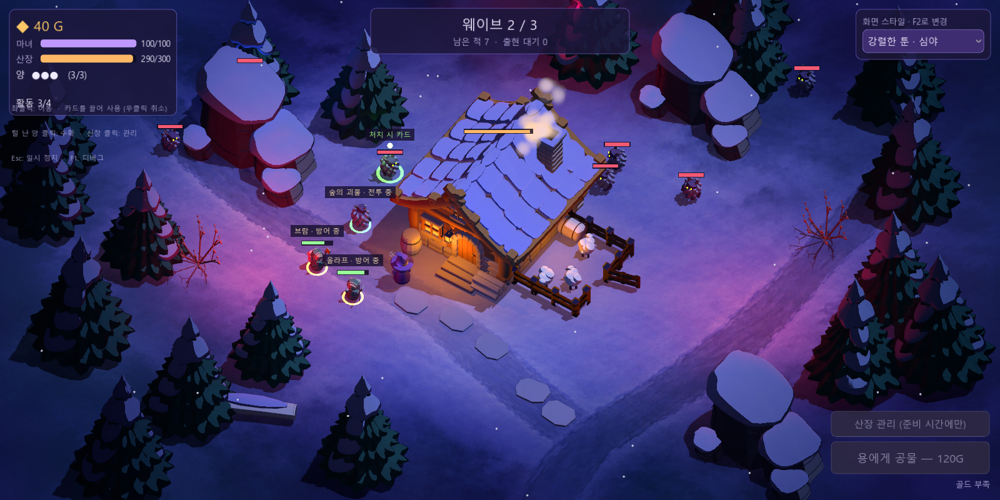

# 레퍼런스 라이팅과 강렬한 툰 조합 — 실제 게임 적용

**카메라 독립 조합 추가:** 이 문서의 11개 셰이딩·라이팅은 오른쪽 위 **셰이딩(F2)** 메뉴에서 선택한다. 별도의 **카메라(F3)** 메뉴에서 5개 렌즈·시점을 조합할 수 있다. [카메라 비교와 실제 실행 화면](camera-presets.md).

적용일: 2026-10-14. 사용자가 제공한 청보라색 바닥·분홍색 주변광·밝은 공격 효과의 레퍼런스를 바탕으로 Godot Forward+ 게임에 두 프리셋을 추가했다. **실제 게임 소스와 `build/WitchsLodge.exe`가 읽는 `WitchsLodge.pck` 모두 적용 완료**다. 아래는 합성 이미지가 아닌 배포 실행판의 렌더 캡처다.

## 비교와 조작

`게임실행.bat` 또는 `build/WitchsLodge.exe`를 실행하고 오른쪽 위 **화면 스타일** 메뉴에서 선택한다. 레퍼런스 중심의 **네온 달빛 / 심야 마법**, 후속 조합인 **강렬한 툰 · 네온 / 강렬한 툰 · 심야**를 비교할 수 있다. **F2**로 총 11종을 순환하며 일시 정지 중에도 전환된다. 같은 실행에서 새 게임을 시작하면 선택이 유지된다. 새 실행의 기존 기본값은 강렬한 툰 셰이딩이다.

| 프리셋 | 의도 | 환경광 / 방향광 | Glow |
| --- | --- | --- | --- |
| 네온 달빛 (`neon_moon`) | 밝은 청보라색 중앙과 부드러운 분홍빛 주변. 공간·배우 가독성을 더 유지 | 0.23 / 0.72 | 0.30 |
| 심야 마법 (`midnight_magic`) | 깊은 인디고 어둠과 더 강한 분홍빛. 창문·마법 발광의 대비를 강조 | 0.12 / 0.45 | 0.38 |

### 네온 달빛



### 심야 마법



### 카드 소환·전투





## 강렬한 툰과 결합

사용자의 후속 요청으로 두 조합을 추가했다. **물체의 명암 경계는 강렬한 툰의 정확한 설정을 유지하고, 분홍/파랑 국소광의 감쇠는 연속으로 유지한다.** 주요 조명을 더 밝고 덜 파랗게 만들어 눈·지붕·배우가 선명하게 읽히게 했다. 색광은 원래 라이팅 프리셋보다 절제했고, Glow와 바닥 안개를 줄여 명암 경계가 흐려지지 않도록 했다.

| 조합 | 환경광 / 방향광 | Glow / HDR threshold | 색광 배율 / 안개 불투명도 |
| --- | --- | --- | --- |
| 강렬한 툰 · 네온 (`toon_neon`) | 0.14 / 1.02 | 0.18 / 1.65 | 0.80 / 0.05 |
| 강렬한 툰 · 심야 (`toon_midnight`) | 0.085 / 0.82 | 0.24 / 1.45 | 1.05 / 0.035 |

공통 유지 값: 완전한 2단 명암, 전환 폭 0.005, 그림자 면 0.035, 눈/나뭇잎 명암 적용 100%, 보조 발광 배율 0.10, 텍스처 혼합 유지량 0.45, 윤곽 음영 0.32. 별도의 두꺼운 외곽선 패스는 켜지 않는다.

**강렬한 툰 · 네온**: 밝기·가독성과 분홍색 분위기의 균형을 우선한 조합.



**강렬한 툰 · 심야**: 주변을 더 어둡게 하고 분홍빛과 창문 대비를 강조한 조합.







[조합 통합 검증](../output/toon-reference-lighting/verification.json): 강렬한 툰의 셰이딩·표면·명암/텍스처 설정을 그대로 유지하는지 확인하고, 같은 조명에서 단계 명암만 끈 렌더와 비교해 실제 물체에 툰 명암이 적용되는 것도 확인했다. 실제 색광·HUD 보존·일시 정지 메뉴/F2·11종 반복 전환·기존 화면 복원·게임 상태 보존·재시작 유지가 통과했다.

[조합 배포판 검증](../output/toon-reference-lighting/pack-verification.json): 갱신한 `build/WitchsLodge.exe`에서 두 조합의 시작·카드 전투를 직접 캡처했다. 종료 코드 0, 선택 ID 일치, 오류 로그 없음과 현재 PCK 해시를 확인했다. 이전 실행 데이터는 `build/WitchsLodge-before-toon-lighting.pck`에 보존했다. 아래 초기 2종 검증 기록은 이전 적용판의 기록이다.

```text
.tools/Godot-4.7.2.exe --path godot --script res://tools/verify_reference_lighting.gd -- --hybrid
build/WitchsLodge.exe -- --style=toon_neon
build/WitchsLodge.exe -- --style=toon_midnight
```

## 구현

- [프리셋 정의](../godot/scripts/visual/screen_style.gd): 환경광·달빛·그림자·AO·Glow·툰 명암·채도·비네트·바닥 재질의 값을 함께 전환한다. 신규 배우도 공통 셰이더 값을 사용한다.
- [국소 조명 모듈](../godot/scripts/visual/reference_lighting.gd): 넓은 분홍 계열 광원 3개와 파란 광원 2개를 월드에 한 번 생성한다. 실제 바닥·프랍·배우를 비춘다. 새 광원은 그림자 패스를 추가하지 않으며 기존 방향광의 그림자를 사용한다.
- [바닥 재질](../godot/shaders/painted_ground.gdshader): 새 프리셋에서 기존 클린플레이트의 자체 발광을 줄여 실제 색광이 더 드러나게 한다. 원래 프리셋으로 돌아가면 원래 값을 복원한다.
- [바닥 안개](../godot/shaders/ground_haze.gdshader): 가장자리의 부드러운 반투명 월드 평면 3개로 옅은 색 안개를 보강한다. 실제 볼류메트릭 산란이 아닌 고정 쿼터뷰용 표현이다. 프랍에 가려지며 HUD에는 적용되지 않는다.
- 월드가 모듈의 생성·수명을 관리한다. 다른 프리셋에서는 모든 추가 광원과 안개를 숨기고 광원 에너지를 0으로 만든다. 반복 전환 시 새 노드를 만들지 않는다.

Godot 공식 [OmniLight3D](https://docs.godotengine.org/en/4.7/classes/class_omnilight3d.html)와 [Environment](https://docs.godotengine.org/en/4.7/classes/class_environment.html)의 국소광·환경광·Glow 기능을 사용한다. 성능 수치는 별도로 측정하지 않았다.

## 검증

[렌더 통합 검증](../output/reference-lighting/verification.json)과 [검증 도구](../godot/tools/verify_reference_lighting.gd):

- 실제 HUD 메뉴 9종, 두 신규 프리셋의 일시 정지 중 메뉴 선택·F2 전환 통과.
- 같은 프리셋에서 추가 광원만 꺼 비교했을 때 실제 바닥과 바위 픽셀의 변화 확인. 화면 필터만으로 만든 효과가 아님을 검증했다.
- 심야 마법의 중앙 영역 평균 밝기가 네온 달빛보다 낮음 확인.
- 불투명 HUD 체력바 픽셀 유지, 골드·체력·플레이어 위치·손패·게임 상태 보존 통과.
- 9종을 3회 순환한 뒤 노드 수 유지, 기존 프리셋의 광원·안개 비활성화 및 지붕 렌더 복원 통과.
- 게임 장면 재시작 후 선택과 실제 광원 유지 통과.

[배포판 검증](../output/reference-lighting/pack-verification.json): 두 프리셋의 시작 화면·카드 전투 화면과 기본값 화면을 `build/WitchsLodge.exe`에서 직접 캡처했다. 선택 ID·종료 코드·오류 로그·캡처 파일을 확인하고 검증한 PCK의 SHA-256을 기록했다. 교체 전 실행 데이터는 `build/WitchsLodge-before-reference-lighting.pck`로 보존했다.

소스 재현:

```text
.tools/Godot-4.7.2.exe --path godot --script res://tools/verify_reference_lighting.gd
.tools/Godot-4.7.2.exe --path godot -- --style=neon_moon
.tools/Godot-4.7.2.exe --path godot -- --style=midnight_magic
```

배포판에서 바로 선택해 시작:

```text
build/WitchsLodge.exe -- --style=neon_moon
build/WitchsLodge.exe -- --style=midnight_magic
```
