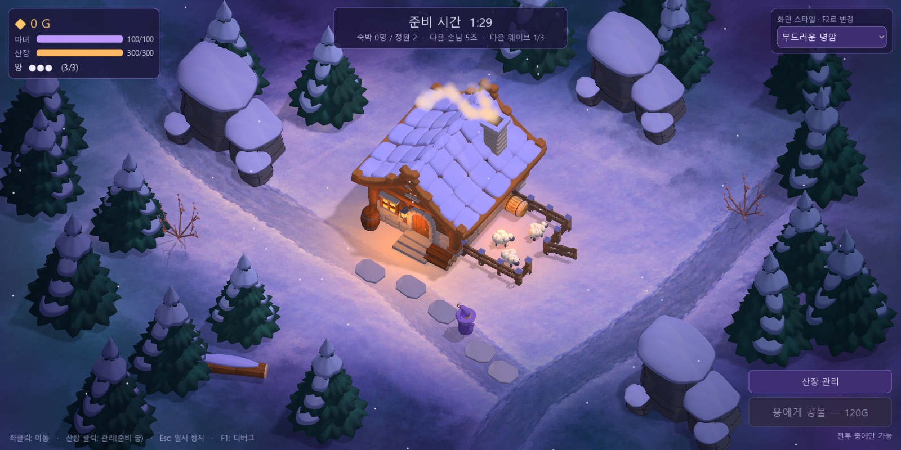
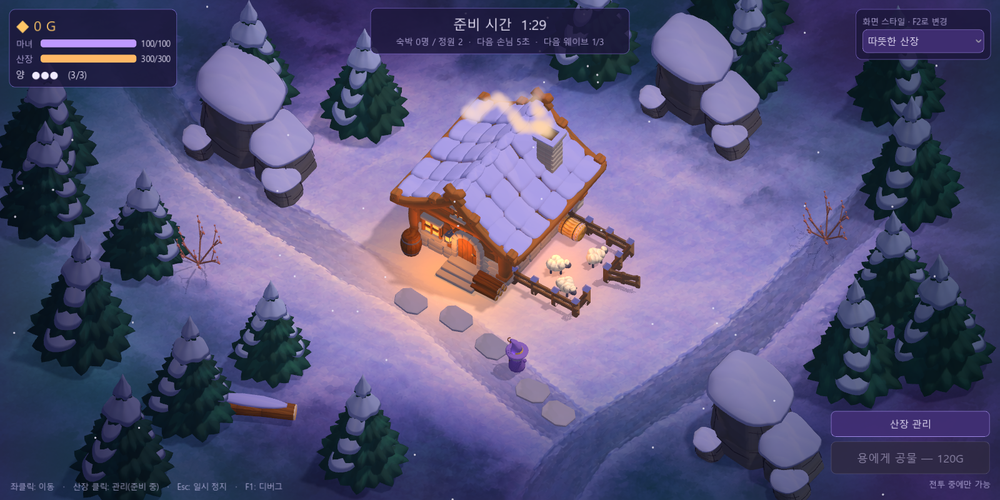
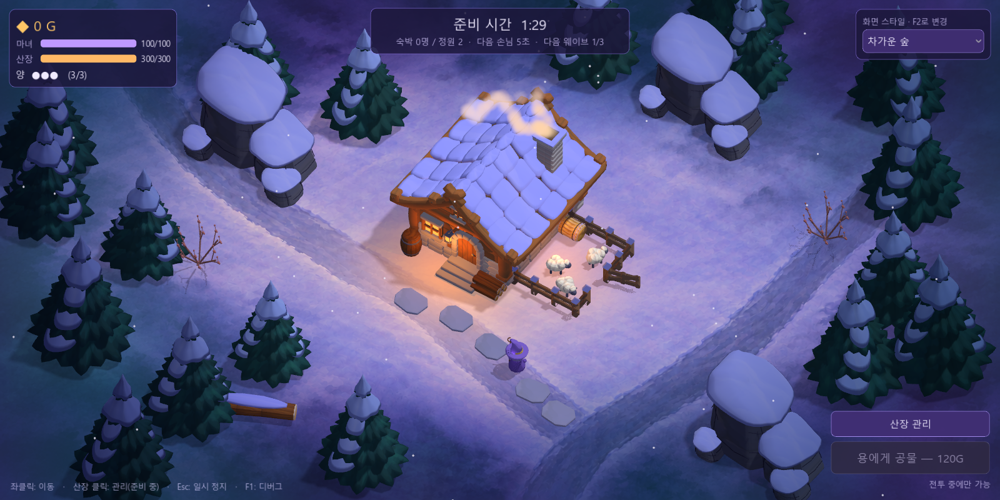
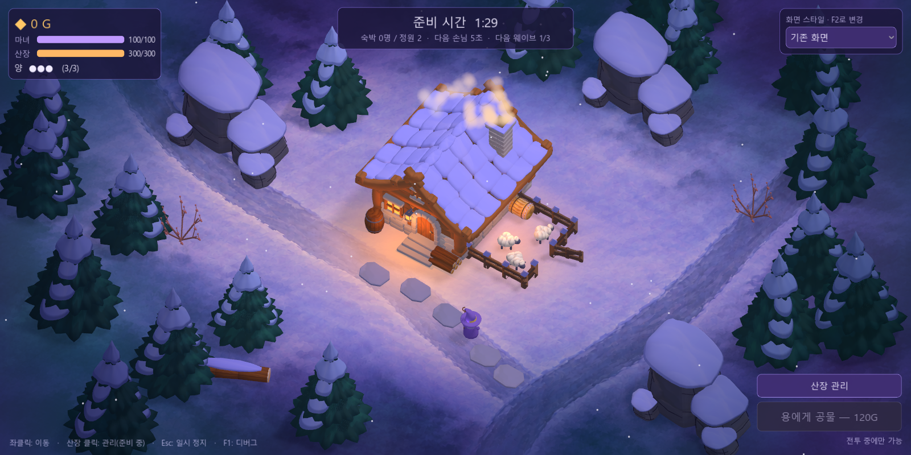
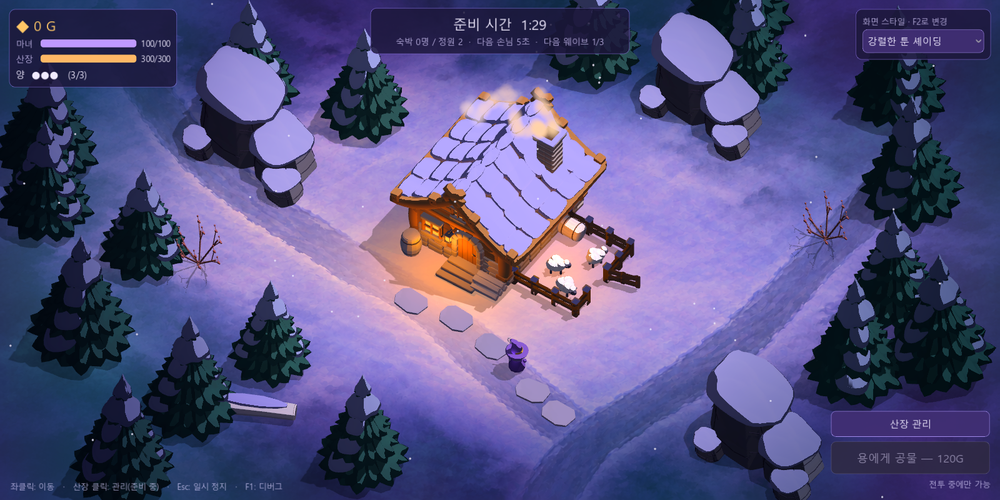
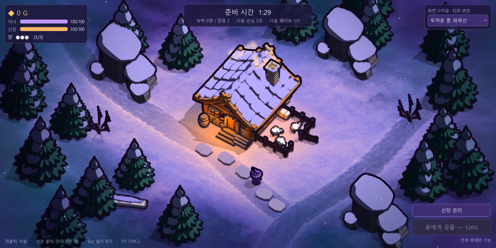
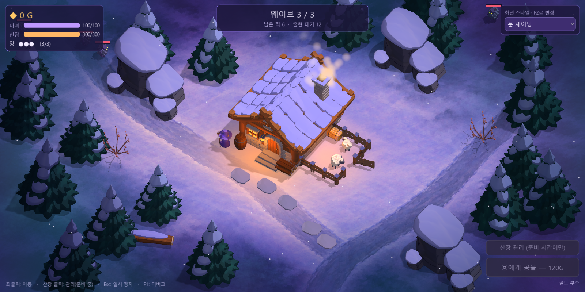
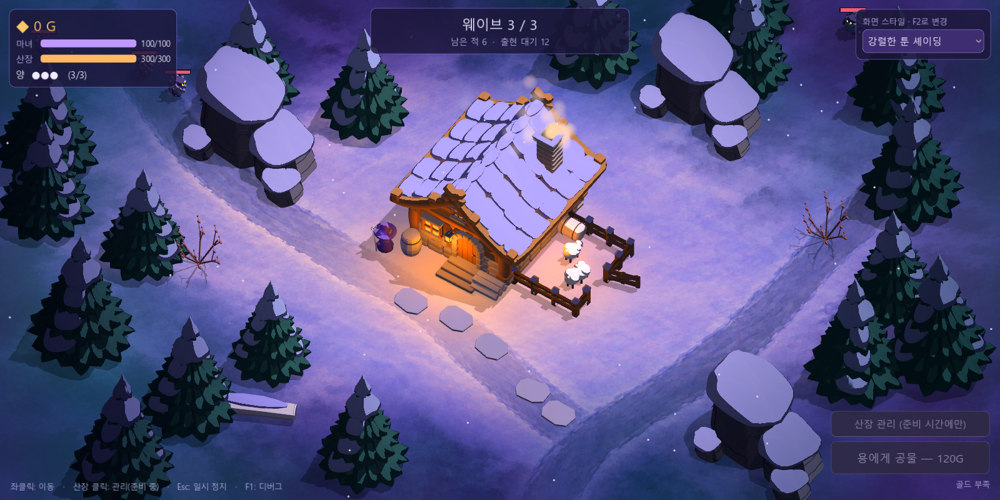
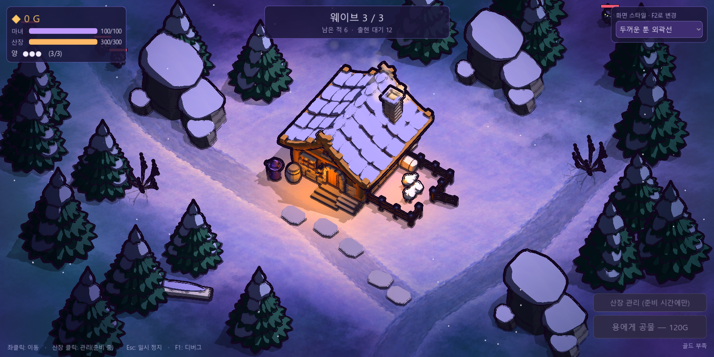

# 실제 게임 화면 프리셋

적용일: 2026-10-13. **기본 소스 게임과 build/WitchsLodge.exe용 PCK에 적용 완료.** 기본값은 부드러운 명암이다. 아래 이미지는 실제 Godot 실행 화면이다.

오른쪽 위 **화면 스타일** 메뉴 또는 **F2**로 즉시 바꾼다. 일시 정지 중에도 전환할 수 있다. 같은 실행에서 새 게임을 시작하면 선택이 유지되며, 프로그램을 다시 실행하면 부드러운 명암으로 시작한다.

| 프리셋 | 의도 | 환경광 / 방향광 |
| --- | --- | --- |
| 부드러운 명암 (기본) | 부드러운 3단 명암, 눈·나뭇잎은 약하게 | 0.42 / 0.88 |
| 따뜻한 산장 | 따뜻한 목재·창문, 넓고 부드러운 명암 경계 | 0.46 / 0.84 |
| 차가운 숲 | 청록·푸른 달빛과 보라 그림자, 조금 강한 3단 | 0.34 / 0.94 |
| 툰 셰이딩 | 2단 중심의 강한 면 구분과 윤곽 음영 | 0.27 / 1.05 |
| 강렬한 툰 셰이딩 | 더 깊은 그림자, 선명한 2단 명암과 절제한 표면 무늬 | 0.12 / 1.16 |
| 두꺼운 툰 외곽선 | 강렬한 툰 + 화면 픽셀 기준 짙은 자주색 실루엣·급격한 면 경계 | 0.12 / 1.16 |
| 기존 화면 | 적용 전 연속 명암 비교 | 0.65 / 0.60 |

## 부드러운 명암

## 따뜻한 산장

## 차가운 숲

## 툰 셰이딩

## 기존 화면

## 강렬한 툰 셰이딩

기존 툰보다 환경광과 그림자 면의 밝기를 낮추고 명암 전환 폭을 좁혔다. 눈·나뭇잎에도 완전한 2단 명암을 적용하며, 표면 텍스처 혼합량을 기존의 45%로 줄여 큰 색면을 강조한다.

## 두꺼운 툰 외곽선

강렬한 툰과 같은 조명에 별도의 외곽선 패스를 더했다. 픽셀 반경 3으로 주변 깊이·법선을 비교해 실루엣 양쪽과 급격한 면 경계에 짙은 자주색 선을 그린다. 표시되는 전체 선 폭은 경계·해상도·창 확대에 따라 달라진다. 기존 프리셋에서는 이 패스를 숨긴다.

## 배포 실행파일 전투 화면

## 검증과 구현 범위

- [전환·재시작 검증](../godot/screenshots/screen-presets/verification.json): 기본값, 7종 드롭다운 전환, 지붕 패치의 실제 렌더 차이, 게임 상태 보존, 잘못된 프리셋 거부, 일시 정지 중 F2, 배우 생성, 장면 재시작 후 선택·외곽선 유지 통과. 강렬한 툰과 외곽선 버전은 내부 조명이 같으므로 지붕 내부 샘플이 같아도 정상이다. 대신 월드 영역에서 외곽선이 실제로 어둡게 만든 38,042픽셀을 확인했으며 불투명 HUD 체력바 픽셀은 동일했다.
- 기본 설정 자동 플레이: 3웨이브 VICTORY, 숙박 수입 360G, 양 사망 0, 산장 295/300, 마녀 95/100. 용 공물 연속 클릭의 두 번째 구매 거부. 로그: `godot/art_sources/screen-styles-autoplay.log`.
- PCK 내보내기 종료 코드 0. 새 패키지 기본 실행에서 soft를 확인했고, 갱신한 `build/WitchsLodge.exe`의 toon 전투 캡처도 종료 코드 0. 이전 PCK는 `build/WitchsLodge-before-screen-presets.pck`로 보존했다.
- 강한 툰 2종 추가 후 PCK 재내보내기와 배포 실행파일의 `toon_strong`·`toon_outline` 전투 캡처도 모두 종료 코드 0이며 각 선택 ID를 로그에서 확인했다. 교체 전 5종 패키지는 `build/WitchsLodge-before-strong-toon.pck`로 보존했다. 실행 중 매핑된 이전 PCK는 이름을 바꿔 보존하고 새 파일을 배치했으므로 이미 실행 중인 게임은 다시 실행해야 7종이 나타난다.
- 인증서 저장소·셰이더 캐시 쓰기 경고는 제한된 실행 환경의 로그에 남는다. 파서·셰이더 컴파일 오류는 없었다. 프레임 성능은 별도로 측정하지 않았다.
- [프리셋 정의](../godot/scripts/visual/screen_style.gd)와 [명암 공통 함수](../godot/shaders/card_style.gdshaderinc)를 사용한다. 전역 셰이더 값이 바뀌므로 나중에 등장하는 적·용 등에도 선택한 스타일이 적용된다. 방향광의 명암은 단계화하고 국소 광원의 감쇠는 연속으로 유지한다.
- 기존 5종의 경계 표현은 시선각에 따른 제한된 자주색 윤곽 음영이다. 새 외곽선 버전은 [깊이·법선 기반 셰이더](../godot/shaders/toon_outline.gdshader)를 별도 카메라 자식 쿼드에 적용한다. 기울어진 같은 평면은 깊이 차이에서 제외해 눈밭에 선이 생기는 것을 줄인다. [Godot 공식 후처리 방식](https://docs.godotengine.org/en/latest/tutorials/shaders/advanced_postprocessing.html)과 [깊이·법선 텍스처](https://docs.godotengine.org/en/latest/tutorials/shaders/screen-reading_shaders.html)를 참고했다. Forward+의 불투명 깊이 패스에 있는 물체를 기준으로 하므로 연기·마법 입자 등 투명 효과 자체에는 외곽선을 만들지 않는다. 월드 효과는 HUD 아래에 있어 UI 텍스트와 체력바에 외곽선을 그리지 않는다.
- 카메라·모델 배치·게임 규칙은 유지했다. 카드 손패·드래그·계약·양털 수확·하수인 게임플레이는 별도로 아직 미구현이다.

재현: `.tools/Godot-4.7.2.exe --path godot --script res://tools/verify_screen_styles.gd`. 특정 프리셋 시작: 게임 실행 인자 `-- --style=soft|warm|moon|toon|toon_strong|toon_outline|original`.
