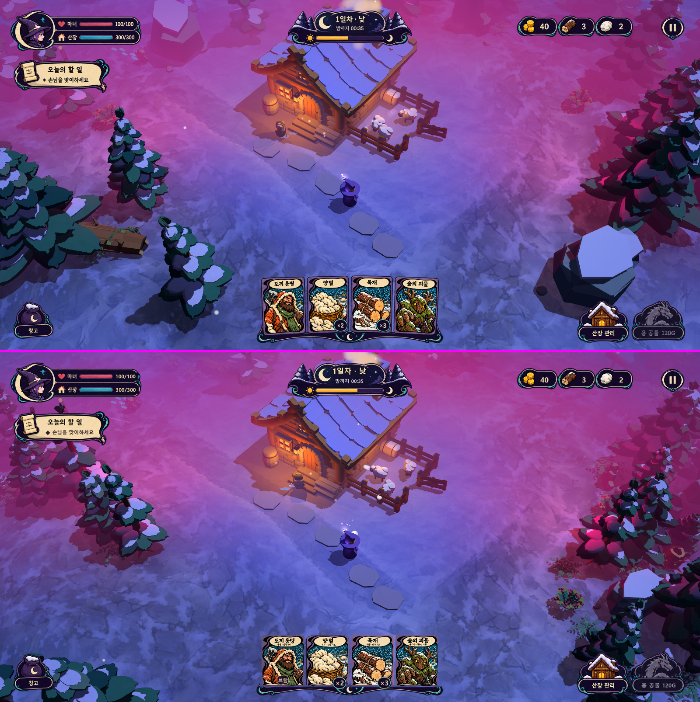

# 달빛 마법 UI · Claude 구현 현황과 에셋 연결 규약

작성일: 2026-10-14. 기준: [기능 명세서](ui-moon-runes-functional-spec.md). 대상: Codex(에셋)·사용자.



## 1. 현재 상태

- 게임 HUD를 달빛 마법 시안 구조로 교체했다. 모든 값은 실제 게임 상태를 따른다: 체력, 낮/밤·웨이브, 골드·목재·양털, 오늘의 할 일, 손패, 창고, 관리, 공물.
- Codex의 런타임 에셋은 아직 납품되지 않았다. 그래서 **임시 부품(interim)**으로 동작한다.
  - 승인 아틀라스에서 그룹을 잘라 예시 숫자·게이지 채움·예시 카드만 지운 것이다.
  - 생성: `godot/tools/build_moon_interim.py`. 출력: `godot/assets/ui/moon_runes/interim/`.
  - 새 그림은 그리지 않았다.
  - 손패 표면은 기존 카드 그림에서 제목과 그림만 남기고 규칙 문구를 뺀 임시본이다.
- 원본 재현 모드(디버그 F1 → "달빛 UI 원본 비교" 또는 실행 인자 `--ui=moon_ref`)는 승인 mockup과 **픽셀 차이 0**이다.

## 2. 코드 구성

| 파일 | 역할 |
| --- | --- |
| `godot/scripts/ui/moon/moon_layout.gd` | 명세 §3 슬롯·앵커·아틀라스 영역, 1600×800 → 화면 균등 스케일 |
| `godot/scripts/ui/moon/moon_skin.gd` | 색, 글꼴, ID로 텍스처 조회(runtime → interim), 공통 StyleBox·테마 |
| `godot/scripts/ui/moon/moon_widgets.gd` | 그룹(원본 px 좌표계), 길이 맞춤 라벨, 3-slice 게이지, 그림 버튼(hover/pressed/disabled/focus) |
| `godot/scripts/ui/moon/moon_hud.gd` | 상시 HUD 8개 그룹과 값 갱신, 원본 재현 모드(Reference) |
| `godot/shaders/moon_button.gdshader` | 버튼 상태 표시(얇은 청록 경계, 저채도, 임시 활성 착색) |
| `godot/scripts/ui/hud.gd` | 관리창, 일시 정지(화면 설정·지도 보기·조작법), 결과창, 디버그, 시간 정지 계약 |
| `godot/scripts/ui/card_hand.gd` | 손패 배치(디자인 px), 수량 배지, 이름표, 기존 드래그·창고·판매·고용 |

게임 판정·가격·저장·카드 소비 규칙은 바꾸지 않았다. 버튼은 기존 함수만 호출한다: `open_lodge_panel`, `open_storage`, `_toggle_pause`, `economy.buy("dragon")`.

## 3. Codex 에셋 연결 규약 (중요)

최종 PNG는 **`godot/assets/ui/moon_runes/runtime/<ID>.png`**에 두면 코드 변경 없이 interim 대신 쓰인다. 카드 표면은 `runtime/cards/<card_id>.png`에 둔다. `art/ui/moon-runes-v01/runtime/`에 납품하면 Claude가 복사·임포트한다.

| ID | 원본 아틀라스 영역 x,y,w,h | 내용 |
| --- | --- | --- |
| `player_status` | 6,6,577,195 | 초상·마녀/산장 아이콘·라벨·빈 게이지 트랙(숫자 없음) |
| `gauge_fill_red` / `gauge_fill_teal` | 312,70,135,12 / 312,126,134,13 | 꽉 찬 채움 줄무늬(좌우 끝 6px는 늘이지 않음) |
| `objective` | 5,197,398,148 | 종이·두루마리·"오늘의 할 일" 제목(본문 없음) |
| `phase` | 625,7,526,175 | 낮밤판·해/달·빈 트랙(제목·남은 시간 없음) |
| `phase_fill` | 754,124,125,14 | 진행 채움 줄무늬 |
| `resources` | 1197,29,468,143 | 동전·목재·양털 카운터(숫자 없음) |
| `pause` | 1668,34,105,116 | 일시정지 |
| `hand_tray` | 460,539,856,340 | 트레이·초승달(카드 없음) |
| `stack_badge` | 70×58 | 빈 원형 수량 배지 |
| `storage` | 3,694,195,185 | 초승달 주머니 + "창고" |
| `lodge_button` | 1315,696,225,183 | 산장 그림 + "산장 관리" |
| `dragon_disabled` / `dragon_active` | 1540,696,233,183 | 용 공물. 글자 없이 빈 띠 |

- **크기를 위 영역과 같게** 유지해야 내부 동적 글 위치(원본 px 좌표)가 그대로 맞는다.
- 크기나 여백이 다르면 `layout.json`에 각 ID의 원본 영역과 동적 글 영역을 적어 준다. Claude가 좌표를 그에 맞춘다.
- 임포트 설정은 `process/fix_alpha_border=false`로 둔다. 켜면 투명 외곽 RGB가 바뀌어 원본과 경계 픽셀이 달라진다. mipmap은 끄고 lossless로 둔다.
- `dragon_active`가 오면 활성 시 임시 착색 대신 그 그림을 쓴다.
- 확장 공통 프레임(modal/tooltip/toast/버튼/행/스크롤)은 지금 StyleBoxFlat으로 그린다(인디고 바탕·크림 경계). 9-slice PNG와 안전 영역이 오면 `moon_skin.gd`의 `modal_box()` 등을 StyleBoxTexture로 바꾼다.

## 4. 검증 (프로젝트 루트에서)

```bash
.tools/Godot-4.7.2.exe --path godot --script res://tools/verify_moon_ui.gd -- --out=<절대경로>/output/ui-moon-runes-claude
```

```bash
.tools/Godot-4.7.2.exe --path godot --script res://tools/verify_moon_runtime.gd -- --out=<절대경로>/output/ui-moon-runes-claude/runtime
```

- `verify_moon_ui`: 원본 재현 픽셀 비교 0, 1600×800·1774×887·1920×1080·1280×800 배치에서 화면 안·중앙 영역 비침범.
- `verify_moon_runtime` 83항목, 캡처 18장:
  - 기본 HUD, HP 감소·회복·0, 자원 0과 5자리
  - 양털 판매 후 같은 프레임 값, 손패 1/4/8장·확대·잘림, 창고 넘침·꺼내기 거부
  - 유효·불가 드래그와 우클릭 취소, 관리창·일시 정지·지도 시간 정지 복원
  - 낮→밤 카운트다운 정지, 공물 비활성·활성·연속 클릭 1회 차감, 전투 중 창고 비정지
  - 정리, 패배, 승리, 1920×1080
- 시안 비교 장면 캡처: `--shot=<png> --scenario=moon_compare --style=toon_midnight --camera=lens_wide`.

## 5. 손패 카드 경험 (하스스톤식)

움직임 기록은 `output/ui-moon-runes-claude/card-motion.gif`다. 구현 위치는 다음과 같다.

- `godot/scripts/ui/card_view.gd`: 카드 한 장. 스프링 위치·회전·배율, 그림자, 발광, 소모 연출을 맡는다.
- `godot/scripts/ui/card_fx.gd`: 입자, 빛 고리, ±수량 글자, 날아가거나 타는 복제본.
- `godot/scripts/ui/card_hand.gd`: 부채꼴 배치, 마우스 반응, 드래그, 인벤토리 변화를 연출로 연결.
- `godot/shaders/card_dissolve.gdshader`: 소모 셰이더.

| 항목 | 동작 |
| --- | --- |
| 부채꼴 | 큰 원호 위에 카드가 겹쳐 놓이고, 바깥 카드일수록 기운다(장당 최대 4.5°, 전체 26°). |
| 마우스 올림 | 카드가 곧게 서서 1.6배로 손패 위에 솟는다. 양옆 카드는 거리별로 밀려난다. 사용 가능 카드는 청록 테두리 발광. |
| 쓸어 만지기 | 마우스 근처 카드가 가우시안으로 솟는다. 마우스가 지나가는 방향·속도만큼 카드가 쓸린다. 판정은 밀리기 전 자리 기준이라 흔들림이 없다. |
| 드래그 | 카드가 손패에서 빠져나와 커서를 따라간다. 나머지 카드는 빈자리를 좁힌다. 따라오는 속도에 비례해 관성으로 기울고(최대 26°), 월드 위에서는 작아진다. 유효 대상은 청록, 불가 대상은 붉은 발광. |
| 원근 기울기 | 드래그 중 진행 방향 가장자리가 공기 저항처럼 뒤로 젖혀져 3D로 기운 듯 보인다. 확대 카드는 마우스가 누르는 쪽으로 살짝 기운다. |
| 대상 화살표 | 월드 위에서는 카드가 커서 아래로 비켜 선다. 카드 위쪽에서 대상 지점까지 휘어진 화살표 위로 갈매기 무늬가 흘러간다(하스스톤식). |
| 놓기·취소 | 소모되면 놓은 자리에서 섬광·확대 후 타 없어진다(입자·빛 고리). 취소나 불가 판정이면 스프링으로 손패 자리로 날아 돌아간다. |
| 그림자 | 카드 뒤 부드러운 그림자. 들어 올릴수록 멀고 넓고 옅어지며, 회전과 무관하게 화면 아래쪽으로 진다. |
| 획득 | 출처(양털은 마녀, 용병은 산장, 목재는 벌목 나무, 그 외는 위쪽)에서 튀어나와 화면 가운데에 크게 공개된다. 이어 빛 고리와 반짝임이 터진 뒤 손패로 날아간다. 여러 장이면 나란히 공개한다. |
| 스택 변화 | 증가하면 복제본이 출처에서 날아와 합쳐지고 배지가 튀며 "+N"이 뜬다. 감소하면 놓은 자리에서 복제본이 타고 "−N"이 뜨며, 원본은 손패로 돌아간다. |
| 창고 | 보내면 카드가 창고 주머니로 빨려 들어간다. 꺼내면 창고에서 날아온다. |

- 마우스 위치는 입력 이벤트로만 추적한다. 그래서 테스트가 실제 커서를 쓰지 않는다.
- 화면 검증은 창을 화면 밖에 띄워 실행한다: `--position -6000,-6000 --fixed-fps 60`. 로직만 보는 검증은 `--headless`.
- 움직임 캡처: `.tools/Godot-4.7.2.exe --fixed-fps 60 --position -6000,-6000 --path godot --script res://tools/capture_card_motion.gd -- --out=<폴더>`.

## 6. 남은 일

1. Codex 런타임 에셋 납품 후 교체, 재검증, 비교 캡처.
2. 공통 확장 frame PNG 적용(모달·툴팁·토스트·버튼).
3. 배포 환경 글꼴: 현재 SystemFont(맑은 고딕 등). 한글 글꼴 파일을 프로젝트에 넣을지 결정이 필요하다.
