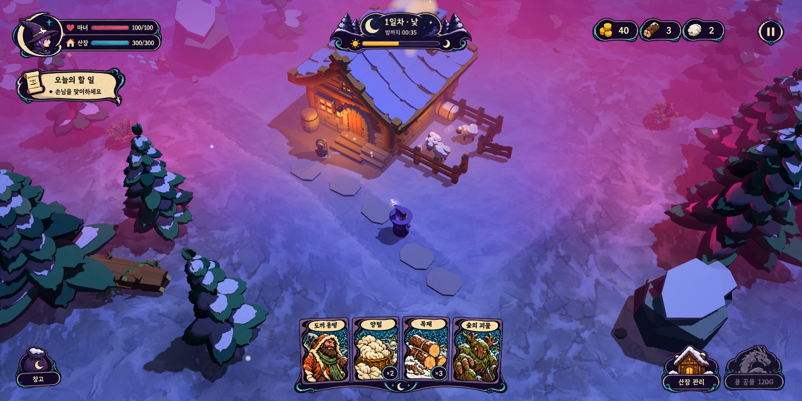

# 달빛 마법 UI 기능 명세서 · Claude 구현 인수인계

작성일: 2026-10-14. 사용자 채택: UI 시안 **3번 달빛 마법**. 목적: 아래 승인 시안의 형태·색·비율·배치를 유지하면서 기존 게임 기능을 실제 상태에 연결한다.

## 1. 작업 분담과 납품 위치

| 담당 | 책임 |
| --- | --- |
| Codex | 이 명세서, 승인 원본의 정확한 분리 에셋, 실시간 수치용 빈 부품, 누락 상태·팝업 공통 부품, 에셋 카탈로그·배치 데이터·검증 이미지 |
| Claude | Godot UI 계층·테마·상태 표시·입력·카드 동작 연결·반응형 배치·런타임 검증·게임 실행판 갱신 |
| 사용자 | 시안 3번 채택 완료. 이후 디자인 변경이 필요하면 변경 부분을 별도 비교 |

Codex는 게임 HUD나 게임 규칙을 구현하지 않는다. Claude는 최종 에셋 패키지의 `manifest.json`, `layout.json`, `README.md`를 읽고 사용한다. 패키지 위치: `art/ui/moon-runes-v01/`. 명세서 작성 완료 후 사용자에게 먼저 알리고 에셋 제작을 시작했다. 최초 저장 시점에는 제작 전이었으며, **이후 에셋 제작과 검증이 완료되었다.** [최종 에셋 사용 안내](../art/ui/moon-runes-v01/README.md), [Claude 인수인계](../art/ui/moon-runes-v01/CLAUDE_HANDOFF.md)를 함께 읽는다.

## 2. 그대로 재현해야 하는 기준

- 최종 화면 기준: `output/ui-style-concepts-v02/03-moon-runes-mockup.png` (1600×800).
- 원본 투명 아트: `output/ui-style-concepts-v01/03-moon-runes-overlay.png` (1774×887). 같은 아트를 사용해 v02를 합성했다.
- 배경 기준: `output/ui-style-concepts-v02/current-source-clean.png`. 시안 기준 셰이딩 `toon_midnight`, 카메라 `lens_wide`, 공기 원근 `dramatic`, 로컬 색 번짐 `local`. 시각 검증 시 이 설정을 명시적으로 선택해 비교한다. 구현 작업 중 현재 게임 기본값을 임의로 되돌리지 않는다.
- 인디고·짙은 자주색 바탕, 크림색 얇은 경계, 작은 청록색 곡선, 초승달, 보라 모자 마녀 초상과 검은 먹선을 유지한다.
- 상단 3개 정보 그룹·우상단 일시정지, 좌측 목표, 하단 중앙 손패·좌하단 창고·우하단 관리/공물의 구조를 유지한다.
- 기존 승인 시안의 정적인 픽셀은 원본 추출 에셋으로 보존한다. 이미 있는 초상·아이콘·문양을 새 이미지로 대체하거나 더 화려한 장식을 추가하지 않는다.
- 실시간 숫자·진행률·상태는 시안 이미지의 값에 고정하지 않는다. 동적 영역만 빈 에셋+텍스트/게이지로 교체한다.
- 원본 시안이 가진 `40`, `3`, `2`, `100/100`, `300/300`, `1일차·낮`, `00:35`, `×2`, `×3`, `120G`는 예시다. 게임 데이터를 보여줄 자리에 예시 이미지 전체를 쓰지 않는다.
- 참고용 원본 고정 에셋과 실사용 동적 에셋은 카탈로그에서 구분한다. 원본 고정본은 시각 비교·구현 기준으로 사용하며 수치를 갱신하지 못하는 상태로 납품 완료 처리하지 않는다.

## 3. 기준 좌표와 화면 비율

좌표 단위는 1600×800 디자인 캔버스의 px다. 원본 아트에는 투명 여백이 있으므로 **아래 외부 슬롯과 내부 실제 이미지 맞춤 결과를 모두 따른다.** `KEEP_ASPECT_CENTERED`로 슬롯에 넣는 것이 기존 시안과 동일한 방식이다. PNG 테두리에 임의의 추가 여백을 붙이지 않는다.

| ID | 위치 x,y | 슬롯 w,h | 앵커 | 원본 아틀라스 영역 x,y,w,h |
| --- | --- | --- | --- | --- |
| player_status | 18,16 | 312,108 | 좌상 | 6,6,577,195 |
| objective | 22,132 | 238,89 | 좌상 | 5,197,398,148 |
| phase | 640,16 | 320,100 | 상중앙 | 625,7,526,175 |
| resources | 1140,25 | 350,85 | 우상 | 1197,29,468,143 |
| pause | 1510,30 | 64,72 | 우상 | 1668,34,105,116 |
| hand | 540,622 | 520,176 | 하중앙 | 460,539,856,340 |
| storage | 24,681 | 106,109 | 좌하 | 3,694,195,185 |
| actions | 1310,687 | 265,107 | 우하 | 1315,696,458,183 |

기준 해상도와 실제 프로젝트의 1774×887 기준 뷰포트를 혼동하지 않는다. 각 좌표를 컨테이너 기준으로 균등 스케일한다. 1920×1080에서는 2:1 기준 캔버스를 비율 유지해 배치하고 남는 높이의 월드는 보여준다. 1600×800 기준 검증에서는 늘이거나 자르지 않는다. 중앙 x350..1249, y225..619에 상시 패널을 추가하지 않는다.

## 4. 기능과 실제 데이터 연결

### 4.1 마녀·산장 상태

- 마녀: `game.player.hp`, `max_hp`. 산장: `game.world.lodge.hp`, `max_hp`.
- 문자열은 기존 HUD처럼 현재 체력을 올림하여 `현재/최대`로 표시한다. 게이지는 clamp(hp/max_hp,0,1).
- 마녀 게이지는 시안의 붉은색, 산장은 청록색. 바탕·얇은 경계·아이콘·초상은 그대로 사용한다.
- 숫자 길이가 늘어나도 초상이나 게이지를 침범하지 않는다. 피해 순간 값과 채우기만 갱신한다. 새로운 회복·방어 규칙을 추가하지 않는다.
- 양 생존·털 준비·활동 계약 수는 기존 기능이다. 시안의 상시 상태판을 늘리지 말고 상태판 툴팁/상세정보에서 `pasture.alive_count()`, `ready_count()`, `contracts.active_count()`와 기존 설정 최대치를 보여준다.

### 4.2 낮/밤과 웨이브

- 실제 상태: `game.session.state`; enum `PREP`, `COMBAT`, `CLEARING`, `VICTORY`, `DEFEAT`.
- PREP: `session.day()`를 일차로, `prep_remaining()`을 `밤까지 mm:ss`로 표시한다. 게이지는 `prep_elapsed / Cfg.PREP_TIME`. 현재 `PREP_TIME=90`이나 이미지를 90초에 고정하지 않는다.
- COMBAT: `wave_index`와 `Cfg.WAVES.size()`를 표시한다. 하위 문구는 `waves.alive()`/`pending()`의 남은 적·출현 대기. 밤에는 PREP 카운트다운을 계속 감소시키지 않는다.
- CLEARING: 기존 정리 상태와 용 귀환 안내. VICTORY/DEFEAT: 결과 창으로 연결한다.
- 낮/밤 기호와 진행 게이지는 시안 아트의 위치에 둔다. 전투 제한시간·새 시간 경제를 만들지 않는다.

### 4.3 골드·목재·양털

- 골드: `economy.gold`, `gold_changed(gold)`.
- 목재: `cards.count_of("timber")`; 양털: `cards.count_of("wool")`. `CardInventory`의 이 함수는 손패·창고에 있는 해당 자원 카드 수량을 합산한다. 별도 가짜 자원 저장소를 만들지 않는다.
- `cards.changed`에서 자원 숫자를 갱신한다. 0도 표시한다. 감소·판매·수리 후 같은 프레임에 값이 맞아야 한다.
- 동전·목재 묶음·양털 그림은 시안의 원본 아이콘. 숫자는 런타임 텍스트, 5자리까지 영역 안에 맞춘다.
- 자원 카운터는 기본적으로 비상호작용이다. 상세 툴팁만 허용한다.

### 4.4 오늘의 할 일

- 신규 퀘스트 저장소 없이 기존 상황에서 안내 문구를 산출한다. PREP 기본 `손님을 맞이하세요`; 수확 가능한 양 존재 시 수확 안내, 고용 제안 존재 시 고용 안내, COMBAT는 산장 방어 안내, CLEARING은 정리 안내. 한 번에 한 문구만 표시한다.
- 상태 우선순위는 종료 > 전투 > 정리 > 고용 제안 > 양털 준비 > 기본 방문 안내. 별도 보상·완료 체크를 만들지 않는다.
- 종이·두루마리 아이콘과 `오늘의 할 일` 제목은 시안대로. 본문은 길이에 따라 두 줄 이내, 작은 글씨로 과도하게 줄이지 않는다.

### 4.5 손패와 카드 사용

- 소유/스택: `game.cards.hand()`, `storage()`, `get_entry(uid)`, `changed`. `Cfg.HAND_VISIBLE=8`은 기존 규칙 그대로 사용한다. 시안의 4장은 비교용 표본이며 손패 한도를 4로 바꾸지 않는다.
- 기존 `card_hand.gd`의 hover, `begin_drag(uid)`, 취소, `_end_drag()` 및 `game.resolver` 판정 연결을 유지한다. 클릭/드래그 이벤트가 마녀 이동으로 전달되지 않게 한다.
- 4장 비교 장면에서는 시안의 `도끼 용병 → 양털 → 목재 → 숲의 괴물`과 수량 배지 `×2`, `×3`를 시각 검증용으로 배치한다. 일반 플레이 순서는 인벤토리 순서다.
- 카드 그림·보라 S자 경계·크림 제목은 승인 시안의 작게 보이는 표면과 기존 카드 카탈로그를 연결한다. 표면 에셋은 카드 ID로 교체할 수 있어야 하며 트레이에 4장 전체 그림을 붙여 가짜 손패를 만들지 않는다.
- 수량 배지는 개별 카드 위 독립 레이어. 스택 자원만 표시하고 값 변경 시 즉시 갱신한다. 트레이·초승달 장식은 카드 아래에 둔다.
- 카드 확대·효과 설명·인물 이름·유효 대상/취소 피드백은 기존 기능을 계속 보여준다. 좁은 손패에서 본문을 상시 노출하지 않는다.
- 1~8장에 대응하고 확대된 카드가 화면 끝에 잘리지 않도록 위치를 보정한다. 기존 UID가 동일 인물을 식별한다.

### 4.6 창고

- 좌하단의 초승달 주머니 버튼 → 기존 `card_hand.open_storage()`/`close_storage()`.
- 기존 손패↔창고 이동 동작을 유지한다. 낮의 창고는 시간 정지, 전투 중 창고는 시간 진행이라는 기존 `hud.refresh_pause()` 계약을 유지한다.
- 기존 자원 수량·카드 이름을 표시한다. 손패가 8장이면 꺼내기 거부와 사유를 기존 규칙대로 표시한다.

### 4.7 산장 관리

- 원본 작은 산장 그림 버튼 → 기존 `hud.open_lodge_panel()`/`close_lodge_panel()`.
- PREP에서만 가능. 수리·회복·객실 증축·양 구입은 기존 `economy.cost_of(kind)`, `block_reason(kind)`, `buy(kind)`를 사용한다.
- 실제 가격·골드·체력·완료 여부를 동적으로 표시한다. 관리창이 열릴 때 시간 정지와 닫을 때 복원을 기존 방식대로 유지한다.

### 4.8 용 공물

- 실제 가격은 `economy.cost_of("dragon")`/`Cfg.COST_DRAGON` (현재 120). `block_reason("dragon")==""`일 때만 활성화한다.
- 클릭은 `economy.buy("dragon")` 한 번만 호출한다. 같은 웨이브 중복 소환·이중 차감 방지는 기존 economy/dragon 모듈에 맡긴다.
- 평상시 시안처럼 보라·회색 비활성 드래곤, 불가 사유는 툴팁. 전투·충분한 골드에서는 제공되는 같은 실루엣의 활성 상태를 사용한다.
- 활성/hover/focus에서는 청록·크림 경계를 짧게 강조한다. 붉은 대형 버튼으로 교체하지 않는다. 전투 시간은 멈추지 않는다.

### 4.9 일시정지와 기존 보조 기능

- 우상단 원형 pause → `hud._toggle_pause()`, Esc와 같은 동작. 재개·재시작·기존 상태 정리를 유지한다.
- 셰이딩·카메라·공기·추적 설정 메뉴는 pause의 설정 하위 패널로 수용한다. F1~F5 기존 단축키 의미를 변경하지 않는다.
- 현재 `exploration_map.gd`의 지도와 클릭 이동은 보존하되 시안 비교 상태에서는 접는다. pause에서 ‘지도 보기’를 열어 기존 map을 사용하는 보조 창으로 연결하고, 게임 재개 후 접을 수 있게 한다. 기존 상시 직사각형 미니맵을 우측에 그대로 두어 시안과 달라지게 하지 않는다.
- 고용 제안·양털 판매·툴팁·토스트·승리/패배·디버그 패널은 기존 기능을 재사용하고 아래 공통 팝업 부품으로 테마만 통일한다. 시안이 보여주지 않는 팝업 디자인은 확장 에셋으로 구분한다.

## 5. 시각/입력 상태

| 상태 | 표시 | 동작 |
| --- | --- | --- |
| normal | 승인 원본과 동일한 색·명암·비율 | 기본 |
| hover | 외형을 키우지 않고 청록/크림 경계를 약하게 강조 | 툴팁, 기존 클릭 가능 여부 유지 |
| pressed | 전체 UI 그림 1px 아래, 명도 약 0.94배 | 클릭 1회 |
| disabled | 시안의 비활성 용 형태/저채도 버튼 | 입력 거부, 이유 설명 |
| focus | 얇은 청록 focus ring | 마우스/키보드 입력이 같은 기능으로 연결 |
| card selected/drag | 기존 카드 이동·미리보기, 얇은 청록 경계 | 실제 resolver 사용 |

장식 TextureRect는 `MOUSE_FILTER_IGNORE`, 버튼/카드/모달만 입력을 받는다. UI의 투명 전체 캔버스로 월드 클릭을 차단하지 않는다. 모달 오픈·클로즈 후 잠금/시간 정지가 남지 않아야 한다.

## 6. 에셋 납품 계약

패키지 `art/ui/moon-runes-v01/`에 다음을 제공한다. 실제 파일·크기·알파·해시·원본 영역·동적 텍스트 영역은 생성 후 `manifest.json`/`layout.json`으로 확정한다.

| 그룹 | 필수 내용 |
| --- | --- |
| approved | 승인 원본 atlas·최종 mockup·정확히 추출한 8개 원본 그룹. 픽셀 기준용 |
| runtime | 상태판·마녀 초상·붉은 체력 게이지·청록 체력 게이지·낮밤판·진행 track/fill·목표 종이·자원 카운터·일시정지·손패 트레이·수량 배지·창고·산장 관리·용 공물 normal/disabled |
| icons | heart、lodge、sun、moon、gold、timber、wool、pause、close、plus、minus、check、warning、arrow（확장용 아이콘은 원본과 구분） |
| cards | 승인 시안의 4종 손패 표면·기존 고해상도 카탈로그 경로·스택 배지 빈 바탕. 예시 수량과 카드 그림을 분리 |
| common | 확장용 modal/tooltip/toast frame·중립 버튼·행/탭·스크롤 track/thumb·구분선. 9-slice 안전 영역과 padding 명시 |
| handoff | 파일 카탈로그·좌표·색/상태·동적 글 영역·원본 재현 이미지·임포트 지침·실시간 테스트 목록 |

PNG는 RGBA 실제 투명 외곽, 원본 해상도 보존. 선형 필터·mipmap off·lossless import를 기본으로 한다. 승인 시안보다 큰 픽셀폭 외곽선/광택/발광을 추가하지 않는다. 고정 비율의 초상·문양·카드를 9-slice로 늘이지 않는다. 범용 panel의 지정된 중간 안전 영역만 9-slice한다.

한글 텍스트는 고정 타이틀의 원본 cutout을 우선 사용하고, 변하는 한글 문장은 Label로 표시한다. 작성 당시 프로젝트는 `SystemFont`에 Malgun Gothic/맑은 고딕/Noto Sans KR/Segoe UI를 사용한다. 이후 패키지에 숫자용 **비트맵 glyph atlas `fonts/numbers.png`와 문자별 좌표·advance·yoffset `fonts/glyphs.json`**을 제공했다. 실제 숫자 영역에서 glyph atlas를 조립해 렌더되는 것을 확인했다. Claude는 이 16개 문자(0–9, :, /, ×, G, +, −)를 사용해 실시간 숫자를 그린다. 배포 환경별 한글 폰트 차이는 Claude가 해결한다. 고정 예시 문구 전체를 숫자 영역에 붙이지 않는다. 참고용 완성 원본과 작동하는 동적 버전을 혼동하지 않는다.

## 7. 구현 순서와 완료 기준

1. 에셋 패키지 상태가 완료인지 확인하고 1600×800 mockup 재현 모드를 먼저 만든다. 동일 원본 8개 그룹과 동일 슬롯의 합성은 승인 이미지와 픽셀 단위로 일치해야 한다. 에셋 자체를 재디자인하지 않는다.
2. 한 항목씩 동적 수치·게이지·개별 카드로 치환한다. 같은 상태에서 정적 장식·배치는 고정하고 값만 변한다. 개발용 비교 모드는 일반 플레이 UI와 분리한다.
3. 기존 관리·창고·판매·고용·pause·결과창의 기능을 연결하고 공통 확장 frame을 적용한다.
4. 기존 화면 설정/지도/디버그 기능의 접근 가능 여부를 확인한다. 게임 판정·가격·저장·카드 소비 규칙은 변경하지 않는다.
5. 실제 실행 캡처로 다음을 제출한다: 기본 HUD, HP 감소/0/회복, 골드·목재·양털 0/다자리, 1/4/8장 손패, hover/drag/취소/불가 대상, 창고 이동, 고용/판매, PREP→COMBAT→CLEARING, 공물 disabled/활성/연속클릭, pause 재개, 관리창, 승리/패배, 지도 이동.
6. 1600×800·1920×1080에서 초상·카드·문양 비율과 중앙 가독성을 비교한다. 정지 화면이 닮았다는 이유만으로 클릭·동적 값·시간 정지 검증을 생략하지 않는다.

**완료 정의:** 원본 재현 모드의 픽셀 비교가 일치하고, 실제 플레이에서 같은 아트와 배치로 동적 값·카드·기존 동작이 정상이며, 시안의 예시 숫자가 일반 플레이에서 고정돼 있지 않다. 사용자 요청의 ‘지금 뽑은 시안 그대로’를 레이아웃만 비슷한 기본 Godot 테마로 대체하지 않는다.

## 8. 구현자가 읽을 실제 파일

- `godot/scripts/ui/hud.gd`: 상태·행동·modal·pause·결과·설정·지도 연결
- `godot/scripts/ui/card_hand.gd`: 손패/hover/drag·창고·고용·판매·툴팁
- `godot/scripts/ui/card_catalog.gd`, `godot/assets/cards/catalog.json`: 카드 그림·효과 문구
- `godot/scripts/game/card_inventory.gd`: UID·스택·손패/창고·자원 합계
- `godot/scripts/game/lodge_economy.gd`: 골드·고용·판매·구매 불가 사유·가격
- `godot/scripts/game/card_use_resolver.gd`: 드래그 판정·소비
- `godot/scripts/game/game_session.gd`, `godot/scripts/config.gd`: 상태·시간·웨이브·한도
- `godot/scripts/ui/exploration_map.gd`: 지도 표시와 클릭 이동
- `godot/tools/render_ui_concepts.gd`: 승인 시안의 실제 atlas 영역·배치 방식

위 함수/경로는 작성 시 현재 소스를 읽어 확인했다. Claude 구현 중 다른 작업의 수정이 있으면 현행 계약을 다시 확인하고, 다른 작업을 되돌리지 않는다.
