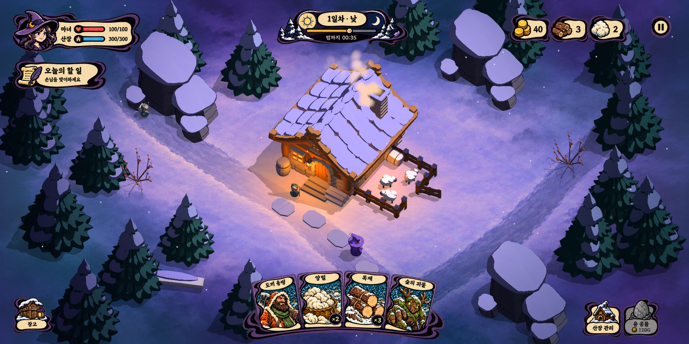
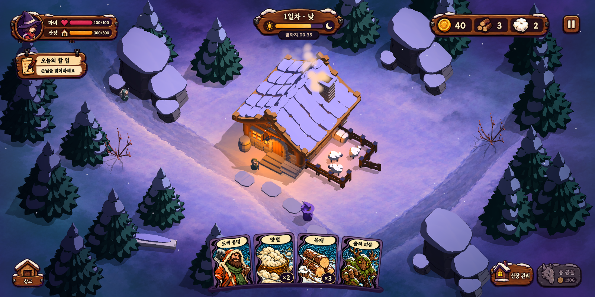
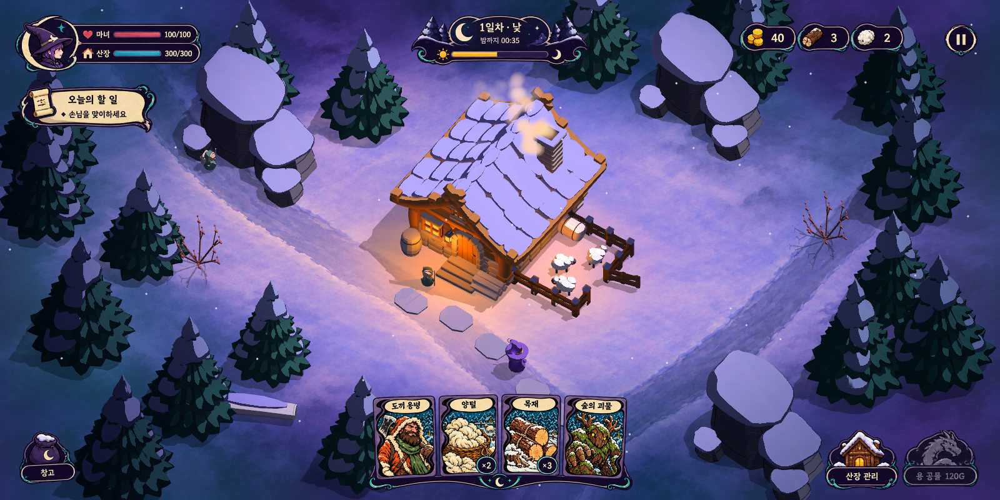
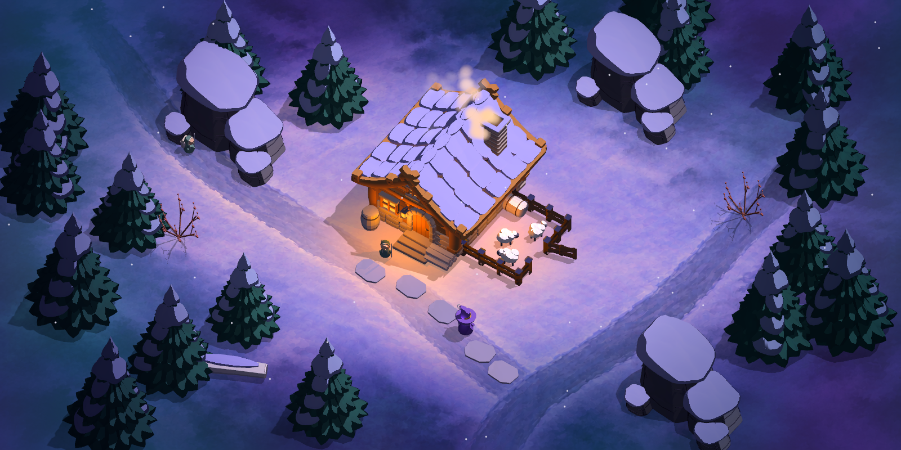

# 실제 게임 화면 기반 UI 아트 시안 · 3종

제작일: 2026-10-14. 사용자 요청으로 **강렬한 툰 셰이딩(`toon_strong`)을 게임 기본 스타일로 확정**하고, 새로 실행한 실제 배포판 화면 위에 UI 아트 시안을 배치했다.

## 1 · 먹선 동화

보라색의 비대칭 곡선, 굵고 변화하는 먹선, 크림 종이를 HUD 전체로 확장한다. 기존 S자 카드와 가장 직접적으로 이어지는 방향이라 우선 추천한다. 큰 종이 면과 짙은 테두리로 차가운 설경에서도 정보가 구별된다.

## 2 · 따뜻한 산장

앰버·밤색 목재 간판, 두꺼운 모서리, 눈과 작은 철물로 산장 운영의 생활감을 강조한다. HUD는 따뜻한 목재, 카드는 기존 보라색·크림 종이 형식으로 이어진다. 목재의 잔무늬와 금속 장식은 최소화한다.

## 3 · 달빛 마법

인디고 바탕에 작은 청록 곡선·초승달, 얇은 크림 경계를 사용한다. 밤 숲과 마녀의 마법을 강조하며, HUD가 어둠에 자연스럽게 들어간다. 카드 초상·크림 패널과 앰버 자원 아이콘은 밝은 정보 초점으로 남긴다.

## 공통 구성과 범위

- 상단: 마녀·산장 상태, 낮/밤 진행, 골드·목재·양털, 일시 정지. 좌측에 작은 목표 패널.
- 하단: 기존 포맷을 참고한 도끼 용병·양털·목재·숲의 괴물 4장, 수량 배지, 창고·산장 관리·용 공물.
- 중앙의 산장·문·마녀·양 목장과 진입로는 같은 배경으로 비교한다. 손패는 화면 아래에 작게 배치했다.
- 숫자·시간·카드 수량과 목표 문구는 스타일 비교를 위한 예시다. 캡처 순간의 실제 게임 상태와 일치하는 데이터 HUD가 아니다.
- 세 UI는 사용자 선택 전의 아트 시안이다. 런타임 HUD 교체나 버튼 작동을 구현한 것은 아니다. 기본 셰이딩 변경은 실제 게임에 적용했다.

## 실제 화면과 합성 방식

`build/WitchsLodge.exe`를 **`--style=` 인자 없이** 새로 실행하고, 기존 `cards` 캡처 시나리오와 `--ui=off`로 1600×800 화면을 저장했다. 시나리오는 시연용 카드·손님·양털 상태를 준비하는 기존 개발 도구다. `pack-capture.log`에서 `SHOT screen style: toon_strong`을 확인했다.

내장 image_gen으로 1774×887 투명 UI 아트 3종을 생성했다. 소스 실행 캡처는 배치 참고, 기존 실제 카드 갤러리는 화풍 참고로 전달했다. 최종 PNG는 **새 배포판 캡처를 배경 TextureRect로 그대로 놓고**, 생성 UI의 각 요소를 Godot AtlasTexture/Control로 화면 가장자리에 배치해 렌더한 결과다. 월드의 나무·산장·눈·캐릭터를 생성 모델로 다시 그리지 않았다.

중앙 `x=350..1249, y=225..619`의 **355,500픽셀은 세 시안 모두 UI 없는 배경 렌더와 완전히 동일**하다. [합성 검증 JSON](../output/ui-style-concepts-v01/composition-verification.json)에서 각 `changed_gameplay_pixels=0`, 투명 중앙과 PNG 저장 성공을 확인했다. 출력 3장을 직접 검토해 마녀·문·목장 가림도 확인했다.

## 기본 셰이딩 적용과 검증

- `screen_style.gd`의 `DEFAULT_ID`와 새 실행 상태를 `toon_strong`으로 변경했다. 프로젝트 셰이더 초기값도 동일한 프로필로 맞췄다.
- 환경광 0.12, 달빛 1.16, 선명한 2단 명암, 글로우 0.06, 채도 1.17인 기존 강렬한 툰 프로필을 그대로 사용한다. 두꺼운 외곽선 버전은 별도 비교 프리셋이다.
- 기존 통합 검증의 시작·기본 복원 기대값을 강렬한 툰으로 갱신했다. [실제 렌더·드롭다운·F2·재시작·상태 보존 검증](../godot/screenshots/screen-presets/verification.json): `passed=true`, `failures=[]`, 프로세스 종료 코드 0.
- PCK 재내보내기 종료 코드 0, 최종 내보내기 오류 로그 없음. `build/WitchsLodge.pck`를 교체한 뒤 실제 실행파일 캡처 종료 코드 0과 기본 프리셋을 확인했다.
- 교체 전 배포판은 `build/WitchsLodge-before-toon-default-v01.pck`로 보존했다. 내보낸 동일 데이터도 `build/WitchsLodge-toon-default-v01.pck`로 보존했다.
- 소스·배포판 모두 신규 실행 기본값이 확정됐다. 개발용 `--style=` 인자, 비교용 메뉴와 F2는 유지한다.

## 파일과 재현

- [시안·투명 UI 레이어·캡처·로그·파일 해시](../output/ui-style-concepts-v01/manifest.json)
- [3종 최종 생성 프롬프트](prompts/ui-style-concepts-v01.md) — 내장 image_gen 사용.
- [합성용 Godot UI 레이아웃 도구](../godot/tools/render_ui_concepts.gd)
- [현재 화면 프리셋 기준](screen-style-presets.md), [아트가이드](pinterest-art-guide-analysis.md), [승인 카드 형식](card-format-design-summary.md)

프로젝트 루트에서 `.tools/Godot-4.7.2.exe --path godot --script res://tools/render_ui_concepts.gd`로 저장된 배포판 캡처와 투명 UI 아트를 다시 합성한다. 기본 스타일 렌더 검증은 `--script res://tools/verify_screen_styles.gd`를 사용한다.
