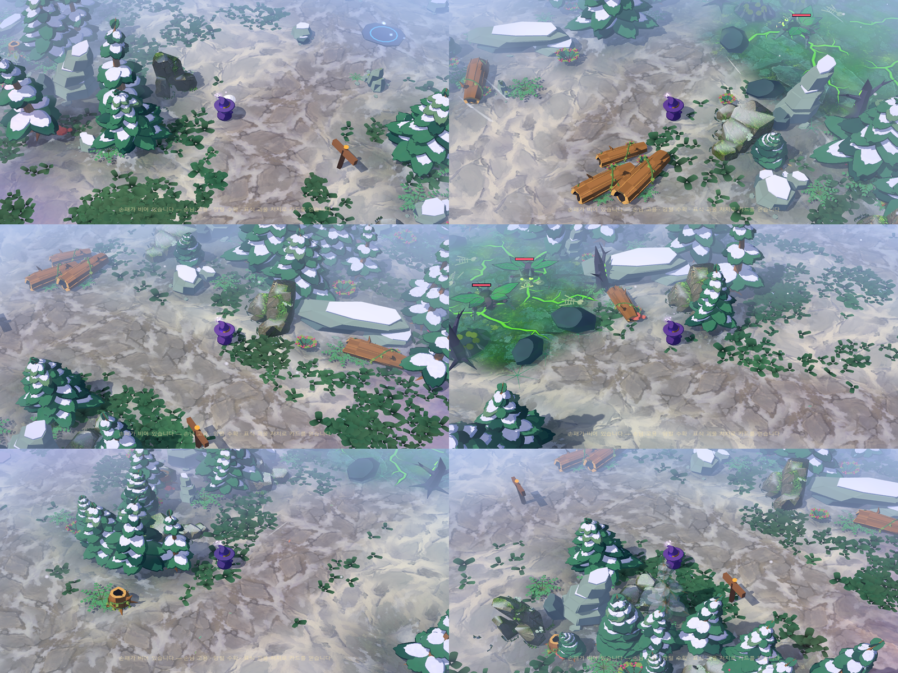
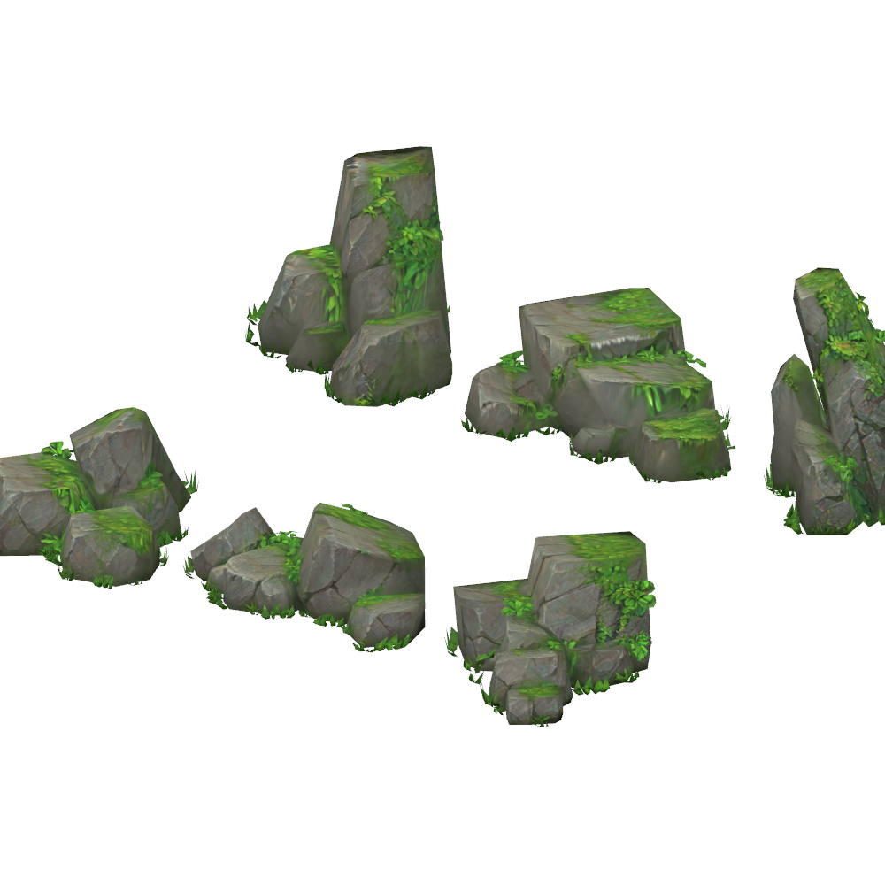

# 사용자 이끼 바위 6종 · 맵 배치

2026-10-15. 사용자가 제작한 Tripo 바위 모델(`rock+formation+3d+model.glb`)을 게임 배경 프랍으로 적용했다.
한 파일에 3×2로 놓인 **여섯 개의 바위 군집을 개별 프랍으로 분리**하고, 숲 군집 13곳에 배치했다.
원본 UV·텍스처·형태는 바꾸지 않았다.

## 분리한 6종

| id | 형태 | 사용처 |
| --- | --- | --- |
| `user_rock_spire` | 기울어진 선돌 | 산장 뒤 · 야영지 가는 길 · 달빛 제단 입구 (중심 바위) |
| `user_rock_ledge` | 층진 큰 덩어리 | 서쪽 길 · 남쪽 능선 (중심 바위) |
| `user_rock_slab` | 계단형 판석 | 벌목터 가장자리 · 북동 굽은 길 |
| `user_rock_steps` | 비탈 돌계단 | 목장 너머 동문 · 전망터 아래 |
| `user_rock_pile` | 둥근 무더기 | 동쪽 길 · 남서 연결부 (보조 바위) |
| `user_rock_low` | 낮은 돌무리 | 북쪽 길 · 남쪽 귀가 길 (보조 바위) |

- `art_sources/user_rocks/split_rock_sheet.py`: 원본(`rock_formation_source.glb`)을 연결 요소 단위로 나눠
  시트 칸별 GLB 6개를 만든다. 잎·잔디 조각도 해당 바위에 붙는다. 바닥 중심 피벗, 삼각형 합계 3,726 = 원본.
- 여섯 GLB는 텍스처 한 장(`assets/rocks/user_rock_paint.jpg`)을 공유한다.
- `shaders/user_rock.gdshader`: 원본 칠을 그대로 쓰고, 기존 툰 라이팅·공기 원근을 따른다.
  윗면에 옅은 서리(`frost_amount` 0.5), 이끼 채도(`moss_saturation` 0.78), 밝기(`paint_brightness` 1.15)는
  `assets/rocks/materials/user_rock_paint.tres`에서 조정한다.
- 프랍 장면: `scenes/props/nature/user_rock_*.tscn` (`nature_id` 메타 포함, 기존 자연물과 같은 방식).

## 배치

`art_sources/place_user_rocks.py`가 `assets/environment/forest_layout.json`에 바위 13개를 넣는다.
기존 숲 파이프라인이 그대로 충돌체(장애물 레이어)·내비게이션·잔디 비우기를 처리한다.

- 길 중심에서 3.6m + 충돌 반경 이상, 산장 마당·목장과 세 맹독 지역 밖.
- 나무 충돌체와 겹치지 않고, 기존 눈 바위와는 살짝 맞붙는 정도(≤0.45m)만 허용.
- 각 바위의 조각된 앞면(+Z)이 가장 가까운 길을 향한다. 발 밑의 고사리·관목 8개는 관통하지 않도록 제거.
- 큰 바위(선돌·층진 덩어리·판석)는 군집 중심, 낮은 바위는 길 가장자리 보조로 둔다.
- 다시 배치하려면 `USER_ROCKS` 목록을 고치고 스크립트를 실행한다. `build_forest_layout.py`로 숲을 재생성하면 그 뒤에 다시 실행한다.

## 검증

- `tools/verify_forest_composition.gd` 통과: 길 여유, 출현점→산장·네 공터 경로, 실제 5회 이동.
  (이전부터 맹독 지역 안에서 생략되는 프랍 29개를 세지 않아 수량 검사가 실패하던 문제도 함께 고쳤다.)
- `tools/preview_user_props.gd -- user_rock_`: 런타임 바위 13개 확인, 위치별 실제 플레이 카메라 캡처 → `output/user-rocks/`.
- 실행판: `build/WitchsLodge.pck` 갱신, 이전 판 `WitchsLodge-before-user-rocks.pck`, 사본 `WitchsLodge-user-rocks.pck`.
- 지면 혼합 마스크(이끼·서리 접촉면)는 아직 새 위치로 다시 굽지 않았다.
