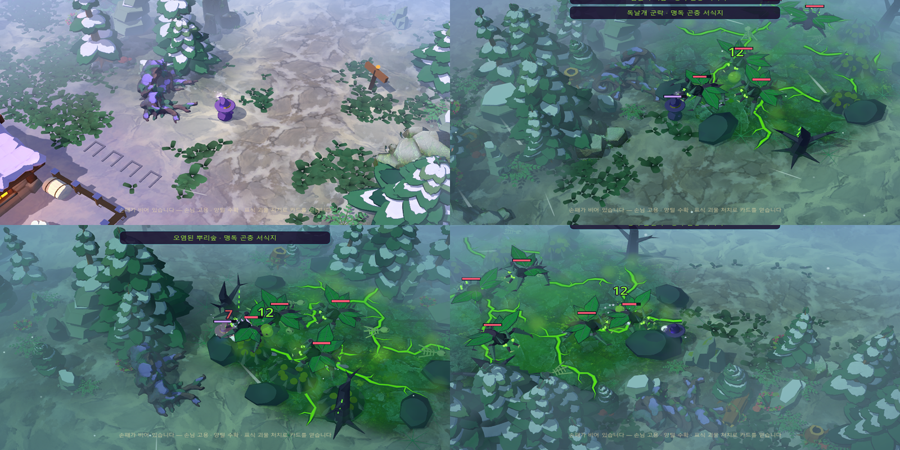
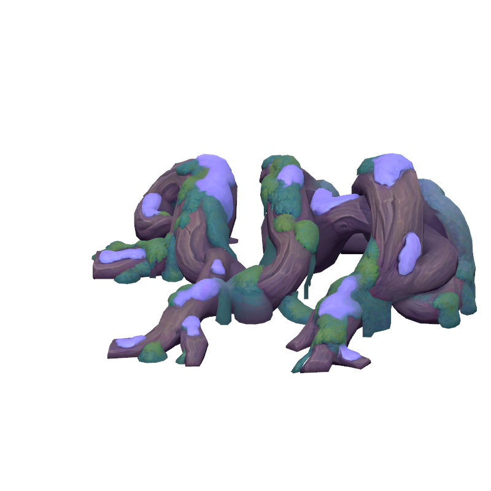
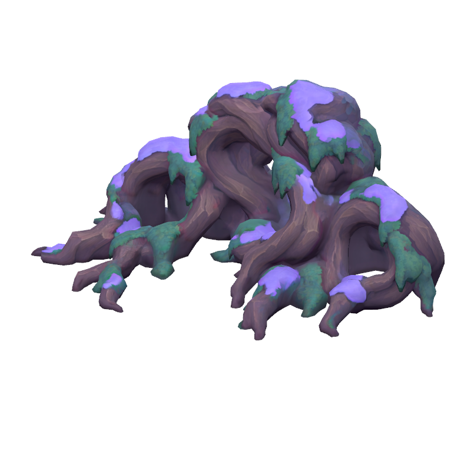

# 사용자 덩굴·고목 뿌리 프랍 2종 · 맵 배치

2026-10-15. 사용자가 제작한 Tripo 모델 두 개를 덩굴 프랍으로 적용하고 숲 8곳에 배치했다.
두 모델 모두 보라빛 눈과 청록 이끼가 칠해져 있어 현재 설경 팔레트와 맞는다. 원본 UV·텍스처·형태는 그대로다.

| id | 원본 파일 | 형태 | 실제 크기 |
| --- | --- | --- | --- |
| `user_vine_coils` | `stylized+rock+formation` | 고리처럼 휘감긴 덩굴 아치 | 폭 4.5m · 높이 1.6m |
| `user_tangled_roots` | `tangled+tree+roots` | 엉킨 고목 뿌리 더미 | 폭 4.6–5m · 높이 2.2–2.4m |

| 휘감긴 덩굴 아치 | 엉킨 고목 뿌리 |
| --- | --- |
|  |  |

- 파일: `godot/assets/vines/*.glb`, 원본 사본 `godot/art_sources/user_vines/`.
- 재질: 바위와 같은 `shaders/user_rock.gdshader`(툰 라이팅·공기 원근). 이미 눈이 칠해져 있어 서리는 0,
  보라빛이 주변 눈보다 진하지 않도록 채도 0.82·밝기 1.1. `assets/vines/materials/*_paint.tres`에서 조정.
- 프랍 장면: `scenes/props/nature/user_vine_coils.tscn`, `user_tangled_roots.tscn`.

## 배치

`art_sources/place_user_vines.py`가 `forest_layout.json`에 8개를 넣는다. 지나갈 수 없는 장애물이고 내비게이션에 반영된다.

| 위치 | 프랍 |
| --- | --- |
| 산장 뒤편 (북쪽 길) | 고목 뿌리 |
| 맹독 균열지 서쪽·동쪽 가장자리 | 고목 뿌리 · 덩굴 아치 |
| 오염된 뿌리숲 남쪽·동쪽 | 고목 뿌리 · 덩굴 아치 |
| 독날개 군락 남쪽·북쪽 가장자리 | 덩굴 아치 · 고목 뿌리 |
| 서쪽 벌목터 너머 바깥 길 | 덩굴 아치 |

- 오염 지역 경계에 뒤틀린 뿌리가 모이도록 했다. 지역 안 공터(정규화 거리 1.0 미만)는 비운다.
- 바위와 같은 기준이다. 길에서 3.6m + 충돌 반경 이상 떨어뜨렸다. 나무 줄기와는 겹치지 않고, 기존 바위와는 0.45m 이내로만 맞닿는다.
  앞면은 가장 가까운 길을 향한다. 발 밑 하층 식생 3개는 지웠다.
- 충돌 반경은 아치 안쪽과 가는 뿌리 끝이 막히지 않게 폭의 0.42(아치)·0.36(뿌리)배로 잡았다.

## 검증

- `tools/verify_forest_composition.gd` 통과: 길 여유, 출현점→산장·네 공터 경로, 실제 5회 이동.
- `tools/preview_user_props.gd -- user_vine_,user_tangled_ user-vines`: 런타임 8개 확인, 위치별 캡처 → `output/user-vines/`.
- 실행판: `build/WitchsLodge.pck` 갱신, 이전 판 `WitchsLodge-before-user-vines.pck`, 사본 `WitchsLodge-user-vines.pck`.
- 지면 혼합 마스크는 바위와 마찬가지로 아직 다시 굽지 않았다.
