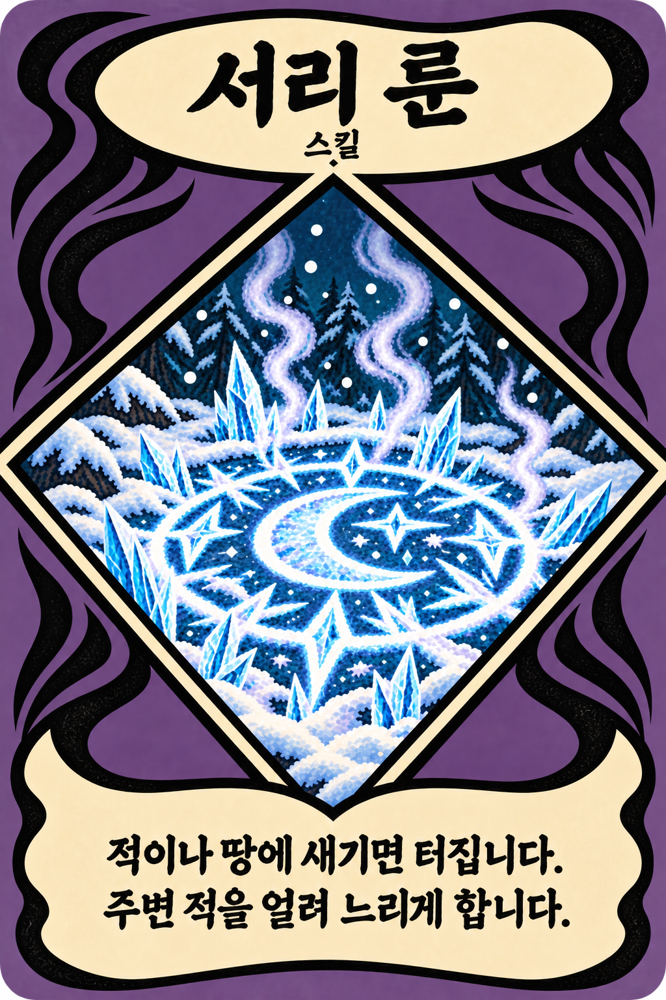
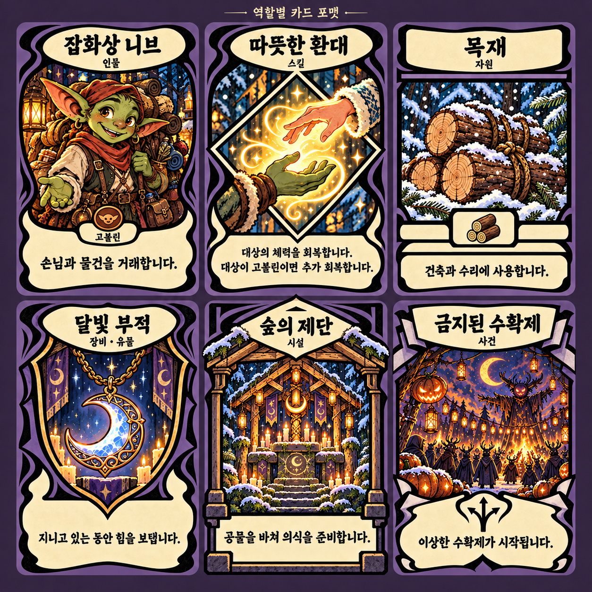
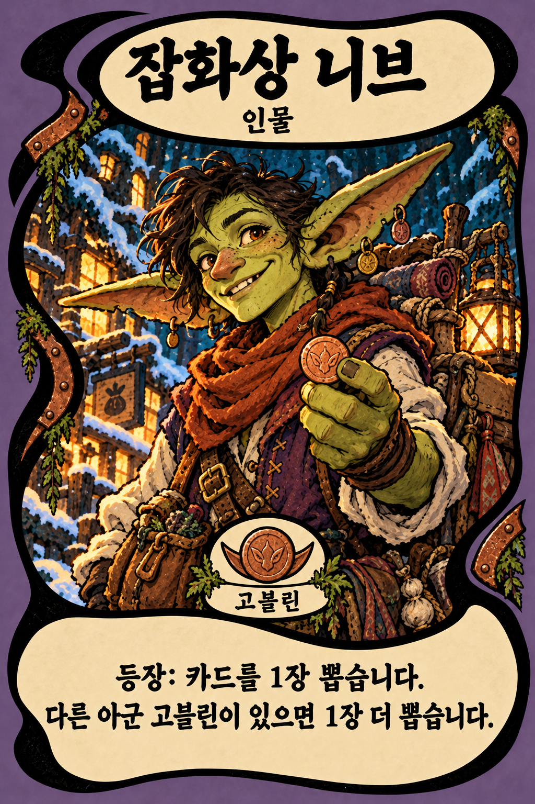
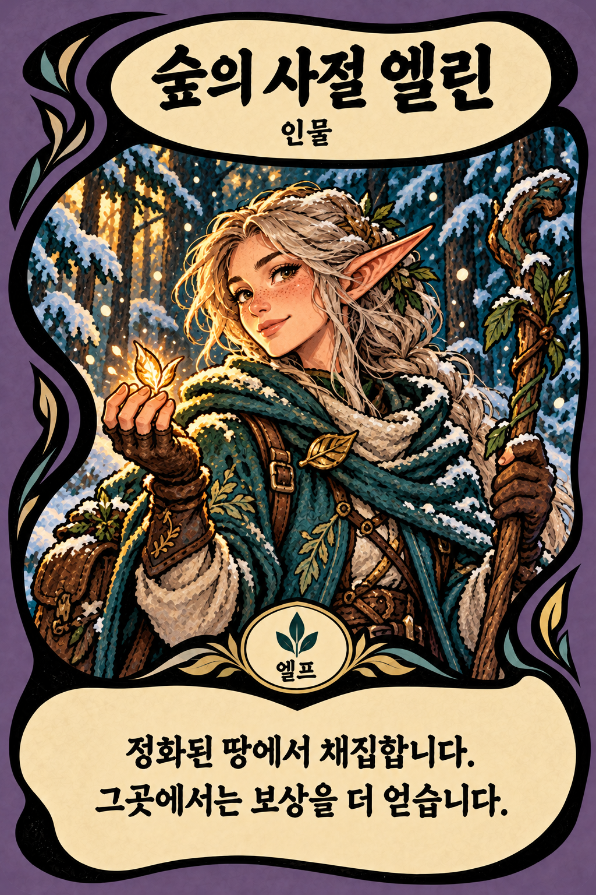
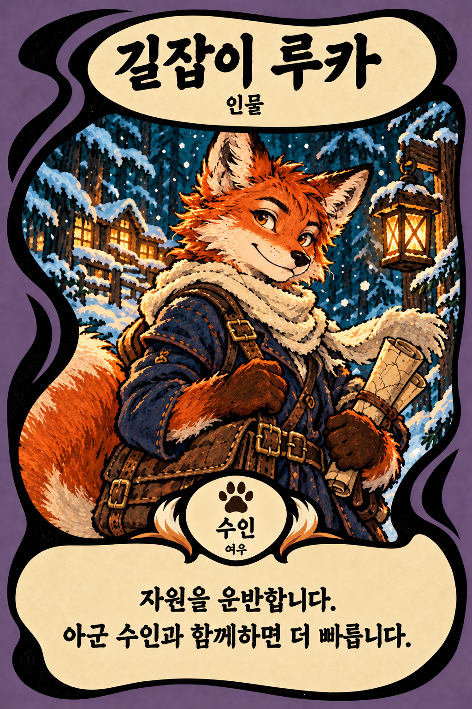

# 마녀산장 — 세계관·종족·역할별 카드 포맷 통합 기획 v0.1

작성일: 2026-10-16 (Asia/Seoul) · 핵심 진행 구조 갱신: 2026-10-17

사용자와의 세계관·종족·카드 논의를 통합하고, 역할별 포맷과 종족별 변형을 시각화하는 문서다. 사용자 결정과 제작 제안을 구분한다. 이번 범위는 기획 문서와 원화 시안이며 게임 로직·카탈로그·배포 카드 교체는 포함하지 않는다.

## 1. 게임의 방향과 역사

### 공통 시대 배경과 제작 기준

**사용자 확정(2026-10-17): 세계관은 중세를 기반으로, 일반적인 판타지 문법에 따라 어느 정도 각색할 수 있는 중세 판타지다.** 중세의 생활감과 분위기를 토대로 마법·종족·문화·조형을 게임에 맞게 각색한다. 역사 고증을 엄격하게 재현하는 방향보다 중세 기반의 일관된 판타지 세계를 지향한다.

어떤 설정이나 리소스를 기획·제작·수정하든 이 기준을 반드시 참고한다. 이야기·인물·대사·사회·기술, 복식·건축·도구·무기, 카드 원화·3D 모델·UI 소재·음악·효과음과 제작 프롬프트·결과 검수에 공통 적용한다. 특정 실제 국가·세기·중세 세부 시기와 개별 기술의 허용 범위는 아직 확정하지 않았다. 시각 제작의 적용 기준은 [아트 가이드](art-direction.md), 카드 제작은 [카드 디자인 가이드](card-design-guide.md)를 함께 따른다.

### 마녀의 역할과 세계의 역사

마녀는 인간에게 없는 힘으로 사람들을 보살피고 숲·강·바다를 정화한다. 산장은 생활과 교역, 여행자들의 피난과 만남, 정화·탐험 활동을 연결하는 거점으로 검토한다. 운영과 방어로 기반을 마련하고 활동 반경을 넓혀 유적·기괴한 식물·침식된 자들과 오래된 존재들의 흔적을 발견하는 흐름을 지향한다. 의식과 공물, 제단을 통해 힘을 얻는 콘텐츠는 후속 후보이며 개별 의식과 희생·결말은 미정이다.

사용자가 정한 역사는 다음과 같다.

1. 오래전 워록(남자 마녀), 마녀, 인간과 고대의 존재가 함께 살았다. 이후 확장한 요정·드워프·고블린 등도 사는 세계이며 이 문장은 종족 전체의 목록이 아니다.
2. 인간이 마녀사냥을 벌였다. 워록은 자취를 감췄고 마녀들은 소수만 살아남았다.
3. 고대의 존재들이 인간 세상을 괴롭히자 인간은 뒤늦게 마녀의 존재 이유를 깨닫게 되었다.
4. 마지막으로 살아남은 네 마녀는 동서남북으로 흩어져 각자의 삶을 산다.
5. 현재 인간들은 마녀사냥을 하지 않는다. 마녀를 전설로만 아는 사람, 존재를 믿지 않는 사람, 역사를 아는 사람, 마지막 희망으로 믿는 사람이 함께 산다.
6. 모종의 사건으로 네 마녀가 다시 나서야 할 때가 온다. 이 사건이 게임의 출발점이며 구체적인 계기는 아직 미정이다.

워록의 실종을 멸종으로 확정하지 않는다. 고대의 존재 전체의 성격·목적, 다른 종족들의 마녀사냥 당시 입장·행동, 네 마녀의 관계와 과거, 게임 도입 사건과 결말의 구체적인 내용은 열어둔다. 최종 엔딩의 세 범주와 이후 이야기에 결과를 잇는 구조는 아래 §2.1의 후속 결정으로 확정했다.

## 2. 시작 선택: 마녀 → 지역 → 계절

**누구의 이야기인가(마녀) → 어디를 돌볼 것인가(지역) → 어떤 상황인가(계절) → 시작 카드 드로우** 순서다.

| 선택 | 채택한 역할 | 구체화 후보 |
| --- | --- | --- |
| 동서남북 네 마녀 | 주인공의 이야기 선택. 직업 선택과 같은 개성 부여 | 동쪽: 생명·약초·성장 / 서쪽: 저주·계약·망령 / 남쪽: 불·솥·변환 / 북쪽: 서리·보호·봉인 |
| 지역 | 등장 주민·생물·재료·위협과 카드 소재 | 숲·강·해안·들판·도시 등 |
| 계절 | 그곳의 상태·사건·생활과 준비 | 봄의 발아, 여름의 폭우, 가을의 수확, 겨울의 온기·동면 |

마녀별 성향·능력·고유 카드·개인 도입은 제안이며 세부 채택 전이다. 마녀별 지역·계절 제한도 미정이다. 기존 설경 프로토타입을 모든 지역·계절의 고정 배경으로 보지 않는다.

등장 카드 구성은 **지역 카드 + 계절 카드 + 조합 전용 카드**의 세 층을 제안한다. 사건도 개별 카드로 표현할 수 있다. 사건 후보는 금지된 숲의 수확제, 한밤의 가면무도회, 겨울을 빌리러 온 손님, 분실물 보관실이 열리는 날이다. 약초와 솥·저주와 계약·꿈과 거울·사역마와 숲이라는 전문 분야도 카드 발상을 위한 추가 후보로 보존한다. 구체적 출현·해결·사용 규칙은 미정이다.

### 2.1. 핵심 진행 구조: 봉인석과 다음 마녀의 이야기

**사용자 확정(2026-10-17).** 네 마녀는 각각 자신이 지키는 봉인석을 수호한다. 먼저 플레이한 마녀와 수호/파괴 결말이 다음 마녀 이야기들의 카드 선택지·적의 위협을 바꾸고, 네 마녀의 결과가 최종 엔딩으로 모인다. 로그라이크 덱빌딩의 다회차 동기를 만드는 핵심 플로우다.

- 같은 마녀도 봉인석 수호 결말과 파괴 결말에서 서로 다른 고가치 카드를 해금한다. 다음 마녀의 시작 시 선택하거나 사용할 수 있게 하며, 실제 제공 방식은 추후 정한다.
- 봉인석을 지키지 못하면 이후 이야기들의 적이 강해진다. 단순한 공통 강화에 그치지 않고 **어느 방향의 봉인석이 파괴되었는지에 따라 강화의 갈래가 달라진다.** 지키지 못한 봉인석이 늘수록 이후 플레이의 위험도 커진다.
- 최종 엔딩은 **전체 수호 / 전체 파괴 / 일부 수호(1~3개)**의 세 범주로 나뉜다. 구체적인 결말과 방향 조합별 후일담은 추후 정한다.

카드 목록·효과·선택 방식, 방향별 적 강화와 누적 방식·수치, 일반 패배와 파괴 결말의 관계, 새 여정에서 해금·위험의 유지 범위는 미정이다. 상세 진행과 예시는 [코어 기획 §3.1](kingdom-integration-design.md#31-핵심-장기-플로우-네-마녀봉인석해금위험엔딩), 서사 기준은 [내러티브 §9.1](narrative.md#91-네-마녀의-이야기와-봉인석의-결말)을 따른다. 이번 기록은 게임 구현을 포함하지 않는다.

## 3. 종족과 산장의 손님

인간 외에 요정·드워프·고블린 등 각 종족이 손님으로 찾아온다는 것이 사용자 방향이다. 추가로 논의한 종족을 아래에 모두 보존한다. 종족 전체에 하나의 성격·직업·적대 관계를 고정하지 않는다.

| 종족 | 손님·카드 소재 후보 | 검토할 세계관 연결 |
| --- | --- | --- |
| 인간 | 용병·상인·순례자·피난민, 계약과 교역 | 마녀사냥 이후 서로 다른 믿음과 역사 인식 |
| 요정 | 숲의 사절, 희귀 씨앗, 정화 요청 | 자연의 상태와 관계. 작은 자연의 마법적 존재로 구분하는 안 |
| 드워프 | 장인·광부·유물 조사자, 광석과 도구 | 오래된 물건과 유적에 관한 지식 |
| 고블린 | 행상인·수집가·탐험가, 부품과 교환 | 종족 조건을 가진 거래·지원 카드 |
| 엘프 | 순찰자·기록 보관자, 활·약초·고대 기록 | 장수 종족으로 채택하면 오래전 마녀를 기억하는 인물 가능 |
| 수인 | 여우 행상인·늑대 용병·토끼 배달부 | 동물 특징이 만든 실루엣, 이동·추적·운반 |
| 오크 | 호위병·주술사, 공동체의 음식과 의식 | 인간과 다른 공동체·계약 문화 |
| 하플링 | 요리사·농부·여행 작가 | 음식·침구·농사·환대라는 산장의 일상 |
| 노움 | 수리공·연금술사, 장치·물약 | 도구의 개조와 뜻밖의 발명 |
| 인어·물의 종족 | 강의 사절·진주 상인 | 조수·오염된 물·침수된 유적 |
| 트롤·거인족 | 여행자·목동, 바위와 큰 짐 | 체격에 따른 공간·숙박·건설의 사건 후보 |
| 용인 | 용의 사절·공물 운반자 | 용·비늘·불씨·오래된 계약 |

위 목록은 세계 확장의 검토 풀이다. 추가 종족의 최종 목록·문화·외형·수명·거주지는 아직 확정하지 않는다. 요정과 엘프의 구분, 마녀/워록이 종족인지 능력·정체성인지도 후속 결정 사항이다.

손님 구체화의 기준으로 **종족 + 직업 + 방문 목적 + 마녀에 대한 태도 + 개인 사연**을 제안한다. 지역·계절에 따라 손님 분포와 소지품·사건을 달리할 수 있다. 자주 만나는 손님과 거인·용의 사절처럼 특별한 방문을 구분하는 안도 남긴다. 수명 차이를 채택하면 같은 사건을 직접 기억하는 손님과 전승으로만 아는 손님을 함께 보여줄 수 있다.

## 4. 주머니와 손패: 확정 규칙의 통합

상세 결정과 후속 구현 이력은 [지역·계절·주머니 기획](region-season-pocket-design.md) 및 [우선순위·구현 기록](region-season-pocket-priorities.md)을 따른다. 현재 문서 확인 시 반영된 후속 결정도 포함한다.

| 항목 | 확정한 기본 규칙 |
| --- | --- |
| 신규 획득 | 자리를 사용할 수 있으면 손패로 즉시 획득. 가득 차서 손패에 넣지 못한 카드·자원은 주머니로 보내며 잃지 않음 |
| 시작 | 시작 카드를 주머니에 넣고 무작위 시작 손패 드로우. 후속 결정은 기존 6장 중 3장 공개, 1장 교체 가능 |
| 손패 | 8장 한도. 가득 차면 드로우를 건너뛰고 주머니에 보존 |
| 주머니 | 덱 역할. 목록은 볼 수 있지만 원하는 카드 자유 입출고는 불가 |
| 아침 | 주머니에 카드가 있으면 무작위 1장 드로우 |
| 드로우 카드 | 채집가: 사용 시 1장 / 독버섯: 체력 대가로 1장 / 마법서적: 주머니의 무작위 최대 3장 중 1장 선택 |
| 사용 후 | 자원 외 카드는 버림패, 활동 카드는 활동 종료 후 버림패. 자원은 사용 수량 차감 |
| 재순환 | 버림패의 기본 자동 재순환 없음 |
| 빈 주머니 | 본래 효과가 있는 카드는 그 효과만 사용 가능. 드로우 전용 카드는 사용 불가·비용 없음 |
| 자원 드로우 | 주머니에서 자원 1개씩 가져옴. 세계에서 자원을 획득할 때의 수량을 1개로 제한하는 규칙이 아님 |
| 자원 사용 | 건축·수리·판매·봉헌 모두 손패의 자원만 사용. 특별한 카드·기믹은 예외를 만들 수 있음 |
| 마법서적 | 후보가 1~2장이면 있는 만큼 공개, 미선택 카드는 주머니 유지, 선택 중 시간 정지 |

시작 교체·아침 및 추가 드로우의 중앙 공개 후 손패 이동, 손패 오른쪽에 획득 순서대로 추가하는 후속 연출 결정도 관련 문서에 보존한다. 본 작업은 기존 코드와 구현 결과를 변경하거나 재검증하지 않는다.

## 5. 카드 분류: 역할과 종족의 두 축

**역할에 따라 큰 포맷이 달라지고, 종족은 인물·생물 카드의 포맷 안에서 작은 변형으로 읽힌다.** 종족과 카드의 기능을 별도 정보로 다루어, 종족이 늘어도 역할 식별을 유지한다. 이 분리는 사용자 요청을 구체화한 시안의 설계 기준이다.

| 대분류 후보 | 형태와 구획의 시안 | 예시 |
| --- | --- | --- |
| 인물·생물 | 얼굴·상체를 크게 담는 아치형 초상창, 분리된 종족 문장과 직업 표기 | 고블린 행상인, 엘프 순찰자, 여우 수인 배달부. 동물·하수인도 이 계열에서 하위 구분 검토 |
| 스킬 | 마름모·룬 형태의 원화창, 한 번의 행동이 보이는 구성, 종족 문장 자리 없음 | 회복·저주·정화·드로우 효과 |
| 자원 | 넓고 단순한 재료 원화창과 수량을 위한 여백, 묶음·꾸러미 느낌 | 목재·양털·검은 털·생고기 |
| 장비·유물 | 세로로 긴 물건의 전시창, 받침·메달 형태의 구획 | 오래된 마법서적, 달빛 부적. 영구 유물과 소모 도구는 하위 표기 |
| 시설 | 지붕형 상단·건축물 원화창·단단한 하단 구획 | 제단·등불·가시 방책. 건설·성장·지속 표기의 자리 검토 |
| 사건 | 펼쳐진 장면을 보여주는 넓은 창, 갈라진 종이·두 갈래 표식의 하단 | 금지된 수확제, 가면무도회 |

같은 2:3 외곽·손패 정렬 크기, 보라색 바탕·검은 비대칭 S자 먹선·크림색 이름과 설명란이라는 기존 시각 언어를 유지하며 내부 원화창과 구획을 바꾼다. 색 외에 형태·역할 이름을 함께 사용한다. 기존 ‘모든 카드 동일 포맷’ 승인 기록은 보존하며 이번 역할별 분화 요청을 후속 방향으로 연결한다. 타 게임의 구체적인 프레임·보석·마나·공격력·체력 장식은 추가하지 않는다. 손패에서 역할 표식과 종족 문장의 위치를 일정하게 유지한다.

6종의 세부 분류와 이번 시안의 디자인은 검토 후보다. 실제 모든 카드의 분류 이동·이중 역할, 생물과 인물의 하위 구분, 시설·장비의 작동과 수명은 후속 결정한다. 예: 마법서적의 그림은 도구여도 드로우 효과를 가지며, 그 효과만으로 인물 카드나 종족 카드로 바뀌지는 않는다.

## 6. 종족별 시각 변형과 조건부 기믹

사용자 방향: 종족마다 카드 포맷을 조금씩 다르게 만들어 시각적으로 구별하고, 종족 종류를 실제 효과의 조건과 연결한다. **‘만약 대상이 고블린이라면’** 같은 기믹을 사용할 수 있다.

종족 문장·종족명은 인물 원화창 아래의 고정 위치에 둔다. 보라색 기본 프레임은 유지하고 곡선의 끝·보조 테두리·문장의 형태를 변형한다. 종족별 전면 배경색만 바꾸거나 장식을 무제한 늘리는 방식으로 역할 구획을 흐리지 않는다. 이번 변형 후보는 다음과 같다.

| 우선 시안 | 문장·형태 후보 | 보조색 | 선정 이유 |
| --- | --- | --- | --- |
| 고블린 | 둥근 귀/동전 문장, 짧은 비대칭 금속 패치·리벳 | 이끼색·구리 | 사용자가 든 조건부 효과의 예시이며 교역·도구 소재로 연결하기 좋음 |
| 엘프 | 잎 문장, 길게 빠지는 잎맥형 곡선 | 청록·옅은 금색 | 기존 역사와 숲·정화에 연결할 수 있고 고블린과 실루엣 대비가 큼 |
| 수인 | 발자국 문장, 짧은 털 결처럼 갈라지는 곡선 | 호박색·크림 | 얼굴·귀·주둥이로 식별이 빠르고 이동·운반 콘텐츠에 연결 가능 |

우선 시안의 순서는 이번 비교 원화의 제작 선택이며 최종 출시 종족 우선순위를 확정한 것은 아니다. 인물의 역할 창 구조·종족 문장 위치는 세 종족에 공통 적용한다. 고블린·엘프·수인 외 종족의 문장은 후속 제작한다. ‘수인’과 여우·늑대 등의 세부 혈통을 별도 조건으로 쓸지 역시 미정이다.

### 조건부 효과의 표기와 판정 제안

기본 효과 뒤에 조건과 추가 효과를 분리해 읽는다. 아래 효과는 시안용 예시이며 확정 밸런스·구현 기능이 아니다.

| 카드/효과 예시 | 기본 효과 | 종족 조건 후보 |
| --- | --- | --- |
| 따뜻한 환대(스킬) | 아군 대상의 체력 회복 | **대상이 고블린이면** 추가 회복 |
| 행상인 니브(고블린 인물) | 등장 시 카드 1장 드로우 | 다른 아군 고블린이 있으면 1장 추가 드로우 |
| 숲길의 약속 | 아군의 채집 지원 | 대상이 엘프이면 정화된 장소에서 추가 보상 |
| 여정의 간식 | 아군의 이동 지원 | 대상이 수인이면 자원 운반 중 추가 효과 |

카드의 역할, 종족, 직업, 세력, 대상 상태는 서로 다른 조건으로 구별한다. 고블린에게 효과를 주는 스킬도 역할은 스킬이며 그 스킬 자체가 고블린 인물인 것은 아니다. 예컨대 역할 `character`, 종족 `goblin`, 직업 `merchant`라는 정보로 대상 판정을 표현하는 안을 제안하되 실제 데이터 계약은 구현 시 정한다. 표시와 판정은 같은 정의를 참조해야 한다.

대상 조건은 사용 미리보기와 확정 순간에 검사하고, 미리보기에서 추가 효과의 활성 여부를 보여주는 방향을 제안한다. 기본 효과의 유효 대상과 추가 보너스 조건을 구분한다. ‘고블린이면 추가 회복’은 고블린 외 아군에게 기본 회복이 가능한 효과이며, ‘고블린에게만 사용 가능’과 구별한다. 인물의 종족이 월드 소환체에도 이어져야 한다. 외형·피부색·초상 이미지로 종족 판정을 추정하지 않는다. 중첩 보너스·혼혈·변신·다중 종족·선택 대상이 없는 효과는 후속 명세다.

## 7. 이번 원화 납품과 검토 항목

**앞으로의 확정 제작 기준:** 사용자는 정리된 개별 카드 6종의 포맷을 앞으로 생성하는 카드에도 지키도록 요청했다. [카드 디자인 가이드](card-design-guide.md)에 역할별 승인 참조, 제목·설명 최소 영역, 장식 제한과 제작·검수 절차를 기록했다. 카드 원화 생성 시 이 가이드와 개별 PNG를 우선하며 아래의 탐색·시안 상태는 과거 이력으로 읽는다.

**최신 개별 제작(2026-10-16):** 사용자는 이후의 빈 프레임·먹선 실험을 돌아본 뒤, 이 절의 **역할별 6종 비교판 v02가 전반적으로 더 마음에 든다**고 밝혔다. 이어 비교판의 6종 모두를 개별 카드로 다시 그리고 다국어 이름·설명 여백과 불필요한 구획·장식을 정리하도록 요청했다. [역할별 6종 개별화·다국어 레이아웃 정리](individual-role-cards-layout-v02.md)에 최종 PNG 6장과 여백 기준, 수정·검수 기록을 제공한다. 현재 검토 기준은 그 개별 카드이며 아래 비교판과 빈 포맷은 이력으로 보존한다. 별도로 요청한 서리 룬의 마름모 스킬 시안은 아래에 보존하며, 6종의 따뜻한 환대를 대체하지 않는다.

### 서리 룬 · 마름모 스킬 포맷 단일 시안

기존 카드의 제목과 두 줄 인쇄 설명을 유지하고 분류를 ‘스킬’로 표기했다. 기존의 눈 위 달 문양 룬·방사형 얼음 결정·차가운 수증기와 숲을 마름모 창 안에 배치했다. 창 바깥은 보라색 카드 바탕이며 스킬의 검은 마름모 테두리와 크림색 안쪽 선을 유지했다. 파일은 1024×1536이고 제목·분류·설명 문구·마름모 창을 직접 확인했다. 기존 게임 파일은 교체하지 않았다.

[실제 생성 프롬프트](prompts/cards/frost-rune-diamond-v01-prompt.md) · [치수·해시·검수 기록](../art/concepts/cards/roles-races-v01/frost-rune-diamond-v01.json).

**사용자 후속 피드백(2026-10-16):** 아래 역할별 시안은 포맷의 차이가 충분하지 않다는 평가를 받았다. 다음 검토 기준은 [원화 없는 역할별 포맷 탐색 v02](empty-card-format-exploration-v02.md)이며, 원화 영역을 어두운 회색으로 비우고 실루엣·구획·배치가 확연히 다른 세 방향을 비교한다. 아래의 ‘최종’은 이전 생성 라운드 안의 최종 산출물을 뜻하며 사용자 승인 상태를 뜻하지 않는다. 종족 인물 원화는 보존한다.

내장 image_gen으로 기존 카드 원화를 스타일 참고해 새 비교 시안을 제작했다. 역할별 6종 비교판과 종족별 인물 카드 3장, 실제 생성 프롬프트를 보존한다. 원화에 표시한 효과 문구는 후보이며 기존 게임 수치를 대체하지 않는다.

| 납품물 | 원본 PNG | 비교 포인트 |
| --- | --- | --- |
| 역할별 6종 최종 비교판 v02 | [역할 포맷 비교](../art/concepts/cards/roles-races-v01/01-role-formats-v02.png) | 인물 초상창 / 스킬 마름모 / 자원 직사각 구획 / 유물 방패형 창 / 시설 지붕·기단 / 사건 갈라진 종이 |
| 고블린 행상인 니브 | [인물 원화](../art/concepts/cards/roles-races-v01/02-goblin-nib-v01.png) | 구리 리벳·동전과 귀 문장, 고블린 조건부 추가 드로우 예시 |
| 엘프 사절 엘린 | [인물 원화](../art/concepts/cards/roles-races-v01/03-elf-elin-v01.png) | 잎 곡선·청록/옅은 금색·잎 문장, 정화된 장소의 채집 예시 |
| 여우 수인 길잡이 루카 | [인물 원화](../art/concepts/cards/roles-races-v01/04-beastfolk-luka-v01.png) | 털 결 곡선·호박색·발자국 문장, 아군 수인과 운반 협력 예시 |

[초기 비교판 v01](../art/concepts/cards/roles-races-v01/01-role-formats-v01.png)도 보존했다. v02는 자원·시설·사건·장비의 구획 차이를 보강했다. [실제 생성·수정 프롬프트](prompts/cards/races-role-formats-v01-prompts.md)와 [파일 크기·해상도·SHA-256·복사 일치 및 검수 기록](../art/concepts/cards/roles-races-v01/manifest.json)을 함께 제공한다. 비교판은 정사각형, 인물 3장은 각각 1024×1536의 2:3 원화이며 배경을 포함한 RGB 시안이다. 투명 프레임·레이어 분리·손패용 축소·실제 게임 분류·종족 조건 판정 구현은 이번 납품 범위에 포함하지 않는다.

검수에서 최종 비교판의 역할 6종·한글 문구·창 구조, 인물 3장의 이름·종족 표기·효과 문구와 테두리 변형을 직접 확인했다. PNG 5개는 생성 원본과 SHA-256이 일치하며 인물의 2:3 비율을 확인했다. 문서의 내부 링크·문자 인코딩·공백 오류도 확인한다. 이 검수는 시안 파일과 문서에 한정한다.

검토 기준은 다음과 같다.

- 6종이 글자를 읽기 전에도 원화창·구획의 형태로 구별되는가.
- 세 인물이 같은 인물 포맷을 공유하면서 문장·테두리·초상으로 종족이 구별되는가.
- 기존 보라색·검은 S자 먹선·크림 패널과 페인터리 원화 스타일이 이어지는가.
- 종족 조건이 기본 효과와 구별되고, 종족·직업·세력·역할을 혼동하지 않는가.
- 작은 손패에서 표식이 읽히는지와 실제 작동은 구현 시 별도로 검증해야 한다. 이번 비교 원화만으로 런타임 검증을 완료했다고 보지 않는다.

## 8. 관련 문서와 다음 결정

- [지역·계절·주머니 전체 기획](region-season-pocket-design.md): 사용자 선택과 세계관의 원문 기준, 손패·주머니 규칙.
- [주머니 우선순위·구현 이력](region-season-pocket-priorities.md): 별도 작업의 실제 게임 반영 범위.
- [기존 내러티브](narrative.md): 마녀와 여행자의 관계·소문·사건의 초기 기준.
- [숲과 오컬트 후보](narrative-forest-occult-ideas.md): 탐험·제단·의식의 후속 아이디어.
- [기존 카드 포맷 승인 이력](card-format-design-summary.md): 공통 화풍과 비대칭 S자 포맷의 원본 기준.

다음 결정은 네 마녀의 개별 이야기, 게임 도입 사건, 확정 종족 범위·문화·역사, 6종 포맷의 채택·수정, 조건부 효과의 구체적인 목록과 밸런스다. 다른 작업에서 진행 중인 게임·자산 변경은 보존한다.
