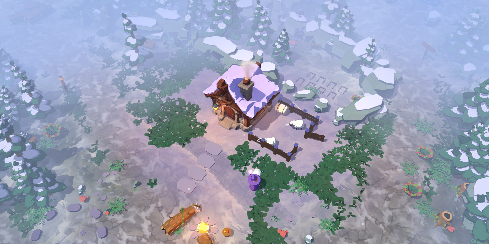
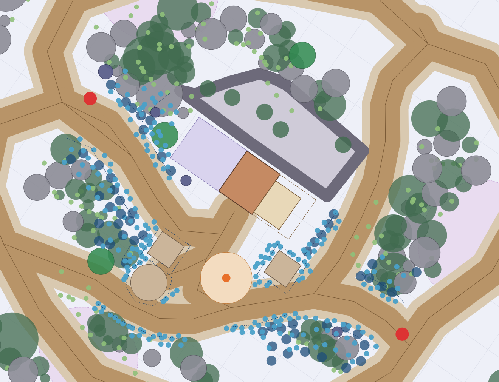
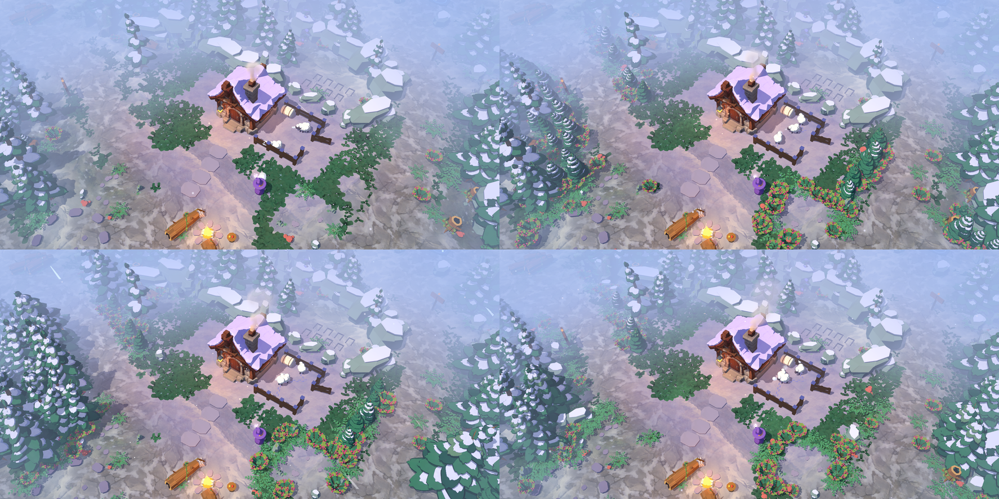
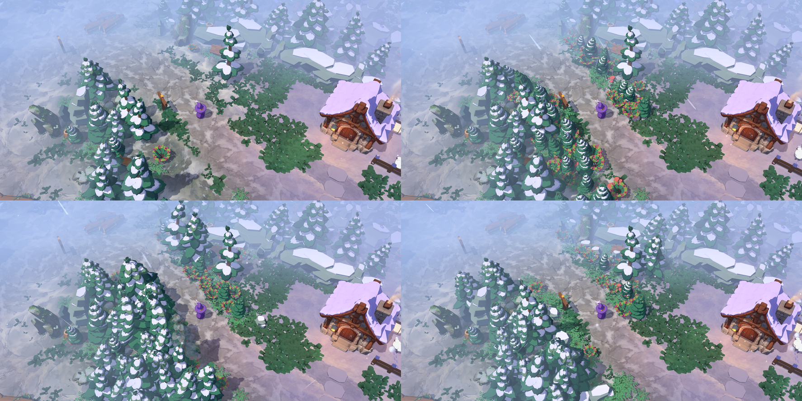
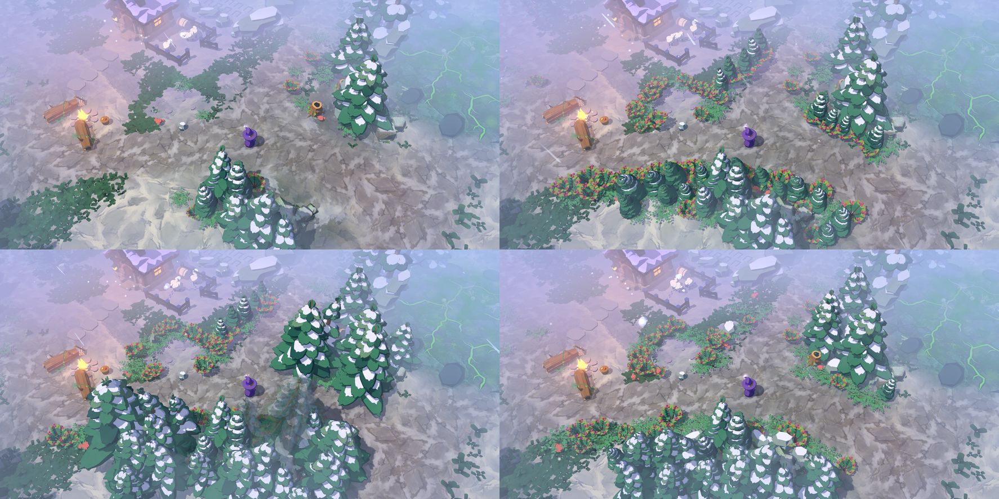
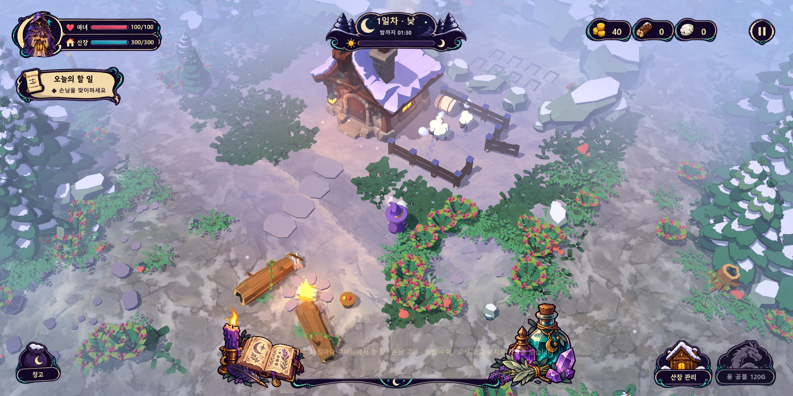

# 산장 주변 식생 구분선 시안 3종 (v01)

작성일: 2026-10-18  
요청: 현재 산장 주변 프랍·지형 배치가 마음에 들지 않는다. **식생 뭉치를 더 밀도 높게 배치해 길목과 각 지역에 확실한 구분선 역할**을 하게 하는 시안 몇 가지를 제안한다.  
기준: [산장 주변 맵 A안 구현 기록](lodge-layout-a-implementation.md) · 승인 원화 `art/concepts/environment/layout-a-game-camera-v03-style/01-layout-a-style-restored.png` · [길을 따라 형성되는 배경 숲 군집](forest-composition.md) · [아트 가이드](art-direction.md)  
상태: **2026-10-18 사용자 선택 — C안(바위 능선) 적용, 게임 기본값.** F7 로 현재·A·B 와 여전히 비교할 수 있다. 같은 요청으로 산장 둘레 잔디 보강, 공터의 자연스러운 표현, 산장 뒤 구석 진동 버그 수정을 함께 했다(7절).

## 1. 현재 배치의 문제(진단)

- 숲 군집은 길 중심선에서 3.6m+ 떨어진 규칙으로 자동으로 밀려나(A안 적용 때 76개 이동) **길과 숲 사이에 빈 눈밭 띠**가 남았다. 길목이 "숲 사이 골짜기"로 읽히지 않고 넓은 눈밭 한가운데의 자국처럼 보인다.
- 앞마당의 공터(감시탑 2·제단 1)·모닥불·증축 예약 눈밭·목장은 **경계가 바닥 패치뿐**이라 구역이 하나로 뭉개진다. 승인 원화는 각 공터를 관목·침엽수 덩어리가 둘러싸고 있다.
- 증축 예약 눈밭(산장 왼쪽)은 왼쪽 웨이브 길과 그대로 이어져 어디까지가 "산장 땅"인지 알 수 없다.
- 북쪽 제단 탐험길과 목장 동쪽 사이도 열려 있어 탐험길·목장·앞마당이 하나의 공터처럼 보인다.

## 2. 공통 설계 — 구분선 11개 + 공터 테두리 3개

세 시안은 **같은 구분선 중심선**(아래 평면도의 점선)을 쓰고, 띠의 **단면(높이·재질)**만 다르다. 그래서 "어디를 가를 것인가"는 공통 결정이고, "무엇으로 가를 것인가"가 시안의 차이다. 좌표·규칙은 [`godot/scripts/world/yard_hedges.gd`](../godot/scripts/world/yard_hedges.gd)의 `BANDS`·`PROFILES`·`VARIANTS`에 있다.

평면도 읽는 법: 화면 방향(카메라 yaw 35°)·격자 5m. 갈색 띠 = 길(1.8m), 연한 띠 = 통행 여유 2.8m. 짙은 초록·회색 = 기존 숲 군집, 보라 점선 사각형 = 증축 예약, 회색 고리 = 후면 차단 띠. **파란 원 = 시안이 더하는 부품**(큰 원 = 침엽수, 보라 = 바위, 작은 원 = 관목·고사리).

| 구분선 | 역할 | 비고 |
| --- | --- | --- |
| `reserve_south` 증축 예약 남쪽 울타리 | 왼쪽 웨이브 길 ↔ 증축 예약 눈밭 | 산장 모퉁이(x > −8.2) 쪽 2.4m 는 열어 둬 눈밭 입구가 현관 쪽에서만 열린다. 자원 나무(−11.6, 1.2) 주변 2.3m 는 비움 |
| `reserve_west` 증축 예약 서쪽 마감 | 눈밭을 후면 띠 시작점까지 닫아 포켓으로 | 기존 `lodge_west` 군집이 대부분 차지해 부품 수는 적다 |
| `lane_a_north` / `lane_a_south` | 왼쪽 웨이브 길(스폰 A → 마당)의 양쪽 길목 | 벌목터 공터·스폰 A 주변은 규칙대로 비움 |
| `altar_west` 제단 포켓 서쪽 벽 | 왼쪽 길에서 탑 L·제단 공터 뒤로 도는 눈밭을 막음 | 제단·탑 공터와 0.4m 여유 |
| `pasture_east` 목장 동쪽 울타리 | 목장 ↔ 북쪽 제단 탐험길 | 목장 문 앞 통로(x 7.75~9.9)는 비워 수확·공격 동선 유지 |
| `lane_b_south` / `lane_b_north` | 오른쪽 웨이브 길(스폰 B → 마당)의 양쪽 길목 | 기존 `south_gate`·`lookout_inner`·`lodge_east` 군집의 틈을 메운다 |
| `yard_edge_b` / `yard_edge_home` | 마당 안 길 가장자리(충돌 없음) | 모닥불 남쪽 길과 야영지 길의 바깥 가장자리 |
| `ring_tower_l` / `ring_tower_r` / `ring_altar` | 공터 테두리(충돌 없음) | 길에 닿는 변은 자동으로 비워져 입구가 생긴다 |

### 배치 규칙(세 시안 공통, `verify_yard_hedges.gd` 로 검사)

- **동선 우선**: 충돌 부품(나무·바위)은 길 중심선에서 **2.6m + 충돌 반경**(나무 3.0m) 이상, 장식(관목·고사리·버섯)은 1.9m 이상. 바닥 트레일 페인트는 1.0~3.4m 에서 흐려지므로 관목이 길 가장자리에 걸치고 나무 줄기는 트레일 밖에 선다. 기존 숲 군집 규칙(3.59m)보다 1m 가까워 **길목이 좁아 보인다**.
- 증축 예약·감시탑·제단·모닥불 쉼터(`Layout.in_yard_reserve`)·후면 띠 안·산장 주변 2.4m·목장(최대 단계)+1m·목장 문 앞 통로·스폰 2.4m·랜드마크 4.75m·오염 지역·자원 나무 1.9m 에는 두지 않는다.
- 기존 숲 군집·후면 띠 침엽수와 줄기가 겹치지 않는다(바위끼리는 무더기로 겹쳐도 된다). 같은 자리에서 5번까지 흔들어 기존 나무 사이 틈을 채운다.
- **구분선 나무는 벌목 대상이 아니다**(고정 지형, `harvest_trees` 에 넣지 않음). 큰 나무(3m+)는 카메라 가림 페이드 목록에 들어간다.
- 시안은 데이터(중심선·단면)로 재현되고 매 실행이 같다(시드 = 시안 id + 띠 id).

## 3. 시안 비교

비교판(좌상 현재 · 우상 A · 좌하 B · 우하 C), 낮·조감(F4) 카메라:

왼쪽 길목(마녀가 (−11, 6.5) 에 선 추적 카메라):

오른쪽 길목(마녀가 (15.5, 6) 에 선 추적 카메라):

| | A안 생울타리 | B안 숲 쐐기 | C안 바위 능선 |
| --- | --- | --- | --- |
| 단면 | 묘목(1.6~2.8m) 두 줄 + 관목·고사리 세 줄 + 작은 바위 | 큰 침엽수(4.6~7m) 앞줄 + 중간 침엽수 두 줄(3.4~5.8m) + 앞쪽 묘목·관목 | 낮은 눈 바위(0.8~1.15m) 앞줄 + 묘목 + 중간 침엽수 두 줄 + 관목 |
| 부품 수(장식 포함 / 충돌) | 304 / 49 | 288 / 59 | 253 / 56 |
| 구분선 읽힘 | 선은 또렷하지만 낮아서 "울타리"에 가깝다. 구역 구분은 되지만 길목이 골짜기로 읽히지는 않는다 | **길이 숲 사이 골짜기로 읽힌다.** 승인 원화와 가장 가깝다 | 바위가 후면 차단 띠와 같은 재질이라 "산장 땅의 경계"로 읽힌다. 길목 밀도는 B보다 낮다 |
| 시야·가림 | 거의 없음 | 왼쪽 길목에서 큰 나무가 마녀를 가릴 수 있음 → 기존 가림 페이드로 처리됨(캡처 확인) | 낮음 |
| 전투 가독성 | 적이 길목에서 잘 보임 | 길목 진입 순간이 극적이지만 적이 수관 뒤에서 나타남 | 적이 바위 사이로 보임 |
| 예약 눈밭·목장 쪽 | 묘목 울타리 | 같은 묘목 울타리(큰 나무는 좁아서 들어가지 않음) | 묘목 울타리 |
| 공터 테두리 | 관목 고리(공통) | 관목 고리(공통) | 관목 고리(공통) |

### 추천

**B안(숲 쐐기)을 기본으로 하고, 앞마당 안쪽은 공통 관목 테두리로 마감**하는 구성을 추천한다. 이유:

1. 사용자가 꼽은 문제("식생 뭉치의 밀도", "길목 구분")에 가장 직접 답한다. 좌우 웨이브 길이 숲 벽 사이의 골짜기가 되어 적의 진입 방향이 멀리서도 읽힌다.
2. 승인 원화의 "길이 만드는 숲 덩어리"와 같은 문법이고, 기존 40개 군집(초승달·능선·쐐기)의 느슨해진 실루엣을 길 쪽에서 다시 조여 준다.
3. 가림은 이미 있는 카메라 페이드가 처리하고, 동선·공격 지점·대기 자리·스폰 경로는 검증으로 유지됐다.

C안의 바위 앞줄은 B안에 **부분 적용**할 가치가 있다(예: `pasture_east`·`reserve_south` 를 `ridge` 로 덮어써 "산장 땅"의 경계만 바위로). `VARIANTS[*].overrides` 한 줄로 조합할 수 있다.

## 4. 보는 방법

- 게임 실행 후 **F7**: 현재 → A → B → C → 현재 순환(토스트로 이름 표시). 내비메시를 다시 구워 적·일꾼 경로에도 바로 반영된다.
- 특정 시안으로 바로 시작: `WitchsLodge.exe -- --yard-hedge=b` (a / b / c / none).
- 개별 캡처: `godot/screenshots/yard-hedges/<시안>-01-overview · 02-follow-hud · 03-left-lane · 04-right-lane.png`, 비교판 `compare-*.png`.
- 평면도: `output/yard-hedges-v01/map-<시안>.png`(+ `.svg`). `tools/plot_yard_map.gd -- --variant=all` 로 다시 그린다.

## 5. 검증

헤드리스 `tools/verify_yard_hedges.gd`: **RESULT 85/85**. 시안 A·B·C 를 F7 과 같은 경로로 차례로 조립해 다음을 검사한다.

- 배치 규칙: 길 여유 위반 0, 예약 영역·후면 띠 침범 0, 산장·목장·문 앞 통로·스폰 침범 0, 기존 숲·자원 나무 겹침 0, 충돌 부품 수 하한(A 20·B 30·C 22), 띠 밀도 하한(A 1.6·B 1.4·C 1.2 부품/m, 공터 테두리는 0.45/m).
- 동선: 스폰 A·B → 현관·목장 문, 현관 → 모닥불·목장 문·제단 공터·감시탑 공터 2·증축 앞 눈밭·랜드마크 4, 손님 경로 → 현관, 대기 자리 16곳 내비메시 위, 산장 뒤 도달 불가 유지, 공격 지점 8개 도달 가능.
- 구분선 나무가 벌목 목록에 들어가지 않음(자원 나무 138 그대로), 충돌 몸체 수 = 충돌 부품 수, `none` 복귀 뒤 잔여 부품 0, F7 순환 호출 동작.

회귀: `verify_lodge_layout.gd`·`verify_forest_composition.gd`(기본 `none` 상태) — 결과는 README 기록 참고.

실제 렌더 캡처(`tools/capture_yard_hedges.gd`, 창 모드)는 헤드리스로 확인할 수 없는 **실루엣·밀도·가림·길목이 좁아 보이는 정도**를 보기 위한 것이다.

## 6. 남은 결정·주의

- **어느 시안을 기본값으로 할지**(또는 B + C 부분 조합). 결정되면 `yard_hedges.gd` 의 `current_id` 기본값을 바꾸고 `verify_lodge_layout.gd` 가 그 상태를 기본으로 검사하게 한다.
- 구분선 나무를 **벌목 가능**하게 둘지. 지금은 고정 지형이다. 벌목 가능으로 바꾸면 후면 띠처럼 "베면 구분선이 열린다"가 되므로 권하지 않는다.
- 길 여유 2.6m(나무 3.0m)는 기존 숲 규칙 3.59m 보다 좁다. 적 군집·일꾼 교행이 길목에서 걸리는지 실제 웨이브로 한 번 더 본다. 더 좁히면(2.2m) 길목은 더 극적이지만 통행이 1.3m 폭까지 줄어든다.
- 관목 `berry_shrub` 의 붉은 열매가 많이 반복된다. A안은 특히 그렇다. 열매 없는 변형(또는 `fern_clump` 비중 상향)은 아트 쪽 후속.
- 잔디 풀밭(`grass_meadow`)은 기본 시안 기준으로 한 번 깔리므로 F7 로 바꾼 직후에는 관목 아래 풀이 남을 수 있다. 기본값 확정 뒤에는 문제없다.
- 밤 색감·안개는 건드리지 않았다. 낮 캡처만 비교했다.

## 7. 적용 결과와 함께 고친 것(2026-10-18, 사용자 요청)

사용자 결정: **C안 적용**. 추가 요청 세 가지를 같은 작업에서 처리했다.

| 항목 | 변경 |
| --- | --- |
| C안 기본값 | `yard_hedges.gd` `current_id = "c"`. 목장 문 앞 통로 규칙에 충돌 반경을 더해(바위가 통로를 좁히지 않게) 최대 목장 문 도달을 유지 |
| 산장 둘레 잔디 | `grass_meadow.gd`: 산장 둘레 26m 안쪽 풀밭 `GrassLodge`(군락 간격 2.1m·밀도 18·눈 비율 0.22)를 기존 풀밭 위에 겹쳐 산장 쪽으로 갈수록 짙어진다. 본채 여유 0.7→0.35m, 열린 마당 타원은 현관~모닥불 사이(3.4×3.0)로 축소, 증축 예약 눈밭에도 풀이 자란다(증축 사각형만 비움). 톤(F6)·마녀 회피는 두 풀밭에 같이 적용 |
| 공터 표현 | `lodge_yard.gd`: 갈색 사각형·원반 대신 **눈이 다져진 불규칙 자리 두 겹**(연한 회보라 `c3b6c0` + 안쪽 회갈색 `a39390`, 11~14각 흔들린 부채꼴) + 흩어진 납작돌 6~7 + 가장자리 고사리·버섯. 감시탑 모서리 돌은 작은 눈 바위로, 제단 둘레 돌은 간격·크기를 흔들어 손으로 놓은 돌처럼. 예약 좌표·크기·충돌 없음은 그대로 |

### 산장 뒤 구석 진동 버그

증상: 캐릭터가 산장 뒤(후면 바위 띠 주변)로 가려다 구석에 들어가 제자리에서 떨거나 멈춘다.

원인(헤드리스로 재현): 내비메시가 **장애물 충돌체의 윗면**(후면 띠 상자·채움 상자 y 1.2~1.9, 바위·울타리 0.7~1.0)을 고립된 섬으로 구워 두었고, `NavigationServer3D.map_get_closest_point` 는 섬도 가장 가까운 점으로 돌려준다. 정찰 지점(`ally._pick_patrol_point`)은 산장 중심 5.5~8m 원에서 임의 점을 골라 "가까운 내비 점이 1.5m 안"이면 채택했는데, 산장 뒤 채움 상자 윗면(y 1.5)이 정확히 1.5m 라 **정찰 3000회 중 563회가 산장 뒤로** 잡혔다. 나무꾼의 작업 위치(`work_position`)·벌목 접근 판정(`tree_access`)도 같은 함수를 XZ 거리로만 써서 후면 띠 뒤 포켓의 나무 10그루가 "접근 가능"으로 잡혔다. NavigationAgent 는 닿을 수 없는 목표를 향해 가장 가까운 폴리곤까지 가고, 거기서 벽을 밀며 분리 힘과 섞여 진동한다.

수정:

- `world.gd`: 내비메시 굽기 범위를 **y −1~1** 로 제한해 장애물 윗면이 구워지지 않게 하고, 모든 장애물 충돌 높이를 `Cfg.OBSTACLE_MIN_HEIGHT`(1.2m) 이상으로 맞췄다(숲 바위·탐험 바위·모닥불·목장 울타리·오염 지역 그루터기·구분선 바위). 결과: 고립 섬 0.
- `scripts/world/nav_util.gd`(신규): `ground_point`(지면 높이 내비 점만), `reachable`, `walkable_from`(출발점에서 경로가 닿는 지면 점), `ground_or_near`(클릭 이동 보정). 정찰 지점·벌목 접근/작업 위치·카드 배치 위치·채집 지점·야생 동물 출현/배회·독곤충 배회·마녀 클릭/지도/제단 이동이 모두 이것을 쓴다.
- 정찰 지점은 **앞마당·양옆(z ≥ −0.5)** 만 고르고 후면 띠 안·목장 뒤 구석은 제외.
- `ally.gd` 멈춤 감시 `_watch_stuck`: 움직이려는데 2.5초 동안 0.3m 도 못 가면 상태별로 목적지를 버린다(정찰 → 새 지점, 벌목 → 그 나무를 `failed_tree` 로 제외하고 다음 나무, 대기 → 새 자리, 채집 → 다음 지점, 교전 → 대상 해제).

검증 `tools/verify_rear_nav.gd` **12/12**: 고립 섬 0, 산장 뒤 탐색점이 띠 밖 지면, 정찰 지점 1052개 전부 앞마당·도달 가능, 접근 가능 나무 55그루의 작업 위치 전부 도달 가능(이전에는 10그루가 불가), 산장 뒤 클릭 보정, 실제 전사 2·나무꾼 1 이 60초(4배속) 동안 멈춤 사건 0·후면 진입 0·총 이동 309m.
