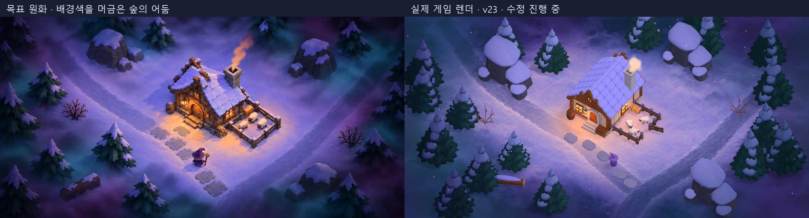

# 마녀산장 — Godot 프로토타입

**2026-10-13 화면 프리셋 적용 완료:** 기본 소스와 배포 실행파일에 부드러운 명암(기본)·따뜻한 산장·차가운 숲·툰 셰이딩·강렬한 툰 셰이딩·두꺼운 툰 외곽선·기존 화면 7종을 적용했다. 오른쪽 위 **화면 스타일** 메뉴 또는 **F2**로 바꾼다. 이미 켜둔 게임은 다시 실행하면 새 프리셋이 나타난다. [실제 화면·검증 기록](../docs/screen-style-presets.md).

**2026-10-14 카드 코어 C0 적용:** [카드 코어 기획 v0.3](../docs/kingdom-integration-design.md)의 하단 손패·드래그 사용·창고, 손님 고용 계약, 벌목/전투 용병, 양털 생산·수확·판매, 표식 괴물 카드·하수인을 실행판에 넣었다. 카드를 끌어 나무·지면·적·산장에 놓고, 털 난 양과 고용을 기다리는 손님은 클릭한다. 시작 골드는 40G다. [구현 기록·조작·검증](../docs/card-core-c0-implementation.md). 아래 기존 조작·120G 공물은 그대로 유지된다.

[인수인계 문서](../docs/godot-prototype-handoff.md)의 첫 프로토타입 범위(방문 → 골드 → 객실 1회 증축 → 일반 방어 → 큰 웨이브 → 용 소환 → 시연 완료)를 한 장면으로 구현했다. 본채·증축·환경 프랍·양·마녀·여행자·괴물·용은 19개 GLB로 교체했다. 실행 데이터는 v23이다. [원화와 실제 렌더 비교 및 남은 차이](../docs/art-refinement-progress.md)를 확인한다. 원화에 맞추는 작업은 진행 중이다.



## 실행

- **엔진: Godot 4.7.2-stable**(표준 또는 Mono 빌드 모두 가능, 스크립트는 GDScript). 다른 버전으로 열지 않는다.
- **렌더러: Forward+**. 문서는 Compatibility를 출발안으로 제안했지만, 원화의 라이팅에 필요한 부드러운 그림자(PCSS), SSAO, HDR 글로우, 인스턴스 셰이더 파라미터를 쓰기 위해 Forward+로 확정했다. 저사양 PC에서 문제가 생기면 SSAO와 그림자 품질부터 낮춘다.
- Godot에서 `godot/project.godot`를 열고 F5를 누른다. 창 크기 1600×800, 기준 뷰포트 1774×887.

| 입력 | 동작 |
| --- | --- |
| 좌클릭(지면) | 이동. 도달할 수 없는 지점은 가장 가까운 이동 가능 지점으로 보정 |
| 좌클릭(산장) / `산장 관리` 버튼 | 준비 시간에 관리 패널 열기(여는 동안 시간 정지) |
| `용에게 공물 — 120G` | 전투 중 용 소환(시간은 멈추지 않음) |
| Esc | 일시 정지 메뉴 |
| F1 | 디버그 메뉴(골드, 웨이브 즉시 시작, 용 강제 소환, 피해, 전체 처치, 적 경로·공격 지점 표시) |
| F2 / 오른쪽 위 화면 스타일 | 화면 프리셋 즉시 전환. 일시 정지 중에도 가능 |

### 실행파일 다시 만들기

Windows 내보내기 템플릿이 설치되어 있지 않아, 게임 데이터만 `.pck`로 내보내고 같은 이름의 Godot 4.7.2 런타임 실행파일을 옆에 둔다(실행파일은 같은 이름의 `.pck`를 자동으로 읽는다).

```text
godot --headless --path . --export-pack "Windows Desktop" ../build/WitchsLodge.pck
copy Godot_v4.7.2-stable_win64.exe ..\build\WitchsLodge.exe
```

템플릿을 설치하면 Godot 에디터의 `프로젝트 → 내보내기`로 단일 실행파일(임베드 pck)도 만들 수 있다.

## 라이팅 — 현재 방식

프랍·밀도는 승인 원화 04, 숲의 어둠은 후속 수정본 07을 비교 기준으로 삼는다. 지면은 기준 카메라로 투영한 클린 플레이트이며 앰버색 공간 마스크를 실제 국소광과 혼합한다. 무광 프랍에는 디퓨즈 아틀라스·실제 조명·약한 보조광을 사용한다. 얇은 눈은 셀프 섀도 얼룩을 줄이기 위해 그림자를 받지 않는다. [방식과 제한](../docs/art-refinement-progress.md)에 자세히 기록했다.

- `shaders/painted_prop.gdshader`, `painted_snow.gdshader`: 무광 페인터리 디퓨즈, 넓은 확산광, GLB 양면 표시 유지.
- `shaders/painted_ground.gdshader`: 두 숲길·보라/청록 어둠의 지면 이미지와 따뜻한 공간 색 마스크.
- `scripts/visual/painted_models.gd`: GLB 연결과 재질 설정, 산장 주변 실제 국소광.
- `scripts/world/world.gd`: 달빛·주변광·그림자·성긴 눈·연기.
- `shaders/post_grade.gdshader`: 약한 가장자리 색 보정.

## 구조(문서 11절 대응)

| 책임 | 파일 |
| --- | --- |
| 상태·승패·타이머 `GameSession` | `scripts/game/game_session.gd` |
| 웨이브·출현 예약 `WaveDirector` | `scripts/game/wave_director.gd` |
| 숙박·골드·구입 `LodgeEconomy` | `scripts/game/lodge_economy.gd` |
| 이동·공격·피해 `Player`, `Monster` | `scripts/actors/player.gd`, `monster.gd`, `magic_bolt.gd` |
| 양 `Pasture`, `Sheep` | `scripts/world/pasture.gd`, `scripts/actors/sheep.gd` |
| 용 `DragonDefense`, `Fireball` | `scripts/dragon/` |
| 입력·표시 `HUD` | `scripts/ui/hud.gd`, 입력은 `scripts/main.gd` |
| 환경 `World` | `scripts/world/world.gd`, 배치값 `layout.gd`, 본채 `lodge.gd` |
| 밸런스 수치 | `scripts/config.gd` (문서의 초기 설계 값 그대로) |
| GLB 모델·재질·효과 | `scripts/visual/` (게임 판정과 분리) |

## 검증한 것

- `tools/run_autoplay.gd` 자동 플레이(헤드리스): 준비 1에 30G씩 3회(90G) → 증축(30G 남음) → 준비 2에 45G씩 3회(135G) → 웨이브 2·3에 공물(연속 2회 클릭에도 1회만 차감) → 3웨이브 정리 후 **시연 완료**(약 5.8분).
- `-- --idle` 옵션(아무 조작 없음): 웨이브 1에서 산장 파괴로 **게임 오버**.
- 화면 캡처: `screenshots/`의 시작, 손님 도착, 전투, 용, 증축 장면.

```text
godot --headless --path . --script res://tools/run_autoplay.gd
godot --path . -- --shot=out.png --scenario=dragon   # start|guests|combat|dragon|extension|panel
```

## 원래 제안과 달라진 점과 남은 조정

- **카메라 하향 각도 50°**: 문서의 65~70°는 블록아웃 시작값이었고, 원화의 나무 옆면과 산장 벽이 보이는 정도에 맞춰 50°로 조정했다(직교, 수평 35°, size 21). `layout.gd`에서 바꿀 수 있다.
- 마녀는 가독성을 위해 시각 모델만 1.3배(모자 포함 약 1.6m)로 키웠다. 충돌 크기는 그대로다.
- 웨이브 1에서 마녀가 움직이지 않으면 약 40초 만에 산장이 무너진다(몬스터 4마리가 초당 10 피해). 문서 9절대로 플레이테스트 후 출현 간격이나 산장 목표 수부터 조정할 것.
- 환경·본채·증축·마녀·양·여행자·몬스터·용은 실제 GLB다. 원화에 맞는 실루엣·표면·비례 조정은 계속 진행 중이다.
- 내비메시는 걷는 면보다 0.5m 위에 구워지므로 바닥 충돌을 0.5m 내려 두었다(`world.gd` 주석 참고).
