# 시작 화면 모델링용 3면도

현재 중앙의 작은 산장·작은 목장·SD 플레이어가 있는 장면을 기준으로 **12종**을 새로 만들었습니다. 이전의 복잡한 산장 3면도와 구분되는 시작 장면 전용 자료입니다.

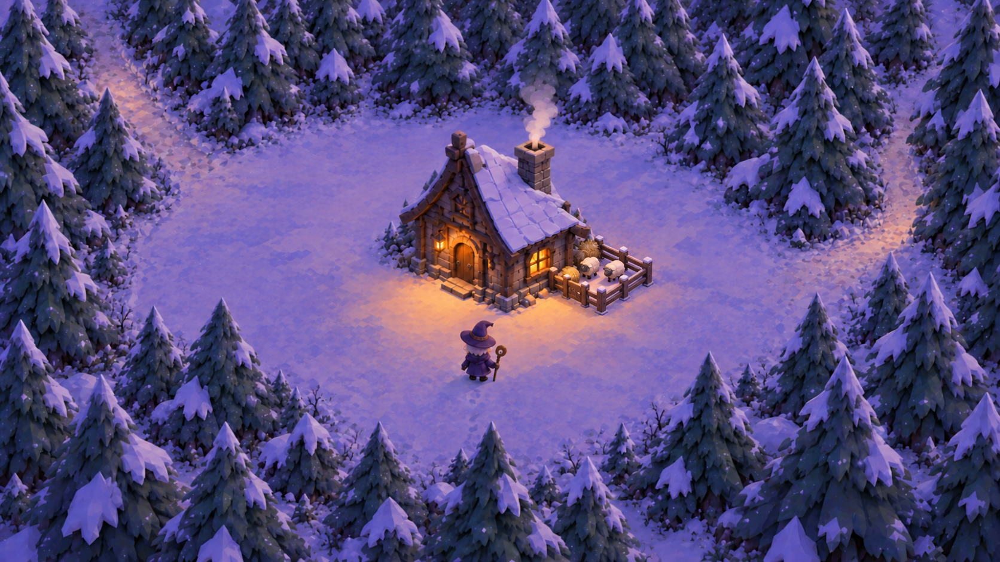

## 구성과 포함 범위

| 시트 | 화면 구성 요소 | 제작 기준 |
| --- | --- | --- |
| [시작 산장](01-starter-lodge.png) | 문·창문·지붕·굴뚝·기단·입구 계단 포함 | FRONT / RIGHT / BACK |
| [SD 플레이어](02-witch-player.png) | 지팡이를 분리한 기본 A 자세, 2~3등신 | FRONT / RIGHT / BACK |
| [나무 지팡이](03-crook-staff.png) | 플레이어가 든 목제 갈고리 지팡이 | FRONT / RIGHT / BACK |
| [눈 덮인 침엽수](04-snow-pine.png) | 크기·회전을 바꿔 큰 나무와 작은 나무 배치 | FRONT / RIGHT / BACK |
| [양](05-sheep.png) | 반복 배치로 작은 목장의 양 구성 | FRONT / RIGHT / BACK |
| [울타리 반복 구간](06-fence-bay.png) | 반복하고 90도 회전해 목장 테두리 조립 | FRONT / RIGHT / BACK |
| [목장 문](07-pasture-gate.png) | 힌지와 잠금쇠를 포함한 닫힌 문 | FRONT / RIGHT / BACK |
| [건초](08-hay-pile.png) | 목장 안의 작은 먹이 더미 | FRONT / RIGHT / BACK |
| [눈 덮인 수풀](09-snow-shrub.png) | 산장 기단·숲 경계의 낮은 수풀 | FRONT / RIGHT / BACK |
| [작은 돌](10-snow-stone.png) | 산장 주변의 작은 장식 돌 | FRONT / RIGHT / BACK |
| [눈 바닥](11-snow-ground.png) | 거의 평평한 눈 표면, 정면·측면·윗면 | FRONT / RIGHT / TOP |
| [벽등](12-wall-lantern.png) | 산장 문 옆의 벽 부착 등과 거치대 | FRONT / RIGHT / BACK |

## 시트 보기

### 시작 산장

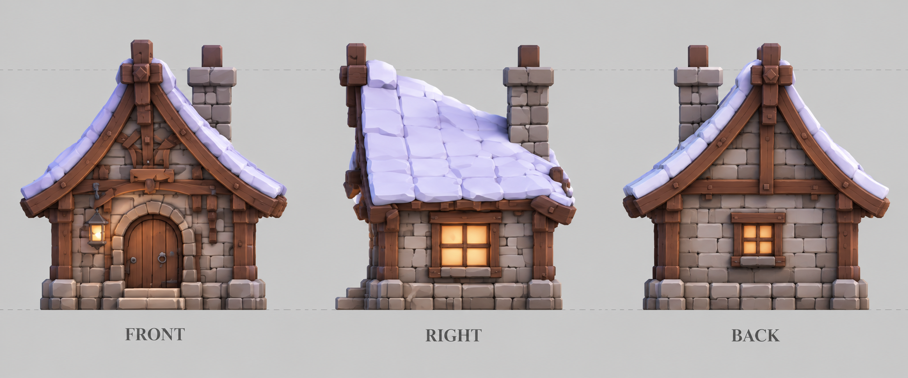

### SD 플레이어

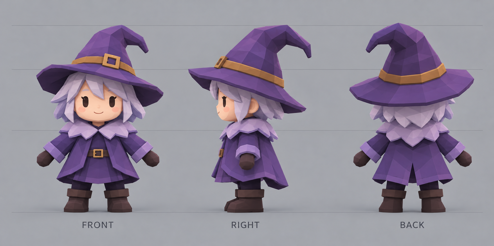

### 나무 지팡이

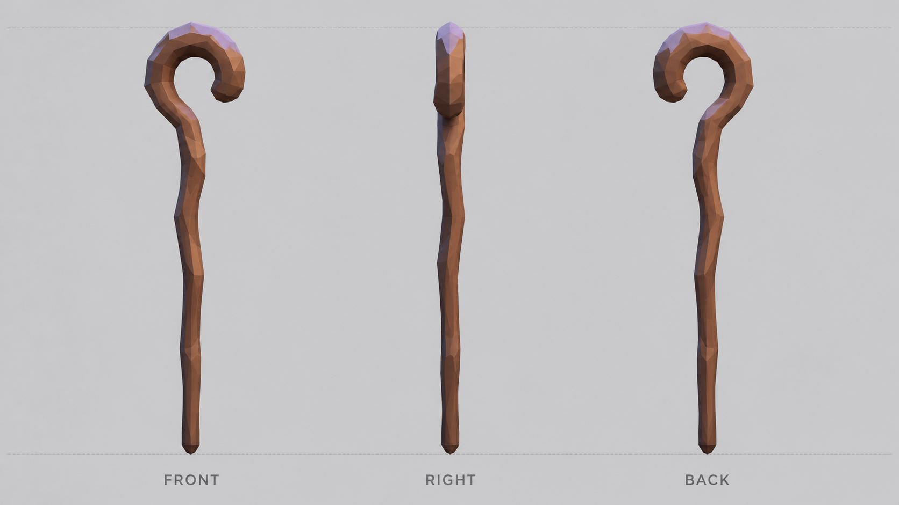

### 눈 덮인 침엽수

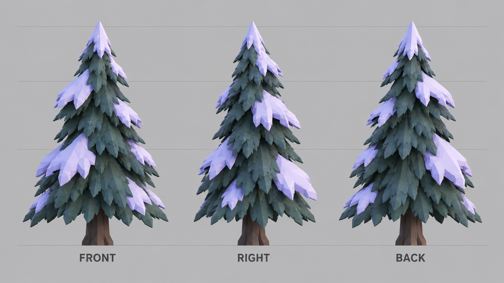

### 양

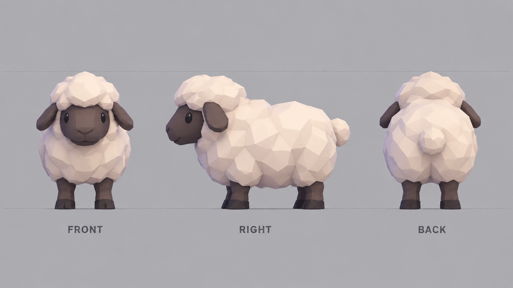

### 울타리 반복 구간

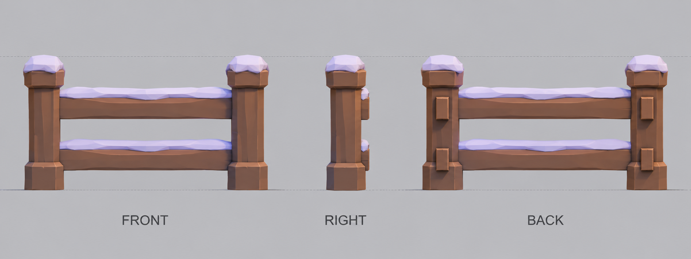

### 목장 문

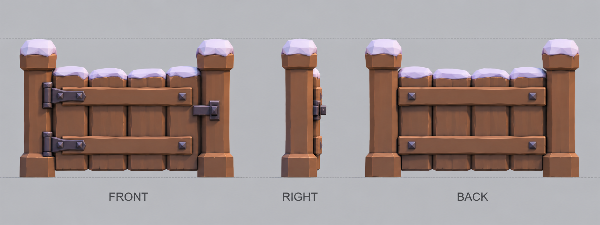

### 건초

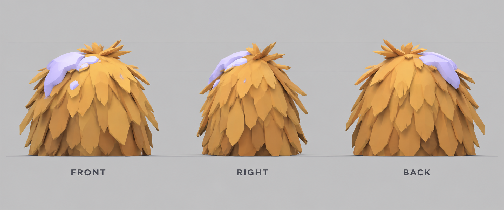

### 눈 덮인 수풀

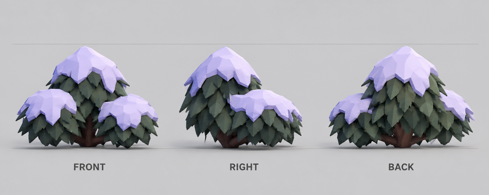

### 작은 돌

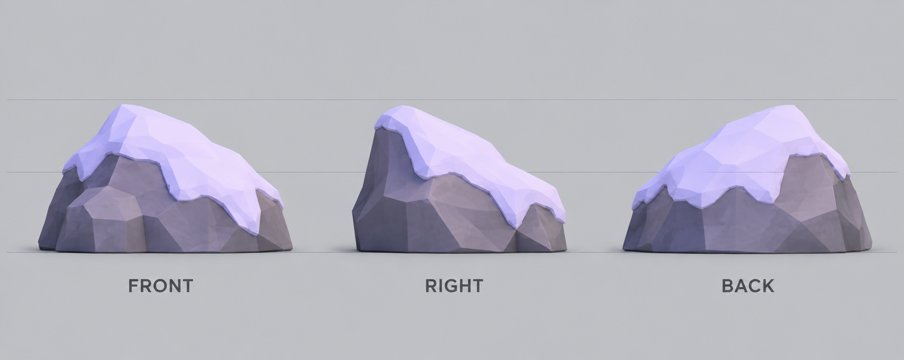

### 눈 바닥

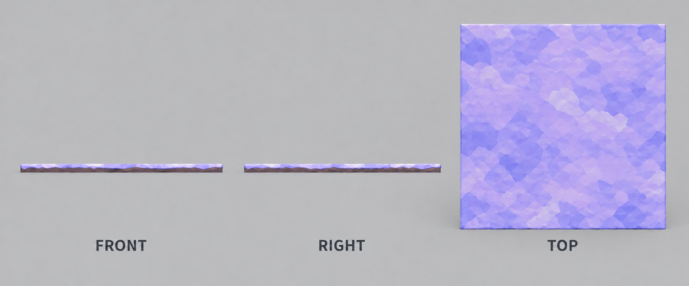

### 벽등

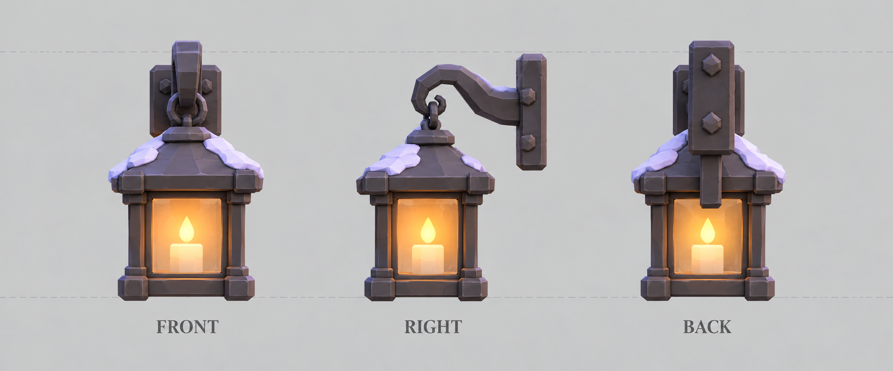

## 모델링 메모

- 각 시트의 세 방향은 같은 모델의 정면·오른쪽 측면·후면을 비교하는 참고입니다. 눈 바닥은 윗면으로 표면을 확인합니다.
- 시트마다 개별 모델을 크게 보여주므로 서로 같은 절대 축척은 아닙니다. 조립할 때 기준 장면의 문 높이, 캐릭터, 양, 울타리 관계를 맞춥니다.
- 산장의 문·창문·굴뚝·계단은 01 시트에 포함합니다. 벽등은 분리 모델링하기 쉽도록 12 시트에서도 확대했습니다.
- 눈 덮개는 나무·지붕·수풀·돌·울타리의 형태와 함께 표현했습니다. 나무와 울타리는 재사용하고, 울타리 코너에서는 공유 기둥이 겹치지 않게 조립합니다.
- 공터와 숲길은 동일한 평평한 눈 바닥에서 경계와 색 변화로 구성합니다. 플레이어의 발자국, 굴뚝 연기, 내리는 눈, 등불의 빛은 별도 모델 프랍보다 데칼·효과·조명으로 다루는 부분입니다.
- 원본에서 가려진 면과 플레이어의 정면은 기존 설정을 바탕으로 보완했습니다. 생성 이미지이므로 수치 도면은 아니며, 미세한 방향 간 차이는 블록아웃 단계에서 맞춥니다.

## 저장 및 검토

12개 최종 시트와 기준 장면 원본을 보존했습니다. 각 결과의 세 방향, 구분 라벨, 모델 형태를 시각적으로 확인했습니다. 제작 방식은 내장 image_gen이며 [전체 프롬프트](prompts.md)와 [원본 해시 목록](manifest.json)을 함께 제공합니다.
