# 마녀산장 UI 그래픽 미적용 점검

2026-10-16 · 현재 배포 `build/WitchsLodge.pck` 실제 렌더 · 원본 36장

플레이어용 25개 점검 항목, 개발용 1개, 디자인 검토 4개. 같은 창 안의 하위 요소를 나누어 센 수치입니다.

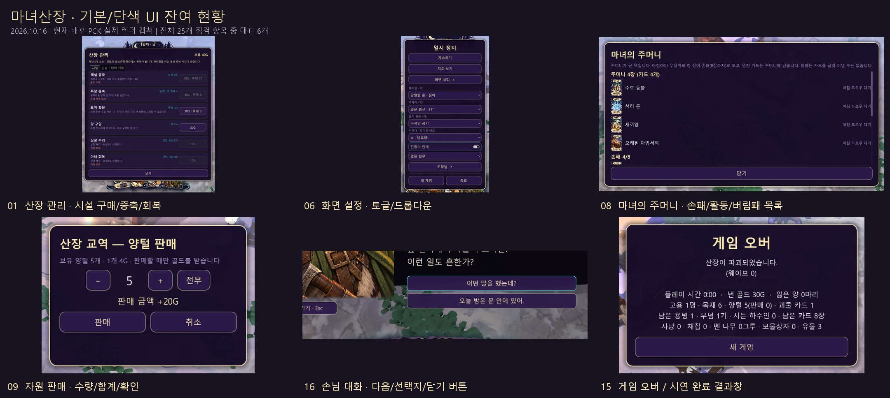

| 번호 | 위치 | 현재 표현 | 우선순위 | 캡처 |
|---|---|---|---|---|
| 01 | 산장 관리 · 시설 구매/증축/회복 | 단색 UI | P1 | [원본](../../godot/screenshots/ui-audit-2026-10-16/01-lodge-facilities.png) |
| 02 | 산장 관리 · 시설/손님/대화 기록 탭 | 기본 위젯 | P1 | [원본](../../godot/screenshots/ui-audit-2026-10-16/01-lodge-facilities.png) |
| 03 | 산장 관리 · 손님 목록 | 단색 UI | P1 | [원본](../../godot/screenshots/ui-audit-2026-10-16/02-lodge-guests.png) |
| 04 | 산장 관리 · 대화 기록 | 단색 UI | P1 | [원본](../../godot/screenshots/ui-audit-2026-10-16/05-dialogue-history.png) |
| 05 | 일시정지 메뉴 | 단색 UI | P1 | [원본](../../godot/screenshots/ui-audit-2026-10-16/07-pause.png) |
| 06 | 화면 설정 · 토글/드롭다운 | 기본 위젯 + 단색 | P1 | [원본](../../godot/screenshots/ui-audit-2026-10-16/08-settings.png) |
| 07 | 조작법 펼침 영역 | 단색 UI | P2 | [원본](../../godot/screenshots/ui-audit-2026-10-16/10-help.png) |
| 08 | 마녀의 주머니 · 손패/활동/버림패 목록 | 단색 UI | P1 | [원본](../../godot/screenshots/ui-audit-2026-10-16/12-pocket.png) |
| 09 | 자원 판매 · 수량/합계/확인 | 단색 UI | P1 | [원본](../../godot/screenshots/ui-audit-2026-10-16/14-sale.png) |
| 10 | 화면 왼쪽 · 고용 제안 | 단색 UI | P1 | [원본](../../godot/screenshots/ui-audit-2026-10-16/11-hire-offer.png) |
| 11 | 카드 설명과 HUD 툴팁 | 단색 UI | P1 | [원본](../../godot/screenshots/ui-audit-2026-10-16/15-card-tooltip.png) |
| 12 | 카드 드래그 · 사용 가능/불가 안내 | 단색 UI | P2 | [원본](../../godot/screenshots/ui-audit-2026-10-16/16-drag-preview.png) |
| 13 | 상단 토스트 · 성공/실패 알림 | 단색 UI | P1 | [원본](../../godot/screenshots/ui-audit-2026-10-16/18-toasts.png) |
| 14 | 탐색 지도 · 창/닫기/지도 표식 | 단색 UI | P2 | [원본](../../godot/screenshots/ui-audit-2026-10-16/17-map.png) |
| 15 | 게임 오버 / 시연 완료 결과창 | 단색 UI | P1 | [원본](../../godot/screenshots/ui-audit-2026-10-16/30-defeat.png) |
| 16 | 손님 대화 · 다음/선택지/닫기 버튼 | 단색 UI | P1 | [원본](../../godot/screenshots/ui-audit-2026-10-16/04-dialogue-choices.png) |
| 17 | 대화 준비 알림 · 말풍선/관리 배지 | 단색 UI | P2 | [원본](../../godot/screenshots/ui-audit-2026-10-16/06-guest-notification.png) |
| 18 | 월드 체력 바 · 적/마녀/산장/양/아군 | 단색 UI | P2 | [원본](../../godot/screenshots/ui-audit-2026-10-16/24-world-hp-tags-carry.png) |
| 19 | 월드 행동 이름표 · 임무/털 수확/고용/카드 드롭 | 단색 UI | P2 | [원본](../../godot/screenshots/ui-audit-2026-10-16/24-world-hp-tags-carry.png) |
| 20 | 양털 깎기 진행 게이지 | 단색 UI | P2 | [원본](../../godot/screenshots/ui-audit-2026-10-16/27-shear-gauge.png) |
| 21 | 새끼양 성장 안내 말풍선 | 단색 UI | P2 | [원본](../../godot/screenshots/ui-audit-2026-10-16/26-lamb-bubble.png) |
| 22 | 용병 자원 소지 말풍선 | 단색 UI | P2 | [원본](../../godot/screenshots/ui-audit-2026-10-16/24-world-hp-tags-carry.png) |
| 23 | 획득 유물 슬롯 | 단색 UI | P2 | [원본](../../godot/screenshots/ui-audit-2026-10-16/19-relic-slots.png) |
| 24 | 용병 카드 · 계약 인물 이름표 | 단색 UI | P2 | [원본](../../godot/screenshots/ui-audit-2026-10-16/15-card-tooltip.png) |
| 25 | 손님 도착 · 인원 예고 띠 | 단색 UI | P2 | [원본](../../godot/screenshots/ui-audit-2026-10-16/32-arrival-count.png) |
| D1 | 개발용 F1 디버그 메뉴 | 단색 UI | 개발용 | [원본](../../godot/screenshots/ui-audit-2026-10-16/29-debug.png) |
| R1 | 가시 씨앗 성장/강화 이름표 | 일반 텍스트 | 검토 | [원본](../../godot/screenshots/ui-audit-2026-10-16/25-thorn-label.png) |
| R2 | 묘지 · 이름/사망 일차 라벨 | 일반 텍스트 | 검토 | [원본](../../godot/screenshots/ui-audit-2026-10-16/28-grave-label.png) |
| R3 | 보물상자/마법서 · 선택 화면의 제목/안내 | 카드 그래픽 적용 | 검토 | [원본](../../godot/screenshots/ui-audit-2026-10-16/23-spellbook-selection.png) |
| R4 | 떠오르는 피해 숫자/골드/획득 텍스트 | 글자 연출 적용 | 검토 | [원본](../../godot/screenshots/ui-audit-2026-10-16/35-dragon-active.png) |

## 근본 연결 상태

공통 그래픽 14개 PNG는 art/ui/moon-runes-v01/common/에 존재하지만 게임은 StyleBoxFlat을 사용한다. HUD는 interim 텍스처를 사용하고 최종 runtime/common 미설치. 용 활성은 dragon_active 부재로 disabled 착색, 납품은 dragon_normal 이름. 숫자 glyph atlas 미연결.

## 상세 근거

### 01. 산장 관리 · 시설 구매/증축/회복

창 전체와 6개 시설 행, 가격/구매 버튼, 닫기 버튼이 단색 프레임입니다. 시설 전용 아이콘·장식·그림 버튼이 연결되지 않았습니다.

코드: `godot/scripts/ui/hud.gd:217`

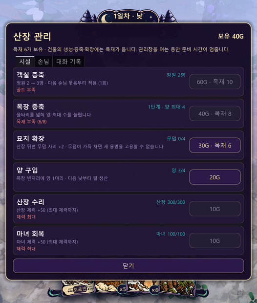

### 02. 산장 관리 · 시설/손님/대화 기록 탭

TabContainer/TabBar 전용 스타일이 테마에 정의되지 않아 회색 기본 탭을 그대로 사용합니다. 선택/비선택 탭 그래픽이 아트 폴더에 있습니다.

코드: `godot/scripts/ui/hud.gd:234`

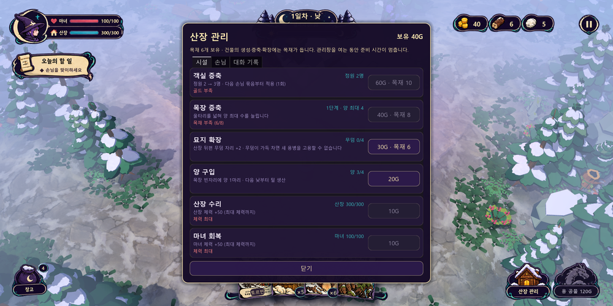

### 03. 산장 관리 · 손님 목록

손님 초상은 적용됐습니다. 목록 배경·상태 행·이야기 듣기/고용 버튼·닫기는 공통 단색 UI입니다.

코드: `godot/scripts/ui/guest_interactions.gd:194`

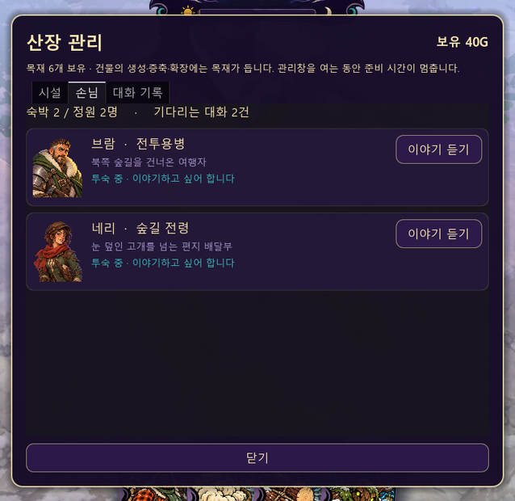

### 04. 산장 관리 · 대화 기록

기록은 단색 행과 일반 텍스트 목록으로 표시됩니다. 기록 페이지/카드 프레임, 탭, 닫기 버튼의 전용 그래픽이 없습니다.

코드: `godot/scripts/ui/guest_interactions.gd:246`

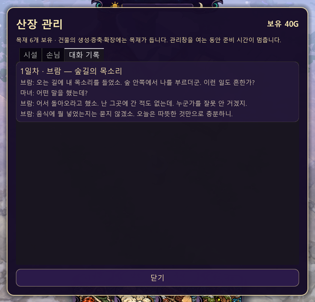

### 05. 일시정지 메뉴

계속하기·지도 보기·설정·조작법·새 게임·종료가 같은 단색 버튼입니다. 메인 HUD의 그림형 일시정지 아이콘과 내부 메뉴의 표현 수준이 다릅니다.

코드: `godot/scripts/ui/hud.gd:293`

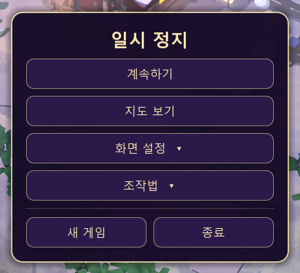

### 06. 화면 설정 · 토글/드롭다운

전장의 안개 CheckButton은 전용 테마/아이콘 지정이 없습니다. OptionButton은 배경색만 바뀌고 화살표 아이콘은 기본값입니다. 펼친 메뉴도 단색 패널입니다.

코드: `godot/scripts/ui/hud.gd:396`

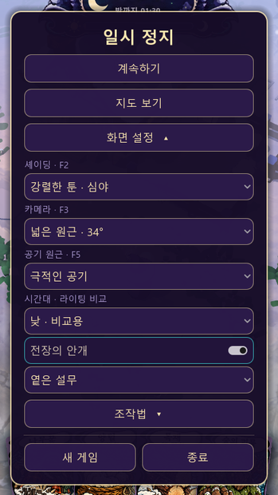

### 07. 조작법 펼침 영역

일시정지 창 안에 일반 라벨로 나열됩니다. 키캡·입력 아이콘·조작법 전용 패널 없이 텍스트로만 구성됩니다.

코드: `godot/scripts/ui/hud.gd:319`

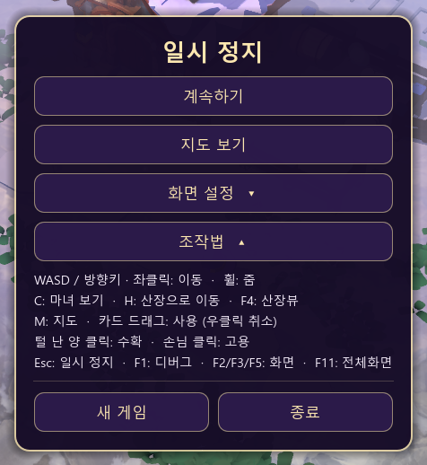

### 08. 마녀의 주머니 · 손패/활동/버림패 목록

카드 썸네일과 버림패 아이콘은 있습니다. 창·섹션·목록 행·닫기는 단순 UI이며 전용 덱/목록 프레임을 쓰지 않습니다. 아래 섹션까지 스크롤해서 확인했습니다.

코드: `godot/scripts/ui/card_hand.gd:1163`

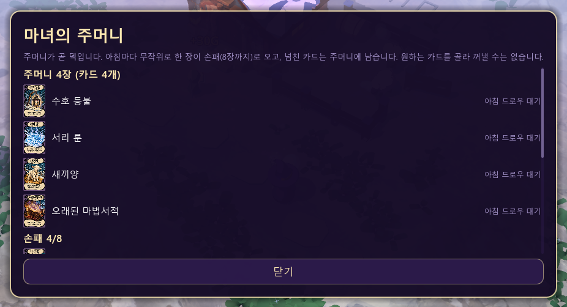

### 09. 자원 판매 · 수량/합계/확인

양털·생고기·토끼 가죽이 공유하는 판매창입니다. 자원 그림 없이 텍스트 정보, −/＋/전부, 판매/취소를 단색 버튼으로 표시합니다.

코드: `godot/scripts/ui/card_hand.gd:223`

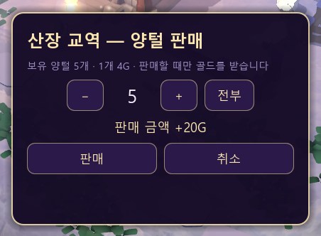

### 10. 화면 왼쪽 · 고용 제안

직업 카드 썸네일은 적용됐지만 제안 패널·남은 시간·고용 버튼은 단색 UI입니다.

코드: `godot/scripts/ui/card_hand.gd:1083`

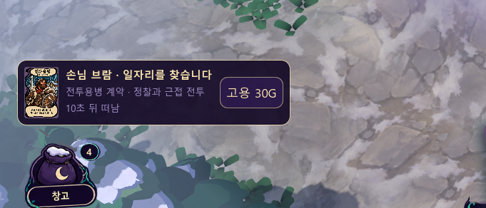

### 11. 카드 설명과 HUD 툴팁

카드 설명과 HUD 상태 설명은 보라색 단색 사각 패널입니다. 전용 tooltip_frame을 사용하지 않습니다. 카드 원화 자체는 적용됐습니다.

코드: `godot/scripts/ui/card_hand.gd:152`

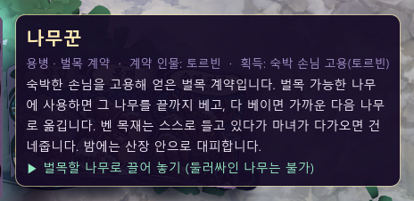

### 12. 카드 드래그 · 사용 가능/불가 안내

드래그 대상 안내창은 단색 바탕과 녹색/적색 테두리로만 상태를 구분합니다. 캡처는 사용 불가 상태입니다.

코드: `godot/scripts/ui/card_hand.gd:922`

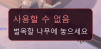

### 13. 상단 토스트 · 성공/실패 알림

판매·골드 부족·수확 등 공통 알림이 단색 반투명 막대와 글자 색으로 표시됩니다. 제공된 toast_frame은 미사용입니다.

코드: `godot/scripts/ui/hud.gd:559`

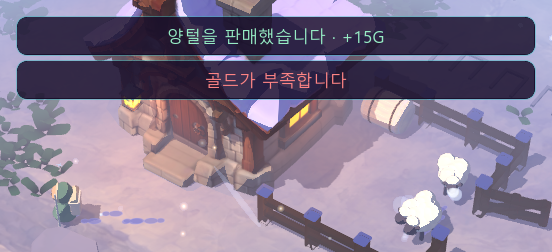

### 14. 탐색 지도 · 창/닫기/지도 표식

지도 프레임과 닫기 버튼은 단색 UI입니다. 지도 내부도 길=선, 산장=사각형, 적/마녀=점으로 직접 그립니다. 지도 전용 프레임·표식 그림은 연결되지 않았습니다.

코드: `godot/scripts/ui/exploration_map.gd:42`

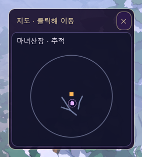

### 15. 게임 오버 / 시연 완료 결과창

패배와 승리 모두 같은 단색 모달+통계 텍스트+새 게임 버튼입니다. 승패별 타이틀/프레임/결과 장식 그래픽이 없습니다.

코드: `godot/scripts/ui/hud.gd:349`

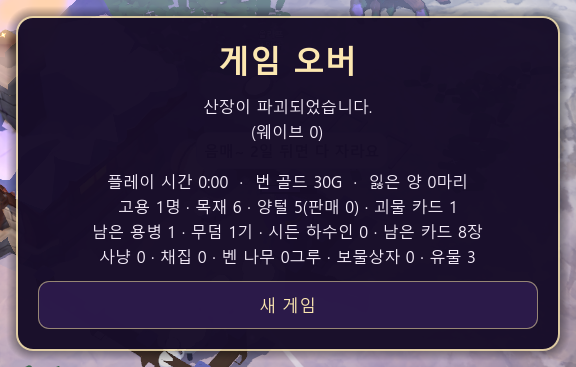

### 16. 손님 대화 · 다음/선택지/닫기 버튼

손님 초상과 잉크 패널 연출은 이미 적용됐습니다. 그 아래 대답하기·두 선택지·나중에 듣기 버튼만 일반 단색 버튼으로 남아 있습니다.

코드: `godot/scripts/ui/guest_interactions.gd:146`

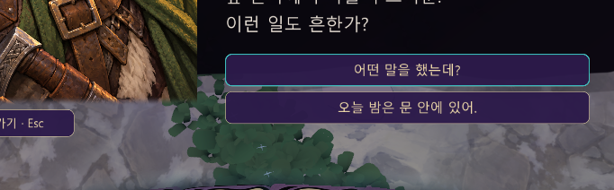

### 17. 대화 준비 알림 · 말풍선/관리 배지

초상은 적용됐습니다. 옆 말풍선은 단색 둥근 패널+삼각형 꼬리이고, 관리 버튼의 인원/느낌표 배지도 단색 도형입니다.

코드: `godot/scripts/ui/guest_interactions.gd:73`

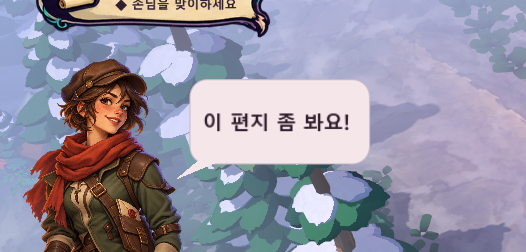

### 18. 월드 체력 바 · 적/마녀/산장/양/아군

상단 HUD 체력판은 그래픽이 적용됐지만 월드 체력 바는 draw_rect로 그린 단색 막대입니다. 대상별 색과 길이만 달라집니다.

코드: `godot/scripts/ui/hud.gd:681`

### 19. 월드 행동 이름표 · 임무/털 수확/고용/카드 드롭

아군 이름+상태, 양 털 수확, 손님 고용 금액, 처치 시 카드가 직사각형 배경+기본 글자로 표시됩니다.

코드: `godot/scripts/ui/hud.gd:722`

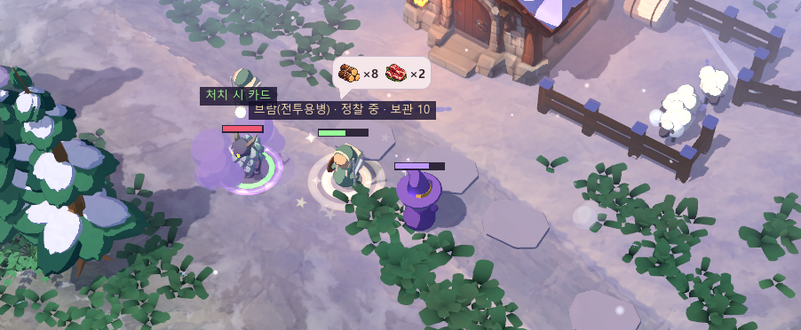

### 20. 양털 깎기 진행 게이지

수확 진행은 단색 트랙/채움 사각형과 ✂ 문자로 직접 그립니다. 전용 진행 바·가위 아이콘은 사용하지 않습니다.

코드: `godot/scripts/ui/hud.gd:753`

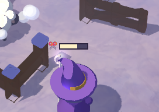

### 21. 새끼양 성장 안내 말풍선

성장일까지 남은 날은 분홍 단색 패널과 삼각형 꼬리로 표시합니다. 말풍선용 아트 프레임이 없습니다.

코드: `godot/scripts/ui/lamb_bubble.gd:19`

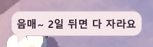

### 22. 용병 자원 소지 말풍선

목재/생고기/가죽 아이콘은 적용됐습니다. 말풍선 바탕·꼬리·수량 표현은 단색 기본 패널/글자입니다.

코드: `godot/scripts/ui/carry_bubble.gd:48`

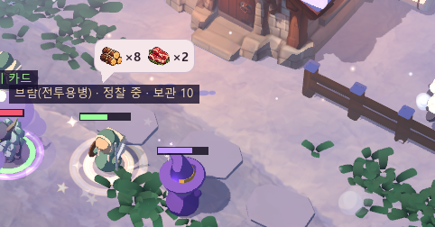

### 23. 획득 유물 슬롯

유물 아이콘은 적용됐습니다. 슬롯은 단색 보라 바탕과 금색 테두리의 작은 사각형이며 장식 슬롯 프레임은 없습니다.

코드: `godot/scripts/ui/hud.gd:111`

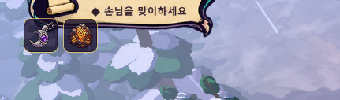

### 24. 용병 카드 · 계약 인물 이름표

손패 카드 원화와 수량 배지는 그래픽이 적용됐습니다. 계약 인물 이름표만 단색 둥근 PanelContainer입니다.

코드: `godot/scripts/ui/card_hand.gd:503`

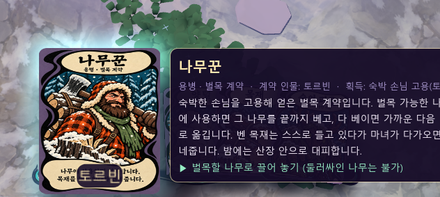

### 25. 손님 도착 · 인원 예고 띠

손님이 도착하기 직전의 “손님 n명이 산장을 찾아옵니다” 띠는 단색 패널입니다. 이어지는 초상/잉크 소개 화면은 이미 연출이 적용돼 있습니다.

코드: `godot/scripts/ui/guest_arrival.gd:219`

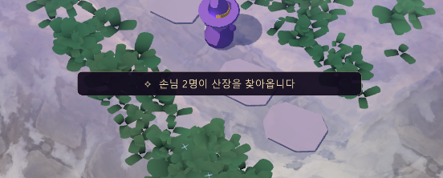

### D1. 개발용 F1 디버그 메뉴

디버그 창/9개 버튼이 단색 기본 UI입니다. 개발 도구이므로 플레이어용 화면과 분리해 낮은 우선순위로 두었습니다.

코드: `godot/scripts/ui/hud.gd:367`

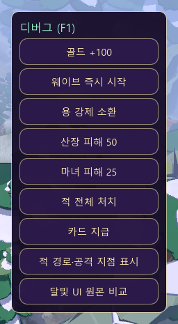

### R1. 가시 씨앗 성장/강화 이름표

Label3D로 성장 초수·가시 방책·강화 상태를 표시합니다. 의도적인 월드 라벨일 수 있어 미완료로 단정하지 않고 디자인 검토 항목으로 둡니다.

코드: `godot/scripts/actors/thorn_seed.gd:63`

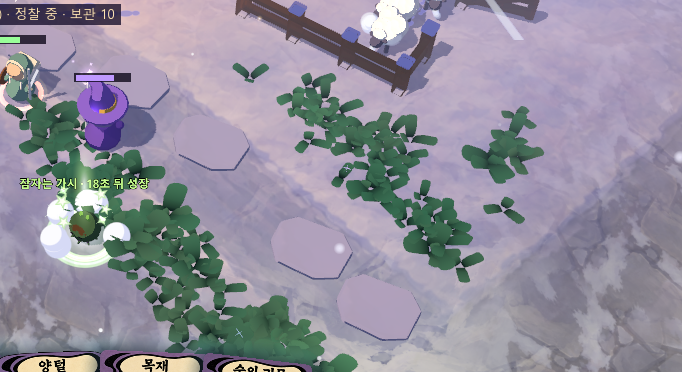

### R2. 묘지 · 이름/사망 일차 라벨

비석은 3D 모델이고 이름/일차는 Label3D입니다. UI 그래픽 누락인지, 월드 가독성용 텍스트인지 결정이 필요합니다. 라벨 가독성을 확인하기 위해 감사 실행에서만 근접 카메라로 촬영했습니다.

코드: `godot/scripts/world/graveyard.gd:109`

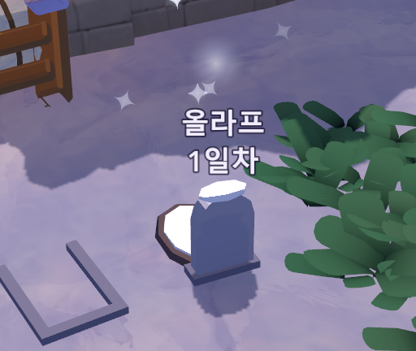

### R3. 보물상자/마법서 · 선택 화면의 제목/안내

상자 원화·물음표 카드·공개 유물·마법서 후보 카드에는 그래픽이 적용됐습니다. 상하단 제목/설명만 일반 텍스트+어두운 배경입니다. 장식 프레임의 필요 여부를 검토할 수 있습니다.

코드: `godot/scripts/ui/spellbook_picker.gd:41`

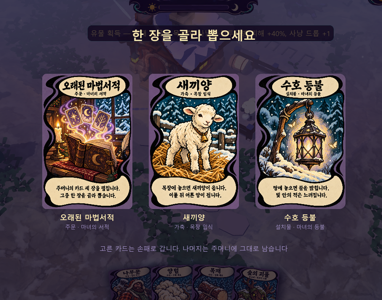

### R4. 떠오르는 피해 숫자/골드/획득 텍스트

피해/골드는 Label3D, 카드 획득 수량은 일반 Label을 사용합니다. 팝/상승/페이드 연출은 있습니다. 글자라는 이유만으로 그래픽 미적용으로 판정하지 않았습니다.

코드: `godot/scripts/visual/fx.gd:236`

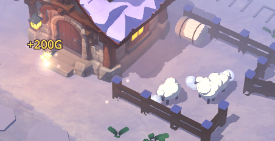
