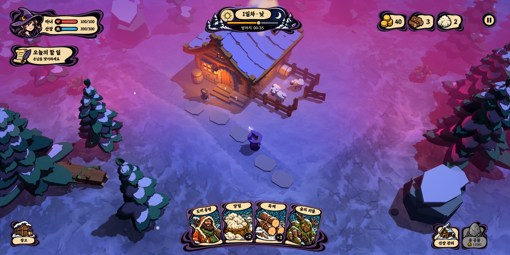
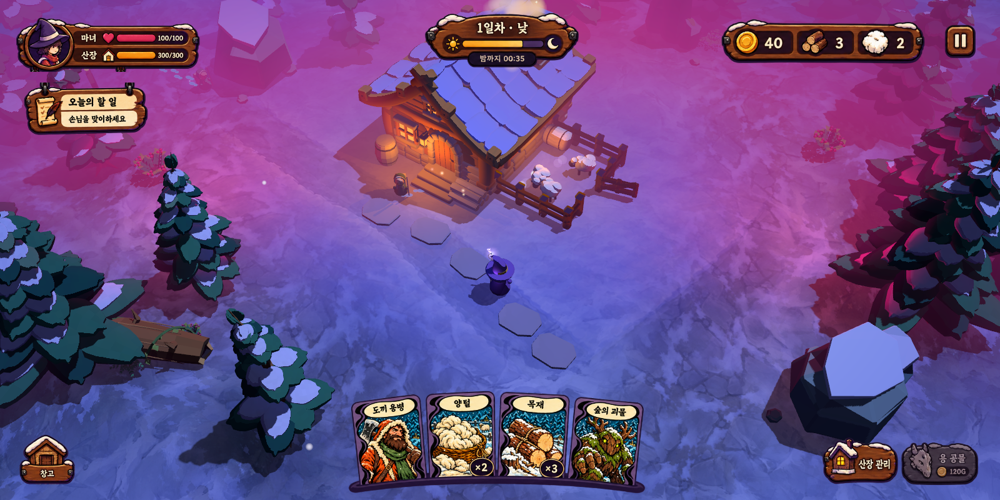

# 최신 게임 화면에 기존 UI 재합성 · v02

2026-10-14. 이전 v01의 UI 아트 3종을 최신 게임 소스의 실제 실행 캡처에 다시 배치했다. 새 UI 아트를 생성하지 않고 동일한 투명 원본과 레이아웃을 재사용했다. 현재 게임 HUD를 교체한 것은 아니다.

실행 로그에서 확인한 현재 설정:

- 셰이딩: `toon_midnight` (강렬한 툰 · 심야)
- 카메라: `lens_wide` (넓은 원근 34°)
- 공기 원근: `dramatic`, 로컬 색 번짐 `local`
- 기본값으로 실행했고 별도 스타일·카메라 인자를 지정하지 않았다.

최종 배경은 `current-source-clean.png`다. 소스와 배포판의 기본값이 달라 별도 캡처한 `current-pack-clean.png`는 비교 기록으로만 보존했다. 배포판 로그는 `toon_strong`, `orthographic`, `dramatic`, `local`이며, 이번 작업에서 PCK나 게임 기본값을 변경하지 않았다.

## 1 · 먹선 동화

## 2 · 따뜻한 산장

## 3 · 달빛 마법

기존 개발용 `cards` 시나리오로 손님·양털 상태를 준비하고 `--ui=off`로 기존 HUD를 숨겼다. 숫자·시간·목표는 기존 UI 아트에 포함된 스타일 비교용 예시이며 실제 캡처 상태의 데이터는 아니다.

Godot TextureRect/AtlasTexture로 UI를 배치했다. 세 시안 모두 중앙 플레이 영역 355,500픽셀이 UI 없는 배경 렌더와 동일하며 `composition-verification.json`의 `passed=true`, `changed_gameplay_pixels=0`으로 확인했다. 캡처와 합성 프로세스 종료 코드는 모두 0, 오류 로그는 비어 있다. 출력 세 장을 직접 검토했다.

이전 아트·생성 프롬프트: [v01 제작 기록](../../docs/ui-style-concepts-v01.md).

재현: 프로젝트 루트에서 `.tools/Godot-4.7.2.exe --path godot --script res://tools/render_ui_concepts.gd -- --source=<이 폴더의 current-source-clean.png 절대경로> --output=<이 폴더 절대경로>`.
